# Flo Health — User Journey Flow Diagrams

All major feature flows mapped from the comprehensive product research. Each diagram represents the end-to-end user journey for a distinct product area.

---

## 1. Onboarding Flow

The ~70-screen onboarding arc, following a deliberate psychological sequence: trust → goal → data → signup → paywall.

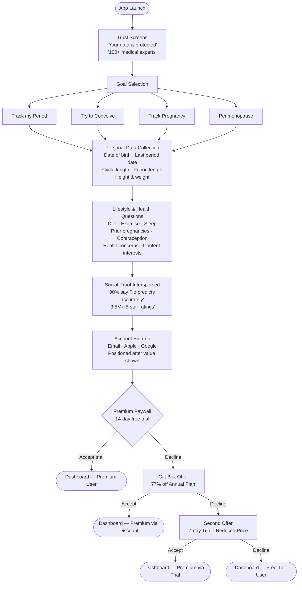

---

## 2. Period Tracking & Cycle Dashboard

The core daily habit loop — logging periods and viewing cycle status.

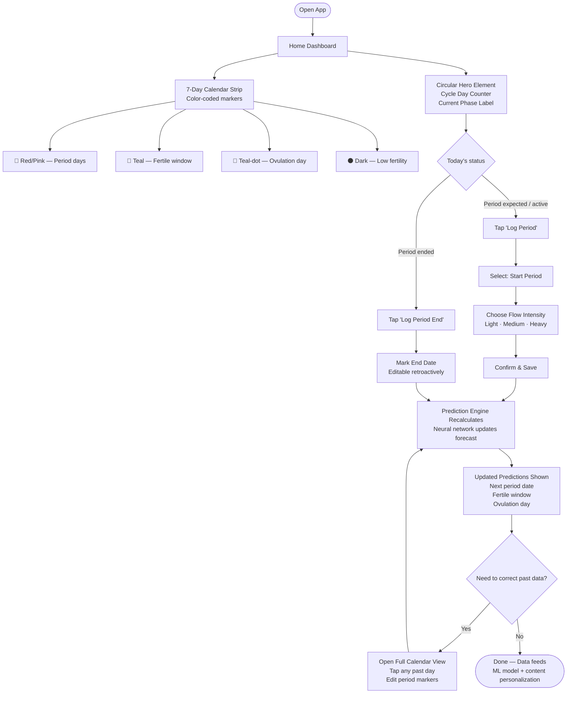

---

## 3. Symptom Logging Flow

80+ symptoms across 16 categories, logged via floating "+" in ≤3 taps.

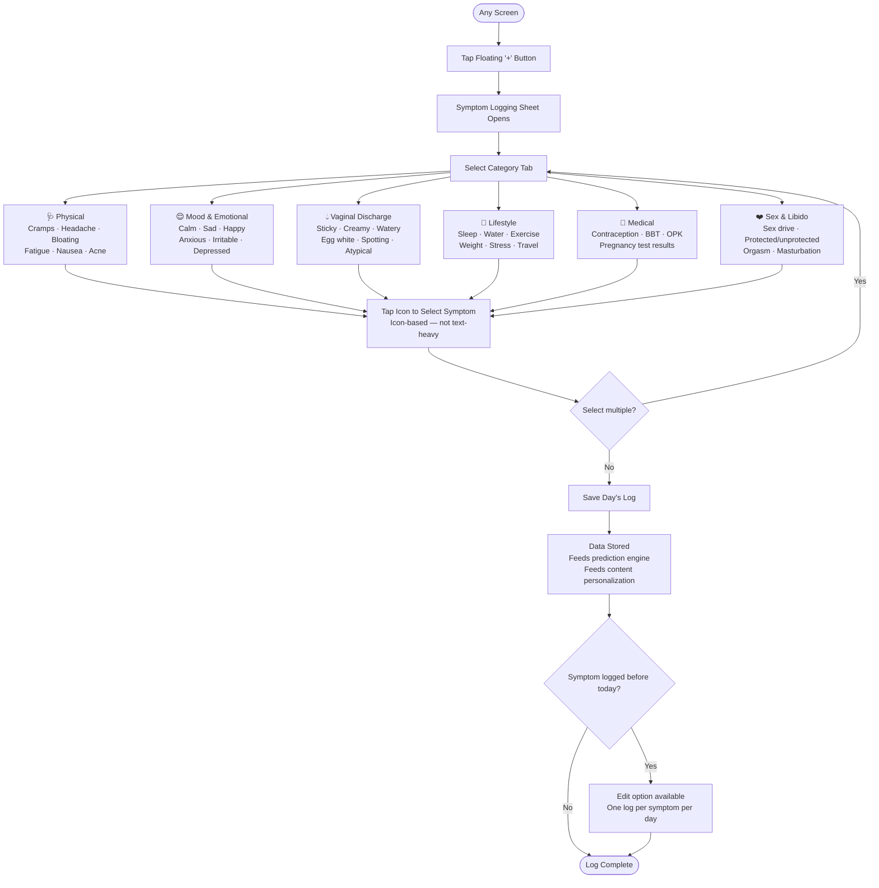

---

## 4. Ovulation & Fertility Tracking (TTC Mode)

Journey for users trying to conceive — BBT, OPK, and fertile window tools.

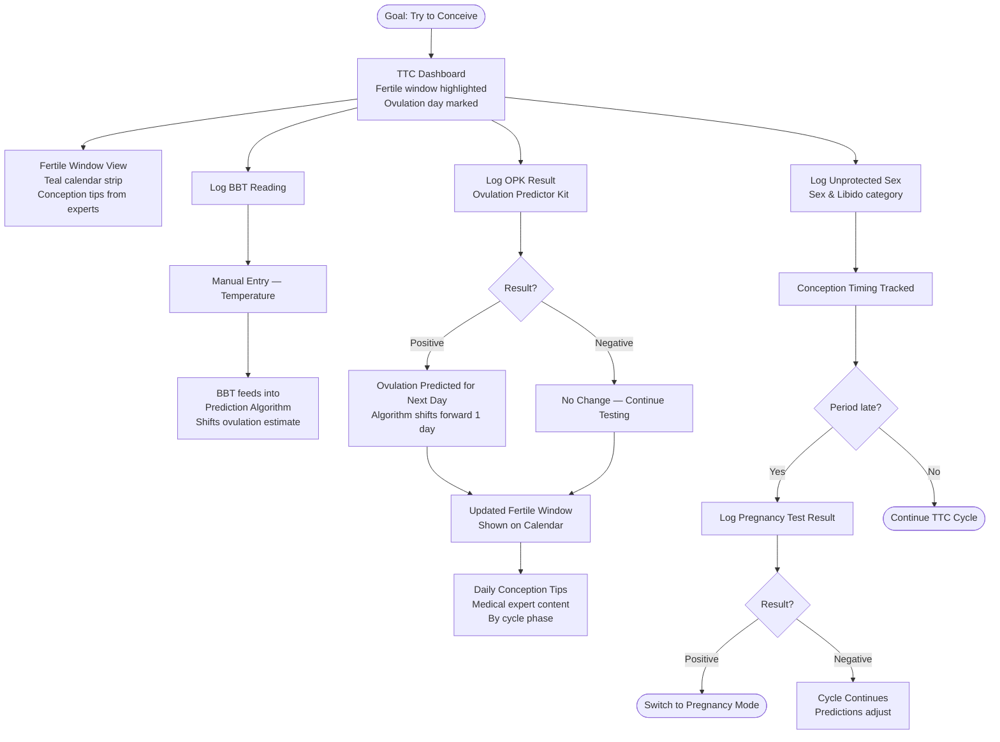

---

## 5. Pregnancy Mode Flow

Full lifecycle from mode switch through postpartum.

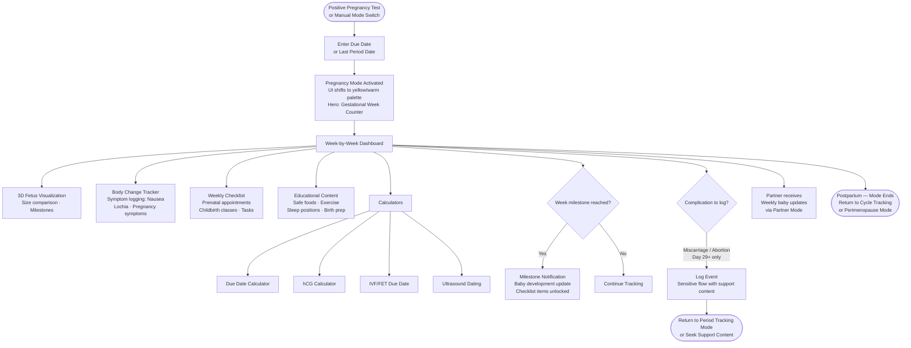

---

## 6. AI Health Assistant — Ask Flo

Conversational health queries triggered by cycle events or user-initiated.

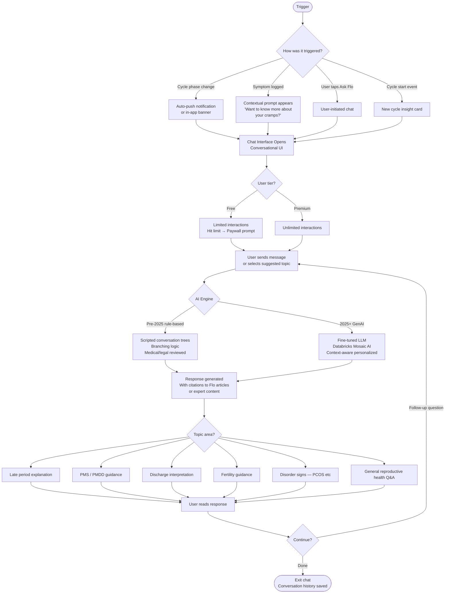

---

## 7. Community — Secret Chats

Anonymous forum with 7M monthly users and full pre-moderation.

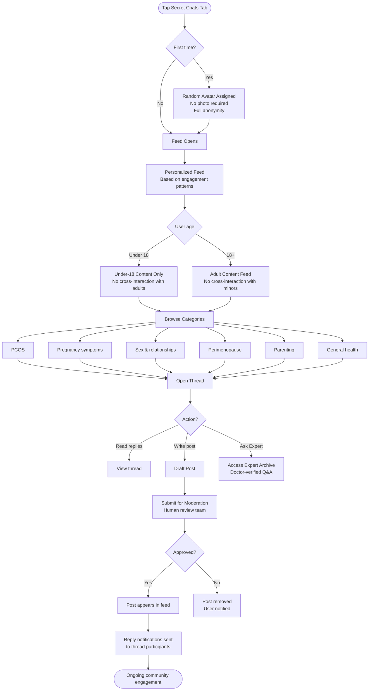

---

## 8. Partner Mode (Flo for Partners)

Sharing flow between primary user and partner — read-only, privacy-first.

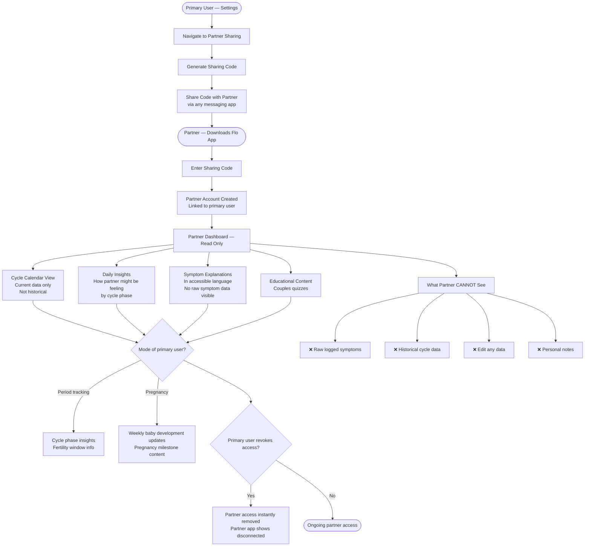

---

## 9. Anonymous Mode Setup

Privacy-first flow decoupling health data from all personal identifiers.

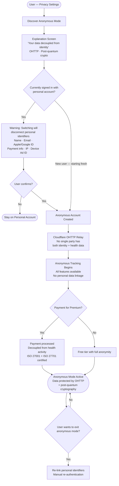

---

## 10. Health Reports & Symptom Checker

Premium-only features for clinical-grade health summaries and self-assessment.

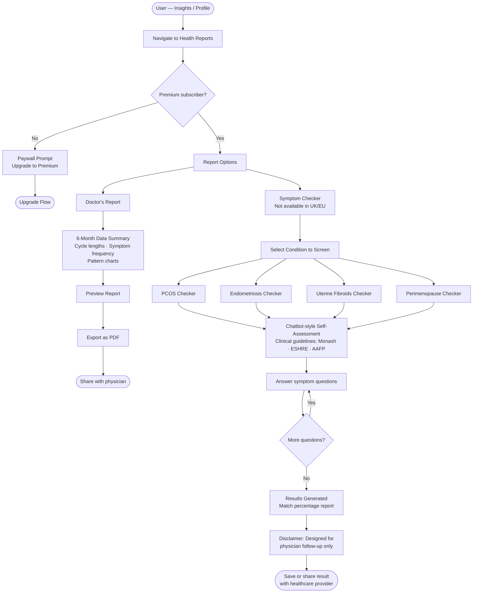

---

## 11. Premium Upgrade Flow (In-App Conversion)

Multiple in-app touchpoints that funnel free users to Premium.

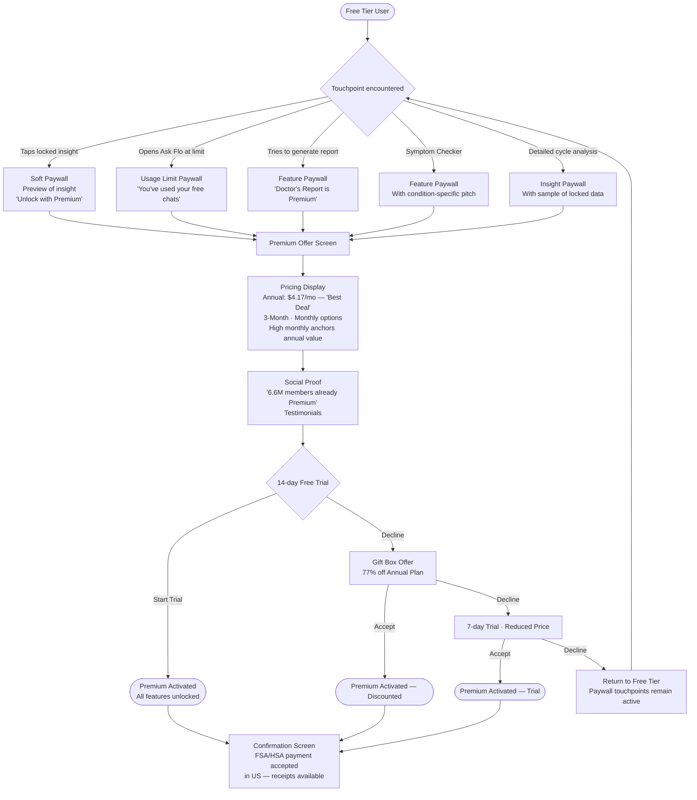

---

## 12. Mode-Switching Flow

How users transition between the app's four lifecycle modes over time.

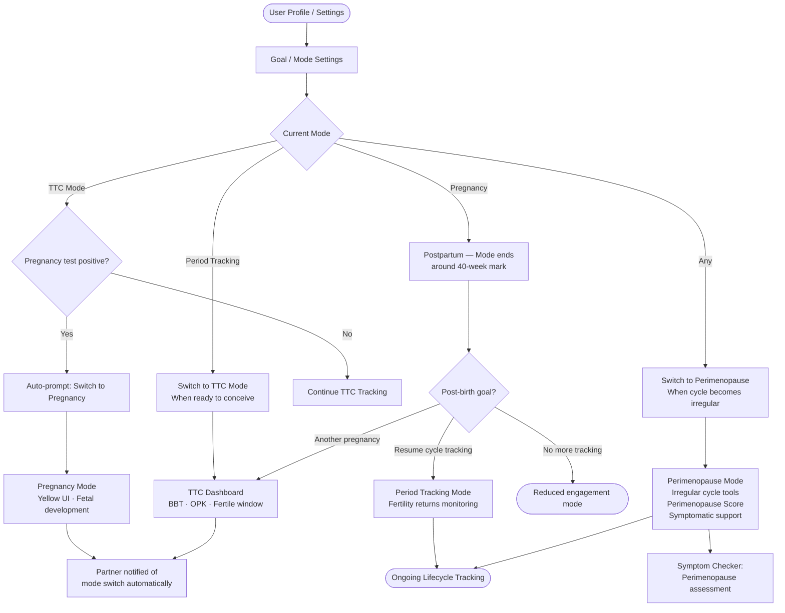

---

## Feature Map Summary

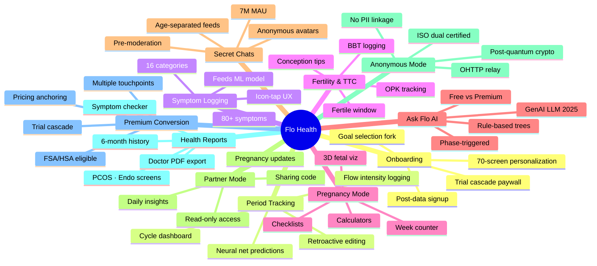
