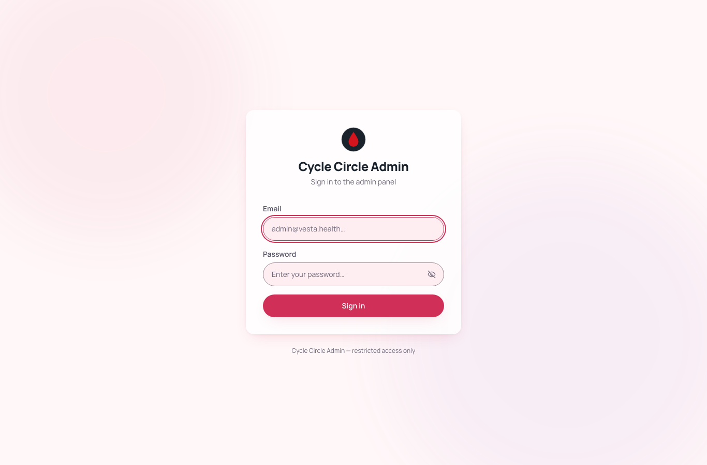
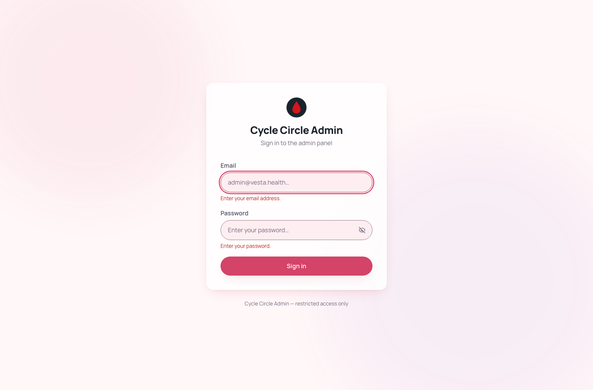
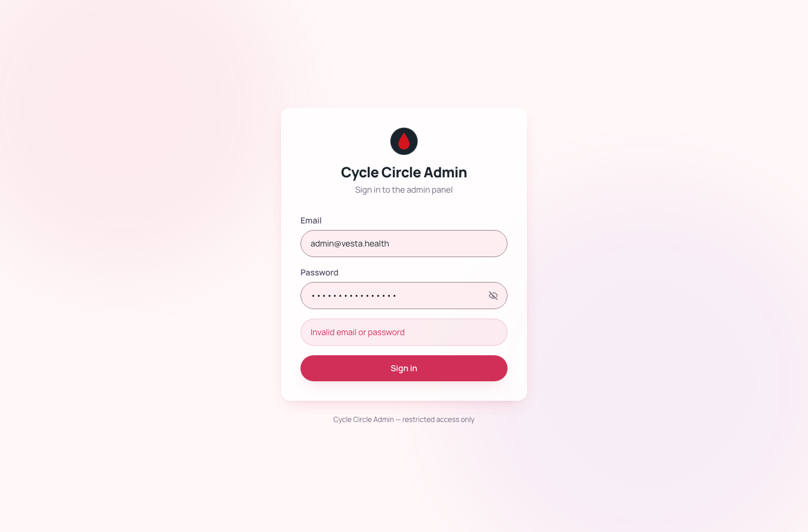
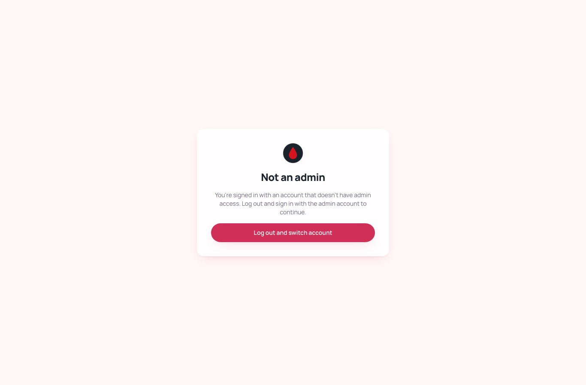
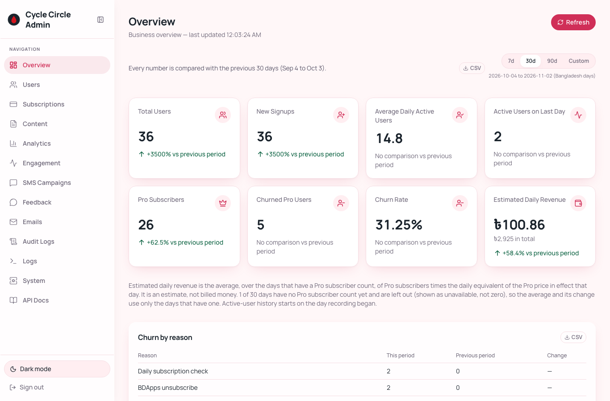
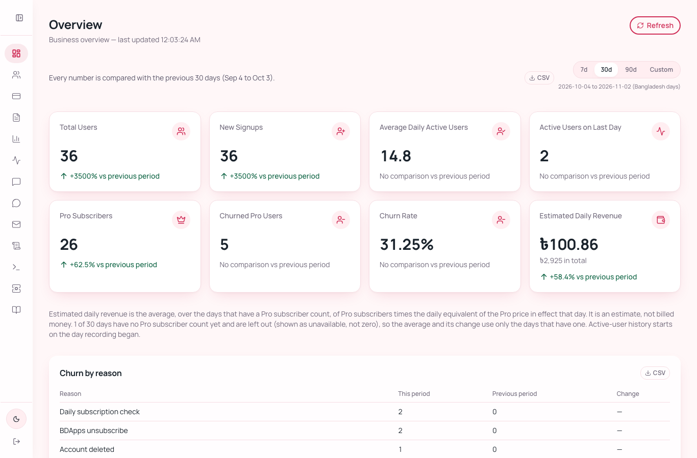
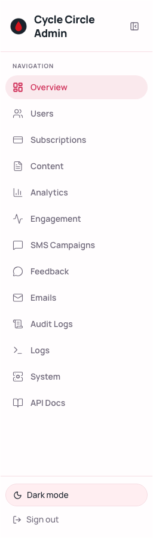

# Access

How an Admin gets into the admin panel and finds their way around it. There is **one Admin level**: an account either is an Admin (role `ADMIN`) or it is not, and every Admin can use every page. Admin accounts are created outside the panel (by the seed or directly in the database); there is no sign-up and no "invite an Admin" screen. Admin sign-in is separate from User login: it uses an email and a password, and the Admin session is a different cookie from the User session, so being logged in to the User app does not log you in here.

## Signing in {#aa-sign-in}

### What it is

The admin panel's login page, headed "Cycle Circle Admin" with the line "Sign in to the admin panel". It asks for an **Email** and a **Password** and has a **Sign in** button. A show/hide eye button sits inside the password box.

### Where to find it

Open the admin app address. Anyone who is not signed in is sent to `/login`, whatever page they asked for.

### How to use it

1. Type the Admin email and password.
2. Press **Sign in** (or Enter). The button shows "Signing in…" while it works.
3. On success the panel opens on the [Overview](#ov-kpis).

### Rules and limits

- The email is trimmed and lower-cased before it is checked, so `Admin@Vesta.Health` and `admin@vesta.health` are the same account.
- The password is checked against a stored hash. A wrong password, an unknown email and a non-Admin account all give the **same** message, on purpose, so the page never reveals which emails are Admins.
- **Failed attempts are limited**: 5 failed attempts per email and 20 per IP address in any 15 minutes. Only wrong-password attempts count. Once the limit is hit, even the right password is refused until the 15 minutes pass.
- A suspended Admin account is refused with "Account suspended" (this does not count towards the limit). A deleted one is refused as "User not found".
- A session lasts **7 days**. After that the next page request sends you back to the login page.
- Every sign-in, failed sign-in (for a real Admin email) and sign-out is written to the audit log ([What each entry means](#au-entries)).
- In a local development build only, the login page also shows a dashed "Dev — sign in as admin@vesta.health" button. It is not present in production.

### What can go wrong

| The Admin sees | Cause | Fix |
|---|---|---|
| "Enter your email address." under the email box | The email box is empty | Type the email |
| "Enter a valid email address." | The text is not in the form name@domain.tld | Correct the address |
| "Enter your password." | The password box is empty | Type the password |
| "Invalid email or password" | Wrong password, unknown email, or the account is not an Admin | Re-type the password; if sure, ask another Admin to check the account exists with role Admin |
| "Too many login attempts. Try again later." | 5 failed attempts for this email (or 20 for this IP) in the last 15 minutes | Wait 15 minutes after the last failure, then sign in with the right password |
| "Account suspended" | The Admin account has been suspended | The account must be reactivated in the database; it cannot be done from the panel (the panel refuses to suspend an Admin, see [Suspend and reactivate](#us-suspend)) |
| "Network error. Please check your connection." | The browser could not reach the admin app | Check the connection and the admin address, then retry |
| Sent back to the login page after working fine | The 7-day session ended, or the Admin signed out in another tab | Sign in again |

### Related

- [Forbidden screen](#aa-forbidden)
- [Signing out](#aa-sign-out)
- [Admin panel problems](#ts-admin)

## Forbidden screen {#aa-forbidden}

### What it is

A page headed **Not an admin** that says: "You're signed in with an account that doesn't have admin access. Log out and sign in with the admin account to continue." It has one button, **Log out and switch account**. It is served with HTTP status 403.

### Where to find it

You do not navigate to it. It replaces any admin page when the browser holds a valid admin-app session whose account is not an Admin.

### How to use it

1. Press **Log out and switch account**. This ends the session and opens the login page.
2. Sign in with the Admin account ([Signing in](#aa-sign-in)).

### Rules and limits

- The check runs before any admin page loads, so no admin data is sent to this account.
- The login form itself never creates this situation (it refuses non-Admins with "Invalid email or password"); it only appears for a session that was issued to a non-Admin account some other way.
- Being a Subscriber or a User in the User app does not give admin access.

### What can go wrong

| The Admin sees | Cause | Fix |
|---|---|---|
| "Not an admin" although they expect access | The session belongs to an account whose role is not Admin | Use **Log out and switch account**, then sign in with an Admin account |
| The button seems to do nothing | The logout request is still running; the button is disabled while it works | Wait a second; if it stays, reload and open the admin address again |

### Related

- [Signing in](#aa-sign-in)
- [Admin panel problems](#ts-admin)

## Admin navigation {#aa-navigation}

### What it is

The left sidebar under the heading "Cycle Circle Admin". It lists every admin page, shows the current one highlighted, and carries the theme switch and **Sign out** at the bottom.

| Item | Opens | Guide |
|---|---|---|
| Overview | `/` | [KPI cards](#ov-kpis) |
| Users | `/users` | [User list](#us-list) |
| Subscriptions | `/subscriptions` | [Subscriptions list](#su-list) |
| Content | `/content` | [Article list](#ac-list) |
| Analytics | `/analytics` | [Date ranges](#an-ranges) |
| Engagement | `/engagement` | [What counts as an Active user](#en-active) |
| SMS Campaigns | `/sms` | [Campaign list](#sm-list) |
| Feedback | `/feedback` | [Feedback inbox](#af-inbox) |
| Emails | `/emails` | [Email log](#em-log) |
| Audit Logs | `/audit-logs` | [Audit log search](#au-search) |
| Logs | `/logs` | [Log channels](#lg-channels) |
| System | `/system` | [Job on/off switches](#sy-jobs) |
| API Docs | `/api-docs` | [Admin API docs](#rl-api-docs) |

### Where to find it

On every admin page after signing in.

### How to use it

1. Click an item to open that page. The current page is shown in the accent colour with a bolder icon.
2. The small button at the top of the sidebar (**Collapse sidebar** / **Expand sidebar**) shrinks it to icons only; hover an icon to see its name.
3. **Dark mode** / **Light mode** switches the panel's theme.
4. On a narrow window the sidebar is replaced by a top bar with an **Open menu** button that opens the same list in a drawer.
5. The first Tab press on any page reveals a **Skip to main content** link for keyboard users.

### Rules and limits

- The page is highlighted by its address: Users stays highlighted on a User's detail page, Subscriptions on its sub-pages, and so on. Overview is highlighted only on `/` itself.
- The collapsed state and the theme are remembered in the browser (per browser, not per Admin).
- The panel is built for a desktop browser; it works on a phone but the tables scroll sideways.
- All pages above are open to every Admin. There is no per-page permission.

### What can go wrong

| The Admin sees | Cause | Fix |
|---|---|---|
| Only icons, no names | The sidebar is collapsed (a remembered setting) | Press **Expand sidebar** |
| No sidebar, a top bar with a menu button | The window is narrower than 768 px | Widen the window, or use **Open menu** |
| The panel is dark (or light) unexpectedly | The theme was changed earlier in this browser | Use the theme button in the sidebar footer |

### Related

- [Signing out](#aa-sign-out)
- [KPI cards](#ov-kpis)

## Signing out {#aa-sign-out}

### What it is

The **Sign out** button at the bottom of the sidebar (a door icon; when the sidebar is collapsed it is the icon alone, named "Log out"). It ends the Admin session on this browser.

### Where to find it

Bottom of the sidebar, below the theme button. On a narrow window, open the menu drawer first.

### How to use it

1. Press **Sign out**.
2. The login page opens. Going back or opening any admin address now sends you to the login page.

### Rules and limits

- Signing out **blacklists that session token**, so copying the cookie out beforehand does not keep it alive.
- It only ends the session on this browser. Other browsers where the same Admin is signed in stay signed in until their own 7 days end.
- The sign-out is recorded in the audit log.

### What can go wrong

| The Admin sees | Cause | Fix |
|---|---|---|
| Still on an admin page after pressing Sign out | The request failed (network) before the redirect | Press **Sign out** again |
| Signed out without pressing anything | The 7-day session ended | Sign in again ([Signing in](#aa-sign-in)) |

### Related

- [Signing in](#aa-sign-in)
- [What each entry means](#au-entries)
