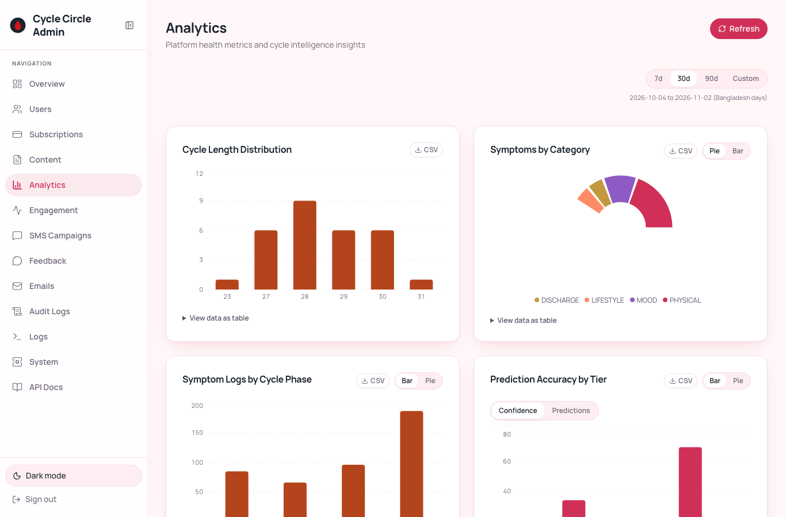
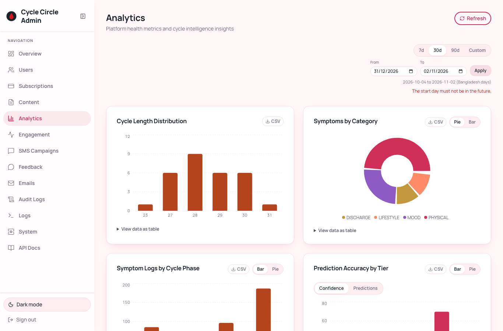
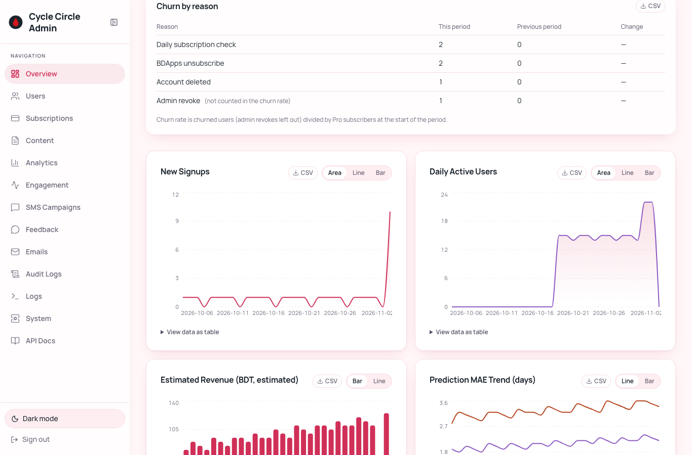
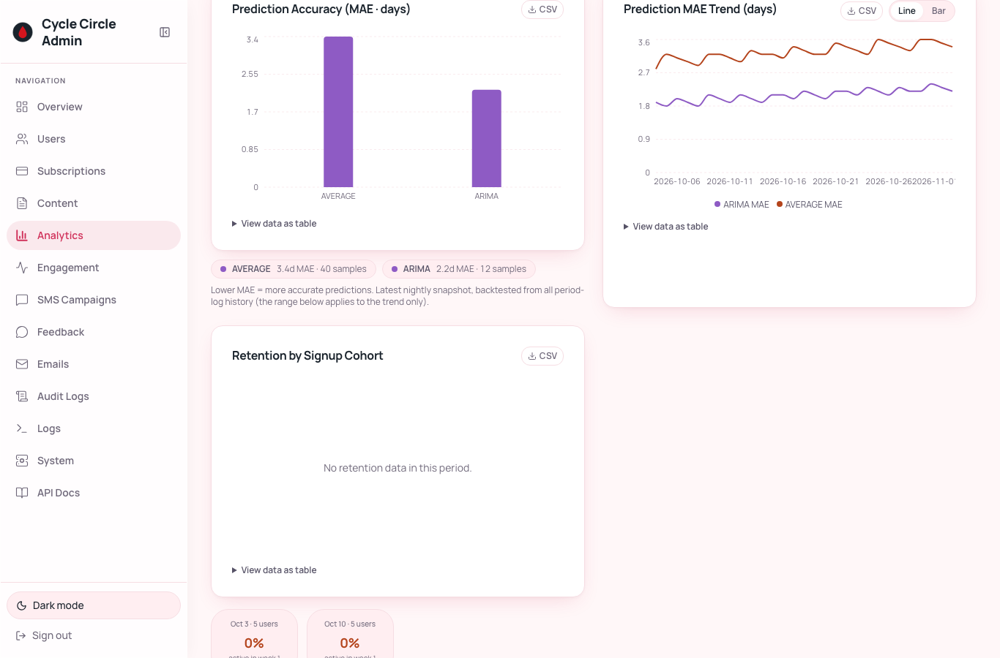
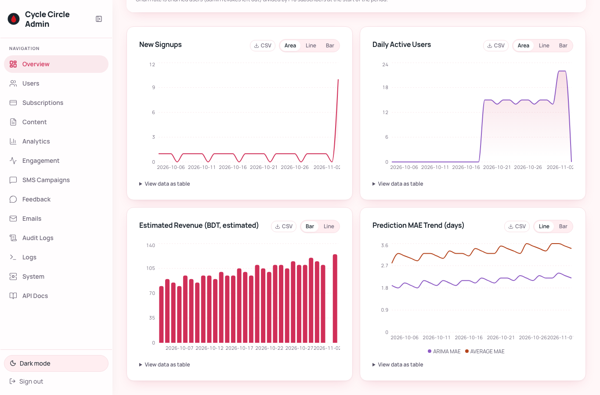
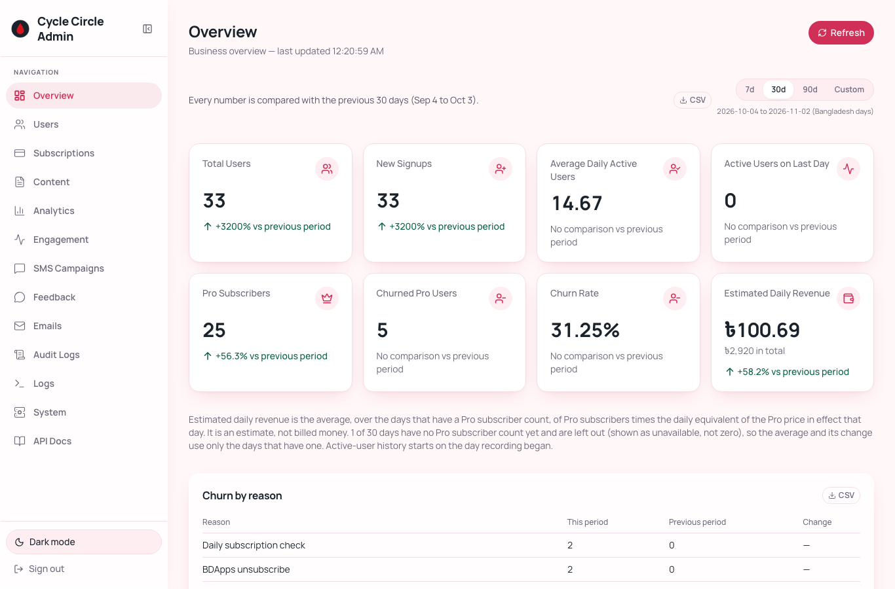
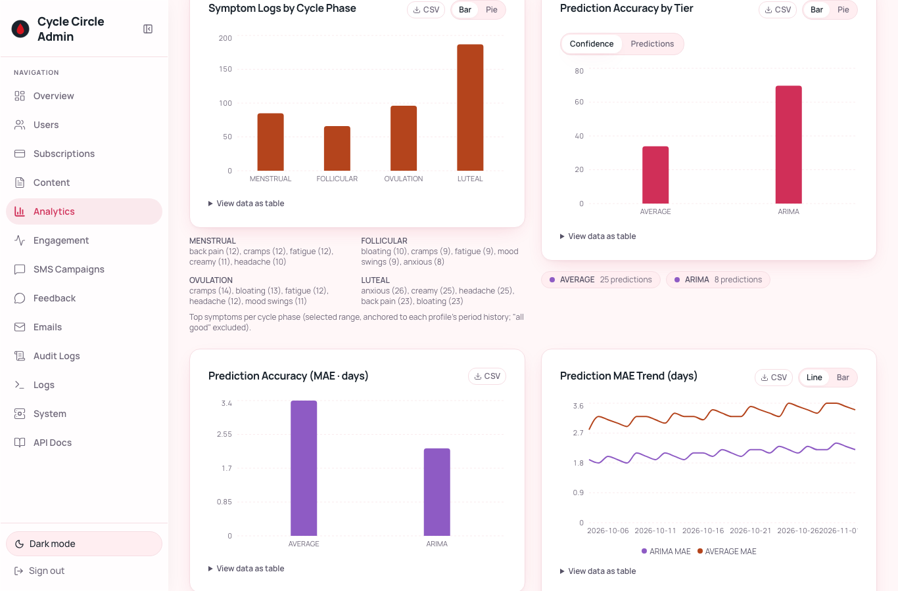

# Analytics

How to read the **Analytics** page, and the four business numbers behind it that live on the **Overview** page: churn, estimated revenue and the daily Pro count. All of them use Bangladesh days (UTC+6) and the terms in the [Glossary](#gl-terms): **Active user**, **Churn** and **Estimated revenue**.

Two things are easy to miss:

- **Churn, Estimated revenue and the Pro count are not panels on the Analytics page.** They are on the [Overview](#ov-kpis). Their sections here explain what they mean and where to find them; the screenshots are taken on the Overview.
- **Estimated revenue is not money received.** BDApps does not tell Cycle Circle what it actually charged.

## Date ranges {#an-ranges}

### What it is

One date range at the top right of the **Analytics** page. It sets the days covered by every chart on the page. The Overview, Engagement and the feedback charts use the same control, but each page keeps its own range.

### Where to find it

**Analytics** in the sidebar, or `/analytics`. The buttons **7d**, **30d**, **90d** and **Custom** sit above the charts, with the exact days printed under them.

### How to use it

1. Press **7d**, **30d** or **90d**. The last N Bangladesh days, ending **today**, are shown. The line under the buttons reads, for example, "2026-10-04 to 2026-11-02 (Bangladesh days)".
2. For another period press **Custom**, choose **From** and **To**, and press **Apply**.
3. Some panels have their own picker (for example **Metric**: Confidence or Predictions; and Sign-ups, Active loggers or Logging rate). These change what is drawn, not the days.
4. Press **Refresh** to bypass the one-minute cache.

### Rules and limits

- The default is **30d**. The range goes into the address (`?range=7d` or `?from=…&to=…`), so a link keeps it.
- A custom range can be at most **366 days**. An end day after today is cut back to today; a start day after today is refused.
- Days are Bangladesh days. The range ends at the end of today's Bangladesh day, so today is included whole.
- Every figure is kept for 60 seconds.
- What each panel does with the range differs, and is written in its own section: the **Prediction Accuracy (MAE · days)** bars ignore the range ([Prediction accuracy](#an-prediction-accuracy)); **Logging Streak Distribution** on [Engagement](#en-panels) uses only the range's last day.
- On the Analytics page there is no comparison with a previous period. The Overview compares ([KPI cards](#ov-kpis)).

### What can go wrong

| The Admin sees | Cause | Fix |
|---|---|---|
| "Pick both a start and an end day." | **Custom** with one date empty | Fill both dates |
| "Use days written as YYYY-MM-DD." | A hand-edited address has a bad date | Use the date pickers |
| "The start day must not be in the future." | **From** is after today | Choose a past start |
| "The start day must not be after the end day." | **From** is later than **To** | Swap the dates |
| "Pick a range of 366 days or fewer." | The custom range is longer than a year | Shorten it; meanwhile the page shows the last 30 days |
| "No symptom data in this period." / "No prediction data in this period." / "No activity data for this period." | The chosen days hold none of that data | Choose a longer range |
| A chart has not changed after new activity | The 60-second cache | Press **Refresh** |

### Related

- [Churn](#an-churn)
- [Prediction accuracy](#an-prediction-accuracy)
- [KPI cards](#ov-kpis)
- [Engagement panels](#en-panels)

## Churn {#an-churn}

### What it is

How many Pro Users stopped being Pro in the period, and what share of the Pro Users that is. It is the Overview's **Churned Pro Users** and **Churn Rate** cards and the **Churn by reason** table. It is **not** on the Analytics page.

### Where to find it

**Overview** in the sidebar, then **Churn by reason** under the cards.

### How to use it

1. Open the **Overview** and choose the period with **7d**, **30d**, **90d** or **Custom**.
2. Read **Churned Pro Users** and **Churn Rate**, then the table: for each reason the count this period, the previous period and the change.
3. Press the table's **CSV** to download it ([KPI cards](#ov-kpis)).

### Rules and limits

- **Churn** is a Pro User becoming non-Pro, for one of four reasons: "Daily subscription check" (the nightly BDApps check found the number unsubscribed), "BDApps unsubscribe" (BDApps told us), "Account deleted" (an Admin deleted a Pro User) or "Admin revoke" (an Admin removed Pro).
- **Admin revokes are shown in the table, marked "not counted in the churn rate", and left out of Churned Pro Users and Churn Rate**, because the Admin chose them.
- **Churn Rate = Churned Pro Users divided by the Pro Subscribers at the end of the day before the period began.** The denominator is the stored count for that day ([Daily Pro count](#an-pro-count)).
- Churned Pro Users counts **events**, not different Users: a User who left Pro, came back and left again in the same period counts twice.
- A User who became Pro **during** the period and left again is in the top of the fraction but not in the bottom, so the rate can in odd cases pass 100%.
- If an Admin restores a deleted account within the 30-day window, its "Account deleted" event is removed again.
- When no Pro count was stored for the day before the period (or it was 0), the rate is "Unavailable", not 0%.

### What can go wrong

| The Admin sees | Cause | Fix |
|---|---|---|
| "Unavailable" on **Churn Rate** | No nightly Pro count for the day before the period, or it was 0 | Choose a later period; the missing count cannot be rebuilt ([Daily Pro count](#an-pro-count)) |
| The note "It is unavailable here: no Pro count was stored for the day before the period." | The same | The same |
| The table adds up to more than **Churned Pro Users** | The "Admin revoke" row is shown but not counted | Subtract that row |
| Churn is higher than the number of Users who left | Repeat leavers count each time | Read it as events |

### Related

- [KPI cards](#ov-kpis)
- [Daily Pro count](#an-pro-count)
- [Grant and revoke Pro](#us-pro-override)
- [Delete and restore](#us-delete-restore)

## Prediction accuracy {#an-prediction-accuracy}

### What it is

Three panels on the Analytics page about the period predictions Users see ([Predictions](#pr-tiers)). They measure different things and are easy to confuse.

| Panel | What it shows |
|---|---|
| **Prediction Accuracy by Tier** | How many predictions each tier holds, or their **average confidence** (the **Metric** picker), for predictions calculated or updated in the range. Under it, a badge per tier: "AVERAGE 25 predictions". |
| **Prediction Accuracy (MAE · days)** | The **mean absolute error** in days of each tier: how many days, on average, a predicted period start was away from the real one. Lower is better. Under the bars: "3.4d MAE · 40 samples". |
| **Prediction MAE Trend (days)** | The MAE of each tier, night by night, over the range. |

### Where to find it

**Analytics**, in the middle of the page.

### How to use it

1. Pick the range ([Date ranges](#an-ranges)). It changes the first panel and the trend, not the MAE bars.
2. In **Prediction Accuracy by Tier** switch **Metric** between **Confidence** and **Predictions**, and **Bar** or **Pie**.
3. Read "Lower MAE = more accurate predictions" under the MAE bars. Compare the AVERAGE bar with the ARIMA bar.

### Rules and limits

- **"Accuracy by Tier" is not measured accuracy.** "Avg Confidence" is the confidence number the prediction engine stored with each prediction (for example 40 to 75 for the AVERAGE tier, up to 92 for ARIMA), shown without a % sign. It says how sure the engine was, not whether it was right. A prediction is one per profile, so "Predictions" counts profiles whose prediction was updated in the range. Profiles of deleted Users are left out.
- **MAE is measured by a backtest.** For each profile the system walks through its logged cycles, predicts each next period start from the cycles before it, and compares with the real start. The tier is the one the engine would have used at that point (6 or more earlier cycles: ARIMA, fewer: AVERAGE).
- The MAE bars come from the **latest nightly snapshot** and use all period-log history; the range does not apply to them. The nightly maintenance job writes a snapshot at 02:30 UTC (08:30 Bangladesh time) and labels it with the **UTC** date, so a day label can be one calendar day behind Bangladesh in the early morning ([Nightly maintenance](#sj-nightly)).
- Only the **AVERAGE** and **ARIMA** tiers have MAE. Another tier that appears in the first panel has no MAE bar.
- A tier with no sample shows "no data".

### What can go wrong

| The Admin sees | Cause | Fix |
|---|---|---|
| "No prediction data in this period." | No prediction was updated in the range | Choose a longer range |
| "No data: not enough period-log history to backtest." | No profile has enough logged cycles yet | Wait for more logs |
| "No data: no nightly MAE snapshots in this period." | The nightly job has not run in the range | Check the nightly maintenance job ([Nightly maintenance](#sj-nightly)) |
| "no data" next to a tier | That tier had no sample in the last backtest | Wait; the next nightly run recomputes |
| The trend line has few points | Snapshots exist only for the nights the job ran | None |
| The MAE bars did not move when the range changed | The bars ignore the range | Read the trend panel for the range |

### Related

- [Date ranges](#an-ranges)
- [Predictions](#pr-tiers)
- [Nightly maintenance](#sj-nightly)

## Estimated revenue {#an-revenue}

### What it is

What the Pro Users would have paid, calculated from the Pro price. It is the Overview's **Estimated Daily Revenue** card (with the total in taka beneath) and the **Estimated Revenue (BDT, estimated)** chart. It is **not** on the Analytics page, and it is an estimate: BDApps does not report what it really charged.

### Where to find it

**Overview**, the last card of the second row, and the chart under the churn table.

### How to use it

1. Open the **Overview** and choose the period.
2. Read **Estimated Daily Revenue** (the average per day) and the smaller line "N in total".
3. Open "View data as table" under the chart for each day, or press the chart's **CSV**.

### Rules and limits

- **For each day: Pro Subscribers that day multiplied by the daily equivalent of the [Pro price](#sy-pro-price) in effect that day.** The daily equivalent is a daily price as it is, a weekly price divided by 7, a monthly price divided by the number of days in that month.
- The price in effect on each day comes from the Pro price history, so a price change affects only the days from its start day.
- Today uses the live Pro count; earlier days use the stored nightly count ([Daily Pro count](#an-pro-count)).
- A day with no stored count, or with no price in effect yet, is **unavailable, not zero**. The average uses only available days, and the page says how many were left out: "N of 30 days have no Pro subscriber count yet and are left out …".
- It follows the price set here, not what BDApps charges. If the Pro price in the System page differs from the real BDApps charge the estimate is wrong by that difference.
- Figures are rounded to 2 decimals.

### What can go wrong

| The Admin sees | Cause | Fix |
|---|---|---|
| "Estimated revenue is unavailable: no daily Pro counts in this period" | No day in the period has a stored count | Choose a later period |
| "N of 30 days have no Pro subscriber count yet and are left out …" | The nightly count was not stored on those days | None for past days; the figure cannot be rebuilt |
| The estimate differs from the money paid by BDApps | It is an estimate from the Pro price and the Pro count | Check the price on the [Pro price](#sy-pro-price) screen; compare with the BDApps report |
| The chart has gaps | Unavailable days are not drawn as zero | See above |
| The card changed after a Pro price edit | The new price applies from its start day | Check the price history |

### Related

- [Pro price](#sy-pro-price)
- [Daily Pro count](#an-pro-count)
- [KPI cards](#ov-kpis)

## Daily Pro count {#an-pro-count}

### What it is

The number of Pro Users at the end of each Bangladesh day, saved once a night. It is the base for the Overview's **Pro Subscribers** card, the **Churn Rate** and the estimated revenue. There is no chart of it of its own; it appears as the **Pro Subscribers** card and inside those two figures.

### Where to find it

The **Pro Subscribers** card on the **Overview**.

### How to use it

1. Open the **Overview**. **Pro Subscribers** is the count at the end of the period (today's live count when the period ends today).
2. Compare with the previous period under the number.

### Rules and limits

- The count is the number of Users on the Pro plan who are **not deleted**. **Suspended Users who are Pro are still counted.**
- The count is saved by a scheduled job at **23:55 Bangladesh time** (17:55 UTC) each day. Running it again the same day overwrites that day.
- Past days cannot be rebuilt: a missed night leaves a gap for good. The first days after the feature was deployed have no count.
- This job has **no on/off switch** on the System page; only the daily reminders, the daily subscription check and the reports can be switched there ([Job on/off switches](#sy-jobs)).

### What can go wrong

| The Admin sees | Cause | Fix |
|---|---|---|
| "Unavailable" on **Pro Subscribers** | No count was stored for the last day of the period | Choose another period; if recent days are missing the host's scheduled call failed, so ask the person who runs the server |
| Churn Rate or revenue "unavailable" | The same gap | The same |
| A Suspended User is still counted | Suspending does not remove Pro | Revoke Pro to remove the User from the count ([Grant and revoke Pro](#us-pro-override)) |

### Related

- [Churn](#an-churn)
- [Estimated revenue](#an-revenue)
- [Scheduled jobs at a glance](#sj-overview)

## Symptoms by phase {#an-symptoms-phase}

### What it is

Two panels about the symptoms Users logged: **Symptoms by Category** (Physical, Mood, Discharge, Lifestyle) and **Symptom Logs by Cycle Phase**, with the five most common symptoms under each phase. The data is anonymous totals; no User or profile is named.

### Where to find it

**Analytics**, in the middle of the page.

### How to use it

1. Pick the range ([Date ranges](#an-ranges)).
2. Read the bars (**Bar** or **Pie** buttons) and the list under them, for example "cramps (14), bloating (13)".
3. Press **CSV** or "View data as table" for the numbers.

### Rules and limits

- Only symptom logs **dated inside the range** count. The "all good" entry is excluded.
- A log's phase comes from the profile's own period history: the most recent period start on or before the log, then the profile's cycle length and period length decide Menstrual, Follicular, Ovulation or Luteal. A log with no earlier period start belongs to no phase and is left out.
- The list shows at most 5 symptoms per phase, ties broken alphabetically. A phase without logs reads "No logs".
- Profiles of deleted Users are left out. Symptom names are shown as stored, with underscores replaced by spaces.
- The phase is worked out afterwards from the cycle settings, so it can differ from the phase the User saw on the day.

### What can go wrong

| The Admin sees | Cause | Fix |
|---|---|---|
| "No symptom data in this period." | No symptom was logged in the range | Choose a longer range |
| Fewer logs by phase than by category | Logs with no earlier period start have no phase | None |
| A phase shows "No logs" | Nothing was logged in that phase in the range | Choose a longer range |
| Totals differ from the Insights a User sees | These are all Users, other range, "all good" excluded | Compare like with like ([Symptom statistics](#in-symptom-stats)) |

### Related

- [Date ranges](#an-ranges)
- [Symptom statistics](#in-symptom-stats)
- [Engagement panels](#en-panels)
