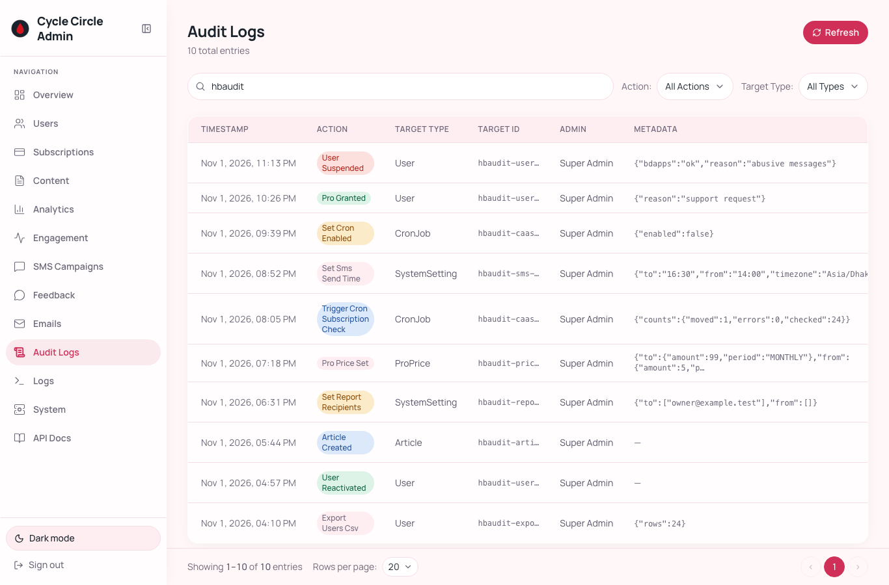
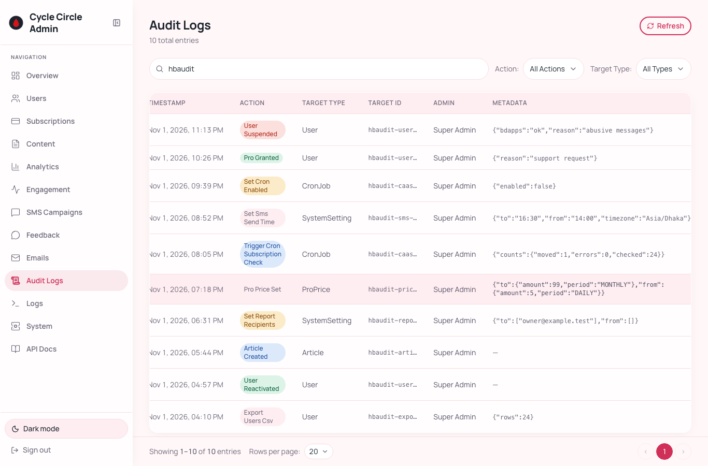

# Audit logs

The record of what each Admin did in the Admin app: who changed which User, article, setting or price, and when. Use it to answer "who did this, and when?" It is separate from the [Logs](#lg-viewer) page, which shows what the servers did, and from the Translog, which records each plan change of a User ([Plan history and Translog](#us-history)).

## Audit log search {#au-search}

### What it is

The **Audit Logs** page. A header with the total ("10 total entries"), a **Refresh** button, a search box ("Search by action or target ID…"), two filters (**Action** and **Target Type**), a table of entries newest first, and page controls. Every entry says which Admin did what to which record. Entries cannot be edited or deleted from the screen.

### Where to find it

**Audit Logs** in the sidebar, or `/audit-logs`. The screenshot was taken after searching for the demo text "hbaudit", so only the fake demo entries show.

### How to use it

1. Open **Audit Logs**. The newest entries are at the top.
2. To find one kind of action, open **Action** and pick it (for example "Pro Granted"). The list has every action the system can record, from "User Suspended" to "Admin Logout".
3. To find entries about one kind of record, open **Target Type** and pick it (User, Article, Article Category, Subscription, Sms Broadcast, Sms Campaign, Sms Campaign Message, Profile, Feedback, Cron Job, System Setting or Pro Price).
4. To find one record, type its ID (or the first part of it) in the search box. To find an action by name, type its words ("pro granted") or its stored name ("PRO_GRANTED"). The search matches the stored name only, so a label that differs from it is not found by its words (see Rules and limits).
5. Use the page controls under the table to move through pages and to change **Rows per page**.
6. Press **Refresh** to see entries made in the last few minutes (see rules).

Filters and search combine: an entry must match all of them. They are kept in the page address, so a filtered page can be bookmarked or shared with another Admin.

### Rules and limits

- The search box matches **the action name or the target ID**, nothing else. It does not search Admin names, metadata or the target type column. Typing spaces is the same as typing underscores, and capital letters do not matter.
- The default page size is 20 entries. Entries are sorted by time, newest first, and there is no other sort.
- Times are Bangladesh time (Asia/Dhaka, UTC+6).
- The page is cached for up to 5 minutes. A change an Admin made a moment ago may not show until you press **Refresh** or the cache expires.
- The audit log is a database table, not a log file. It is not part of the dated log files described in [Log channels](#lg-channels), and it is not removed by the log clean-up.
- Admin sign-ins are recorded too: "Admin Login", "Admin Login Failed" and "Admin Logout". A failed sign-in is recorded only when the email belongs to a real Admin account; for an unknown email only a warning goes to the server logs.
- An Admin account that has audit entries cannot be deleted from the database, so entries always keep their Admin.

### What can go wrong

| The Admin sees | Cause | Fix |
|---|---|---|
| "No audit log entries match your filters." | The search text, Action and Target Type together match nothing | Clear the search box, or set **Action** to "All Actions" and **Target Type** to "All Types" |
| A search for an Admin's name finds nothing | The search covers only the action name and the target ID | Search for the action instead, then read the **Admin** column |
| A change made a minute ago is missing | The list is cached for up to 5 minutes | Press **Refresh** |
| A search for a User's name finds nothing | The **Target ID** column holds the record's ID, not the name | Copy the ID from the User's page ([User detail](#us-detail)) and search for that |

### Related

- Reading one entry: [What each entry means](#au-entries)
- Server-side logs: [Logs viewer](#lg-viewer)
- Plan changes of one User: [Plan history and Translog](#us-history)

## What each entry means {#au-entries}

### What it is

One row in the audit table. Each row has six columns:

| Column | Shows |
|---|---|
| Timestamp | When the Admin acted, in Bangladesh time (for example "Nov 1, 2026, 07:35 PM") |
| Action | A coloured label. The label is the stored action name written in words ("PRO_GRANTED" shows as "Pro Granted"). Red labels are actions that take something away (suspend, delete, revoke), green ones give something back (reactivate, restore, grant Pro), blue ones are the few create, edit and job-run actions listed under Rules and limits, yellow ones start SMS sends or change job and report settings, and grey ones are everything else |
| Target Type | The kind of record the action was done to |
| Target ID | The record's ID, cut to 12 characters with "…". Hover to see the whole ID |
| Admin | The Admin's name, or their email if they have no name (the stored Admin ID if both are empty) |
| Metadata | A short JSON summary of the details, or a dash when there are none |

### Where to find it

The table on the **Audit Logs** page ([Audit log search](#au-search)). Press the grey metadata text of a row to open it in full. The screenshot shows the Pro price entry opened: it records the old price and the new one.

### How to use it

1. Read the row from left to right: when, what, to which kind of record, which record, by whom.
2. Press the metadata text to see all of it; press it again to shorten it. The text is the JSON itself, cut to 60 characters with "…" until you open it (the button's screen-reader name is "Expand metadata" or "Collapse metadata").
3. For settings changes the metadata holds the old and new value:
   - "Set Sms Send Time": the old time, the new time and the time zone.
   - "Set Report Recipients": the old list and the new list of emails.
   - "Set Sms Delivery Reports": the old and new value (true or false).
   - "Set Cron Enabled": whether the job is now on (`enabled`). The Target ID is the job name (`daily-reminders`, `caas-check` or `reports`).
   - "Pro Price Set": the price before (amount, period, first day) and the new price. The Target ID is the new price entry.
   - "Trigger Cron Daily Reminders" and "Trigger Cron Subscription Check": the numbers the job reported (`counts`), or the web app's status code when it failed.
4. Use the Target ID to look the record up: a User ID opens in [User detail](#us-detail).

What gets an entry:

- **Users:** suspend, reactivate, delete, restore, grant Pro, revoke Pro, set subscription to Free, Pro or Lapsed, change notification preferences, send reminders to one User.
- **Content:** article created, updated, deleted, bulk action; category created, renamed, deleted, reordered.
- **SMS:** every campaign and message action (create, import, add, remove, update, reschedule, cancel, delete, resend, send, dispatch).
- **Exports:** a CSV of Users, Feedback or another table. Exports contain contact details, so each one is recorded.
- **System:** job switches, manual job runs, SMS send time, report recipients, SMS delivery reports and the Pro price.
- **Admin sign-in:** login, failed login and logout.

### Rules and limits

- The audit log records what **Admins** did. It does not record what a User did; those lines go to the server logs ([Log channels](#lg-channels)).
- The stored action name never changes, but the label may. The one place the label differs from a plain rewrite is "Trigger Cron Subscription Check", stored as `TRIGGER_CRON_CAAS_CHECK`. The search box matches the stored name, so "caas" finds it but "subscription check" finds nothing; use the **Action** menu for that one.
- A few actions have a coloured label: User Suspended, User Deleted, Pro Revoked and Article Deleted (red); User Reactivated, User Restored and Pro Granted (green); Article Created (blue); Send Sms Broadcast and Dispatch Sms Broadcast (yellow); Update Sms Broadcast and Reschedule Sms Broadcast (blue); Set Cron Enabled and Set Report Recipients (yellow); the two Trigger Cron actions (blue). Every other action, for example "Set Sms Send Time", "Pro Price Set" and "Export Users Csv", has a grey label, even when it matters.
- Metadata is stored as JSON and shown in the order the database returns it, so "to" can appear before "from".
- Not every Admin action has metadata. Reactivate and article creation show a dash; Suspend shows the reason and the BDApps result (`reason`, `bdapps`).
- The Target ID of a sign-in entry is the Admin's own ID, and its Target Type is "User".

### What can go wrong

| The Admin sees | Cause | Fix |
|---|---|---|
| A dash in **Metadata** | That action stores no details | Nothing is wrong; read the Action and Target ID |
| A very long ID cut with "…" | The column shows 12 characters | Hover for the full ID, or open the metadata |
| "Admin Login Failed" entries | A sign-in for a real Admin email was refused: wrong password, suspended account, or too many attempts (the metadata `reason` says which: `BAD_PASSWORD`, `SUSPENDED` or `RATE_LIMITED`) | If the Admin did not do it, change the password and see [Admin access](#aa-sign-in) |

### Related

- Filtering and searching: [Audit log search](#au-search)
- The pages that write entries: [Job on/off switches](#sy-jobs), [SMS send time](#sy-sms-time), [Pro price](#sy-pro-price), [Grant and revoke Pro](#us-pro-override)
