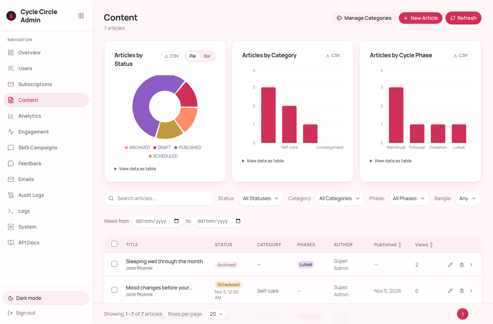
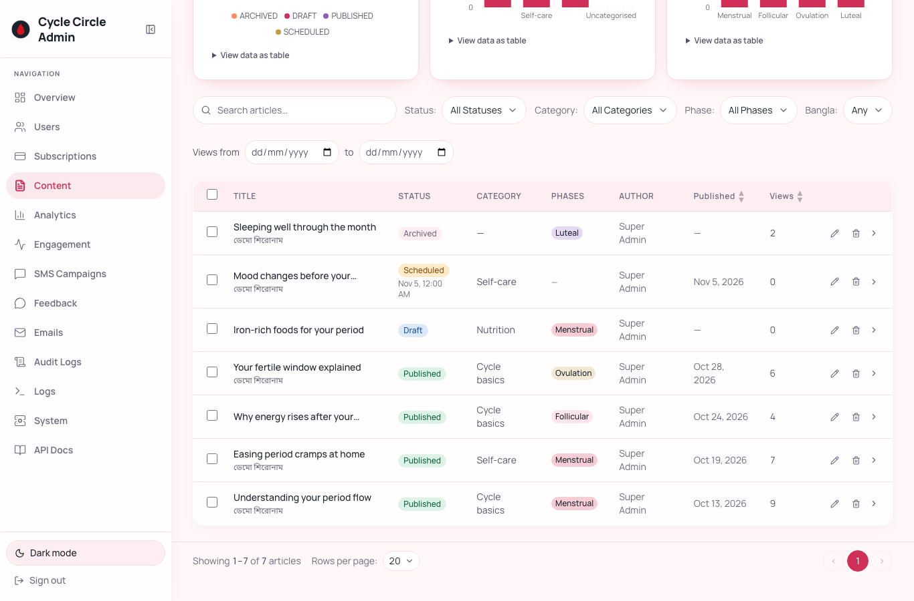
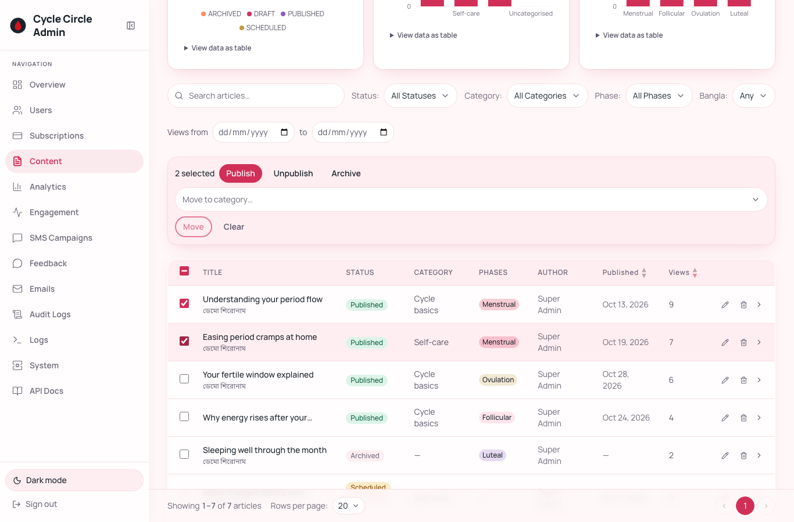
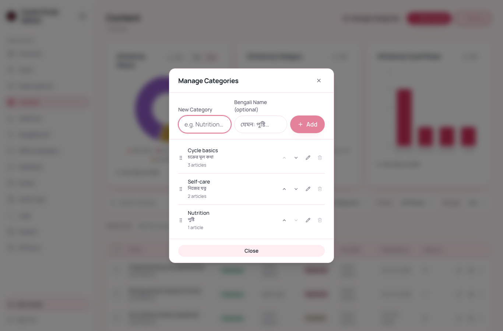
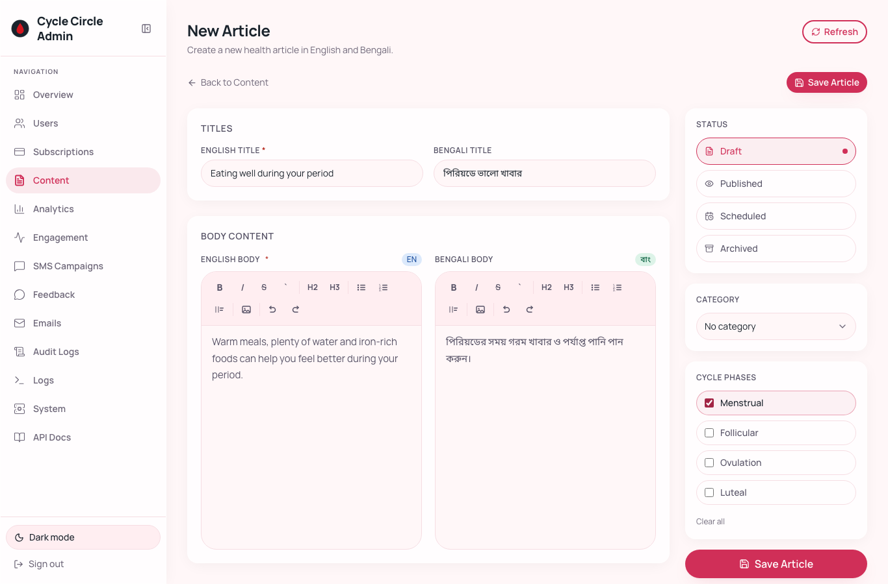
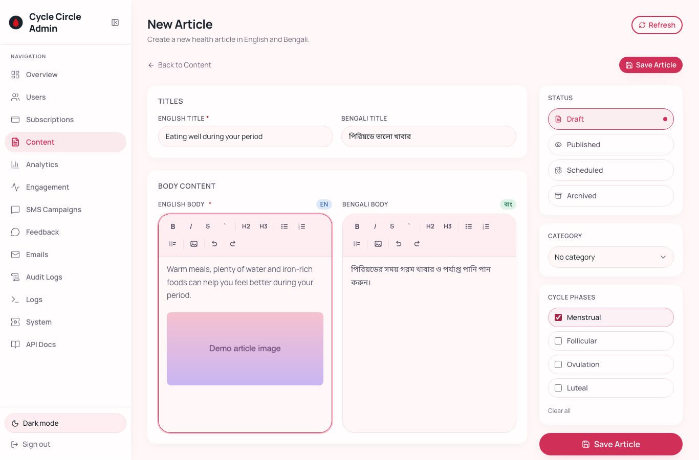
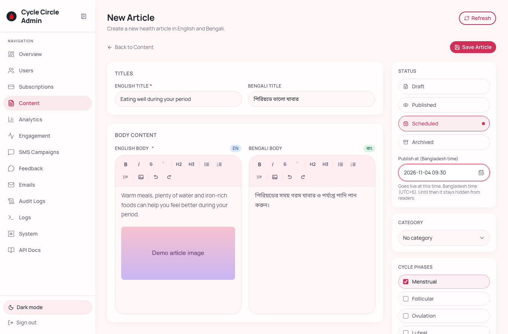
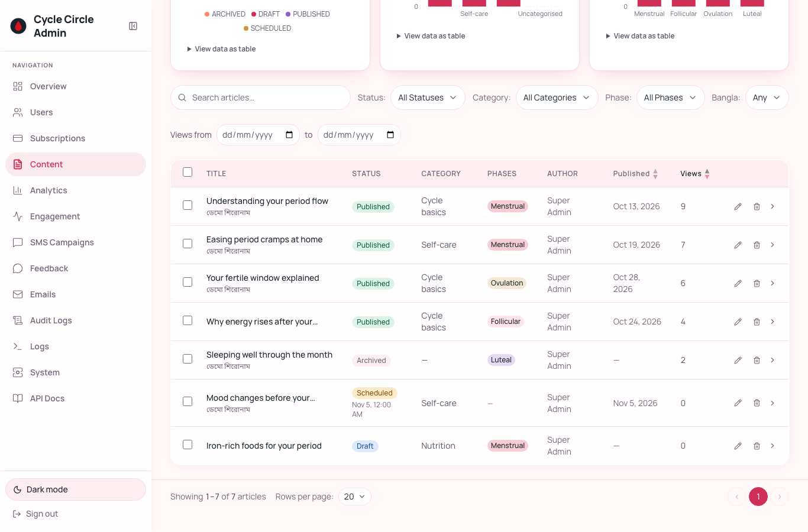

# Content

How an Admin publishes health articles for the Learn page ([Learn: article list](#ct-learn)). Articles are written in English with an optional Bengali version. An article is visible to Users only when its status is **Published** and its publish time has come. "Scheduled" is not a separate stored status: it is a Published article whose publish time is still ahead.

Every change on these screens is written to the audit log ([What each entry means](#au-entries)), and the public site is told to refresh its article cache. Users can still see the old list for up to about a minute.

## Article list {#ac-list}

### What it is

The **Content** page: a header ("N articles"), three charts ("Articles by Status", "Articles by Category", "Articles by Cycle Phase"), a search and filter bar, a "Views from / to" date range, and a table with one row per article. The buttons at the top right are **Manage Categories**, **New Article** and **Refresh**.

| Column | Shows |
|---|---|
| Title | English title, with the Bengali title under it when there is one |
| Status | "Draft", "Published", "Scheduled" (with the day and time it goes live) or "Archived" |
| Category | The category name, or a dash |
| Phases | The cycle phases the article is tagged with (Menstrual, Follicular, Ovulation, Luteal), or a dash |
| Author | The Admin who created the article |
| Published | The day the article went live, or a dash for a Draft or Archived article |
| Views | How many reads were counted in the chosen days ([Views column](#ac-views)) |

### Where to find it

**Content** in the sidebar, or `/content`.

### How to use it

1. Type in **Search articles…** to find an article by part of its English or Bengali title (not the body).
2. Narrow the list with **Status** (All Statuses, Draft, Published, Scheduled, Archived), **Category** (All Categories, No category, or one category with its article count), **Phase** (All Phases or one phase) and **Bangla** ("Any" or "Missing Bangla").
3. Click a row, or the pencil, to open the article in the editor ([Article editor](#ac-editor)). The bin icon asks to delete it.
4. Use **Rows per page** (10, 20, 50 or 100; default 20) and the page buttons at the bottom to move through the list.
5. Press **Refresh** to load the newest data.

### Rules and limits

- The list is ordered by the day each article was **created**, newest first. Nothing in the screen changes that order except the Views sort.
- **Published** in the Status filter means live now. **Scheduled** means Published with a future publish time. The two never overlap.
- **Missing Bangla** lists articles that have no Bengali title or no Bengali body.
- Search, filters, page and sort are kept in the address, so a filtered list can be shared as a link.
- The list and the status chart are kept for 60 seconds; the category list and the category and phase charts for 5 minutes. After any save the Admin's own page is refreshed, but press **Refresh** if another Admin has just changed something.
- Deleting an article cannot be undone. It also removes the article's view counts. The image files it used stay on the server.
- The "Published" column heading shows sort arrows, but clicking it does nothing: only **Views** sorts. (The list cannot be sorted by title in the screen either.)
- "Published" shows the day the article went (or goes) live in Bangladesh time. An article moved back to Draft or Archived loses that day.

### What can go wrong

| The Admin sees | Cause | Fix |
|---|---|---|
| "No articles match your filters." | The search or filters exclude everything | Clear the search and set every filter back to "All" |
| A just-saved change is missing | The list is cached for up to 60 seconds | Press **Refresh** |
| "Are you sure you want to delete "…"? This cannot be undone." | The bin icon was pressed | Press **Delete** to confirm, or close the box to keep the article |
| "Could not delete the article. Check your connection and try again." | The delete request failed (network) | Try again |
| "That item no longer exists." | Another Admin already deleted it | Press **Refresh** |
| "Something went wrong. Please try again." | An unexpected server error | Try again; if it repeats, check the error log ([Logs](#lg-channels)) |

### Related

- [Bulk actions](#ac-bulk)
- [Article editor](#ac-editor)
- [Views column](#ac-views)
- [Learn: article list](#ct-learn)

## Bulk actions {#ac-bulk}

### What it is

A bar that appears above the table as soon as one or more rows are ticked. It changes many articles in one go: **Publish**, **Unpublish**, **Archive**, or **Move** them to another category.

### Where to find it

Tick the boxes at the start of the rows on the **Content** page (the box in the table header ticks every row on the page).

### How to use it

1. Tick the articles. The bar says "N selected".
2. Press **Publish**, **Unpublish** or **Archive**, or choose a category (or "No category") in **Move to category…** and press **Move**.
3. Read the toast: "N succeeded" (green) or "N succeeded, M failed" (red). Failed articles are listed under the bar as "N failed:" with the reason, and stay ticked so the Admin can retry.
4. Press **Clear** to untick everything.

### Rules and limits

- **Publish** makes a Draft, an Archived article or a Scheduled one live **now**. An article that is already live keeps its original publish time.
- **Unpublish** turns the article into a **Draft**; **Archive** turns it into **Archived**. Both remove the article from the Learn page and clear its publish time. Neither deletes anything.
- **Move** changes only the category. "No category" removes it.
- At most **100** articles per action. The selection belongs to the current page, so changing page, filter or search drops it.
- Each article succeeds or fails on its own, and the whole action is written to the audit log as one entry.
- **Bulk Publish does not show the "Publish anyway?" warning** the editor shows for a missing Bengali translation or cycle phase ([Article editor](#ac-editor)). An article that is incomplete goes live without a warning.
- There is no bulk delete.

### What can go wrong

| The Admin sees | Cause | Fix |
|---|---|---|
| "N succeeded, M failed" and a red "N failed:" list | Some articles could not be changed (reasons below) | Fix the reason and press the action again; the failed ones are still ticked |
| "Article not found." | The article was deleted by someone else meanwhile | Press **Refresh** |
| "Could not update this article." | A database error on that one article | Try again |
| "That category no longer exists." | The category chosen for **Move** was deleted meanwhile | Pick another category |
| "Select at most 100 articles at a time." | More than 100 ids were sent | Use a smaller page size, or run the action twice |
| "Could not apply the action. Check your connection and try again." | The request itself failed | Try again |
| The **Move** button stays grey | No category (or "No category") has been chosen yet | Choose one in **Move to category…** |

### Related

- [Article list](#ac-list)
- [Scheduled publishing](#ac-schedule)
- [What each entry means](#au-entries)

## Categories {#ac-categories}

### What it is

Categories group articles on the Learn page. Each has an English name and an optional Bengali name. Their order here is the order of the filter chips Users see.

### Where to find it

**Manage Categories** at the top of the **Content** page. It opens a "Manage Categories" box.

### How to use it

1. **Add:** type the name under **New Category** (and, if wanted, **Bengali Name (optional)**), then press **Add**. The new category goes to the end of the list.
2. **Rename:** press the pencil. Two boxes open (English name, Bengali name). Press Enter or the tick to save, Escape or the cross to cancel. Moving the cursor out of both boxes also saves.
3. **Reorder:** use the up and down arrows beside a category, or drag a row by its grip. The new order is saved at once.
4. **Delete:** press the bin, then confirm "Delete Category".
5. Press **Close** when done.

### Rules and limits

- The English name is required and must be **unique**. The Bengali name is optional.
- A category can be deleted **only when it has no articles**. The bin is greyed out ("Cannot delete a category that has articles") for any category with one or more; move or delete its articles first ([Bulk actions](#ac-bulk)).
- Renaming keeps the category's links. The internal address (slug) follows the English name when the name changes.
- The reorder and the rename controls are locked while another change is saving.
- A category appears on the Learn page only while it holds at least one article that is live.
- Adding, renaming, deleting and reordering are all written to the audit log.

### What can go wrong

| The Admin sees | Cause | Fix |
|---|---|---|
| "A category named "X" already exists" | Another category has the same English name | Choose a different name |
| "That name is already in use." | The same, caught by the database | Choose a different name |
| "Category name is required" | The name box holds only spaces | Type a name |
| **Add** is greyed out | The English name box is empty | Type the English name |
| Bin is greyed out; tooltip "Cannot delete a category that has articles" | The category still has articles | Move or delete the articles first |
| "Cannot delete a category that still has articles." | An article was added to it after the page loaded | Reload the page and check the count |
| "Category not found" | Another Admin already deleted or renamed it | Close the box and press **Refresh** |
| "Categories changed since this page loaded. Reload and try again." | Another Admin added or removed a category while this box was open | Reload the page, then reorder again |
| "Failed to reorder categories" | The save failed (network); the old order comes back | Try again |
| "No categories yet. Add one above." | There are no categories | Add one |

### Related

- [Article editor](#ac-editor)
- [Learn: article list](#ct-learn)
- [Filter by phase](#ct-filter)

## Article editor {#ac-editor}

### What it is

The page where one article is written and saved. **New Article** opens it empty; clicking a row (or the pencil) opens it as **Edit Article** with the article's English title under the heading.

### Where to find it

**Content > New Article** (`/content/new`) or **Content >** an article (`/content/<id>`).

### How to use it

1. Type the **English Title** and the English body. Both are required (marked *).
2. Optionally add the **Bengali Title** and the Bengali body. The two bodies sit side by side. The toolbar gives bold, italic, strikethrough, inline code, H2, H3, bullet and numbered lists, quote, image, undo and redo.
3. In the side column choose a **Status**: Draft, Published, Scheduled ([Scheduled publishing](#ac-schedule)) or Archived.
4. Choose a **Category** ("No category" is allowed) and tick the **Cycle Phases** the article belongs to (**Clear all** unticks them).
5. Press **Save Article** (there is one at the top and one under the side column). On success the page returns to the list.
6. If a box "Publish anyway?" appears, read it and press **Publish anyway** to save, or close it and fix the article.

### Rules and limits

- A new article starts as **Draft**. A Draft is never visible to Users.
- The "Publish anyway?" box appears when the status is Published (or Scheduled) and the article has **no Bengali translation (title and body)** or **no cycle phase tag**. The text reads "This article has no Bengali translation (title and body) and no cycle phase tag. Readers may see an incomplete article." Only the parts that apply are named. It never blocks saving.
- A blank Bengali body (empty, spaces, or an empty paragraph) is stored as no Bengali body at all.
- The body is **cleaned when saved**: only plain formatting (headings, bold, italic, lists, quotes, links, code, images) is kept; scripts, styles and any image not uploaded through the editor are removed. Links open with "noopener noreferrer".
- The address of the article (slug) is made from the English title once, when the article is first created, and does not change when the title is edited.
- Moving a Draft or Archived article to Published makes it live now. Moving any article to Draft or Archived hides it and clears its publish time.
- An article that is **already live** cannot be rescheduled: the "Scheduled" choice is not offered for it.
- If the browser tab is closed or the page is left with unsaved changes, the browser asks first.
- After saving, the Learn page may show the old version for up to about a minute.

### What can go wrong

| The Admin sees | Cause | Fix |
|---|---|---|
| "English title is required." | The English title is empty | Type it |
| "English body is required." | The English body is empty or only an empty paragraph | Write the English text |
| "Choose a publish date and time." | Status is Scheduled but the time is empty or not understood | Fill the time as `YYYY-MM-DD HH:MM` ([Scheduled publishing](#ac-schedule)) |
| "The publish time must be in the future. Use Published to publish now." | The scheduled time is now or in the past | Pick a later time, or choose Published |
| "This article is already published; its publish time cannot be changed." | A live article was saved with a new publish time | Leave the time alone, or move it to Draft first |
| "That category no longer exists." | The category was deleted while the editor was open | Pick another category |
| "Saved, but the web app cache did not refresh. Public pages may be stale for a few minutes." (red toast) | The article is saved, but the public site could not be told to refresh | Nothing is lost; the Learn page catches up by itself within minutes |
| "Failed to save article." / "Something went wrong. Please try again." | A network or server error; nothing was saved | Save again; the typed text is still on the page |

### Related

- [Image upload](#ac-images)
- [Scheduled publishing](#ac-schedule)
- [Bulk actions](#ac-bulk)
- [Reading an article](#ct-reader)

## Image upload {#ac-images}

### What it is

Pictures inside an article body. An image is uploaded to the server's own storage and inserted at the cursor; the article then points at it.

### Where to find it

In either body box of the editor: the picture button in the toolbar (hover text "Insert image").

### How to use it

1. Click in the body where the picture should go.
2. Press the picture button and choose a file, or **drag the file in**, or **paste** an image from the clipboard.
3. Wait for the picture to appear (it is inserted once the upload has finished).
4. Press **Save Article** as usual.

### Rules and limits

- Allowed: **PNG, JPEG, WebP and GIF**, up to **5 MB** each. The type is decided from the file's contents, not its name, so renaming a file does not help.
- The picture's description (alt text) is set to the file name without its extension. There is no box to change it.
- Each upload is stored under a new random name at `/uploads/<name>`. The files are public and cached by the browser for a year.
- Only images uploaded this way survive saving: a picture from any other address is removed from the body when the article is saved.
- Deleting an article does not delete its image files, and there is no screen to list or remove uploads.
- There is no limit on how many pictures one article holds.

### What can go wrong

| The Admin sees | Cause | Fix |
|---|---|---|
| "Image is too large (max 5 MB)." | The file is over 5 MB | Shrink it and try again |
| "Unsupported file type. Use PNG, JPEG, WebP or GIF." | The file is another type (for example a PDF or HEIC photo) | Convert it to one of the four types |
| "The file is empty." | A zero-byte file | Choose the right file |
| "No file provided." | The upload arrived without a file | Try again |
| "Upload failed. Try again." | Network or server error | Try again |
| A pasted web picture vanishes after saving | It came from another website, not from an upload | Save the picture to the computer and upload it |

### Related

- [Article editor](#ac-editor)
- [Reading an article](#ct-reader)

## Scheduled publishing {#ac-schedule}

### What it is

Choosing a future day and time for an article to appear on the Learn page. Nothing runs at that moment: the article is simply hidden from Users until its publish time has passed.

### Where to find it

In the editor, the **Scheduled** choice under **Status** reveals the **Publish at (Bangladesh time)** box.

### How to use it

1. In **Status** press **Scheduled**.
2. Type the time in **Publish at (Bangladesh time)** as `YYYY-MM-DD HH:MM` (24-hour, for example 2026-11-04 09:30), or press the calendar button and pick it.
3. Press **Save Article**. The list now shows the article as **Scheduled** with its day and time.
4. To publish a scheduled article early, open it, choose **Published** and save: it goes live now. To cancel, choose **Draft** or **Archived**.

### Rules and limits

- The time is **Bangladesh time (UTC+6)** whatever the time zone of the Admin's computer. The box says "Goes live at this time, Bangladesh time (UTC+6). Until then it stays hidden from readers."
- It must be in the future. The editor refuses a time that has passed with "The publish time must be in the future. Use Published to publish now." Only if a past time still reaches the server (for example the page sat open past the time) does the server treat it as "now".
- Only a Published article can have a time; Scheduled is stored as Published plus the time.
- The Learn page keeps its list for 60 seconds, so a scheduled article can appear up to about a minute after its time.
- Scheduled articles are not counted as readable: they do not collect views ([Views column](#ac-views)).
- The list's Status filter has a **Scheduled** option, and the "Articles by Status" chart counts them as SCHEDULED.
- A live article cannot be rescheduled.

### What can go wrong

| The Admin sees | Cause | Fix |
|---|---|---|
| "Choose a publish date and time." | The box is empty or not a real date and time | Type it as `YYYY-MM-DD HH:MM` |
| "The publish time must be in the future. Use Published to publish now." | The time is not after the present moment | Choose a later time |
| "Choose a valid publish date and time." | The time reached the server in a form it could not read | Retype it |
| "Only a published article can have a publish time." | A time was sent with Draft or Archived | Use Scheduled or Published |
| The article is still missing a minute after its time | The Learn page's 60-second cache | Wait a minute and reload |
| The Admin typed 09:30 but it shows another hour | The Admin read it in their own time zone | Read the list time as Bangladesh time |

### Related

- [Article editor](#ac-editor)
- [Bulk actions](#ac-bulk)
- [Learn: article list](#ct-learn)

## Views column {#ac-views}

### What it is

The **Views** column counts how many times Users read each article, over a range of days the Admin picks. It tells the Admin which articles are being read.

### Where to find it

The last data column of the article table on the **Content** page, with the **Views from** and **to** date boxes above the table.

### How to use it

1. Leave **Views from** and **to** empty to count all time, or pick a start and end day.
2. Click the **Views** heading: first most read to least read, click again for least read to most read, a third click returns to the normal order.
3. Press **Refresh** to recount.

### Rules and limits

- A view is **one User reading one article on one Bangladesh day**. The same User reading the same article ten times in a day counts once; reading it on two days counts twice. It is therefore a count of "reader-days", not of page loads.
- Only **live** articles count: a Draft, Archived or still-Scheduled article collects nothing. Views counted while an article was live stay after it is hidden.
- A read by a Suspended or deleted User is never counted (judged when they read).
- The **from** and **to** days are Bangladesh days and both are included. The range changes the column and the sort, not which articles are listed.
- Sorting by Views ranks every matching article, then pages the ranking; articles with equal counts keep the newest-created first.

### What can go wrong

| The Admin sees | Cause | Fix |
|---|---|---|
| 0 on an article that was just published | Nobody has read it yet, or the reads were on days outside the range | Clear **Views from** and **to** |
| 0 on a Scheduled article | It is not live yet, so reads are not counted | Wait for its publish time |
| A number lower than the Admin expected | One User counts once a day however often they read | None; this is how views are counted |
| Clicking **Published** does not sort | Only **Views** sorts | Use Views, or the filters |
| The column changed after a date change but the list did not | The range changes only the count | Use the filters to change which articles show |

### Related

- [Article list](#ac-list)
- [Scheduled publishing](#ac-schedule)
- [What counts as an Active user](#en-active)
