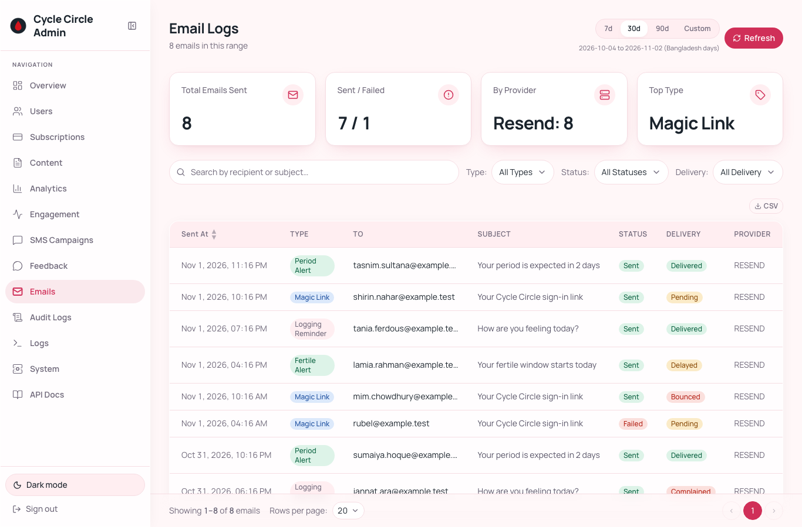
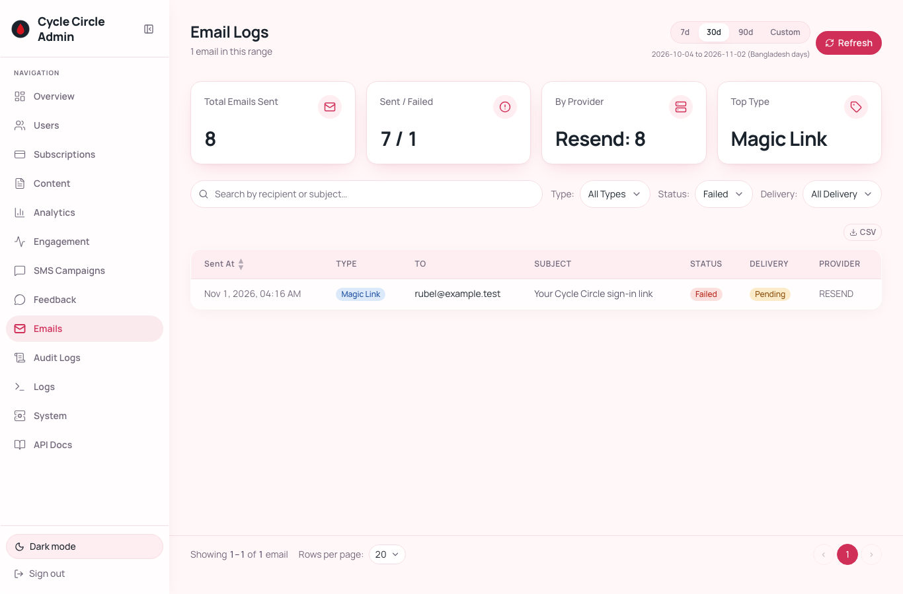
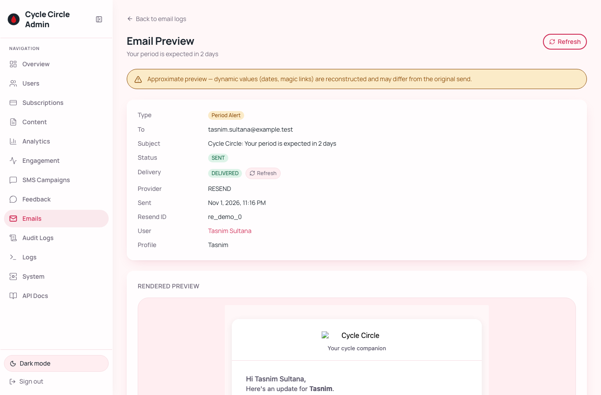
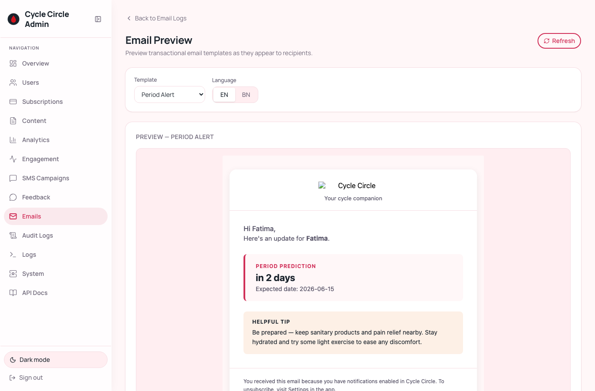
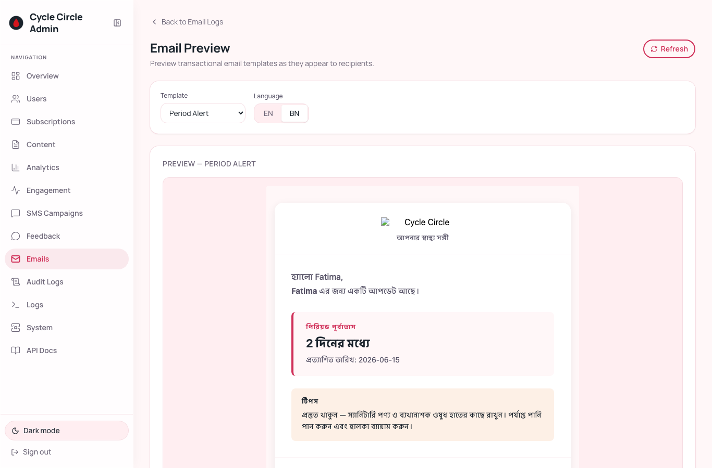

# Emails

Cycle Circle keeps a log of every email it tries to send: sign-in links, reminders, verification codes and reports. The **Emails** section lets an Admin answer "did this User's email go out, and did it arrive?". It has three screens: the log, the detail of one email, and a preview of the reminder templates.

The log stores who the email was for, the subject, whether our system sent it, which provider carried it and what the provider later reported. It does **not** store the email's body or the sign-in link itself, so every preview is a reconstruction.

## Email log {#em-log}

### What it is

The **Email Logs** page: one row for every send attempt, successful or not, newest first, with four summary cards on top.

| Card | Shows |
|---|---|
| Total Emails Sent | All attempts in the period, **including failed ones** |
| Sent / Failed | How many succeeded and how many failed |
| By Provider | The provider that carried most mail, for example "Resend: 8" (in production mail goes through Resend; "SMTP" is the local test mailbox used in development) |
| Top Type | The most common type, for example "Magic Link" |

| Column | Shows |
|---|---|
| Sent At | When the attempt was made, in Bangladesh time |
| Type | "Magic Link", "Period Alert", "Fertile Alert" or "Logging Reminder"; other types show their raw code (see rules) |
| To | The recipient address |
| Subject | The subject, cut at 50 characters (hover for all of it) |
| Status | "Sent" (our provider accepted it) or "Failed" |
| Delivery | "Pending", "Delivered", "Bounced", "Complained" or "Delayed" |
| Provider | RESEND or SMTP |

### Where to find it

**Emails** in the sidebar, or `/emails`.

### How to use it

1. Choose the period with the date buttons (7d, 30d, 90d, Custom). The header says "N emails in this range" ([Date ranges](#an-ranges)).
2. To find a User's email, type their address, or part of the subject, in **Search by recipient or subject…**. The match ignores capital letters.
3. Narrow with **Type** (All Types, Magic Link, Period Alert, Fertile Alert, Logging Reminder), **Status** (All Statuses, Sent, Failed) and **Delivery** (All Delivery, Pending, Delivered, Bounced, Complained, Delayed).
4. Click a row to open [Email detail](#em-detail). Click **Sent At** to sort the rows on this page.
5. **CSV** downloads every row that matches the period and filters (not just this page), with the columns ID, Type, To, Subject, Status, Delivery, Provider, Error and Sent. Times in the file are UTC. The download is written to the audit log ([What each entry means](#au-entries)).

### Rules and limits

- A row is written for **every** send attempt: "Sent" when the provider accepted the mail, "Failed" with the error text when it did not.
- **Sent is not Delivered.** "Sent" only means the provider took the mail. "Delivery" is what the provider reported afterwards, through a notification to Cycle Circle: Delivered, Bounced (the address rejected it), Complained (the recipient marked it as spam) or Delayed. "Pending" means no report has arrived yet. A Failed email has no provider reference, so it stays "Pending".
- The log holds seven types: Magic Link, Period Alert, Fertile Alert, Logging Reminder, Profile-completion reminder, Verification code and Report. The **Type** menu offers only the first four. The other three can be found by searching, or in the CSV; their badge shows the raw code (PROFILE_COMPLETION_REMINDER, VERIFICATION_CODE, REPORT).
- 20 rows per page (adjustable). The card figures and the CSV follow the period; the CSV holds at most 10,000 rows.
- The page keeps its data for up to a minute; the **Refresh** button at the top gets the newest.
- Magic-link rows for a User are the first thing to check for "I never got my sign-in link" ([Magic-link email](#ec-magic-link)).

### What can go wrong

| The Admin sees | Cause | Fix |
|---|---|---|
| "No email logs match your filters." | Nothing in this period or filter | Widen the period, clear the search and filters |
| No row at all for the User | The email was never attempted (for example the reminder was off or not due) | Check the User ([User detail](#us-detail)) and the reminder settings |
| Status "Failed" with an error | The provider refused or was unreachable | Open the row for the error text, then ask the User to try again |
| Status "Sent" but Delivery "Pending" for a long time | No report from the provider yet | Open the row and press **Refresh** ([Email detail](#em-detail)) |
| Delivery "Bounced" | The address does not exist or rejected the mail | Ask the User to correct their email |
| Delivery "Complained" | The recipient marked it as spam | Nothing is resent automatically; contact the User by another channel |
| Delivery "Delayed" | The recipient's mail server is slow | Wait; it usually becomes Delivered |
| Total Emails Sent is larger than the Sent figure | The total includes failed attempts | Read the **Sent / Failed** card |
| A badge reads "REPORT" or "VERIFICATION_CODE" | These types have no friendly label | Normal |

### Related

- Admin screen: [Email detail](#em-detail), [Template preview](#em-preview), [Date ranges](#an-ranges)
- What the User receives: [Emails at a glance](#ec-overview), [Magic-link email](#ec-magic-link)
- Troubleshooting: [Emails and SMS](#ts-notifications)

## Email detail {#em-detail}

### What it is

The page for one logged email: its facts, and a picture of what the email looked like. The page is titled **Email Preview**, with the logged subject under the title.

### Where to find it

Click a row on the [Email log](#em-log), or open `/emails/<id>`.

### How to use it

1. Read the yellow notice: "Approximate preview — dynamic values (dates, magic links) are reconstructed and may differ from the original send."
2. Read the facts:

| Field | Meaning |
|---|---|
| Type | Which kind of email |
| To | The recipient address |
| Subject | The subject of the **reconstructed** email (see rules) |
| Status | SENT or FAILED |
| Delivery | PENDING, DELIVERED, BOUNCED, COMPLAINED or DELAYED |
| Provider | RESEND or SMTP |
| Sent | When it was sent, in Bangladesh time |
| Resend ID | The provider's reference (only when there is one) |
| Error | The failure text (only for a failed email) |
| User | A link to the User ([User detail](#us-detail)) |
| Profile | The profile the email was about |

3. If there is a **Resend ID**, press **Refresh** next to the Delivery badge to ask the provider for the latest state. The badge updates and the list follows.
4. Scroll to **Rendered preview** to see the email. Use **Back to email logs** to return.

### Rules and limits

- The body and the sign-in link are not stored, so the preview is rebuilt from the log row: the User's saved language (English unless Bengali), their name (the full name, or the part of the address before the @), and the profile name.
- Fixed placeholders are used where the real values are not stored: a Period Alert always says "in 2 days" and uses the send date as the expected date; a Logging Reminder always says 5 days; a Fertile Window starts on the send date, ends 6 days later with ovulation 3 days later; a Magic Link shows "[link expired — not stored]" instead of the link. These dates are the UTC date of the send, which can be one day earlier than the Bangladesh date.
- The **Subject** row shows the rebuilt subject (with the "Cycle Circle:" prefix), which can differ from the logged subject shown under the title and in the list.
- **Refresh** is offered only when a Resend ID exists, so never for a failed email. It needs the provider key to be set for the Admin app. A delivery update also arrives by itself when the provider notifies Cycle Circle; Refresh just asks sooner.
- The preview runs in a sandboxed frame; links inside it do not work. The logo may show as a broken picture on a test system.
- Types without a template (Profile-completion reminder, Verification code, Report) have no preview.

### What can go wrong

| The Admin sees | Cause | Fix |
|---|---|---|
| "Could not generate preview for this email type." | The type has no template (Profile-completion reminder, Verification code, Report) | Read the facts above; no preview exists |
| "Failed to load email preview." | The preview request failed | Reload the page |
| "Generating preview…" or "Loading preview…" for long | The preview is still loading | Wait a moment, then reload |
| Red "No Resend ID on this log" | The row has no provider reference | Nothing to refresh |
| Red "RESEND_API_KEY not set" | The provider key is not set for the Admin app | Ask the technical team to set it |
| Red "Resend API error: NNN" | The provider answered with an error code | Try again later; ask the technical team if it persists |
| The preview shows a different date or "in 2 days" | The preview is approximate | Trust the log row, not the preview text |
| The page is "not found" | The email log row no longer exists | Go back to the list |

### Related

- Admin screen: [Email log](#em-log), [Template preview](#em-preview), [User detail](#us-detail)
- What the User receives: [Emails at a glance](#ec-overview)
- Troubleshooting: [Emails and SMS](#ts-notifications)

## Template preview {#em-preview}

### What it is

A page that shows the three reminder emails as a User would see them, in English or Bengali, using made-up example data. It is for checking the wording and layout, not for looking up a real email.

### Where to find it

Open `/emails/preview` (add `/emails/preview` to the Admin address). **There is no link to this page** from the sidebar or from the Email Logs page, so bookmark it.

### How to use it

1. Open the page. It loads the "Period Alert" template in English.
2. Pick another template in the **Template** menu: Period Alert, Fertile Window or Logging Reminder.
3. Press **EN** or **BN** under **Language** to switch between English and Bengali.
4. The frame under "Preview — NAME" shows the email. **Back to Email Logs** returns to the log.

### Rules and limits

- Only three templates are shown. Magic link, Verification code, Profile-completion reminder and Report emails have no preview here.
- The data is fixed example text: the name "Fatima", an expected period date of 2026-06-15 (in 2 days), a fertile window of 2026-06-20 to 2026-06-26 with ovulation on 2026-06-23, and 5 days since the last log.
- Nothing is sent and nothing is saved. Viewing the page does not email anyone.
- The page itself is in English only; only the email inside the frame changes language.
- The frame is sandboxed, so links do not work. The logo may show as a broken picture on a test system.

### What can go wrong

| The Admin sees | Cause | Fix |
|---|---|---|
| "Loading preview…" or "Generating preview…" | The template is being built | Wait a moment |
| "Select a template to preview" | The template could not be built | Reload the page |
| The page is not in the sidebar | It is not linked | Open `/emails/preview` directly |
| Bengali shows boxes or question marks | The device lacks a Bengali font | Use a current browser on a device with Bengali fonts |
| The real email looked different | The preview uses example data and today's template | Compare with [Email detail](#em-detail) for the real row |

### Related

- Admin screen: [Email log](#em-log), [Email detail](#em-detail)
- What the User receives: [Period alert](#ec-period-alert), [Fertile window email](#ec-fertile-window), [Logging reminder](#ec-logging-reminder)
- Language: [Navigation and language](#nl-switch-language)
