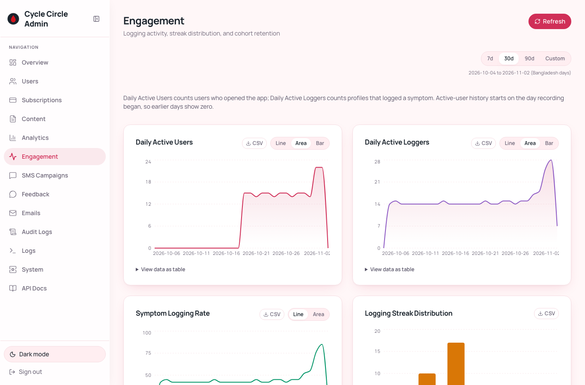
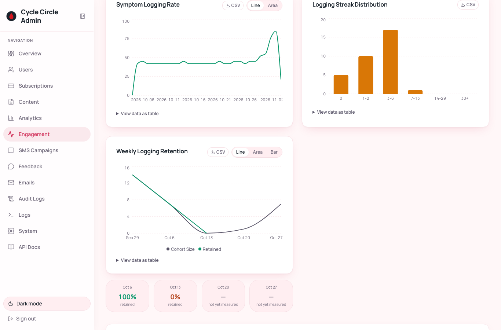

# Engagement

How much Users use the app, and how well they keep logging. The **Engagement** page is a set of charts over one date range. The key term is the **Active user**; the rest of the page counts something different, so read both sections before quoting a number.

## What counts as an Active user {#en-active}

### What it is

An **Active user** is a User who opened the app on a given Bangladesh day ([Glossary](#gl-terms)). The **Daily Active Users** chart shows how many there were on each day. The Overview's **Average Daily Active Users** and **Active Users on Last Day** cards are built from the same daily counts.

### Where to find it

**Engagement** in the sidebar, or `/engagement`. **Daily Active Users** is the first chart, under a note that explains it.

### How to use it

1. Choose the days with **7d**, **30d**, **90d** or **Custom** ([Date ranges](#an-ranges)).
2. Read **Daily Active Users**: one point per Bangladesh day. Switch with **Line**, **Area** or **Bar**, open "View data as table" for the numbers, or press **CSV**.
3. For one number for the whole period use the Overview ([KPI cards](#ov-kpis)).

### Rules and limits

- **Opening is enough.** Any signed-in visit to the app, or to the onboarding screens, counts once for that User that day. The User does not have to log anything. Each User counts **once per day**, however often they open the app.
- **Suspended and deleted Users never count.** This is judged by their status **now**, not on the day. Suspending a User therefore also lowers the past daily counts, and restoring or reactivating one raises them again.
- Admins do not count for using the Admin app. (An Admin who also uses the User app as a User would count.)
- **History starts on the day recording began.** Earlier days show 0 on this page; the Overview card shows "Unavailable" instead (and a permanent footnote on the Overview reads "Active-user history starts on the day recording began."). The charts on this page plot those days as 0. A 0 before that day is not "nobody came".
- A day is a Bangladesh day. Someone who opens the app at 23:50 and again at 00:10 is active on two days.
- It is **not** the same as **Daily Active Loggers**, which counts profiles that logged a symptom ([Engagement panels](#en-panels)). A User can be active without logging.

### What can go wrong

| The Admin sees | Cause | Fix |
|---|---|---|
| "No activity recorded for this period." | No Active user in the range (for example, a range before recording began) | Choose a later range |
| Zeros at the start of a long range | Recording had not begun | Read from the first non-zero day |
| A past day's number changed | A User was suspended, deleted or reactivated since | None; counts always follow the current status |
| Active users is higher than Daily Active Loggers | Many Users open the app without logging | Expected |
| The Overview shows "Unavailable" while Engagement shows 0 | Same cause, shown two ways | Choose a later period |
| The number differs from "Total Users" on the Overview | Total counts all accounts; Active counts those who opened the app that day | Compare like with like |

### Related

- [KPI cards](#ov-kpis)
- [Suspend and reactivate](#us-suspend)
- [Engagement panels](#en-panels)

## Engagement panels {#en-panels}

### What it is

The other charts on the Engagement page. They measure **logging**: whether Users record symptoms.

| Chart | What it shows |
|---|---|
| **Daily Active Loggers** | Per day, how many **profiles** (not Users) logged at least one symptom |
| **Symptom Logging Rate** | That count as a percentage of all profiles |
| **Logging Streak Distribution** | How many profiles are on a logging streak of 0, 1-2, 3-6, 7-13, 14-29 or 30+ days |
| **Weekly Logging Retention** | For each week, how many profiles first logged that week and how many of them logged again the next week |
| **Logging Rate Over Time** | The logging rate again, as a full-width area chart |

### Where to find it

The same **Engagement** page, below **Daily Active Users**.

### How to use it

1. Choose the days at the top ([Date ranges](#an-ranges)).
2. Read each chart; hover for the value, switch the drawing with the buttons on the chart, open "View data as table", or press **CSV**.
3. Under **Weekly Logging Retention** four small cards show the latest weeks, for example "100% retained", or a dash with "not yet measured".

### Rules and limits

- **Logging** means a symptom log, and "all good" counts as one. A period log alone does not.
- **Profiles, not Users.** A User with three profiles can add up to three loggers. Profiles of **deleted** Users are left out; profiles of Suspended Users are **not** left out here (unlike Active users).
- **Symptom Logging Rate** divides by the number of profiles that exist **today**, for every day in the range, and is shown as a whole percent.
- **Streak:** measured at the range's last day (never later than today). A profile has a streak only if it logged on that day or the day before; the streak is the run of consecutive days up to there. Only the last 41 Bangladesh days are looked at (today and the 40 days before it), so a streak longer than that is cut. Profiles that never logged count in the "0" bucket.
- **Weekly Logging Retention:** the range is cut into 7-day weeks ending on its last day (at most 53). A profile belongs to the week of its **first symptom log ever**, and counts as retained if it logs again in the **next** week. A week is "not yet measured" (a dash, with no line) until the next week has fully passed. A profile that first logged before the range is in no cohort.
- The ranges are one shared range: all charts on the page change together.
- Figures are kept for 60 seconds. Press **Refresh** to reload.

### What can go wrong

| The Admin sees | Cause | Fix |
|---|---|---|
| "No logging data for this period." | No symptom log in the range | Choose a longer range |
| "No rate data for this period." / "No logging rate data for this period." | The same | The same |
| "No streak data yet." | No profile has logged | Wait for logs |
| "No retention data yet." | No profile first logged inside the range | Choose a longer range |
| A dash and "not yet measured" under a week | The following week has not finished | Look again next week |
| The rate fell though logging is steady | New profiles raise the divisor | Expected |
| Streaks look short | Only the last 41 days are examined, and a missed day ends the streak | Expected |
| Counts do not match the Overview's active Users | Different thing: opening the app, not logging | See [What counts as an Active user](#en-active) |

### Related

- [What counts as an Active user](#en-active)
- [Symptoms by phase](#an-symptoms-phase)
- [Date ranges](#an-ranges)
