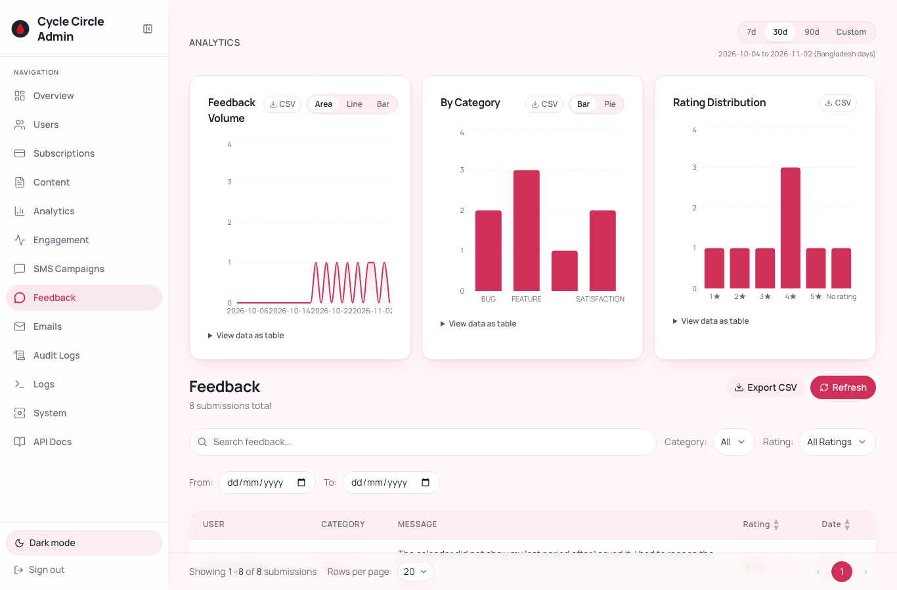
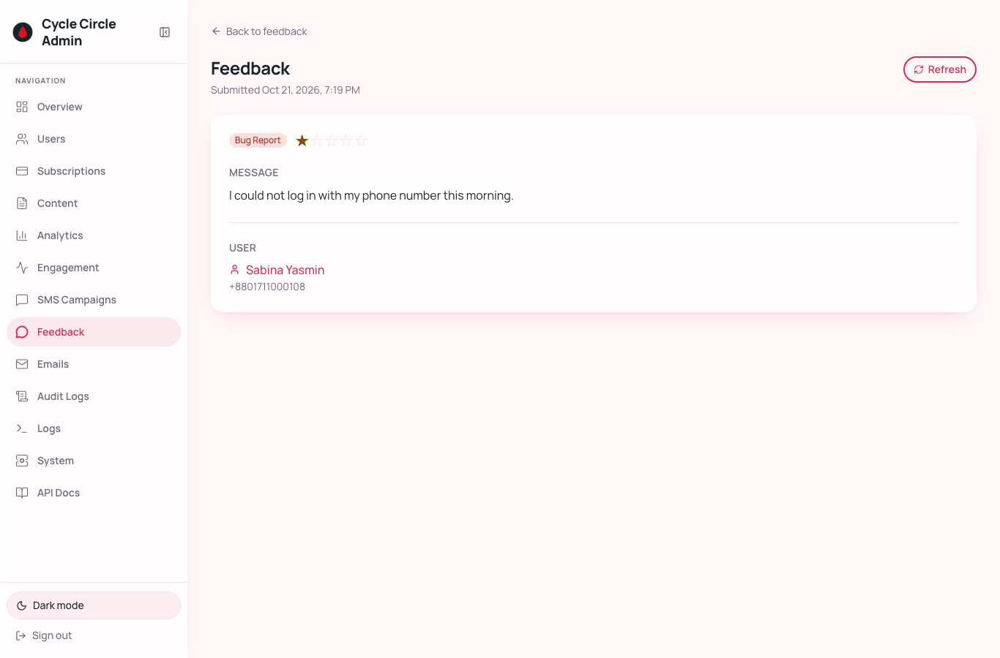
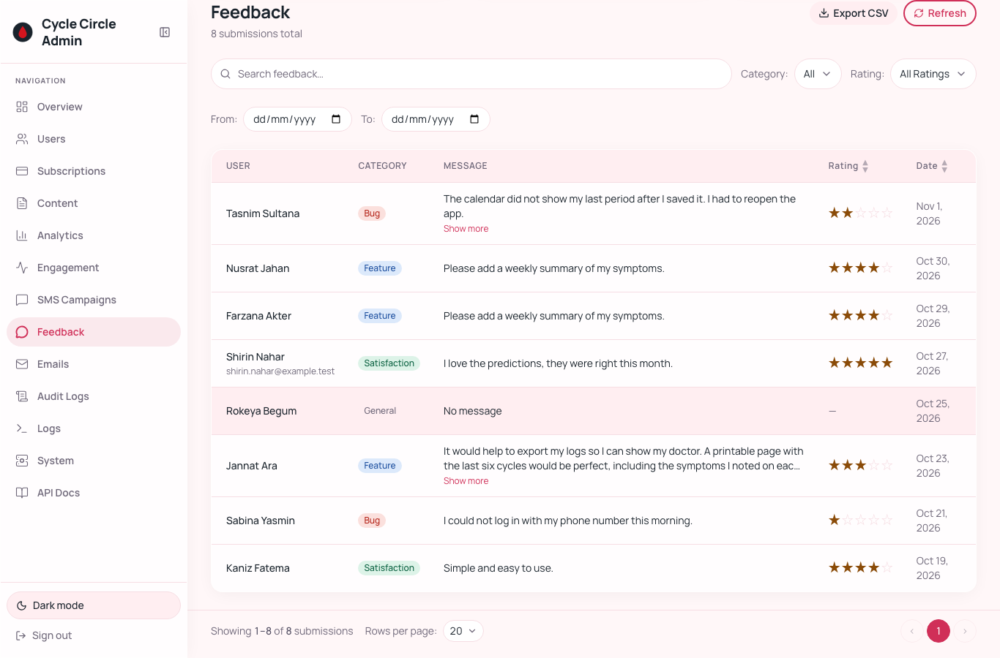

# Feedback

What Users send from **Feedback** in the app ([Send feedback](#fb-send)): a category, an optional star rating and an optional message. Admins read it here. The inbox is read-only: there is no reply, no status and no delete.

## Feedback inbox {#af-inbox}

### What it is

The **Feedback** page. At the top an **Analytics** block with three charts ("Feedback Volume", "By Category", "Rating Distribution") and its own date range. Below it the inbox: a header ("N submissions total"), **Export CSV** and **Refresh**, a search and filter bar, and a table with one row per submission, newest first.

| Column | Shows |
|---|---|
| User | Name, with the email under it when the User has one |
| Category | "Bug", "Feature", "General" or "Satisfaction" |
| Message | The text. More than 80 characters is cut to two lines, with **Show more** and **Show less** |
| Rating | The stars given, or a dash for none |
| Date | The day it was sent (Bangladesh time) |

### Where to find it

**Feedback** in the sidebar, or `/feedback`.

### How to use it

1. Type in **Search feedback…** to find part of a message, a User's name or an email (upper or lower case does not matter).
2. Filter by **Category** (All, Bug Report, Feature Request, General, Satisfaction) and **Rating** (All Ratings, "1+ Stars" to "5+ Stars", or "Exactly 1" to "Exactly 5").
3. Narrow by day with **From:** and **To:**; **Clear dates** removes both.
4. Click a row to open it ([Feedback detail](#af-detail)).
5. Use **Rows per page** (10, 20, 50, 100; default 20) and the page buttons.

### Rules and limits

- The header total is the number **matching the current filters**, even though it says "total".
- **Two separate date controls.** The buttons **7d / 30d / 90d / Custom** at the top change only the three charts. **From:** and **To:** change only the table and the CSV. Neither affects the other.
- From and To are Bangladesh days and both are included.
- The table is always newest first. The **Rating** and **Date** headings show sort arrows, but they only reorder the rows already on the screen (the current page); they do not sort the whole inbox.
- A message sent without text shows "No message" ([Send feedback](#fb-send)).
- A User with only a phone number shows no email. The name shows a dash if the User has none.
- The list and charts are kept for up to 5 minutes. Press **Refresh** to load the newest.
- Search, filters and page are kept in the address, so a view can be shared as a link.

### What can go wrong

| The Admin sees | Cause | Fix |
|---|---|---|
| "No feedback matches your filters." | The search or filters exclude everything | Clear the search, set **Category** and **Rating** to All, press **Clear dates** |
| "No submissions in this period" / "No category data" / "No rating data" | The chart range holds no feedback | Choose a longer range at the top |
| Chart counts differ from the table total | The charts use their own range; the table uses the filters | Set the same days in both |
| New feedback is missing | The 5-minute cache | Press **Refresh** |
| Sorting by **Rating** or **Date** looks wrong across pages | It sorts only the current page | Use the filters and page size instead |
| Fewer rows than "N submissions" | The list is paged | Use the page buttons |

### Related

- [Feedback detail](#af-detail)
- [CSV export](#af-export)
- [Send feedback](#fb-send)
- [Feedback history](#fb-history)

## Feedback detail {#af-detail}

### What it is

One submission in full: its category, rating, the whole message, who sent it, and which profile they had open.

### Where to find it

Click a row in the [Feedback inbox](#af-inbox), or open `/feedback/<id>`.

### How to use it

1. Read the header ("Submitted Oct 21, 2026, 7:19 PM", Bangladesh time), the category badge ("Bug Report", "Feature Request", "General" or "Satisfaction") and the stars.
2. Read the **Message** in full.
3. Under **User**, click the name to open that User's page ([User detail](#us-detail)); the email and phone are shown when the User has them.
4. **Profile** names the profile the User had selected when sending.
5. Press **Back to feedback** to return.

### Rules and limits

- Read-only: no reply, no status, no delete.
- The profile shows only its name. If the profile was deleted since, the **Profile** block is not shown.
- If a User has no name the page falls back to the email, then the phone, then "Unknown user".
- The page is kept for up to 5 minutes; press **Refresh** for the newest.
- Anything a User wrote is shown as plain text.

### What can go wrong

| The Admin sees | Cause | Fix |
|---|---|---|
| A "not found" page | The id is wrong, or the User (and so the feedback) was permanently removed | Go back to the inbox |
| "No message" as the text | The User sent only a category or rating | Nothing to fix |
| No stars | The User gave no rating | Nothing to fix |
| No **Profile** block | The User had no profile selected, or it has been deleted | Nothing to fix |
| The User link opens a deleted User | The account was deleted after sending | Restore it from the User page if needed ([Delete and restore](#us-delete-restore)) |

### Related

- [Feedback inbox](#af-inbox)
- [User detail](#us-detail)
- [Send feedback](#fb-send)

## CSV export {#af-export}

### What it is

The **Export CSV** button at the top of the inbox. It downloads every submission that matches the current search, **Category**, **Rating** and **From:** / **To:** as a spreadsheet file.

### Where to find it

The top right of the **Feedback** header, beside **Refresh**.

### How to use it

1. Set the search and filters you want.
2. Press **Export CSV**. The button reads "Exporting…" while it works.
3. The file `feedback-<today>.csv` (for example `feedback-2026-11-02.csv`) is saved by the browser, and a green toast says "Feedback CSV exported".
4. Open it in Excel or Google Sheets.

### Rules and limits

- It exports **all** matching rows, not only the page on the screen, newest first, with no row limit.
- It follows the table filters, **not** the date buttons (**7d** to **Custom**) above the charts.
- Columns: ID, User ID, Profile ID, User, Email, Category, Message, Rating, Date.
- Category appears as its code: BUG, FEATURE, GENERAL or SATISFACTION.
- **Date is written as UTC**, for example `2026-10-21T13:19:00.000Z`, not Bangladesh time. Add 6 hours for Bangladesh time. (The date in the file name is the Bangladesh day.)
- The file is UTF-8 with a byte-order mark so Excel reads Bengali text. A cell that starts with `=`, `+`, `-` or `@` gets a leading apostrophe so it cannot run as a formula.
- The file holds Users' names, emails and free text. Treat it as personal data.
- Every export is written to the audit log as "EXPORT_FEEDBACK_CSV" with the number of rows and the filters used ([What each entry means](#au-entries)).

### What can go wrong

| The Admin sees | Cause | Fix |
|---|---|---|
| "Export failed" (red toast), or a message from the server | The request failed | Try again |
| A file with only the heading row | No submission matches the filters | Clear the filters |
| The export holds more than the page | It covers every matching row | Expected |
| The export ignores the 7d / 30d / 90d buttons | Those buttons control only the charts | Use **From:** and **To:** |
| Times are 6 hours behind Bangladesh time | The Date column is UTC | Add 6 hours |
| Bengali text looks broken in Excel | The file was opened as plain text instead of UTF-8 | Open it with "Data > From text/CSV" and choose UTF-8 |
| A message begins with an apostrophe | The cell began with `=`, `+`, `-` or `@` | Expected |

### Related

- [Feedback inbox](#af-inbox)
- [CSV export](#us-export)
- [What each entry means](#au-entries)
