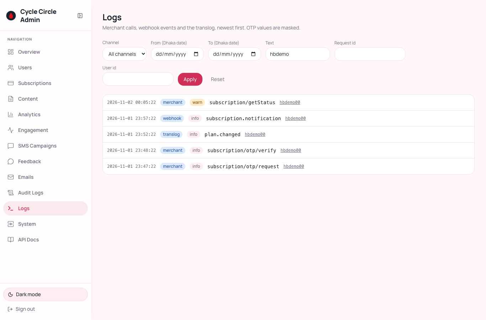
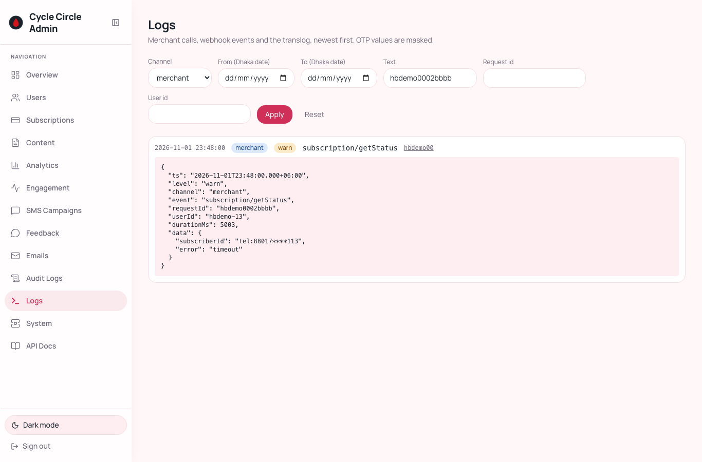
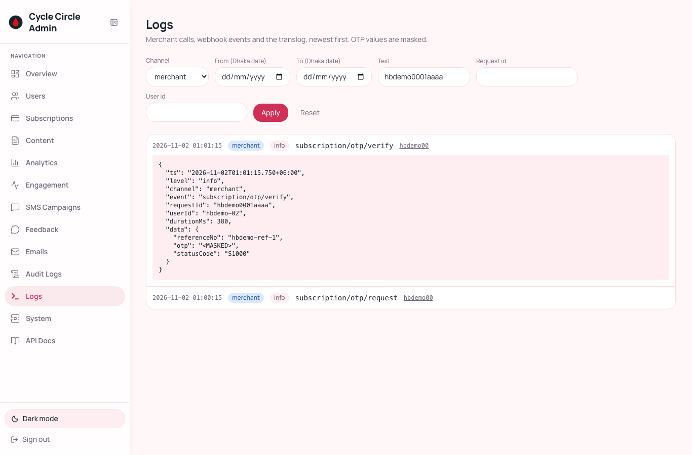

# Logs

The server's own diary, readable in the Admin app. Use it when something went wrong and you need to see what Cycle Circle sent to BDApps, what BDApps sent back, and which plan changes followed. For "which Admin did this?" use the [Audit log](#au-search) instead.

## Log channels {#lg-channels}

### What it is

Every line the servers write belongs to one of six **Log channels**: merchant, customer, webhook, translog, cron and error (GLOSSARY.md). Each channel is a folder of dated files, one file per Bangladesh day (ADR 0004). The Admin **Logs** page shows only three of the six.

| Channel | What a line records | Shown to Admins |
|---|---|---|
| merchant | A call Cycle Circle makes out to BDApps (OTP request and verify, subscription status, subscribe and unsubscribe, SMS), with BDApps' answer | Yes |
| webhook | A call BDApps makes into Cycle Circle (subscription notification, incoming SMS or USSD, delivery report) and what was done with it | Yes |
| translog | One plan change of a User: Free to Pro, Pro to Free, an Admin override or a charge, with who, from what, to what, and why | Yes |
| customer | Something a User did that matters operationally (logging in, requesting or verifying an OTP, adding a phone, unsubscribing, logging out) | No |
| cron | One run of a scheduled job, as one summary | No (see [Run history](#sy-runs) for the subscription check) |
| error | Errors that belong to no other channel, plus a copy of every error-level line | No |

### Where to find it

**Logs** in the sidebar, or `/logs`. The **Channel** menu in the filter row lists "All channels", merchant, webhook and translog. The screenshot shows the page with every channel selected, filtered by the demo text "hbdemo": a merchant, a webhook and a translog line.

### How to use it

1. Open **Logs**. With **Channel** on "All channels" the page mixes the three channels, newest first. The coloured label on each line says which channel it came from.
2. To read one channel, pick it in **Channel** and press **Apply**.
3. To find a User-side event (a User logging in, a User's OTP), look at the merchant lines that match the User, or the translog lines for their plan changes. The customer, cron and error channels are only on the server.

### Rules and limits

- The page reads the files live from disk. Nothing is cached, so a line appears as soon as the server has written it (writing is asynchronous, so allow a second).
- Files are named for the **Bangladesh** day (`YYYY-MM-DD.log`), so a new file starts at Bangladesh midnight. Past days are compressed.
- Clean-up on the server removes translog files after 400 days (the plan-change audit trail) and every other channel after 90 days. Searching further back finds nothing.
- Log lines contain everything the server wrote: phone numbers, masked BDApps IDs and one-time passwords. The page masks OTPs when it shows them ([OTP masking](#lg-masking)), but the files on the server are not masked. Passwords, tokens, cookies and the BDApps credentials are never written; they appear as `<REDACTED>`.
- The glossary names six channels; the page deliberately shows three. Requesting `?channel=customer` (or cron, or error) in the address is ignored and the page shows the three channels anyway.
- Every line of one request carries the same request ID, so one action can be followed across channels ([Logs viewer](#lg-viewer)).

### What can go wrong

| The Admin sees | Cause | Fix |
|---|---|---|
| "No log lines match these filters." | Nothing in the chosen days, channel or text, or the files are older than the clean-up limit | Press **Reset**, widen the dates, or pick "All channels" |
| A line you expected from the customer or cron channel is missing | Those channels are not shown on this page | Read the file on the server ([Troubleshooting](#ts-index)), or use [Run history](#sy-runs) for the subscription check |
| A log line from a minute ago is missing | The server writes lines asynchronously | Reload after a few seconds |

### Related

- Reading one line: [Logs viewer](#lg-viewer)
- Hidden digits: [OTP masking](#lg-masking)
- Plan changes of one User: [Plan history and Translog](#us-history)
- Admin actions: [Audit log search](#au-search)

## Logs viewer {#lg-viewer}

### What it is

The filter row, the list of lines and the "Older" and "Newest" links on the **Logs** page. Each line is one row: the time, the channel, the level, the event name, and a short request code you can press. Pressing the row opens the full line as formatted JSON.

### Where to find it

**Logs** in the sidebar. The screenshot shows one merchant line (a warning from a subscriber status call) opened.

### How to use it

1. Set any of the filters and press **Apply**:
   - **Channel**: "All channels", merchant, webhook or translog.
   - **From (Dhaka date)** and **To (Dhaka date)**: first and last day, both included.
   - **Text**: part of any word on the line, in any field. Capital letters do not matter.
   - **Request id**: the exact request ID.
   - **User id**: the User's ID. It matches the line's user and also the user ID inside the details (`userId` or `targetUserId`).
2. Read the list. Each row shows:
   - the time in Bangladesh time, to the second;
   - the channel label;
   - the level: "info", "warn" or "error";
   - the event name, for example `subscription/otp/verify`;
   - the first 8 characters of the request ID, as a link.
3. Press the time or the event name to open the line (pressing the request link instead jumps to step 4). The whole line shows as JSON with the keys `ts` (the time), `level`, `channel`, `event`, `requestId`, `userId`, `durationMs` (how long it took, in milliseconds) and `data` (the details).
4. Press the request link to see every line of that request: the **Request id** filter fills in, every other filter is cleared, and the list shows the merchant, webhook and translog lines of that one action.
5. The page shows 50 lines at a time. Press **Older** to go further back and **Newest** to return to the newest lines.
6. **Reset** clears all filters.

### Rules and limits

- Newest first. Within one second the order is the order the lines were written.
- Paging walks day by day and reads only the days it needs, so a narrow date range loads faster.
- **Text** looks at the masked line, so you cannot search for an OTP value (it has been replaced).
- **Request id** must match the whole ID, not a part of it; to search by part, use **Text**.
- The date boxes are Bangladesh days. A line written at 01:00 on 2 November Bangladesh time belongs to 2 November, even though it is still 1 November in UTC.
- The filters are in the page address, so a filtered view can be shared with another Admin.
- A line that is not valid JSON, or a file that cannot be read, is skipped without an error.

### What can go wrong

| The Admin sees | Cause | Fix |
|---|---|---|
| "No log lines match these filters." | The filters combine (all must match) | Remove filters one at a time, or press **Reset** |
| Pressing a row opens another page of lines | The press landed on the request code link, which filters by request | Press the time or the event name instead, or **Reset** |
| **Older** is missing | You are at the oldest day that still has a file | Nothing older is kept |
| A User's id search finds fewer lines than expected | Only lines carrying that User's id in `userId`, `data.userId` or `data.targetUserId` match | Search the phone number with **Text** as well |

### Related

- Channels explained: [Log channels](#lg-channels)
- Masked digits: [OTP masking](#lg-masking)
- Subscription check outcomes: [Run detail](#sy-run-detail)
- A User's plan history: [Plan history and Translog](#us-history)

## OTP masking {#lg-masking}

### What it is

When the Logs page shows a line that contains a one-time password, it replaces the digits with `<MASKED>`. An Admin can read that an OTP was sent or verified, but not the code.

### Where to find it

On every line of the **Logs** page, after you open it. The screenshot shows a merchant line for a verified OTP where the `otp` field reads `<MASKED>`.

### How to use it

1. Search for the event, for example **Text** `otp/verify`, with **Channel** set to merchant.
2. Open the line. The OTP fields show `<MASKED>`; the reference number, status and timing stay readable.
3. To check a User's login problem, compare the `statusCode` and `referenceNo` of the request and verify lines (same request ID) instead of the code.

### Rules and limits

- Masking is done **when the page reads the file**. The file on the server still holds the real code (ADR 0004). Treat the server's log directory as sensitive.
- What is masked: any field whose name contains otp, passcode, `verificationCode` or `verification_code`, or is exactly pin (a key written with a space, "verification code", is not matched); a field named `code` that holds 4 to 8 digits only; and digits that follow the words otp, code or the Bengali word for code inside a message text (for example "otp: 123456" or "your code is 123456"). It looks through the line down to 10 levels of nesting; text inside anything nested deeper is not masked.
- Only OTPs are masked. Phone numbers, BDApps masked IDs and other details are shown as written.
- The same masking applies to **Text** search and to the JSON you open, so a masked code cannot be found by searching.

### What can go wrong

| The Admin sees | Cause | Fix |
|---|---|---|
| `<MASKED>` where you wanted the code | By design | Ask the User to request a new OTP; the Admin app never shows OTPs |
| A search for the 6 digits finds nothing | The digits are masked before the search | Search by phone number or reference number |
| A number that is not an OTP is also masked | A field called `code` with 4 to 8 digits, or digits right after the word "code" in a message | Read the surrounding fields; the original value is only on the server |

### Related

- Reading a line: [Logs viewer](#lg-viewer)
- What the channels hold: [Log channels](#lg-channels)
- OTP rules for Users: [Phone login with a BDApps OTP](#gs-phone-login)
