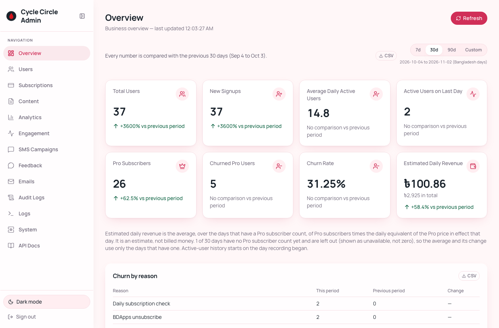
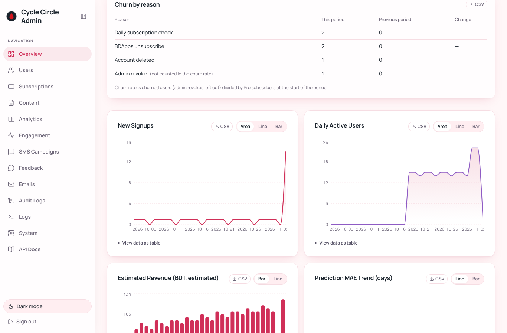
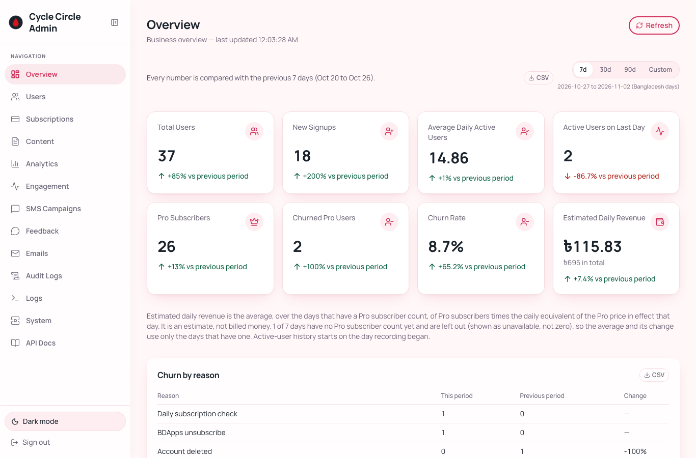
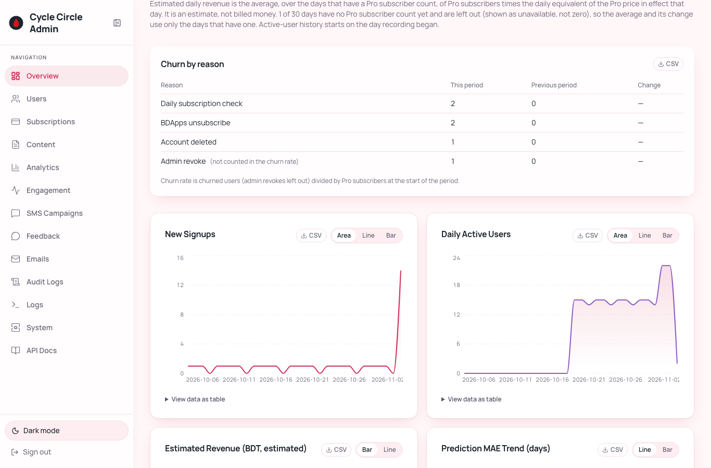

# Overview

The first page after signing in: the business in eight numbers, a table of why Pro Users left, and four charts. Every figure is for a **period** (default: the last 30 Bangladesh days including today) and is compared with the **previous period of the same length**. The page can be at most a minute old: the numbers are cached for 60 seconds, the header says when they were last computed ("Business overview — last updated" and the time, Bangladesh time), and **Refresh** recomputes them now.

## KPI cards {#ov-kpis}

### What it is

Eight cards, then a table and a note. Under each number is the change against the previous period, for example "+12.5% vs previous period" (green for up or equal, red for down) or "No comparison vs previous period" when no change can be worked out. Above the cards a line says which days are being compared: "Every number is compared with the previous 30 days (Sep 3 to Oct 2)."

| Card | What the number is |
|---|---|
| Total Users | Accounts that existed on the last day of the period and were not deleted by then. This counts every account row, so it includes Suspended Users, email-trial accounts and Admin accounts. |
| New Signups | Accounts created during the period, including any deleted since, and including Admin accounts. |
| Average Daily Active Users | The mean of the daily Active user counts over the period, rounded to 2 decimals. Only days on or after the first day activity was recorded are averaged. |
| Active Users on Last Day | The Active user count on the last day of the period. |
| Pro Subscribers | Pro Users at the end of the period. For past days this is the nightly stored count; for today it is the live count. |
| Churned Pro Users | Pro Users who stopped being Pro during the period, for any reason **except an Admin revoke**. |
| Churn Rate | Churned Pro Users divided by the Pro Subscribers at the end of the day before the period began, shown as a percentage. |
| Estimated Daily Revenue | The average, over the days that have a stored Pro count, of Pro Subscribers times the daily equivalent of the Pro price in effect that day. A smaller line shows the total in taka. |

Below the cards, **Churn by reason** lists, for this period, the previous period and the change: Daily subscription check, BDApps unsubscribe, Account deleted and Admin revoke (marked "not counted in the churn rate"). It has its own **CSV** button.

### Where to find it

**Overview** in the sidebar, or `/`.

### How to use it

1. Pick the period with the buttons **7d**, **30d**, **90d** or **Custom**. Under the buttons the page prints the exact days, "2026-10-03 to 2026-11-01 (Bangladesh days)".
2. For **Custom**, choose **From** and **To** and press **Apply**. The choice goes into the address (`?range=7d` or `?from=…&to=…`), so a link keeps the period.
3. Press **CSV** next to the date buttons for the "Overview numbers" file: one row per number with the columns Metric, This period, Previous period and Change %, followed by one row per churn reason. The churn table has its own **CSV** ("Churn by reason").
4. Press **Refresh** to bypass the one-minute cache.

### Rules and limits

- **Days are Bangladesh days** (UTC+6). A period ends at the end of today's Bangladesh day.
- Presets are 7, 30 and 90 days. A custom period can be at most **366 days**; an end day after today is cut back to today.
- **Percent change** is shown to one decimal. It is blank ("No comparison") when either side is unavailable, or when the previous figure was 0 and this one is not.
- **Unavailable** is not zero. Churn Rate is unavailable when no Pro count was stored for the day before the period (or that count was 0). Active-user figures are unavailable for a period that ends before recording began; "Active-user history starts on the day recording began." Days without a stored Pro count are left out of the revenue average, and the page says how many: "N of 30 days have no Pro subscriber count yet and are left out …".
- **Active user** (see [What counts as an Active user](#en-active)) never includes Suspended or deleted Users, judged by their status *now*. Suspending a User therefore also lowers the past daily counts.
- The nightly Pro count is stored late each Bangladesh day by the pro-snapshot job ([Daily Pro count](#an-pro-count)). If that job is off, recent days become "unavailable".
- **Estimated revenue is an estimate, never billed money.** The daily equivalent of the Pro price is: daily price as is, weekly price divided by 7, monthly price divided by the number of days in that month. The price in effect on each day comes from the price history ([Pro price](#sy-pro-price)).
- **Admin revokes are left out of Churned Pro Users and Churn Rate** because the Admin chose them; they still appear in the churn table and in the CSV ("in churn rate: no").
- Daily subscription check = the User fell out of Pro in the nightly BDApps check; BDApps unsubscribe = BDApps told us the number unsubscribed; Account deleted = an Admin deleted a Pro User (restoring that User within 30 days removes the event again).

### What can go wrong

| The Admin sees | Cause | Fix |
|---|---|---|
| "Unavailable" on Churn Rate or Pro Subscribers | No nightly Pro count is stored for the needed day | Check the pro-snapshot job on the [System page](#sy-jobs); the figure cannot be rebuilt for past days |
| "Unavailable" on both Active-user cards | The period ends before activity recording began | Choose a later period |
| "Pick both a start and an end day." | Custom period with one date empty | Fill both dates |
| "Use days written as YYYY-MM-DD." | A hand-edited address has a bad date | Use the date pickers |
| "The start day must not be in the future." | From is after today | Choose a past start |
| "The start day must not be after the end day." | From is later than To | Swap the dates |
| "Pick a range of 366 days or fewer." | The custom period is longer than a year | Shorten it; the page falls back to the last 30 days meanwhile |
| A number does not match another page | Pages count different things: Total Users here counts Admin and Suspended accounts; the [Users](#us-list) list defaults to Active only | Compare like with like; see each page's rules |
| A figure is a minute out of date | The 60-second cache | Press **Refresh** |
| A User's Pro status changed but the card did not | Same cache, or the change was an Admin action made seconds ago | Press **Refresh** |

### Related

- [Signup trend](#ov-signup-trend)
- [Churn](#an-churn)
- [Estimated revenue](#an-revenue)
- [Pro price](#sy-pro-price)
- [User list](#us-list)

## Signup trend {#ov-signup-trend}

### What it is

The **New Signups** chart under the churn table: one point per Bangladesh day in the period, the number of accounts created that day. Days with no signups show as 0. Next to it are **Daily Active Users**, **Estimated Revenue (BDT, estimated)** and **Prediction MAE Trend (days)** (the average error of period predictions, per prediction tier; see [Prediction accuracy](#an-prediction-accuracy)).

### Where to find it

On the Overview, below the **Churn by reason** table. It follows the same period as the cards.

### How to use it

1. Hover (or tap) a point to see the date and the count.
2. Switch the drawing with the **Area**, **Line** and **Bar** buttons on the chart.
3. Open "View data as table" under the chart to read the exact numbers.
4. Press the chart's **CSV** button for the days and counts of the current period.

### Rules and limits

- Counted by the Bangladesh day of the account's creation time.
- Counts every account created, including accounts deleted since and Admin accounts. It therefore equals the **New Signups** card.
- If no account was created in the period the chart says "No signups in this period".
- The [Users page](#us-list) has a separate "New signups" chart with its own 7d, 30d, 90d and 1y buttons; it does not follow the Overview's period.

### What can go wrong

| The Admin sees | Cause | Fix |
|---|---|---|
| "No signups in this period" | No account was created in the chosen days | Choose a longer period |
| A spike on one day | A bulk import or test accounts were created | Look at that day in the [User list](#us-list), sorted by Created |

### Related

- [KPI cards](#ov-kpis)
- [User list](#us-list)
