# SMS campaigns

An SMS **Campaign** is a named series of SMS messages sent to every Subscriber, one **Campaign message** per Bangladesh day (ADR 0010). A one-off SMS is simply a one-day campaign. Gaps between days are allowed, and a campaign can hold up to 120 messages.

Four rules shape everything on these pages:

- **One SMS a day, across all campaigns.** Two campaigns cannot both have a message on the same Bangladesh day. The Admin is stopped when planning, not at send time.
- **A message has a day, never a time.** Every message goes out at the one daily send time set on the System page (default 14:00 Bangladesh time, see [SMS send time](#sy-sms-time)). A scheduled job sends it ([Campaign SMS dispatch](#sj-sms-dispatch)).
- **A message is never sent late.** If its day passes without a send, it becomes **Missed** and stays Missed.
- **A failed message is never retried automatically.** The Admin decides: resend it on a free day.

Each message has one text, in English, Bengali or both mixed. There are no separate English and Bengali fields and no "send language" switch.

## Campaign list {#sm-list}

### What it is

The **SMS Campaigns** page. From top to bottom: a header ("N campaigns") with the **New Campaign** button, the date buttons (7d, 30d, 90d, Custom), two charts, a search box with a status filter, a **CSV** button, and the campaign table.

- **SMS Send History** counts campaign messages sent per Bangladesh day, for the chosen period.
- **Message Status Breakdown** counts all campaign messages by status (Planned, Sent, Failed, Missed, Cancelled, and so on). It is not cut by the period.

| Column | Shows |
|---|---|
| Campaign | The name, as a link to the campaign page |
| Days | One date for a one-day campaign, or "first date – last date (N days)". A blue "Next send" badge marks the campaign that holds the next planned message |
| Status | The campaign badge ("Planned", "Running", "Finished" or "Cancelled"), "N of M sent", a totals line ("1 sent · 1 failed to send · audience 18") and a delivery line ("Delivered 15 · Failed 2" or "Delivery reports off"). A red line repeats the first send error |
| Last sent | When the most recent message went out, in Bangladesh time |
| Created by | The Admin who created it |
| (icons) | Edit, Move to another day, Send Now, Delete (see below) |

The campaign badge is worked out from its messages: **Cancelled** once the campaign has been cancelled; **Planned** while nothing has been sent, failed or missed; **Finished** when no message is left to go out; otherwise **Running**.

### Where to find it

**SMS Campaigns** in the sidebar, or `/sms`.

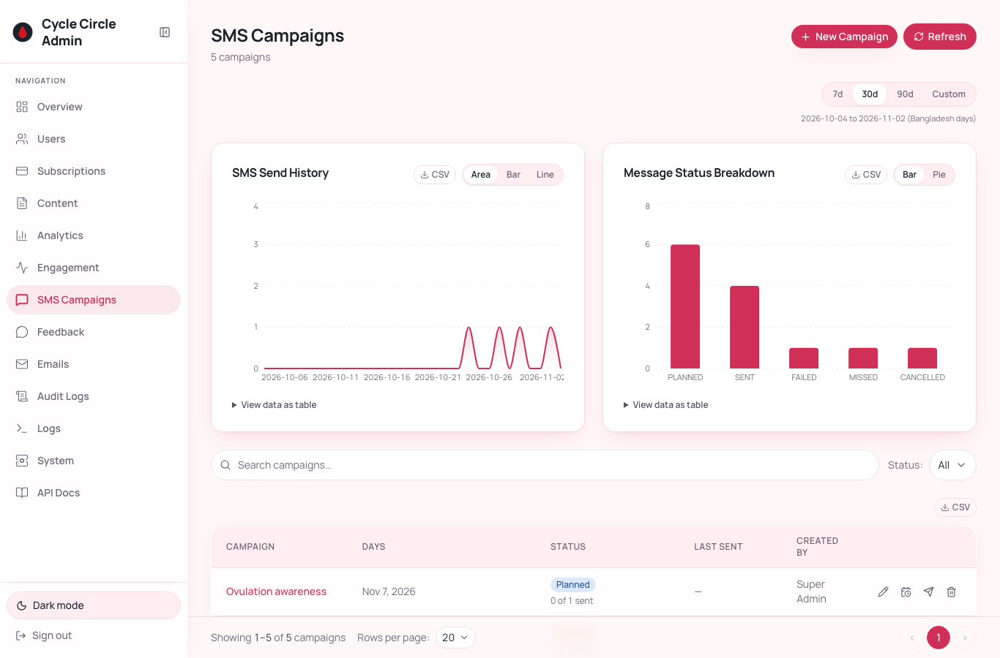

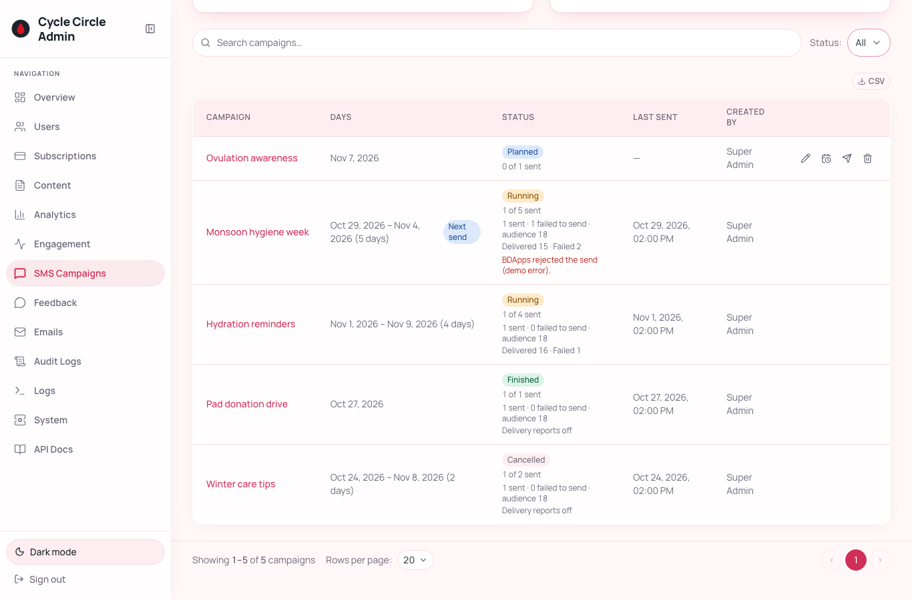

### How to use it

1. Press the date buttons to change the period. Only the **SMS Send History** chart follows it ([Date ranges](#an-ranges)); the table and the status chart always show everything.
2. Type in **Search campaigns…** to find a campaign by its name or by any of its message texts. Choose **Status** (All, Planned, Running, Finished, Cancelled) to narrow the table.
3. Click a campaign name to open it ([Per-message view](#sm-messages)).
4. A **one-day** campaign also has quick icons on its row: **Edit** (pencil), **Move to another day** (calendar), **Send Now** (paper plane) while its message is Planned, and **Delete** (bin) while nothing has gone out. A longer series is managed from its own page.
5. **CSV** downloads the whole filtered list (not just this page) with the columns ID, Name, Status, Messages, First day, Last day, Created by, Created.

### Rules and limits

- Newest created campaign first, 20 rows per page (the page size can be changed).
- The search and the status filter work across all pages. The search text is cut at 100 characters.
- The table is a planning list, so upcoming days are included whatever period is chosen. The CSV is the same, and it holds at most 10,000 rows. Each CSV download is written to the audit log ([What each entry means](#au-entries)).
- The "Next send" badge goes to the campaign with the earliest Planned message, ignoring cancelled campaigns.
- The page keeps its data for up to one minute. A send made by the scheduled job shows up within about a minute; press **Refresh** at the top to see it at once.
- "failed to send" counts only messages in the Failed state. Missed messages are not in that count (see the campaign page).

### What can go wrong

| The Admin sees | Cause | Fix |
|---|---|---|
| "No campaigns yet. Create the first one with New Campaign." | No campaign exists | Press **New Campaign** ([Create a campaign](#sm-create)) |
| "No campaigns match your filters." | The search or status excludes everything | Clear the search or choose **All** |
| A message that went out this morning is still "Planned" | The page was cached | Press **Refresh** |
| No icons on a campaign row | It has several messages, or its message is no longer Planned | Open the campaign |
| Toast "Could not delete the campaign" | The delete request failed | Try again; see [Cancel a campaign](#sm-cancel) for the delete rule |

### Related

- Next: [Create a campaign](#sm-create), [Per-message view](#sm-messages)
- Admin screen: [SMS send time](#sy-sms-time), [SMS delivery reports](#sy-delivery-reports)
- Automatic job: [Campaign SMS dispatch](#sj-sms-dispatch)
- What the Subscriber receives: [Campaign messages](#as-campaign-sms)

## Create a campaign {#sm-create}

### What it is

The **New SMS Campaign** window. It plans a campaign by typing in its days: a name, and one date and one text per message.

### Where to find it

**SMS Campaigns**, then the **New Campaign** button at the top right.

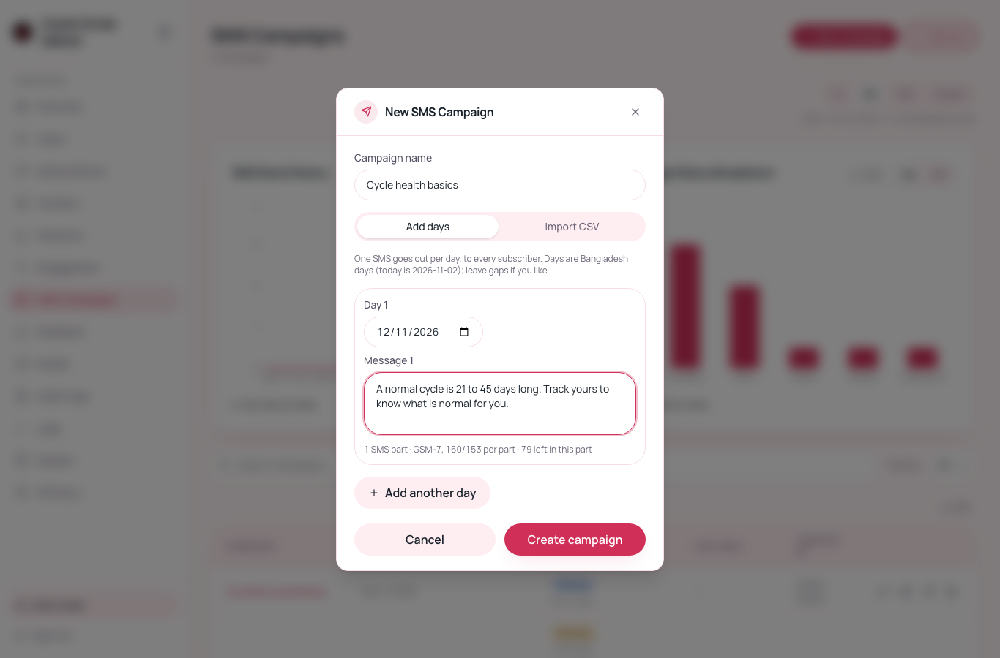

### How to use it

1. Type the **Campaign name** (for example "Monsoon hygiene week").
2. Stay on the **Add days** tab. Under **Day 1**, pick a date, then write **Message 1**. The line under the text shows how many SMS parts it uses.
3. Press **Add another day** for each further message and fill its **Day** and **Message**. The bin icon removes a day (there is no bin while only one day is left).
4. Press **Create campaign**. The window closes and the campaign appears at the top of the list as "Planned".

To bring in many days at once from a spreadsheet, use the **Import CSV** tab instead ([CSV import](#sm-import)).

### Rules and limits

- Campaign name: required, 80 characters at most.
- Up to 120 messages per campaign. **Add another day** is greyed out at 120.
- Each day is a **Bangladesh day**. Today is allowed; earlier days are refused. The window says "today is YYYY-MM-DD". The date field shows dates in your browser's format.
- No day may repeat inside the campaign, and no day may already hold a message that is Planned, Sending or Sent in **any** campaign. Days of Failed, Missed or Cancelled messages are free again.
- Message text: required. Counting: plain English text (GSM-7) is 160 characters in one part and 153 per part after that; text with Bengali letters (Unicode) is 70 and 67. Some symbols count double.
- The text may use up to **6 SMS parts**. Above 2 parts the counter turns amber ("Over 2 parts: every subscriber is charged for N SMS. Consider shortening the message."). Above 6 it is refused.
- Nothing is saved until **Create campaign** works: a refused campaign saves no days at all. The creation is written to the audit log.

### What can go wrong

| The Admin sees | Cause | Fix |
|---|---|---|
| "Give the campaign a name." | The name is empty | Type a name |
| "Pick a day for message N." | A day is blank | Pick the date |
| "Message N: YYYY-MM-DD is in the past." | The day is before today in Bangladesh | Pick today or a later day |
| "Message N: YYYY-MM-DD is used twice in this campaign." | Two days are the same | Change one |
| "Message N: Message cannot be empty." | A text is blank | Write the text, or remove the day |
| "Message N: Message is N SMS parts long; the limit is 6." | The text is too long | Shorten it |
| "Too long: the limit is 6 SMS parts. Shorten the message to plan it." (under the text) | Same, shown while typing | Shorten it |
| "A campaign can have at most 120 messages." | More than 120 days | Split into two campaigns |
| "YYYY-MM-DD already has a message in the campaign "NAME"" | Another campaign holds that day | Choose a free day, or move the other message first ([Schedule and reschedule](#sm-schedule)) |
| "One of those days was just taken by another campaign" | Another Admin planned that day a moment earlier | Choose another day |
| "Campaign name is too long (limit 80 characters)" | The name is over 80 characters | Shorten it |
| "Could not reach the server. Check your connection and try again." | Network problem | Try again |

### Related

- Admin screen: [CSV import](#sm-import), [Schedule and reschedule](#sm-schedule), [Campaign list](#sm-list)
- Admin screen: [SMS send time](#sy-sms-time)
- Audit trail: [What each entry means](#au-entries)

## CSV import {#sm-import}

### What it is

The **Import CSV** tab of the **New SMS Campaign** window. It creates one campaign from a spreadsheet file with one row per day. It is **all or nothing**: if any row is bad, the whole file is refused and nothing is saved.

### Where to find it

**SMS Campaigns**, **New Campaign**, then the **Import CSV** tab.

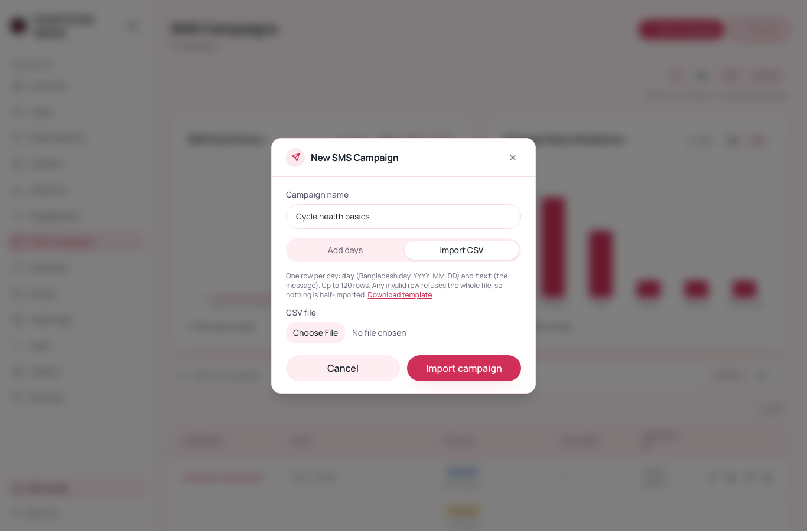

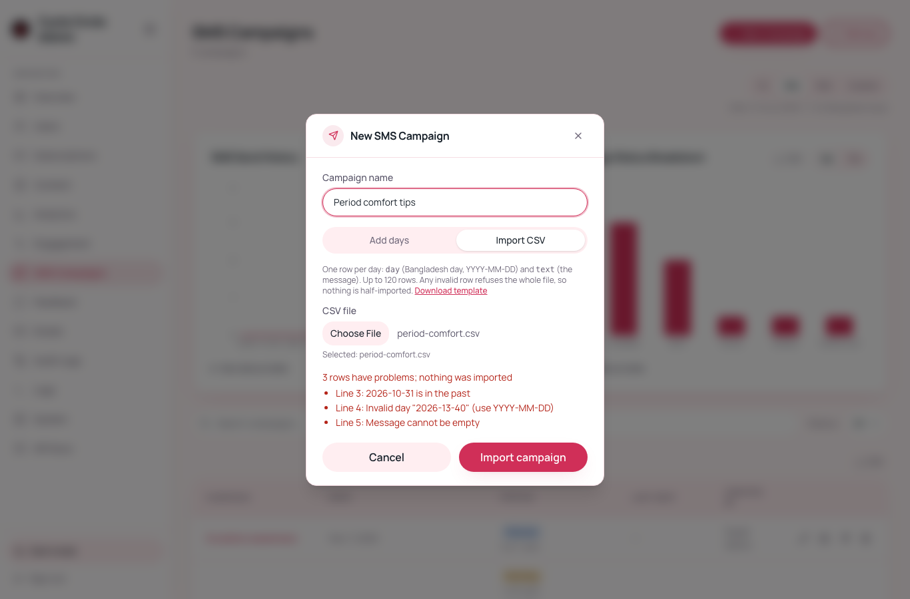

### How to use it

1. Open **Import CSV**. Press **Download template** to get `campaign-template.csv`, an example with two days starting tomorrow.
2. Fill the file: first row `day,text`, then one row per day, for example `2026-11-10,"Drink water today, stay hydrated."`. Put the text in quotes if it contains a comma. Save as CSV (UTF-8, so Bengali letters survive).
3. Type the **Campaign name**. Choose the file under **CSV file**. The window shows "Selected: file name".
4. Press **Import campaign**. If the file is accepted, the campaign appears in the list as "Planned".
5. If it is refused, read the red message and the list of lines below it, fix the file and choose it again.

### Rules and limits

- The first row must name the columns `day` and `text` (any order, capital letters do not matter). `day` is YYYY-MM-DD, a real Bangladesh day.
- Up to 120 rows. The file may be at most 200,000 characters. Empty rows are skipped.
- Every row follows the same rules as the **Add days** tab: no past day, no repeated day, no day held by another campaign, a non-empty text of 6 SMS parts or fewer.
- Every problem is listed by line number (the header is line 1). One problem shows as "Line N: ...". Several show "N rows have problems; nothing was imported" with the list under it.
- A successful import is written to the audit log as a campaign import.

### What can go wrong

| The Admin sees | Cause | Fix |
|---|---|---|
| "Give the campaign a name." | No name typed | Type a name |
| "Choose a CSV file to import." | No file chosen | Choose the file |
| "That file is too large to import." | Over 200,000 characters | Split it into several campaigns |
| "Could not read that file." | The browser could not open it | Save it again as CSV |
| "Line 1: The file is empty" | No content | Use the template |
| "Line 1: The header must have "day" and "text" columns" | The first row has other column names | Rename the header |
| "Line 1: The file has no rows" | Only a header | Add rows |
| "Line N: day is required" | A row has text but no day | Add the day |
| "Line N: Invalid day "..." (use YYYY-MM-DD)" | The day is not a real date or has the wrong format (for example 2026-13-40, or 10/11/2026) | Use YYYY-MM-DD |
| "Line N: YYYY-MM-DD is already used on line M" | The same day appears twice | Remove one row |
| "Line N: Message cannot be empty" | The text is blank | Fill it |
| "Line N: Message is N SMS parts long; the limit is 6" | The text is too long | Shorten it |
| "Line N: YYYY-MM-DD is in the past" | The day is before today | Change the day |
| "Line N: YYYY-MM-DD already has a message in the campaign "NAME"" | Another campaign holds the day | Choose a free day |
| "Line N: Too many rows: a campaign can have at most 120 messages" | More than 120 rows | Split the file |

### Related

- Admin screen: [Create a campaign](#sm-create), [Schedule and reschedule](#sm-schedule)
- Audit trail: [What each entry means](#au-entries)

## Schedule and reschedule {#sm-schedule}

### What it is

Changing the days of a campaign after it exists. An Admin can **move** a Planned message to another day, **add** a day to a campaign, **edit** a Planned message's text and **remove** a Planned message. First planning happens in [Create a campaign](#sm-create).

### Where to find it

Open the campaign (**SMS Campaigns**, then the campaign name). In the table, a Planned row has three icons: **Edit** (pencil), **Move to another day** (calendar) and **Remove from campaign** (X). **Add day** is at the top right.

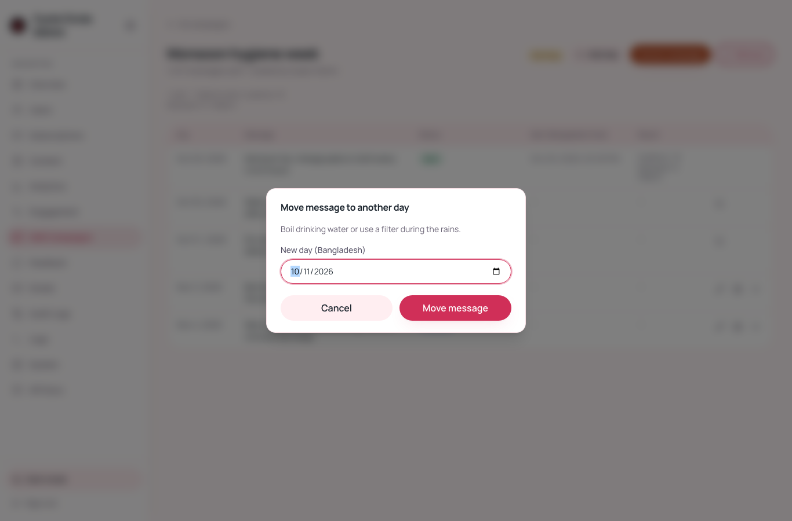

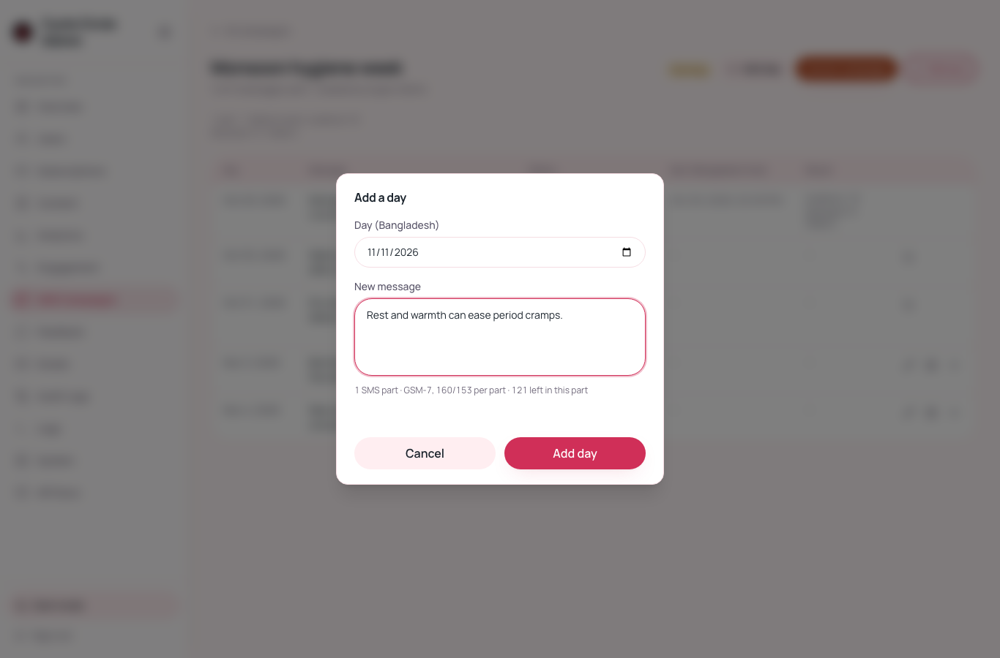

### How to use it

1. **Move:** press the calendar icon on a Planned row. In "Move message to another day" pick the **New day (Bangladesh)** and press **Move message**. A green toast says "Message moved".
2. **Add a day:** press **Add day**. In "Add a day" pick the **Day (Bangladesh)**, write the **New message** and press **Add day**. The toast says "Day added".
3. **Edit text:** press the pencil. In "Edit message" change the **Message** and press **Save changes**. The toast says "Message updated".
4. **Remove:** press the X, then **Remove** in "Remove this message?" ("The message for DATE will not be sent and the day becomes free again."). The toast says "Message removed".

A one-day campaign has the pencil and calendar icons straight on the list.

### Rules and limits

- Only a **Planned** message can be edited, moved or removed. Sent, Sending, Failed, Missed and Cancelled messages cannot. (To redo a Failed or Missed one, see [Resend failed messages](#sm-resend).)
- A **cancelled** campaign cannot be changed at all, and **Add day** is hidden on it.
- Days follow the same rules as planning: not in the past (today is allowed), and not a day that already carries a Planned, Sending or Sent message in any campaign. The message being moved does not clash with itself.
- Moving a message never moves the other days of the campaign.
- The last remaining message of a campaign cannot be removed; delete the campaign instead.
- A campaign holds at most 120 messages.
- The text must not be empty and may use at most 6 SMS parts. The **Add a day** and **Edit message** boxes also stop at 480 characters, which is stricter than the composer for plain English text (480 characters is 4 parts).
- The send time cannot be chosen per message; it is the single daily send time ([SMS send time](#sy-sms-time)).
- Each change is written to the audit log (add, update, reschedule, remove).

### What can go wrong

| The Admin sees | Cause | Fix |
|---|---|---|
| "Pick a day." | The date field is empty | Pick a date |
| "Message cannot be empty." | The text is blank | Write the text |
| "YYYY-MM-DD is in the past" | The day is before today | Pick today or later |
| "YYYY-MM-DD already has a message in the campaign "NAME"" | Another message holds that day | Pick a free day |
| "YYYY-MM-DD was just taken by another campaign" | Another Admin took the day a moment earlier | Pick another day |
| "A sent message cannot be changed" | The message went out | Nothing to do; add a new day instead |
| "A message that is sending cannot be changed" | It is being sent right now | Wait and refresh |
| "A failed message cannot be changed" / "A missed message cannot be changed" / "A cancelled message cannot be changed" | Only Planned messages are editable | Resend a Failed or Missed one ([Resend failed messages](#sm-resend)) |
| "A cancelled campaign cannot be changed" / "A cancelled campaign cannot get new messages" | The campaign is cancelled | Create a new campaign |
| "This is the campaign's last message; delete the campaign instead" | Removing the only message | Delete the campaign |
| "This message can no longer be removed" | The message was sent or changed a moment ago | Refresh the page |
| "A campaign can have at most 120 messages." | The campaign is full | Create another campaign |
| "Message not found" | It was deleted meanwhile | Refresh the page |

### Related

- Admin screen: [Create a campaign](#sm-create), [Resend failed messages](#sm-resend), [Cancel a campaign](#sm-cancel)
- Admin screen: [SMS send time](#sy-sms-time)
- Automatic job: [Campaign SMS dispatch](#sj-sms-dispatch)

## Send a campaign {#sm-send}

### What it is

How a campaign message reaches Subscribers. Normally nobody presses anything: on the message's day, once the daily send time has passed, the scheduled job sends it. An Admin can also send a Planned message immediately with **Send Now**.

### Where to find it

**Send Now** is the paper-plane icon on the list row of a **one-day** campaign whose message is Planned. A campaign with several days has no Send Now button; its days go out on their own.

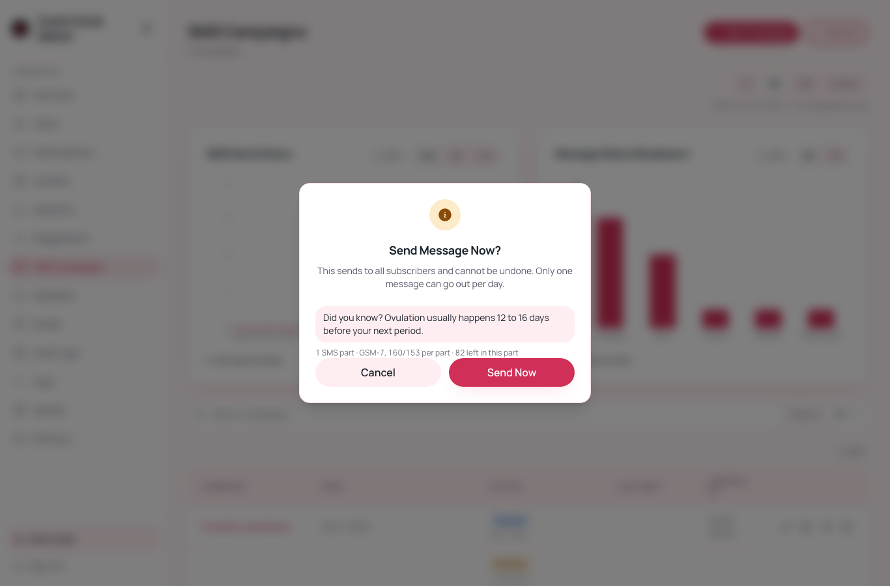

### How to use it

**Automatically:**
1. Plan the day. Do nothing else.
2. On that Bangladesh day, once the send time has passed (14:00 unless changed), the next run of the scheduled job sends it to all Subscribers.

**Manually:**
1. On **SMS Campaigns**, press the paper-plane icon on a Planned one-day campaign.
2. Read the window "Send Message Now?" and the preview of the text with its SMS parts.
3. Press **Send Now**. A green toast says "Message sent". The status becomes "Sent" and the time appears under **Last sent**.

### Rules and limits

- The message goes to **all Subscribers** (BDApps "tel:all"). It cannot be aimed at a few people.
- **Send Now cannot be undone.** A manual send is written to the audit log as a manual SMS send; the job's send is logged as a dispatch under the campaign creator's name. Both use the older "broadcast" wording in the audit log.
- Only a Planned message can be sent. It is claimed first, so a double click or a click that races the job sends **once**.
- The dialog says "Only one message can go out per day." That is true of planning, but Send Now itself does not check it: an Admin can send a Planned message on a day other than its own, and the message keeps its planned day.
- If BDApps refuses or cannot be reached, the message becomes **Failed to send**, the reason appears in red, and nothing is retried automatically.
- If the process stops mid-send and the message is still "Sending" after 30 minutes, it is closed as Failed with "Outcome unknown: sending did not finish. Check whether subscribers received it before rescheduling." Check with BDApps or a handset before resending.
- A message whose day passes without a send becomes **Missed** with "Missed: not sent on its day." It is never sent late.
- "Audience" is our own estimate: Users with a Pro subscription and a stored BDApps subscriber number at the time of sending. BDApps does not return a count.

### What can go wrong

| The Admin sees | Cause | Fix |
|---|---|---|
| Toast with the BDApps error, and the message shows "Failed to send" | BDApps rejected or could not be reached | Read the red text, then [resend it](#sm-resend) on a free day |
| "Cannot send a message with status SENT" (or FAILED, MISSED, CANCELLED) | The message is no longer Planned | Refresh; if it is Failed or Missed, resend it |
| "This message is already being sent" | Another click or the job claimed it first | Wait, then refresh |
| "The message was sent, but saving its status failed. Do not send it again; it will be reviewed within a day." | The SMS went out but our database write failed | Do not resend; check later |
| The day arrived but the message is still Planned | The send time has not passed yet, or the job is switched off | Check [SMS send time](#sy-sms-time) and [Job on/off switches](#sy-jobs) |
| The message turned "Missed" | Nobody sent it on its day and the job did not run | Resend it on a free day; check the job |
| "Failed to send" with "Outcome unknown..." | The send was interrupted | Check whether it arrived, then resend |

### Related

- Admin screen: [SMS send time](#sy-sms-time), [Job on/off switches](#sy-jobs)
- Admin screen: [Resend failed messages](#sm-resend), [Delivery status](#sm-delivery)
- Automatic job: [Campaign SMS dispatch](#sj-sms-dispatch)
- What the Subscriber receives: [Campaign messages](#as-campaign-sms)

## Resend failed messages {#sm-resend}

### What it is

Plans a **Failed** or **Missed** message again, with the same text, on a free Bangladesh day. The old day stays in the history as Failed or Missed; the new one is a fresh Planned message in the same campaign.

### Where to find it

Open the campaign. A Failed or Missed row has a circular-arrow icon, **Resend on a free day**.

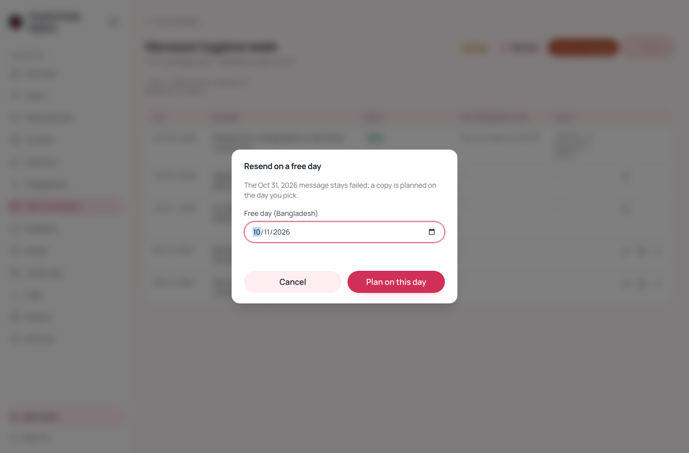

### How to use it

1. Open the campaign and find the Failed or Missed row.
2. Press the circular-arrow icon. The window "Resend on a free day" says "The DATE message stays failed; a copy is planned on the day you pick." (it says "missed" for a Missed message).
3. Pick the **Free day (Bangladesh)** and press **Plan on this day**. The toast says "Message planned again".
4. The new row appears in day order as "Planned".

### Rules and limits

- Only Failed and Missed messages can be resent. The button is hidden on a cancelled campaign.
- The new day follows the planning rules: today or later, and not held by another Planned, Sending or Sent message in any campaign.
- The original is never edited or moved, and later days of the campaign never shift.
- Check that the first attempt really did not go out (see the "Outcome unknown" case in [Send a campaign](#sm-send)) before resending, or Subscribers may get the text twice.
- A resend is written to the audit log. The list totals keep counting the old row as "failed to send".

### What can go wrong

| The Admin sees | Cause | Fix |
|---|---|---|
| "Pick a day." | No date chosen | Pick a date |
| "YYYY-MM-DD is in the past" | Day before today | Pick today or later |
| "YYYY-MM-DD already has a message in the campaign "NAME"" | The day is taken | Pick a free day |
| "Only a failed or missed message can be resent" | The message is Planned, Sent or Cancelled | Refresh; nothing to resend |
| "A cancelled campaign cannot get new messages" | The campaign was cancelled | Create a new campaign |
| "A campaign can have at most 120 messages." | The campaign is full | Create a new campaign |

### Related

- Admin screen: [Per-message view](#sm-messages), [Send a campaign](#sm-send)
- Admin screen: [Schedule and reschedule](#sm-schedule)

## Cancel a campaign {#sm-cancel}

### What it is

Stops the rest of a campaign. Days not yet sent are cancelled; days already sent stay in the history. The campaign then reads "Cancelled, N of M sent". A campaign that has not sent anything can be **deleted** instead, which removes it completely.

### Where to find it

On the campaign page, the red **Cancel campaign** button (while at least one message is Planned) and the **Delete campaign** button (while no message is Sent or Sending). On the list, a campaign's bin icon is the same delete.

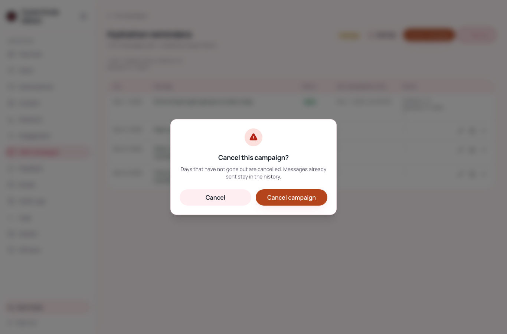

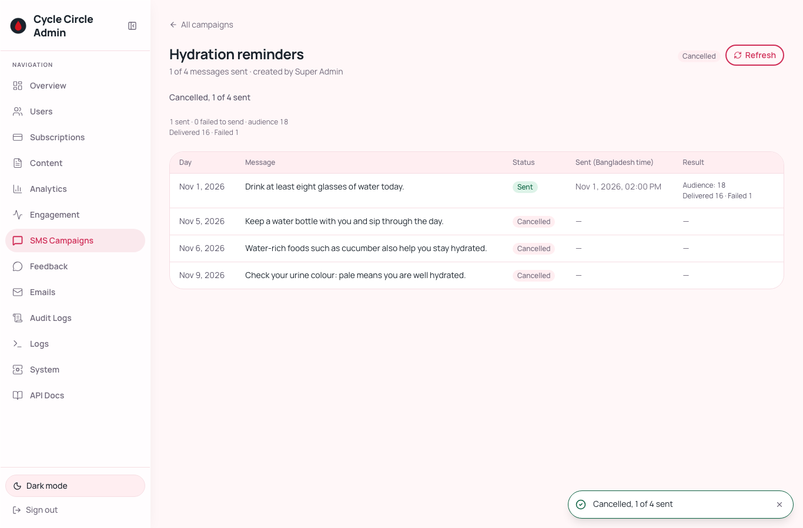

### How to use it

**Cancel:**
1. Open the campaign and press **Cancel campaign**.
2. The window "Cancel this campaign?" says "Days that have not gone out are cancelled. Messages already sent stay in the history." Press **Cancel campaign** to confirm.
3. The toast says "Cancelled, N of M sent", and the page shows the same line under the title.

**Delete:**
1. Press **Delete campaign** on the campaign page (window "Delete this campaign?"), or the bin on the list (window "Delete Campaign?", "Delete the campaign "NAME"? This cannot be undone.").
2. Press **Delete**. The toast says "Campaign deleted".

### Rules and limits

- Cancelling turns every **Planned** message into Cancelled and frees its day for other campaigns. Sent, Sending, Failed and Missed messages stay as they are.
- A cancelled campaign cannot be changed, extended, resent or cancelled again. It cannot be un-cancelled.
- Delete is allowed only while no message is **Sent** or **Sending**. A campaign with Failed or Missed days can still be deleted. Delete erases the campaign and all its messages for good.
- Nothing already sent can be recalled.
- Cancel and delete are written to the audit log.

### What can go wrong

| The Admin sees | Cause | Fix |
|---|---|---|
| "This campaign is already cancelled" | It was cancelled before | Nothing to do |
| "Cannot delete a campaign that has sent, or is sending, a message" | At least one message went out | Cancel it instead |
| No **Cancel campaign** button | The campaign is already cancelled or has no Planned day | Nothing to cancel |
| No **Delete campaign** button | A message is Sent or Sending | Cancel it instead |
| Toast "Could not cancel the campaign" / "Could not delete the campaign" | The request failed | Refresh and try again |
| "Campaign not found" | Someone deleted it | Go back to the list |

### Related

- Admin screen: [Per-message view](#sm-messages), [Campaign list](#sm-list)
- Audit trail: [What each entry means](#au-entries)

## Per-message view {#sm-messages}

### What it is

The page for one campaign: every day's message, its status, when it went out and what it reached.

### Where to find it

Click a campaign name on the list, or open `/sms/<campaign id>`.

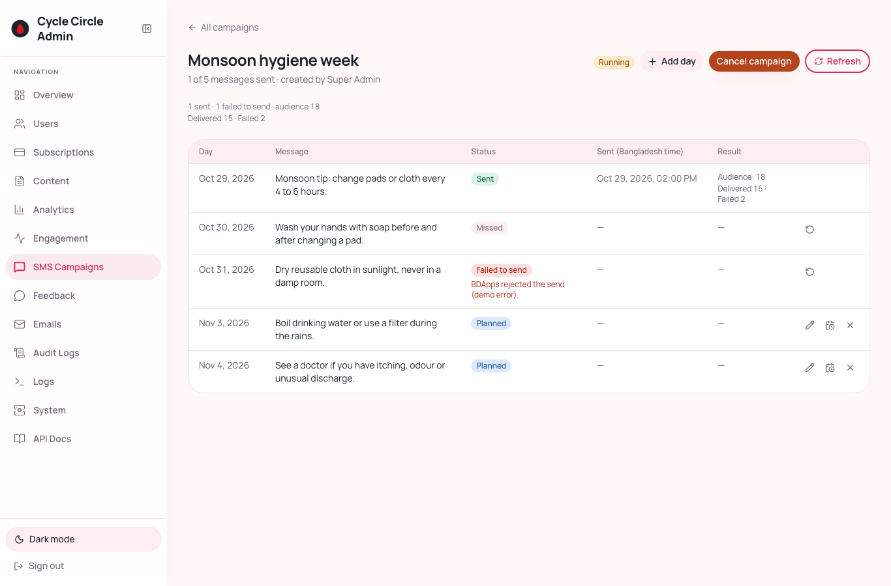

### How to use it

1. Read the header: the name, the campaign badge, "N of M messages sent · created by NAME".
2. Read the line of totals under the header ([Delivery status](#sm-delivery)).
3. Read the table: one row per day, in day order.

| Column | Shows |
|---|---|
| Day | The Bangladesh day |
| Message | The text |
| Status | "Planned", "Sending", "Sent", "Failed to send", "Missed" or "Cancelled". A Failed message also shows its error in red |
| Sent (Bangladesh time) | When it went out |
| Result | "Audience: N", then "Delivered N · Failed N" or "Delivery reports off" (only for Sent messages) |
| (icons) | Edit, Move to another day, Remove from campaign (Planned rows); Resend on a free day (Failed and Missed rows) |

4. Use **Add day**, **Cancel campaign** and **Delete campaign** at the top right ([Schedule and reschedule](#sm-schedule), [Cancel a campaign](#sm-cancel)). **All campaigns** at the top left goes back to the list.

### Rules and limits

- Times are Bangladesh time. A Sent message shows the real send moment, which can be later than the send time because the job runs repeatedly.
- The page keeps its data for up to a minute; press **Refresh** for the newest state.
- The campaign page has no **Send Now**: that exists only on the list, for one-day campaigns.
- The totals line counts "N failed to send" for Failed messages only. Missed messages show in the table but not in that count.
- Status meaning: Planned (waiting for its day), Sending (being sent right now), Sent (BDApps accepted it), Failed to send (BDApps refused or the send was interrupted), Missed (its day passed unsent), Cancelled (cancelled with the campaign).

### What can go wrong

| The Admin sees | Cause | Fix |
|---|---|---|
| The page is "not found" | Wrong or deleted campaign | Go back to the list |
| A row stuck on "Sending" | A send is in progress, or was interrupted | After 30 minutes it becomes Failed ("Outcome unknown..."); see [Send a campaign](#sm-send) |
| "Missed" on a day | The day passed without a send | Resend it ([Resend failed messages](#sm-resend)) and check the job |
| No icons on a row | The message is Sent, Sending or Cancelled, or the campaign is cancelled | Nothing can be done to it |
| Delete dialog says "Nothing has been sent" while rows are Failed | The wording ignores Failed and Missed rows | Nothing is lost: they were never delivered |

### Related

- Admin screen: [Delivery status](#sm-delivery), [Resend failed messages](#sm-resend)
- Admin screen: [Campaign list](#sm-list)

## Delivery status {#sm-delivery}

### What it is

How to tell whether a campaign reached people. There are two levels: **message status** (did we hand the SMS to BDApps?) and **delivery counts** (did the phones receive it?).

### Where to find it

The totals lines on the list and under the campaign title, and the **Result** column on the campaign page.

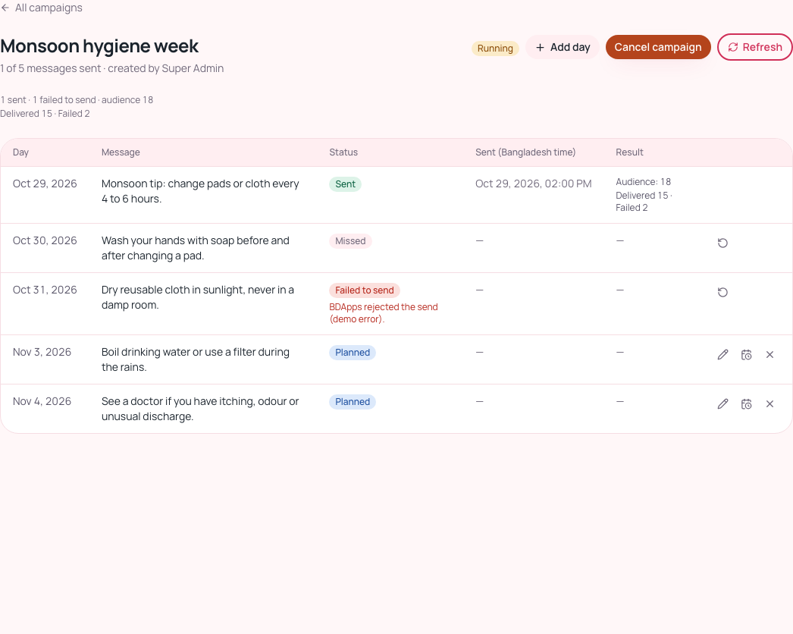

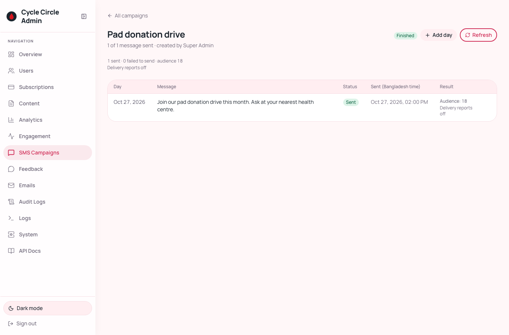

### How to use it

1. For a quick view, open the list: the **Status** column shows "N of M sent", "N sent · N failed to send · audience N" and the delivery line.
2. For one message, open the campaign: **Result** shows "Audience: N" and, if reports are on, "Delivered N · Failed N".
3. If it says "Delivery reports off", the send did not ask BDApps for reports, so no delivered or failed numbers exist. That is not an error and the zero is not real.
4. To get delivery counts for future messages, an Admin turns on the switch under [SMS delivery reports](#sy-delivery-reports).

### Rules and limits

- **Audience** is an estimate from our own records at send time (Pro subscriptions with a stored BDApps subscriber number), not a number from BDApps. Someone who unsubscribed on BDApps since the last check still counts.
- **Delivered** and **Failed** come from BDApps delivery reports that arrive after the send, one per recipient, so the numbers grow for a while. The first values after a send are "Delivered 0 · Failed 0".
- Counted as delivered: DELIVERED. Counted as failed: FAILED, UNDELIVERABLE, EXPIRED, DELETED, REJECTED. Reports still in flight (ACCEPTED) or UNKNOWN are not counted.
- Reports are matched to the message by BDApps' request number. A report that matches nothing is ignored.
- The switch is **off** by default. The BDApps SMS plan in use has delivery reports disabled; if they are requested on such a plan, BDApps refuses the whole send (error E1312). Turn the switch on only when the plan allows it.
- The switch is read at send time: a message sent while it was off stays "Delivery reports off" for good.
- The page also has **Message Status Breakdown** (all messages by status) and **SMS Send History** (messages sent per day), see [Campaign list](#sm-list).

### What can go wrong

| The Admin sees | Cause | Fix |
|---|---|---|
| "Delivery reports off" | Reports were not requested for that send | Normal. Turn the switch on for future sends if the plan allows |
| "Delivered 0 · Failed 0" long after the send | No reports have arrived (plan or webhook problem) | Check with BDApps; see [Emails and SMS](#ts-notifications) |
| Delivered plus Failed is lower than the audience | Reports are still arriving, or some are in flight, or the audience estimate is high | Wait and refresh |
| "Audience: -" | The audience could not be counted | Not an error; the send still happened |
| The send failed with an "E1312" message | Reports were switched on but the plan does not allow them | Switch **SMS delivery reports** off, then resend |
| Totals differ from what BDApps shows | Audience is an estimate | Trust BDApps for exact numbers |

### Related

- Admin screen: [SMS delivery reports](#sy-delivery-reports), [Per-message view](#sm-messages)
- Automatic job: [Campaign SMS dispatch](#sj-sms-dispatch)
- Troubleshooting: [Emails and SMS](#ts-notifications)
