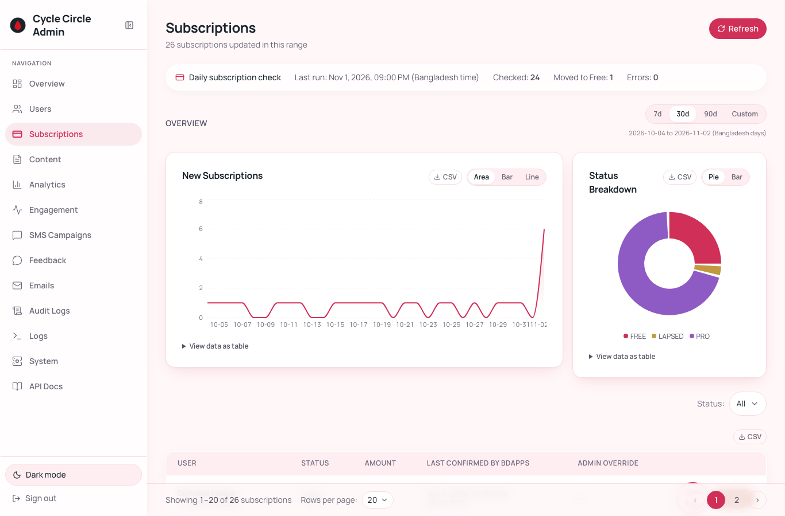
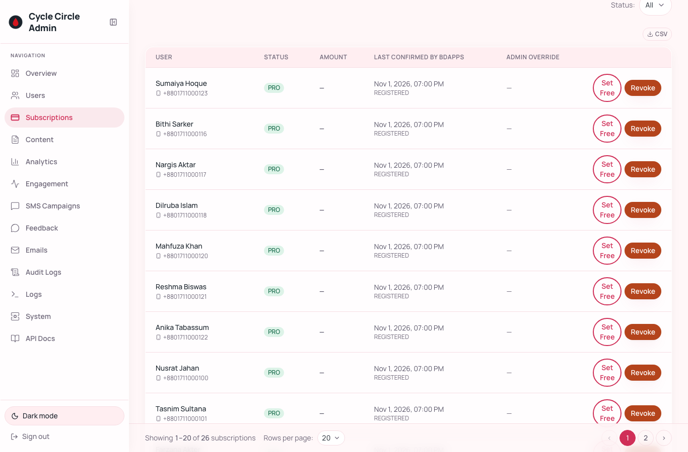
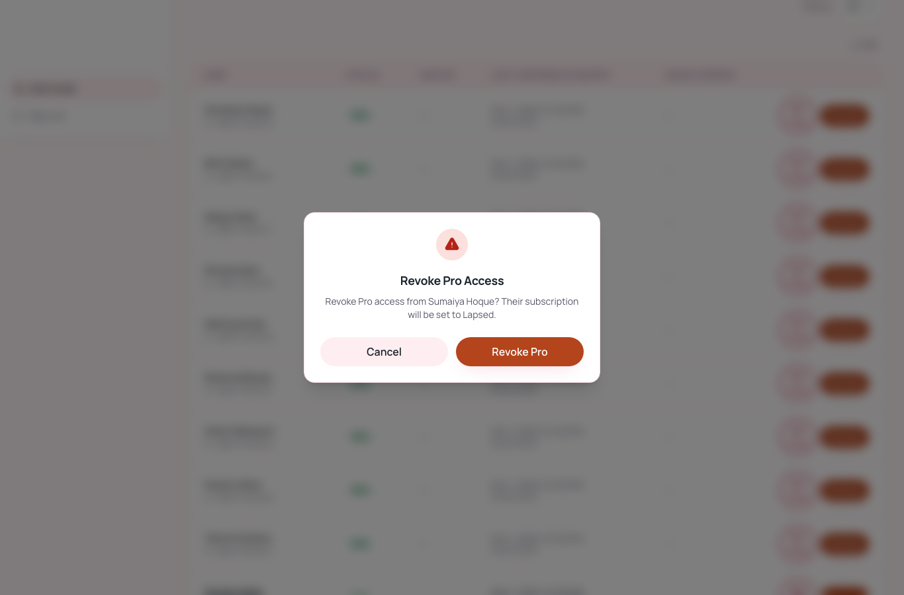
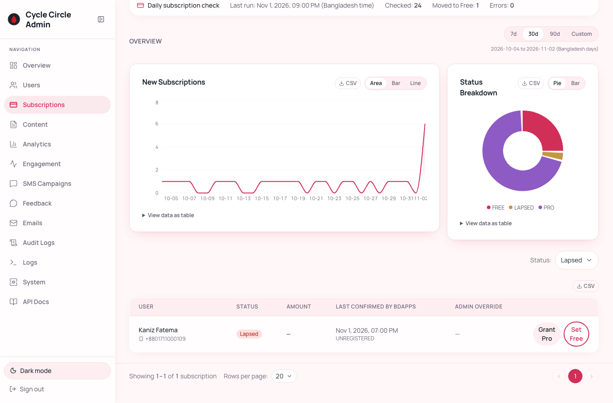

# Subscriptions

One row per subscription record (the plan record behind a User), with the BDApps check status and the buttons to change the plan from the list. The page answers "who is Pro, who is Lapsed, when did BDApps last confirm it, and which plans did an Admin set by hand?"

## Subscriptions list {#su-list}

### What it is

The **Subscriptions** page. From top to bottom:

- A header: "N subscriptions updated in this range".
- The **Daily subscription check** strip: "Last run: Nov 1, 2026, 05:10 AM (Bangladesh time)", then "Checked", "Moved to Free" and "Errors" counts. A yellow warning appears when the check never ran, failed, was skipped or ran more than a day ago.
- An **Overview** block with the date buttons (7d, 30d, 90d, Custom), a **New Subscriptions** chart (subscription records created per day) and a **Status Breakdown** chart (Users per plan).
- A status filter, a **CSV** button, and the table.

| Column | Shows |
|---|---|
| User | Name, email and phone |
| Status | "PRO", "Lapsed" or "Free" badge |
| Amount | Amount charged in taka, or a dash |
| Last confirmed by BDApps | When BDApps last answered the daily check, with the status it reported (for example REGISTERED), or "never" |
| Admin Override | An "Override" badge if an Admin set this plan; otherwise a dash |
| (buttons) | **Grant Pro**, **Set Free**, **Revoke** |

### Where to find it

**Subscriptions** in the sidebar, or `/subscriptions`.

### How to use it

1. Choose the period with the date buttons; the list, count and **New Subscriptions** chart follow it ([Date ranges](#an-ranges) describes the shared control).
2. Use the buttons on a row. Which buttons appear depends on the row's plan:
   - Not Pro: **Grant Pro**. Confirm window "Grant Pro Access": "Grant Pro access to <name>? This will override their current subscription status."
   - Not Free: **Set Free**. Window "Set Subscription to Free": "Set <name>'s subscription to Free? This will remove any active Pro or Lapsed status."
   - Pro: **Revoke**. Window "Revoke Pro Access": "Revoke Pro access from <name>? Their subscription will be set to Lapsed."
3. After confirming, a green toast says "Pro access granted", "Subscription set to Free" or "Pro access revoked", and the list refreshes.
4. Press **CSV** to download the table (see rules).

### Rules and limits

- **What the buttons do** is the same as the plan menu on the User page ([Set subscription status](#us-set-status)): the change is stored as an Admin override and written to the audit log (as SUBSCRIPTION_SET_PRO, SUBSCRIPTION_SET_LAPSED or SUBSCRIPTION_SET_FREE, not the older PRO_GRANTED and PRO_REVOKED) and the Translog. **Set Free** and **Revoke** also **unsubscribe the number on BDApps** (ADR 0006) and, if the User was Pro, record an "Admin revoke" churn event. **Grant Pro** does not subscribe the number on BDApps.
- **Revoke leaves the User Lapsed, not Free**, while **Set Free** leaves them Free. The glossary says Revoke is "Pro to Free"; on this page Revoke ends in Lapsed.
- The list shows subscription records **updated** inside the chosen period, newest update first, not all records. A change made today moves a record into the current period. The header count says "updated in this range".
- A User can appear even if deleted or Suspended: the table is built from subscription records, not from the User list.
- The **Status Breakdown** chart counts **Users** (not records) by plan, for non-deleted Users, regardless of the period. Its numbers can differ from the table.
- **Amount** is shown in taka from a stored paisa value (divided by 100). Subscriptions created by the normal login flow do not store an amount, so the column is usually a dash.
- The status filter values are All, PRO, FREE and Lapsed. The default is All.
- Page sizes 10, 20, 50 and 100 (default 20).
- **CSV** exports the whole filtered table, not just the page, for the chosen period and filter, to a maximum of 10,000 rows. Columns: ID, User, Phone, Email, Status, Amount, Payment, Admin override, Last confirmed, Created, Updated. Timestamps are UTC. Each export is written to the audit log because it contains contact details.
- The list and charts are cached for up to a minute; use **Refresh** at the top.
- The daily check strip reports the latest run of the nightly job that asks BDApps about each Subscriber ([Run the subscription check manually](#sy-manual-sub-check)). "Moved to Free" counts Users the check demoted because BDApps no longer reports them as subscribed.

### What can go wrong

| The Admin sees | Cause | Fix |
|---|---|---|
| Yellow warning "The daily subscription check has never run." | The job was never run in this environment | Run it from the [System page](#sy-manual-sub-check) and check the host's scheduler |
| "The last daily subscription check failed." (with the error) | BDApps unreachable or a job error | Open the run in [Run detail](#sy-run-detail), fix the cause, run it again |
| "The last run was skipped because the job is switched off. No subscribers were checked." | The job's switch on the System page is off | Switch it on ([Job on/off switches](#sy-jobs)) |
| "The last daily subscription check ran more than a day ago." | The scheduler missed a day | Check the scheduler; run the check manually |
| Red toast "Plan changed, but the BDApps unsubscribe failed: <error>. The user may still be charged." | Set Free or Revoke worked in our system; BDApps did not unsubscribe | Ask BDApps to unsubscribe the number |
| Red toast "Could not update the subscription" | The change failed | Retry; look in [Logs](#lg-viewer) |
| "No subscriptions match your filters." | No record in the period matches the status filter | Widen the period or set the status to All |
| A User expected in the list is missing | Their record was last updated outside the period | Choose a longer period, or find them in the [User list](#us-list) |

### Related

- [Status filter](#su-filter)
- [Grant and revoke Pro](#us-pro-override)
- [Admin overrides and billing](#pa-admin-overrides)
- [Run the subscription check manually](#sy-manual-sub-check)

## Status filter {#su-filter}

### What it is

The **Status** menu above the table with the choices All, PRO, FREE and Lapsed.

### Where to find it

Subscriptions page, between the charts and the table.

### How to use it

1. Open **Status** and choose a plan. The table and the count show only records with that plan.
2. Choose **All** to remove the filter.

### Rules and limits

- The filter follows the stored plan of the **subscription record**, which is normally the same as the User's plan.
- It combines with the date buttons: both must match.
- The filter is kept in the address (`?status=LAPSED`), and the **CSV** button exports exactly the filtered table.
- There is no search box on this page; find a person by name on the [Users page](#us-search-filters).
- Changing the filter returns to page 1.

### What can go wrong

| The Admin sees | Cause | Fix |
|---|---|---|
| "No subscriptions match your filters." | No record with that plan updated in the period | Widen the period |

### Related

- [Subscriptions list](#su-list)
- [Lapsed](#pa-lapsed)
