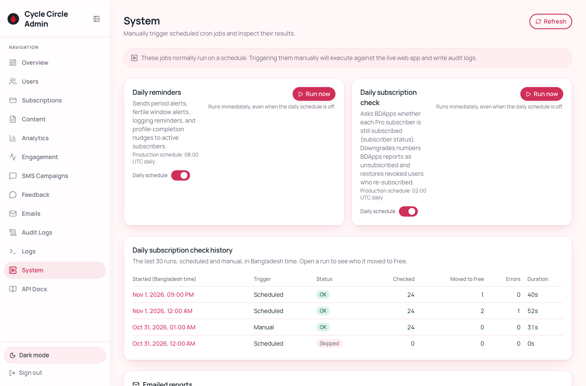
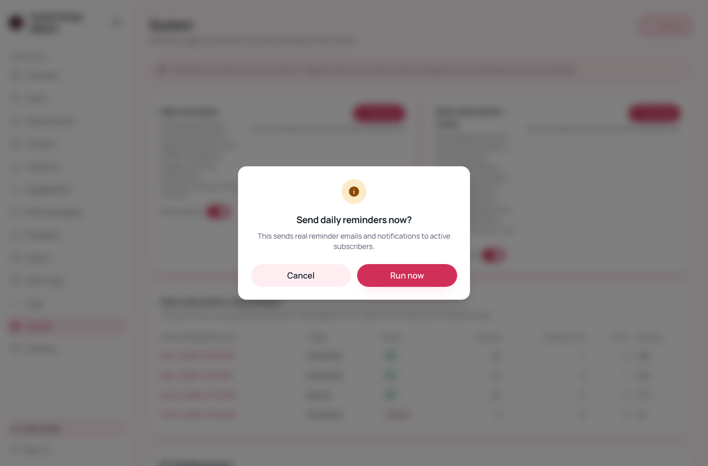
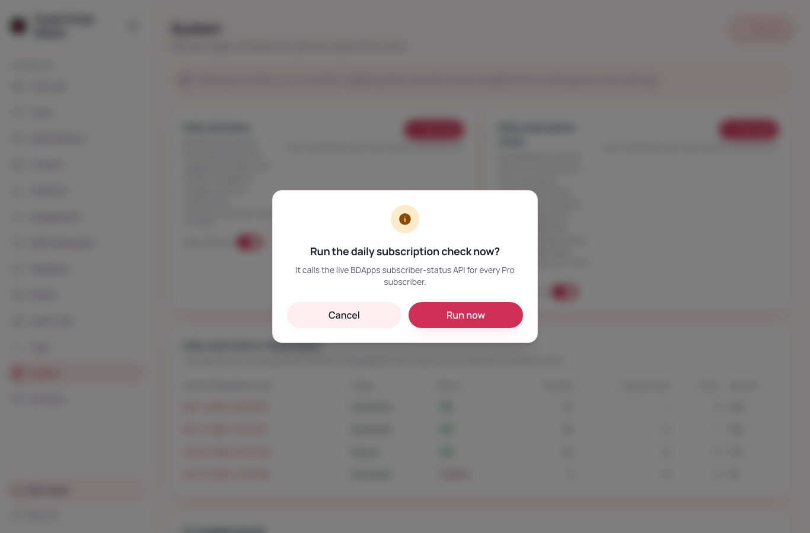
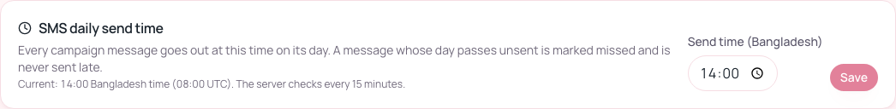
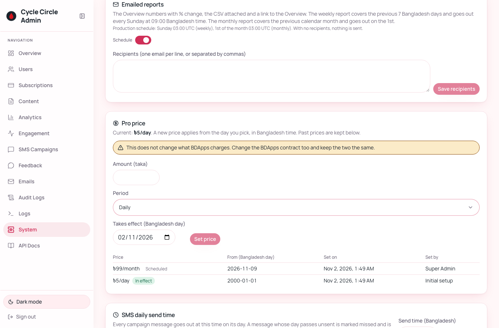
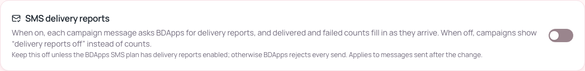
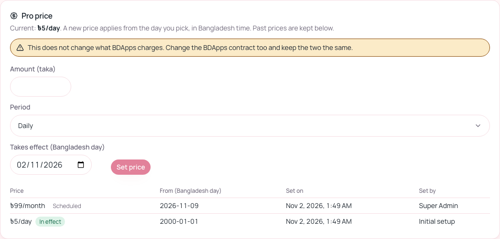
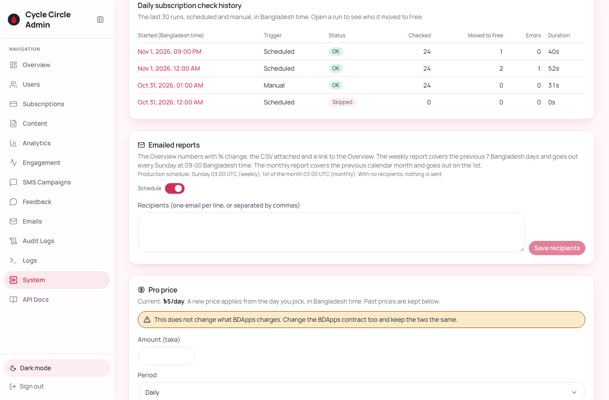
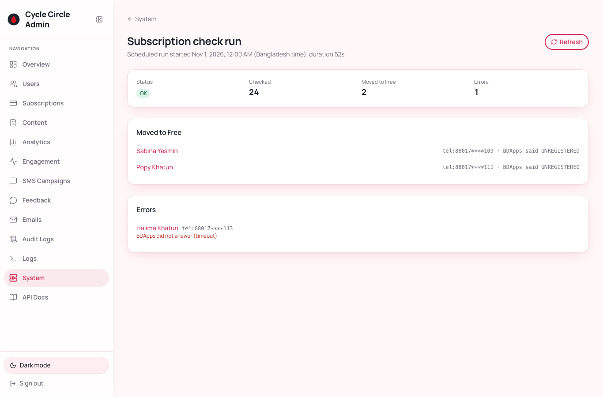

# System

The one Admin page that changes how Cycle Circle behaves without a deploy: switches for the scheduled jobs, buttons to run two of them now, the SMS send time, who gets the emailed reports, whether SMS delivery reports are requested, and the Pro price. Everything here is saved as soon as you press its button, and every change is written to the [audit log](#au-search).

The page header says "Manually trigger scheduled cron jobs and inspect their results." The page does more than that today; this chapter follows what each card does.

## Job on/off switches {#sy-jobs}

### What it is

A **Daily schedule** switch on each job card, and a **Schedule** switch on the **Emailed reports** card. A switch decides whether the **scheduled** run of that job does its work. Two cards sit at the top of the page, **Daily reminders** and **Daily subscription check**, each with its production schedule and a **Run now** button ([manual runs](#sy-manual-reminders)).

### Where to find it

**System** in the sidebar, or `/system`. Top to bottom the page shows: the two job cards, Run history (the subscription check table), Emailed reports, Pro price, SMS send time and SMS delivery reports.

### How to use it

1. Open **System**. A blue switch is on, a grey switch is off.
2. Press the switch next to **Daily schedule** on a card to turn that job off or on. The switch moves at once and is saved in the background.
3. For the emailed reports, use the **Schedule** switch inside the **Emailed reports** card.
4. Reload the page to confirm the switch kept its position.

| Switch | What it controls |
|---|---|
| Daily schedule, **Daily reminders** | The scheduled daily reminder run, and also the 15-minute campaign SMS check (both read this one switch) |
| Daily schedule, **Daily subscription check** | The scheduled run of the check that asks BDApps whether each Pro User is still subscribed |
| **Schedule** on **Emailed reports** | The weekly and monthly emailed reports |

### Rules and limits

- A job that has never been switched is **on**. Only a saved "off" stops it.
- The switch stops the scheduled call only. **Run now** always works, even when the switch is off ("Runs immediately, even when the daily schedule is off.").
- Each card shows its production schedule in UTC: Daily reminders "08:00 UTC daily" (14:00 Bangladesh time), Daily subscription check "02:00 UTC daily" (08:00 Bangladesh time), reports "Sunday 03:00 UTC (weekly), 1st of the month 03:00 UTC (monthly)" (09:00 Bangladesh time). The times come from the server's scheduler (see [Scheduled jobs](#sj-overview)); the switch does not change them.
- When the subscription check is off and the scheduler still calls it, the run is recorded as **Skipped** in [Run history](#sy-runs) with nothing checked. For the reminders and reports jobs a switched-off call does nothing and records nothing.
- Turning the **Daily reminders** switch off also stops campaign SMS sending, because the 15-minute SMS dispatch call reads the same switch ([Campaign SMS dispatch](#sj-sms-dispatch)).
- Each change is recorded as "Set Cron Enabled" with the job name (`daily-reminders`, `caas-check` or `reports`) and whether it is now on.

### What can go wrong

| The Admin sees | Cause | Fix |
|---|---|---|
| The switch jumps back to its old position, with no message | The save failed (for example the session ended); the page puts the old value back silently | Reload, sign in again if asked, and try once more |
| Reminders or reports stopped arriving | Its switch is off | Turn it on here; check the [audit log](#au-search) for "Set Cron Enabled" to see who turned it off |
| Campaign SMS stopped going out | The **Daily reminders** switch is off (it also gates the SMS check) | Turn **Daily reminders** on |
| "The last run was skipped because the job is switched off. No subscribers were checked." on the Subscriptions page | The subscription check switch is off | Turn it on ([Subscriptions list](#su-list)) |

### Related

- Running a job now: [Run daily reminders manually](#sy-manual-reminders), [Run the subscription check manually](#sy-manual-sub-check)
- What the jobs do: [Scheduled jobs](#sj-overview)
- Who changed a switch: [Audit log search](#au-search)

## Run daily reminders manually {#sy-manual-reminders}

### What it is

The **Run now** button on the **Daily reminders** card. It sends the day's period alerts, fertile window alerts, logging reminders and profile-completion nudges to active Subscribers right now, instead of waiting for the schedule.

### Where to find it

**System**, **Daily reminders** card, **Run now**. A confirm window opens first.

### How to use it

1. Press **Run now** on the **Daily reminders** card.
2. Read the window: "Send daily reminders now?" and "This sends real reminder emails and notifications to active subscribers."
3. Press **Run now** to start, or **Cancel** to stop.
4. Wait. The button shows a spinner while the job runs. When it ends a toast says "Daily reminders finished", and the card shows a green panel "Job completed successfully." with the numbers the job reported.
5. If it failed, a red toast and a red message give the reason ([What can go wrong](#sy-manual-reminders--what-can-go-wrong)).

### Rules and limits

- It runs against the **live** app: real emails, real notifications. There is no test mode.
- It runs even if the **Daily schedule** switch is off.
- The job's usual once-a-day checks still apply, so pressing the button twice in one day does not send the same reminder twice to the same User.
- The same run also takes the SMS step: if today's planned campaign SMS is due (the send time has passed and it was not sent yet) it is sent now. See [SMS send time](#sy-sms-time).
- Only numbers are shown in the result panel. The SMS details the job returns are not shown there.
- The run is recorded as "Trigger Cron Daily Reminders" in the [audit log](#au-search), with the numbers, or the status code when it failed. A manual reminder run does **not** appear in [Run history](#sy-runs); that table holds the subscription check only.
- If the call to the web app itself fails before it answers (for example the address or secret is not set), the card shows the error and **no** audit row is written; only a reply, good or bad, is recorded.
- To send reminders to **one** User, use [Send reminders](#us-reminders) on the User page.

### What can go wrong

| The Admin sees | Cause | Fix |
|---|---|---|
| Red message "APP_URL or CRON_SECRET is not configured for the admin app" | The Admin app is missing one of two settings it needs to call the web app | Fix the Admin app's settings on the server and redeploy ([Admin panel problems](#ts-admin)) |
| Red message "Web app returned 401" (or another number) | The web app refused or failed the request; 401 means the secret differs between the two apps | Make the two apps' CRON_SECRET match; read the web app's logs |
| Red message "Request failed" | The Admin app could not reach the web app | Check the web app is running; try again |
| Toast "Daily reminders failed" | The job returned an error with no message | Look in the [audit log](#au-search) (status code) and the server's error log |
| Nothing seems to have been sent | Every reminder for today was already sent, or no User has one due | Nothing is wrong; the counts in the green panel show zeros |

### Related

- The job itself: [Daily reminder emails](#sj-daily-reminders)
- Switching it off: [Job on/off switches](#sy-jobs)
- One User only: [Send reminders](#us-reminders)

## Run the subscription check manually {#sy-manual-sub-check}

### What it is

The **Run now** button on the **Daily subscription check** card. It asks BDApps about every Pro Subscriber ("subscriber status"), moves to Free anyone BDApps reports as no longer subscribed, and brings back Users an Admin revoked who have subscribed again.

### Where to find it

**System**, **Daily subscription check** card, **Run now**.

### How to use it

1. Press **Run now** on the **Daily subscription check** card.
2. Read the window: "Run the daily subscription check now?" and "It calls the live BDApps subscriber-status API for every Pro subscriber."
3. Press **Run now** to start, or **Cancel**.
4. Wait for the toast "Daily subscription check finished". The card shows "Job completed successfully." and the numbers: Checked, Downgraded, Skipped, Errors and Reinstated.
5. Open the new top row of [Run history](#sy-runs), then its [Run detail](#sy-run-detail), to see who was moved.

### Rules and limits

- It calls BDApps live for every Pro Subscriber. A large list takes time; the scheduled run does the same.
- It runs even when the **Daily schedule** switch is off.
- A manual run is recorded in [Run history](#sy-runs) with Trigger "Manual". The scheduled run is "Scheduled".
- The check never moves a User to Free because of an error: when BDApps does not answer, the User stays Pro and the error is counted.
- "Downgraded" on this card is the same number as "Moved to Free" in the history table.
- The Subscriptions page shows the result in its strip ([Subscriptions list](#su-list)); the page is refreshed after the run.
- The audit log records "Trigger Cron Subscription Check" with the counts.

### What can go wrong

| The Admin sees | Cause | Fix |
|---|---|---|
| Red message "APP_URL or CRON_SECRET is not configured for the admin app" | The Admin app is missing a setting | Fix the settings on the server |
| Red message "Web app returned 500" (or another number) | The job failed; a run row with status "Failed" is usually recorded | Open the run in [Run detail](#sy-run-detail) and read the red error |
| Red message "Request failed" | The Admin app could not reach the web app | Check the web app is up; run again |
| The numbers show Errors above zero | BDApps did not answer for some Subscribers | Open [Run detail](#sy-run-detail) for the list; run again later |
| A new row does not appear in the history | The page needs a moment to refresh | Reload the page |

### Related

- The job itself: [Daily subscription check](#sj-sub-check)
- Result strip: [Subscriptions list](#su-list)
- Past runs: [Run history](#sy-runs)

## SMS send time {#sy-sms-time}

### What it is

The **SMS daily send time** card. It sets the clock time at which each day's campaign SMS goes out.

### Where to find it

**System**, scroll to **SMS daily send time**.

### How to use it

1. In **Send time (Bangladesh)** pick the time (24-hour, to the minute).
2. Press **Save**. The button works only when the time differs from the saved one.
3. A green toast says "SMS send time set to 16:30 Bangladesh time". The line under the title updates: "Current: 16:30 Bangladesh time (10:30 UTC). The server checks every 15 minutes."

### Rules and limits

- Times are Bangladesh time. The card also shows the UTC equivalent.
- The default, until an Admin saves one, is **14:00** Bangladesh time (08:00 UTC).
- Every campaign message goes out at this time on its day. A message whose day passes unsent is marked **missed** and is never sent late.
- The server looks every 15 minutes, so a message goes out within about 15 minutes after the saved time, not at the exact minute.
- The new time applies to every campaign message not yet sent, including messages scheduled earlier.
- Each change is recorded as "Set Sms Send Time" with the old time, the new time and the time zone.
- Campaign SMS also stops if the **Daily reminders** switch is off ([Job on/off switches](#sy-jobs)).

### What can go wrong

| The Admin sees | Cause | Fix |
|---|---|---|
| **Save** is greyed out | The time is the same as the saved one, or empty | Pick a different time |
| Red toast "Send time must be HH:MM in 24-hour time (for example 14:00)" | The value is not a valid time | Pick a time with the clock control |
| A message was marked missed | The send time was moved past the end of that day, or the SMS check was off all day | See [Send time and missed days](#as-send-time); use [Resend failed messages](#sm-resend) where it applies |
| A message went out later than the saved time | The server checks every 15 minutes | Nothing is wrong |

### Related

- How SMS sends are planned: [Schedule and reschedule](#sm-schedule), [Send time and missed days](#as-send-time)
- Campaign dispatch job: [Campaign SMS dispatch](#sj-sms-dispatch)

## Report recipients {#sy-report-recipients}

### What it is

The **Emailed reports** card: the list of email addresses that receive the weekly and monthly Overview report, and the **Schedule** switch for those reports.

### Where to find it

**System**, scroll to **Emailed reports**. The screenshot shows the card with no recipients.

### How to use it

1. In **Recipients (one email per line, or separated by commas)** type or paste the addresses. Spaces, commas, semicolons and new lines all separate addresses.
2. Press **Save recipients**.
3. A toast says "Reports will go to 2 recipients" (or "Reports will go to 1 recipient"). An empty list gives "Report recipients cleared".
4. Check the **Schedule** switch is on ([Job on/off switches](#sy-jobs)).

### Rules and limits

- The weekly report covers the previous 7 Bangladesh days and goes out on Sunday at 09:00 Bangladesh time. The monthly report covers the previous calendar month and goes out on the 1st at 09:00 Bangladesh time. Each has the Overview numbers with % change, the CSV attached and a link to the Overview.
- Addresses are changed to lower case and repeats are removed.
- **One bad address saves nothing.** The whole list is refused and the card names the entries that are not valid emails.
- With no recipients, nothing is sent.
- **Save recipients** works only when the list differs from the saved one.
- Each change is recorded as "Set Report Recipients" with the old and new lists.
- The report for a period is sent once. Saving recipients afterwards does not resend a report that has already gone out.

### What can go wrong

| The Admin sees | Cause | Fix |
|---|---|---|
| Red message under the box "Not a valid email address: owner@, x.com" | One or more entries are not valid emails; nothing was saved | Correct or remove the entries named, then save again |
| "Report recipients cleared" and no reports | The list was emptied | Add recipients and save |
| Reports do not arrive although recipients are saved | The **Schedule** switch is off, or the report for this period was already sent | Check the switch; see [Weekly and monthly reports](#sj-reports) |
| The **Schedule** switch jumps back | The save failed | Reload and try again |

### Related

- The job: [Weekly and monthly reports](#sj-reports)
- What the numbers mean: [KPI cards](#ov-kpis)
- Who changed the list: [Audit log search](#au-search)

## SMS delivery reports {#sy-delivery-reports}

### What it is

A switch named "SMS delivery reports". When on, every campaign message asks BDApps for a delivery report, and the delivered and failed counts of a campaign fill in as reports arrive.

### Where to find it

**System**, last card, **SMS delivery reports**.

### How to use it

1. Press the switch. The toast says "SMS delivery reports turned on" or "SMS delivery reports turned off".
2. Send campaign messages afterwards. The change applies to messages sent after it, not to messages already sent.

### Rules and limits

- It is **off** until an Admin turns it on.
- Keep it off unless the BDApps SMS plan has delivery reports enabled. If it is on and the plan does not allow it, BDApps rejects every send with the error E1312 and no campaign SMS is sent.
- When it is off, campaigns show "delivery reports off" instead of counts ([Delivery status](#sm-delivery)).
- Each change is recorded as "Set Sms Delivery Reports" with the old and new value.

### What can go wrong

| The Admin sees | Cause | Fix |
|---|---|---|
| Campaign messages all fail after turning the switch on | The BDApps SMS plan has no delivery reports; BDApps refuses the send (E1312) | Turn the switch off, then use [Resend failed messages](#sm-resend) |
| Campaigns show "delivery reports off" | The switch is off | Turn it on only if BDApps has enabled reports |
| The switch is greyed out | The save is still running | Wait a second |
| Red toast with a message | The save failed | Retry; look in [Logs](#lg-viewer) |

### Related

- Delivery numbers: [Delivery status](#sm-delivery)
- SMS behaviour for BDApps: [Delivery reports](#as-delivery-reports)
- Resending: [Resend failed messages](#sm-resend)

## Pro price {#sy-pro-price}

### What it is

The **Pro price** card. An Admin sets the amount and period (daily, weekly or monthly) of Pro. This is the one source for the price the User app shows (subscription page, upgrade confirmation, Terms, in English and Bengali) and for estimated revenue (ADR 0011). Every change is kept in a history with the day it takes effect.

### Where to find it

**System**, **Pro price** card. The history table at the bottom lists every price.

### How to use it

1. Read "Current:" at the top of the card: the price in effect today, for example "5/day" (with the taka sign), or "not set" when no price is in effect.
2. Read the yellow note: "This does not change what BDApps charges. Change the BDApps contract too and keep the two the same."
3. Fill the form:
   - **Amount (taka)**: more than 0, at most two decimals.
   - **Period**: Daily, Weekly or Monthly.
   - **Takes effect (Bangladesh day)**: today or a later day.
4. Press **Set price**. A toast says "Pro price set to <price> from <day>". The history table gains a row.
5. Read the history: **Price**, **From (Bangladesh day)**, **Set on**, **Set by**. A badge says "In effect" for today's price, "Scheduled" for a future one and "Replaced" for one overruled by a newer entry on the same day.

### Rules and limits

- This does **not** change what BDApps charges. Keeping the two equal is the Admin's job.
- The highest price is 100000 taka (a typo guard).
- The day cannot be in the past. A past day is refused.
- The price in effect on a day is the latest entry whose first day is on or before that day. If two entries share a day, the newer wins and the older shows "Replaced".
- A past period is counted at the price that was in effect then, so changing the price does not rewrite old estimated revenue ([Estimated revenue](#an-revenue)).
- The first entry, "Initial setup", has the first day 2000-01-01 and no Admin.
- After saving, the web app's cached price is refreshed so the User app shows the new price without a deploy.
- Each change is recorded as "Pro Price Set" with the old and the new price.

### What can go wrong

| The Admin sees | Cause | Fix |
|---|---|---|
| **Set price** greyed out | Amount or day is empty | Fill both |
| "Price must be a number greater than 0" | Amount is 0, negative or not a number | Enter a positive amount |
| "Price must be at most 100000 taka" | Amount is above the limit | Check for an extra zero |
| "Price can have at most two decimal places" | For example 99.999 | Use at most two decimals |
| "Effective day cannot be in the past" | The day is before today (Bangladesh) | Pick today or later |
| "Effective day must be a real date written YYYY-MM-DD" | The date is not valid | Pick the date with the date control |
| "Period must be daily, weekly or monthly" | An invalid period reached the server | Choose from the **Period** list |
| Red toast "Saved, but the web app cache did not refresh. Customers may see the old price for a few minutes." | The price is saved, but the User app's cache was not cleared | Wait a few minutes, or check the web app is up. (The toast says "Customers"; this handbook says Users.) |
| Users see a price different from what they are charged | The BDApps contract was not changed to match | Change the price at BDApps, then keep both equal |

### Related

- Where the price shows to a User: [Pro price on the subscription page](#sb-price)
- Estimated revenue: [Estimated revenue](#an-revenue)
- Who set a price: [Audit log search](#au-search)

## Run history {#sy-runs}

### What it is

The **Daily subscription check history** table: the last 30 runs of the subscription check, scheduled and manual, newest first.

### Where to find it

**System**, between the job cards and the **Emailed reports** card.

### How to use it

1. Read the columns:

| Column | Shows |
|---|---|
| Started (Bangladesh time) | Start time, a link to the run |
| Trigger | "Scheduled" (the scheduler) or "Manual" (**Run now**) |
| Status | "OK", "Failed" or "Skipped" |
| Checked | Subscribers asked |
| Moved to Free | Users moved to Free |
| Errors | Subscribers BDApps did not answer for |
| Duration | Seconds from start to finish ("0s" for a skipped run, a dash while unfinished) |

2. Press a start time to open that run ([Run detail](#sy-run-detail)).

### Rules and limits

- Only the subscription check is listed. Reminders and reports runs are not recorded here.
- Only the last 30 runs show. There is no paging.
- A "Skipped" run means the job was called while its switch was off ([Job on/off switches](#sy-jobs)).
- A "Failed" run means the job itself stopped; the reason is on the run's page.
- When there are none: "No runs recorded yet."
- The Subscriptions page shows only the newest run ([Subscriptions list](#su-list)).

### What can go wrong

| The Admin sees | Cause | Fix |
|---|---|---|
| "No runs recorded yet." | The job never ran here | Press **Run now** ([manual run](#sy-manual-sub-check)) and check the scheduler |
| No run for yesterday | The scheduler did not call the job | Check the server's scheduler ([Scheduled jobs](#sj-sub-check)) |
| A "Skipped" row | The switch was off | Turn it on |
| A "Failed" row | The job stopped | Open it and read the error |
| A new manual run is not in the table | Page not refreshed | Reload |

### Related

- Opening a run: [Run detail](#sy-run-detail)
- Running now: [Run the subscription check manually](#sy-manual-sub-check)
- The job: [Daily subscription check](#sj-sub-check)

## Run detail {#sy-run-detail}

### What it is

The page for one run of the subscription check: its totals, who was moved to Free, and the errors.

### Where to find it

Press a start time in [Run history](#sy-runs), or open `/system/runs/<run id>`. A "System" link at the top goes back.

### How to use it

1. Read the title "Subscription check run" and the line under it: "Scheduled run started Nov 1, 2026, 12:16 AM (Bangladesh time), duration 52s."
2. Read the four boxes: **Status**, **Checked**, **Moved to Free**, **Errors**. A failed run also shows its error in red.
3. Under **Moved to Free**, each row is a User (a link to their [User detail](#us-detail)), the masked subscriber ID and "BDApps said <status>", for example "BDApps said UNREGISTERED". Empty: "Nobody was moved to Free in this run."
4. Under **Errors**, each row names the User, the masked ID and the reason. Empty: "No errors in this run."

### Rules and limits

- Subscriber IDs are masked; the page never shows a full phone number.
- A deleted User shows as "Deleted user", with no link.
- A moved User is Free now. If they subscribe again on BDApps, the next check brings them back to Pro only if an Admin had revoked them; others subscribe again by logging in ([Users](#us-detail)).
- An unknown run ID shows a "not found" page.
- Errors do not change a User's plan.

### What can go wrong

| The Admin sees | Cause | Fix |
|---|---|---|
| "not found" page | The run ID does not exist | Go back to **System** and open a run from the table |
| A red error at the top | The run itself failed | Read it, fix the cause (often BDApps unreachable), run the check again |
| "BDApps did not answer within 15s" for a User | BDApps was slow or down for that number (the number of seconds is the call's time limit, 15 for the check) | Run again later; the User stays Pro meanwhile |
| A User you expected is not listed | They were not Pro at check time, or BDApps still reports them subscribed | See [Plan history and Translog](#us-history) |

### Related

- The list of runs: [Run history](#sy-runs)
- A moved User: [User detail](#us-detail), [Plan history and Translog](#us-history)
- The strip on [Subscriptions list](#su-list)
