# Users

Every account in Cycle Circle, and the actions an Admin can take on one. Three actions take something away from a User: **Revoke** (Pro to not-Pro), **Suspend** (no login) and **Delete** (account hidden). By decision ADR 0006 each of them also **unsubscribes the User's number on BDApps**, so nobody is charged for access that was removed. The reverse actions (**Reactivate**, **Restore**, **Grant**) lift only our own block and **never re-subscribe** the number on BDApps: the User becomes a Subscriber again by logging in with their phone. An Admin override of the plan wins over BDApps only until BDApps reports a new subscription for that number.

If BDApps cannot be reached when one of those actions runs, the action still applies on our side and the Admin sees a red message ending "The User may still be charged." (see each section).

## User list {#us-list}

### What it is

The **Users** page: a header ("N total users"), five charts, a search and status filter, and a table of accounts with one row per User, newest first.

| Column | Shows |
|---|---|
| Name | Full name, or a dash if none |
| Contact | Email and/or phone (phones are stored as +880…) |
| Auth | "OTP" (phone login) or "Email" |
| Subscription | "Pro", "Lapsed" or "Free" badge |
| Trial | "Trial · 9h" (hours left) for an active email trial, "Trial expired", or a dash |
| Profiles | How many profiles the User has |
| Status | "Active", "Suspended" or "Deleted" |
| Last Login | Date of the last login |
| Created | Date the account was created |

The charts are "New signups — last 30d" (with 7d, 30d, 90d and 1y buttons), "Auth method" (Phone OTP / Email), "Subscription status", "Language preference" (English / Bengali) and "Account status".

### Where to find it

**Users** in the sidebar, or `/users`.

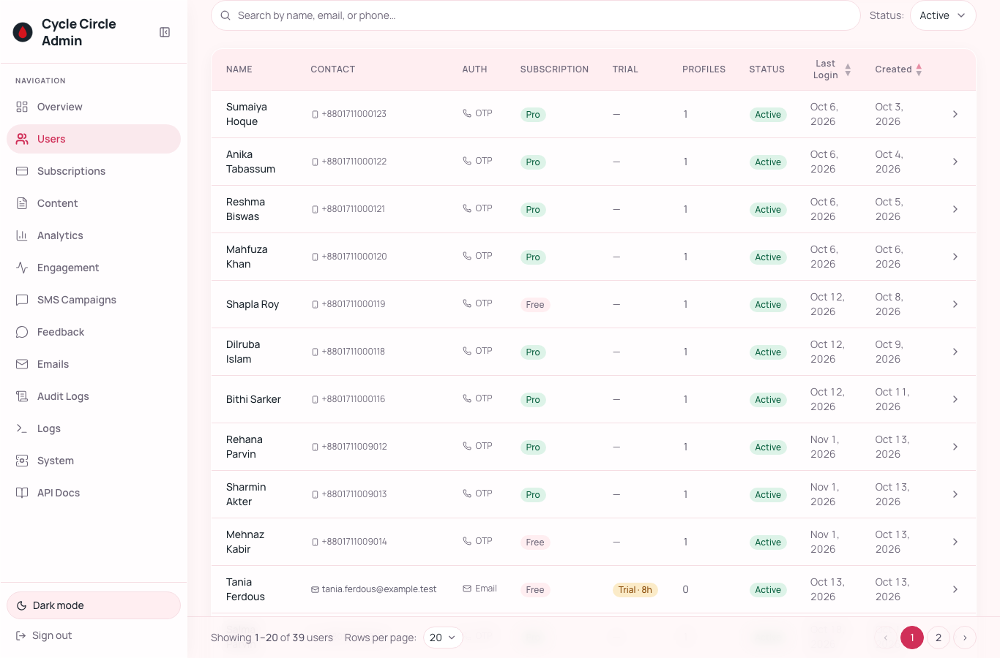

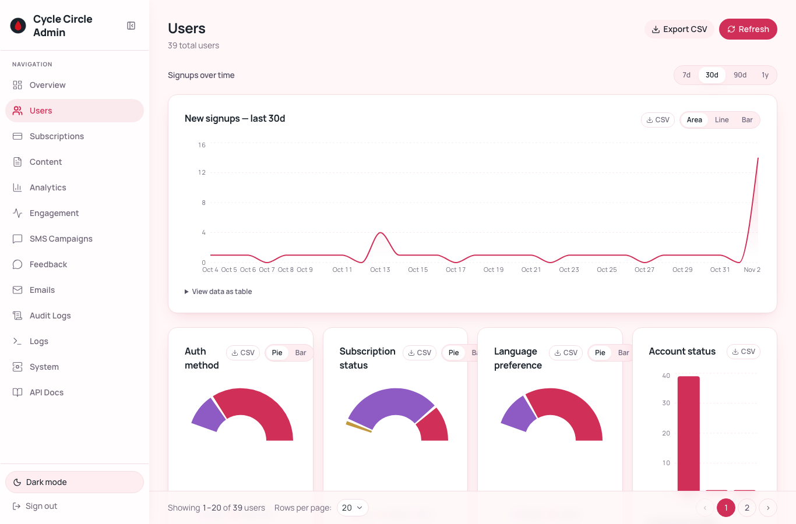

### How to use it

1. Click a column title marked sortable (**Last Login**, **Created**) to sort; click again to reverse. The default is Created, newest first.
2. Click a row to open that User's page ([User detail](#us-detail)).
3. Use the page-size menu at the bottom (10, 20, 50 or 100 rows; default 20) and the page buttons to move through the list.

### Rules and limits

- Dates are Bangladesh time and written like "Nov 1, 2026".
- The list **includes Admin accounts** (nothing in the table marks the role; their detail page shows an "Admin" badge).
- Pro, Lapsed and Free follow the stored plan. An email-trial account is "Free" with a Trial badge.
- Search, status, sort and page live in the address, so a filtered list can be shared as a link.
- The list and the charts are cached for a few minutes (the list for up to 5 minutes, the charts for 1); press **Refresh** at the top to recompute.

### What can go wrong

| The Admin sees | Cause | Fix |
|---|---|---|
| "No users match your filters." | The search or status filter excludes everyone | Clear the search, set Status to Active |
| A User they know is missing | The default filter shows Active only; the User is Suspended or Deleted | Change Status ([Search and filters](#us-search-filters)) |
| A just-made change is not in the list | The list is cached for up to 5 minutes | Press **Refresh** |
| The header total differs from Overview "Total Users" | The header counts the current filter; Overview counts all non-deleted accounts at the end of its period | Set Status to All and compare again |

### Related

- [Search and filters](#us-search-filters)
- [User detail](#us-detail)
- [CSV export](#us-export)

## Search and filters {#us-search-filters}

### What it is

The bar above the table: a search box with the hint "Search by name, email, or phone…" and a **Status** menu with the choices Active, All, Suspended and Deleted.

### Where to find it

On the Users page, between the charts and the table.

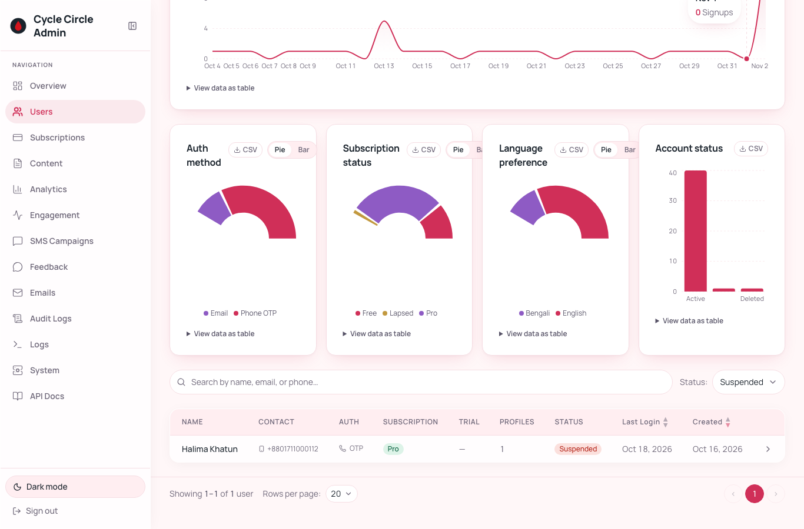

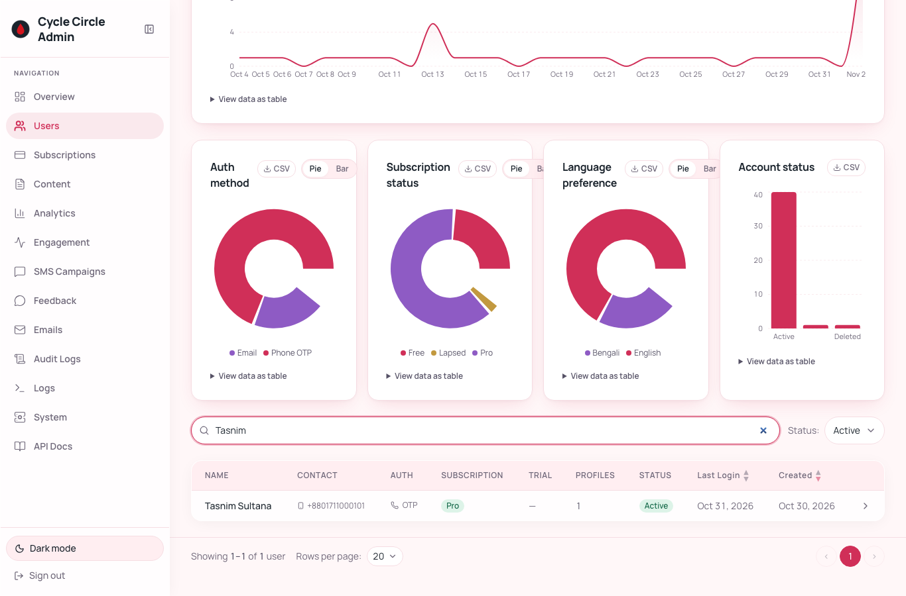

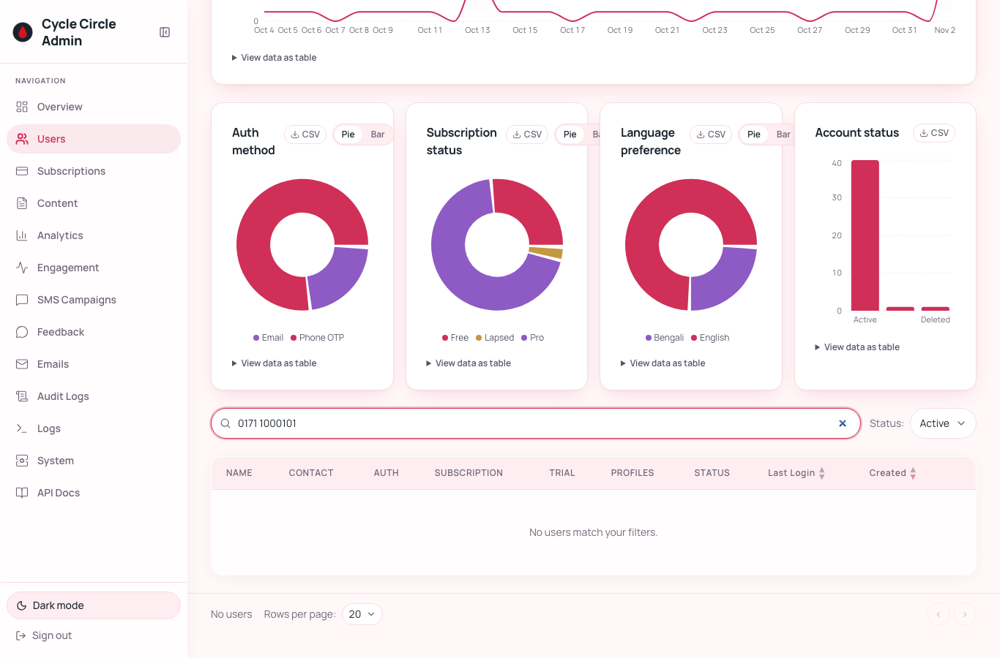

### How to use it

1. Type part of a name, an email or a phone number. The list updates about a third of a second after you stop typing.
2. Choose a **Status**.
3. To start over, empty the search box and set Status back to Active.

### Rules and limits

- Search matches any part of the **name** or **email** (upper and lower case do not matter) and any part of the **phone number as stored**.
- Phone search is a plain **text match on the stored number**, which is in international form (`+8801711000101`). Typing the number the way Users write it (`01711000101`) still matches, because the stored text contains it. Spaces, dashes or brackets in what you type do **not** match: type digits only.
- Status choices: **Active** (not suspended, not deleted; the default), **Suspended** (suspended and not deleted), **Deleted**, and **All**. **All does not include Deleted Users**: it means Active plus Suspended. Look under Deleted to see deleted accounts.
- Changing the search or status returns to page 1.

### What can go wrong

| The Admin sees | Cause | Fix |
|---|---|---|
| "No users match your filters." after typing a phone as `0171 1000101` | The search is a plain text match; the space (or a dash) is not in the stored number | Type digits only, `01711000101` |
| A deleted User is not found under "All" | All excludes Deleted | Choose Deleted |
| Typing seems to do nothing | The list waits about 0.3 s after the last keystroke | Pause briefly |

### Related

- [User list](#us-list)
- [Delete and restore](#us-delete-restore)

## CSV export {#us-export}

### What it is

The **Export CSV** button at the top right of the Users page. It downloads the Users that match the current search and Status as a spreadsheet file.

### Where to find it

Users page header, beside **Refresh**.

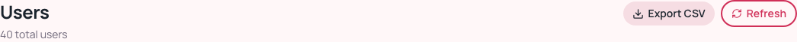

### How to use it

1. Set the search and Status you want (the export follows them).
2. Press **Export CSV**. The button reads "Exporting…" while it works, then the browser saves `users-2026-11-01.csv` (the Bangladesh date of the download).

### Rules and limits

- The file holds **every matching User**, not just the visible page.
- Columns: ID, Name, Phone, Email, Auth Method, Subscription, Role, Profiles, Profile Complete, Created, Last Login. Auth Method is `OTP` or `EMAIL`; Subscription is `FREE`, `PRO` or `LAPSED`.
- Created and Last Login are written as UTC timestamps (like `2026-10-31T18:30:00.000Z`), **not** Bangladesh time. Add 6 hours to read them as Bangladesh time.
- The file is UTF-8 with a byte-order mark so Excel reads Bengali names; text that starts with `=`, `+`, `-` or `@` gets a leading apostrophe so a spreadsheet never runs it as a formula.
- The file contains phone numbers and emails. Each export is **written to the audit log** with the row count and filters ([What each entry means](#au-entries)). Handle the file as personal data.

### What can go wrong

| The Admin sees | Cause | Fix |
|---|---|---|
| The file has fewer Users than expected | The default Status is Active, so Suspended and Deleted are left out | Set Status to Suspended or Deleted and export again; "All" still leaves Deleted out |
| Times are 6 hours behind | CSV times are UTC | Add 6 hours |
| Bengali names look broken in Excel | Excel opened it as plain text | Use Data, From Text/CSV and choose UTF-8 |
| Nothing downloads | The browser blocked the download, or the request failed | Allow downloads for the admin address and try again |

### Related

- [Search and filters](#us-search-filters)
- [What each entry means](#au-entries)

## User detail {#us-detail}

### What it is

One User's page. The top card shows the name with badges (Active, Suspended or Deleted; Pro or Lapsed; Admin; trial state), the email and phone, how they log in ("Phone OTP" or "Magic Link"), "Joined" and "Last seen" dates, and the action buttons. Under it: three counters (Profiles, Period Logs, Feedback), the **Reminder emails** card, and four tabs.

| Tab | Shows |
|---|---|
| Profiles | Each profile: name, relation, Cycle length, Period length, Period logs, Symptom logs, the three notification switches and up to three recent period logs. "No profiles created yet." if none. |
| Subscription | "Current Subscription": Status, Since, "Last confirmed by BDApps" (a date and "(reported REGISTERED)", or "never"), and "Source: Admin Override" with "Override at" when an Admin set the plan. "Charge transactions (N)" lists amounts and SUCCESS, FAILED or pending. |
| Plan history | Every plan change from the Translog ([Plan history and Translog](#us-history)). |
| Feedback | The User's feedback with category, "Rating: 4/5", date and a **View** link to the feedback detail. |

### Where to find it

Click a row in the [User list](#us-list), or open `/users/<id>`. The tab is kept in the address (`?tab=plan`). **Back to users** returns to the previous page.

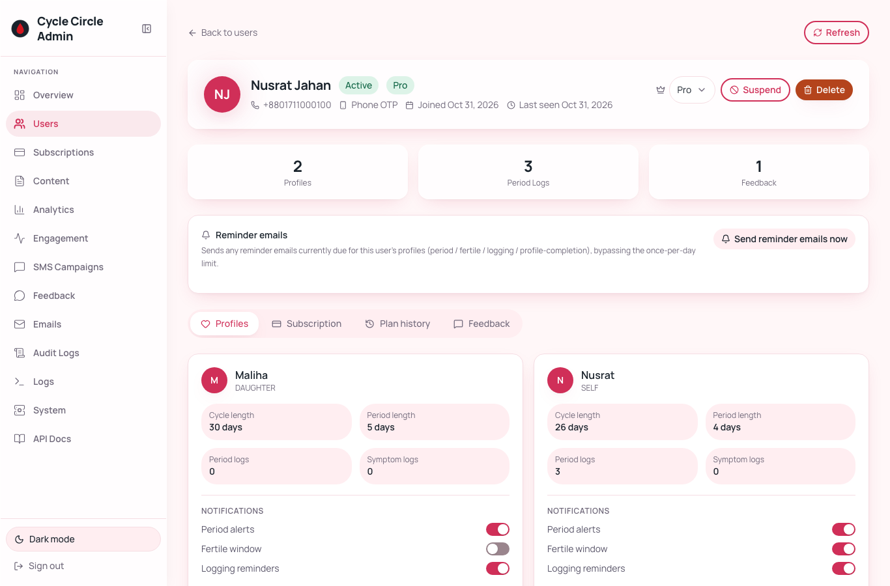

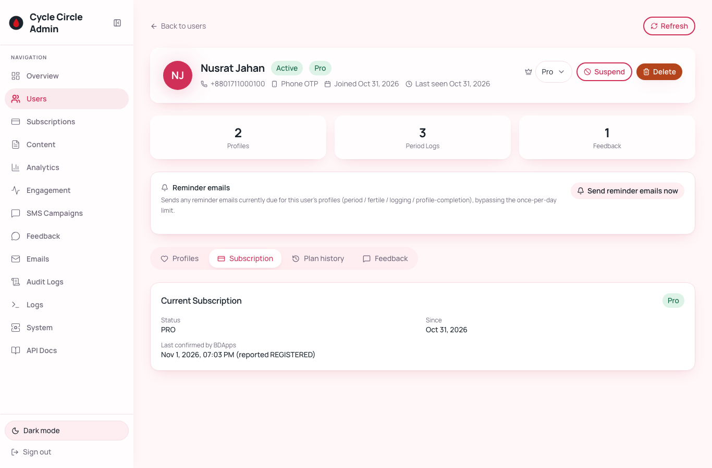

### How to use it

1. Read the badges and the counters first.
2. Open a tab; arrow keys, Home and End also move between tabs.
3. Use the buttons in the top card for the actions in the sections below. **Refresh** reloads this User.

### Rules and limits

- A deleted User shows "Deleted <date>" and either **Restore** or "Restore window (30 days) has passed"; the plan selector, Suspend, Delete and the reminder card are hidden for a deleted User.
- **Admin accounts** show an "Admin" badge and have no **Suspend** or **Delete** button. The server also refuses: "Admin accounts can't be suspended or deleted."
- "Last seen" is the last *login* date, not the last time the app was opened.
- The page is cached for up to a minute; actions refresh it automatically.
- Everything an Admin does here is written to the audit log.

### What can go wrong

| The Admin sees | Cause | Fix |
|---|---|---|
| A 404 page | The User id does not exist (or the User was purged after 30 days) | Search the list; purged Users cannot be recovered |
| "No subscription record found." | The User never had a Subscription row (for example a new email-trial account) | Normal; nothing to fix |
| "Last confirmed by BDApps: never" | The daily subscription check has not yet answered for this number | See [Run the subscription check manually](#sy-manual-sub-check) |
| The Plan history tab is empty | No plan change has been recorded in the retained log files | See [Plan history and Translog](#us-history) |

### Related

- [Suspend and reactivate](#us-suspend)
- [Delete and restore](#us-delete-restore)
- [Set subscription status](#us-set-status)
- [Notification preferences](#us-notif-prefs)

## Suspend and reactivate {#us-suspend}

### What it is

**Suspend** blocks a User from the app and removes their BDApps subscription, keeping all their data. **Reactivate** lifts the block. As defined in the glossary, Suspend is for keeping someone out; it is not a deletion and it is not a plan change.

### Where to find it

User detail, top card: **Suspend** (visible when the User is Active) or **Reactivate** (when Suspended).

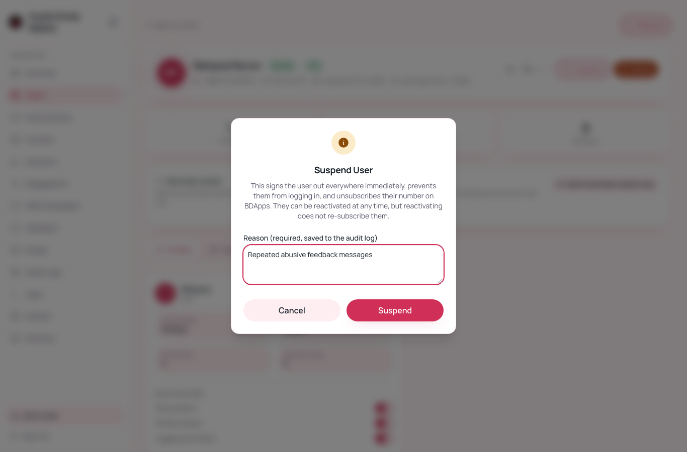

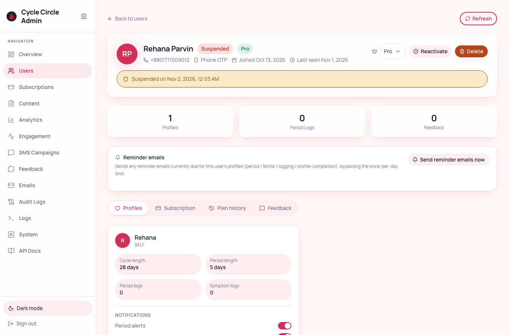

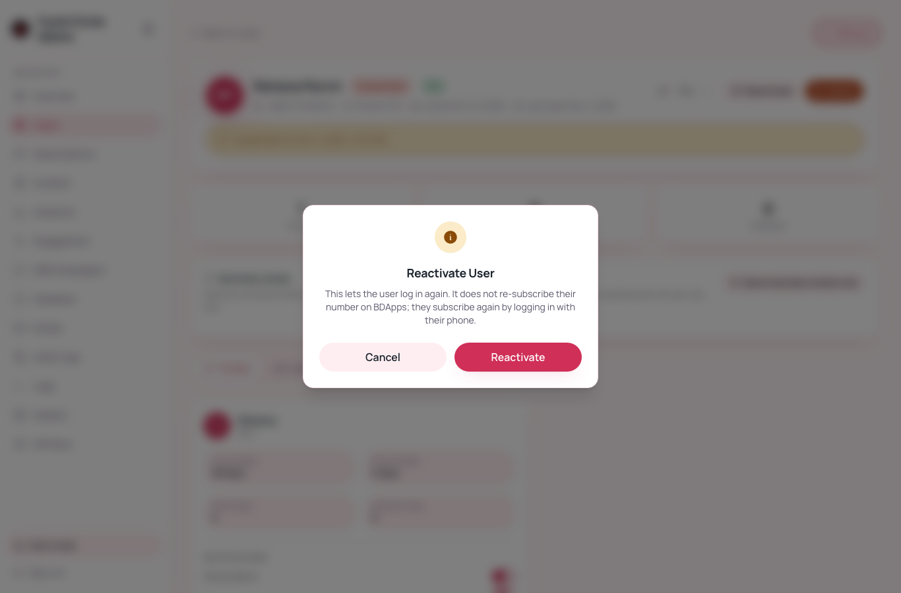

### How to use it

1. Press **Suspend**. The window "Suspend User" opens.
2. Type a **Reason** ("Reason (required, saved to the audit log)", up to 500 characters). **Suspend** stays disabled until the reason is not blank.
3. Press **Suspend**. A banner "Suspended on <date and time>" appears.
4. To undo, press **Reactivate**, then confirm in the "Reactivate User" window.

### Rules and limits

- The window says: "This signs the user out everywhere immediately, prevents them from logging in, and unsubscribes their number on BDApps. They can be reactivated at any time, but reactivating does not re-subscribe them."
- Existing sessions stop working on the User's next request; new logins are refused with "Account suspended" (a message from the system; the app has no special screen for it).
- **ADR 0006:** the BDApps number is unsubscribed as part of Suspend. If the User has no usable BDApps subscriber id (an old phone-only record, or an email account) there is nothing to unsubscribe and the step is "skipped"; the suspension still applies.
- **Reactivate does not re-subscribe.** The window says: "This lets the user log in again. It does not re-subscribe their number on BDApps; they subscribe again by logging in with their phone." Reactivating a User who is not suspended does nothing.
- Suspend does not change the stored plan by itself, and a Suspended User never counts as an Active user.
- Admin accounts cannot be suspended.
- The reason and the BDApps result are written to the audit log.
- The daily reminder run does not skip Suspended Users' profiles; turn off their [notification preferences](#us-notif-prefs) if they must not be contacted.

### What can go wrong

| The Admin sees | Cause | Fix |
|---|---|---|
| The **Suspend** button in the window is greyed | The reason is empty or only spaces | Type a reason |
| Red toast "User suspended, but the BDApps unsubscribe failed: <error>. The user may still be charged." | BDApps refused or could not be reached | The User is suspended in our system. Ask BDApps to unsubscribe the number, or check [Plan history](#us-history) for the error |
| Red banner "Admin accounts can't be suspended or deleted." | The target is an Admin | Not possible from the panel |
| Red banner "User not found" | The User was purged meanwhile | Refresh the list |
| The User says they can log in again after Reactivate but are not Pro | Reactivate does not re-subscribe | The User logs in with their phone; that subscribes the number again |

### Related

- [Delete and restore](#us-delete-restore)
- [Admin overrides and billing](#pa-admin-overrides)
- [What each entry means](#au-entries)

## Delete and restore {#us-delete-restore}

### What it is

**Delete** hides a User's account and removes their BDApps subscription; the data is kept for 30 days. **Restore** brings the account back inside that window.

### Where to find it

User detail, top card: red **Delete**; on a deleted User, **Restore**. Deleted Users are listed under Status "Deleted".

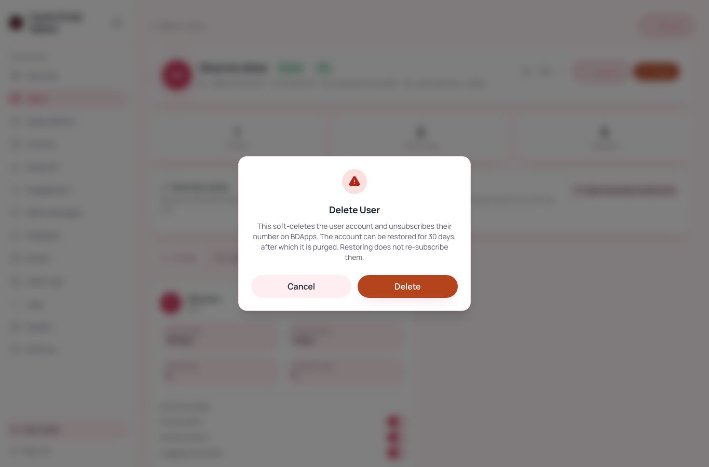

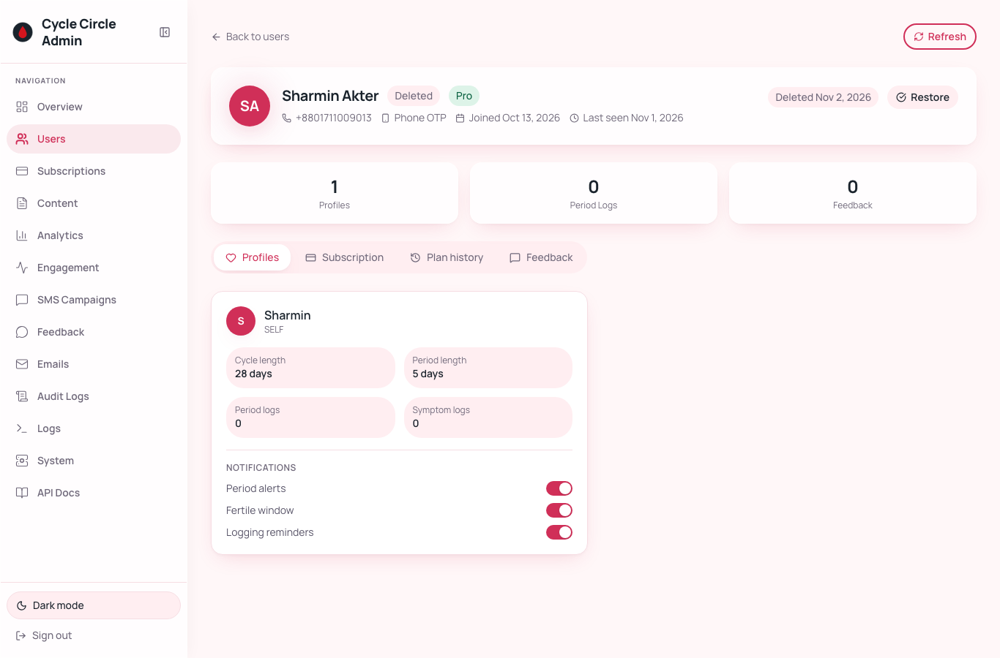

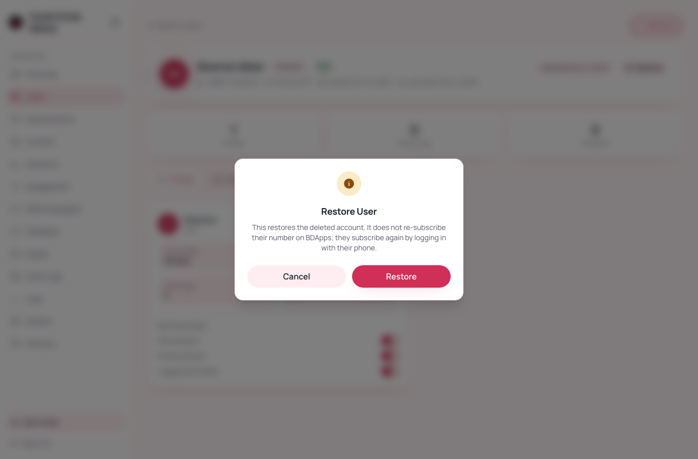

### How to use it

1. Press **Delete** and confirm in the "Delete User" window. The page then shows "Deleted <date>" and **Restore**.
2. To undo within 30 days, press **Restore** and confirm in the "Restore User" window.

### Rules and limits

- The window says: "This soft-deletes the user account and unsubscribes their number on BDApps. The account can be restored for 30 days, after which it is purged. Restoring does not re-subscribe them."
- Existing sessions stop working at once. The deleted User disappears from Active/All lists, from Total Users and from the Active user counts.
- If the User was Pro, an "Account deleted" churn event is recorded ([KPI cards](#ov-kpis)). **Restoring removes that event again**, because the User did not leave.
- **Restore is allowed for 30 days (720 hours) after deletion.** After that the page shows "Restore window (30 days) has passed". The system answers "Accounts can only be restored within 30 days of deletion".
- Restore says: "This restores the deleted account. It does not re-subscribe their number on BDApps; they subscribe again by logging in with their phone."
- After 30 days a nightly job **purges** the User, their profiles and their logs, leaving one Translog line. A purged User cannot come back.
- Deleting an already-deleted User changes nothing and does not restart the 30 days. Admin accounts cannot be deleted.
- ADR 0006: the BDApps number is unsubscribed on Delete exactly as on Suspend, with the same "skipped" case.

### What can go wrong

| The Admin sees | Cause | Fix |
|---|---|---|
| Red toast "User deleted, but the BDApps unsubscribe failed: <error>. The user may still be charged." | BDApps failed; the deletion still applied | Ask BDApps to unsubscribe the number |
| "Restore window (30 days) has passed" | More than 30 days since deletion | The account is gone for good; the person must register again |
| A restored User cannot log in with the same phone and is not Pro | Restore does not re-subscribe | They log in with their phone, which subscribes the number again |
| Cannot find the User after Delete | Deleted Users are hidden by default | Status, Deleted |

### Related

- [Search and filters](#us-search-filters)
- [Suspend and reactivate](#us-suspend)
- [Churn](#an-churn)

## Grant and revoke Pro {#us-pro-override}

### What it is

An **Admin override** puts a User on a plan chosen by an Admin instead of the plan BDApps reports. **Grant** makes a User Pro; **Revoke** takes Pro away and unsubscribes the number on BDApps. The override wins until BDApps reports a new subscription for that number.

### Where to find it

Two places, which do the same thing:

- **User detail**: the plan menu in the top card (see [Set subscription status](#us-set-status)). Choosing Pro is a Grant; choosing Free or Lapsed is a Revoke.
- **Subscriptions page**: the **Grant Pro**, **Set Free** and **Revoke** buttons on each row ([Subscriptions list](#su-list)).

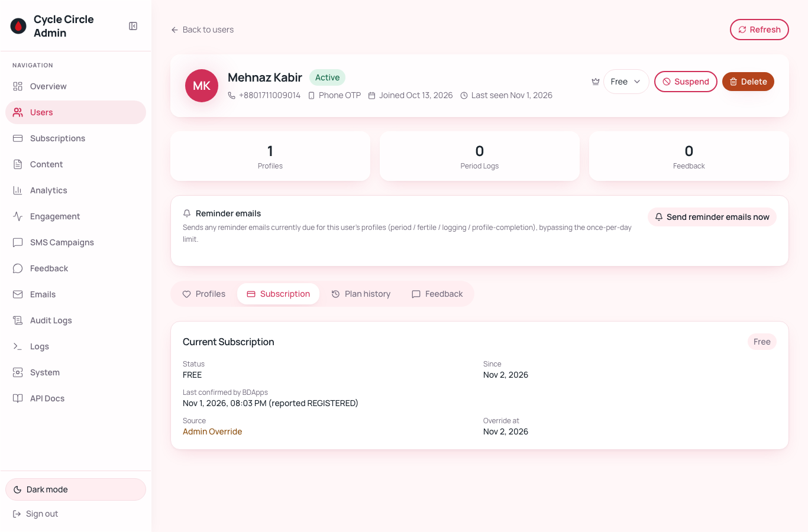

### How to use it

1. Open the User (or the row) and pick the new plan.
2. Confirm in the window. After a successful change the Subscription tab shows "Source: Admin Override" and an "Override at" date.

### Rules and limits

- **Grant** sets the plan to Pro and marks it as an override. **It does not subscribe the number on BDApps**, so the User gets Pro features without being charged.
- **Revoke** (plan menu "Free" or "Lapsed", or **Set Free** / **Revoke** on the Subscriptions page) first unsubscribes the number on BDApps (ADR 0006), then stores the new plan as an override. If the User was Pro, an "Admin revoke" churn event is recorded; it is not counted in the churn rate.
- The two Revoke routes land on **different plans**: the plan menu's *Free* and the Subscriptions page's **Set Free** set Free; the Subscriptions page's **Revoke** sets **Lapsed** ("Their subscription will be set to Lapsed."). The glossary defines Revoke as "Pro to Free"; in the panel Revoke on the Subscriptions page ends in Lapsed.
- **When the override ends:** the next time BDApps reports the number as subscribed (a new login subscription, or the webhook), the override is dropped and BDApps' answer applies, so a revoked User who pays again is Pro again. If our own unsubscribe was not confirmed (failed, or skipped for lack of a subscriber id), only a *new* subscriber id ends the override.
- While an override is in place the daily subscription check keeps the plan ("Admin override kept" appears in Plan history).
- Every change is written to the audit log and the Translog.

### What can go wrong

| The Admin sees | Cause | Fix |
|---|---|---|
| Red toast "Plan changed, but the BDApps unsubscribe failed: <error>. The user may still be charged." | The Revoke worked in our system; BDApps did not unsubscribe | Ask BDApps to unsubscribe the number |
| A revoked User is Pro again after a few days | They subscribed again through BDApps | Expected; use [Suspend](#us-suspend) to keep someone out |
| A granted User sees Pro features but was never charged | Grant does not subscribe on BDApps | Expected; use Grant for support gestures only |
| The User says they were not charged but BDApps shows them subscribed | Unsubscribe was skipped (no subscriber id) or failed | Check [Plan history](#us-history), then ask BDApps |

### Related

- [Admin overrides and billing](#pa-admin-overrides)
- [Set subscription status](#us-set-status)
- [Subscriptions list](#su-list)
- [Billing and subscription](#ts-billing)

## Set subscription status {#us-set-status}

### What it is

The plan menu in the User detail top card (a crown icon, labelled "Set subscription status") with the choices **Pro**, **Free** and **Lapsed**. It is how an Admin forces any plan on a User.

### Where to find it

User detail, top card, left of **Suspend**. Hidden for deleted Users.

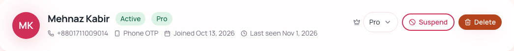

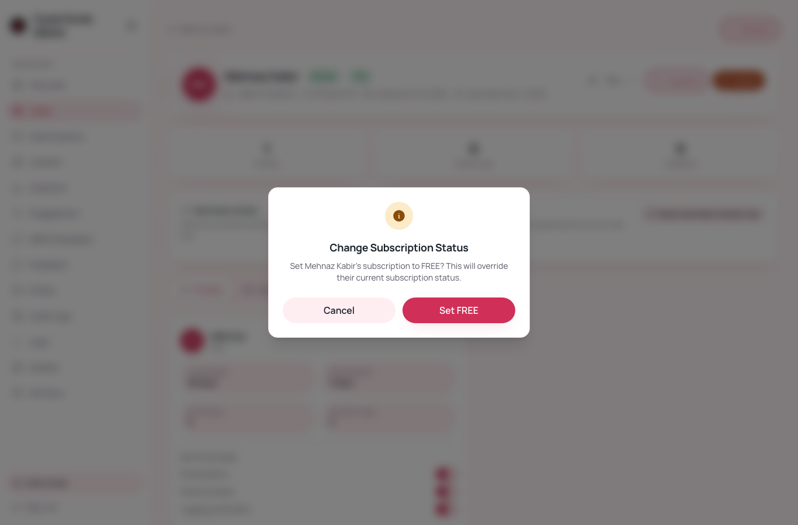

### How to use it

1. Open the menu and choose a plan different from the current one (choosing the current plan does nothing).
2. The window "Change Subscription Status" asks: "Set <name>'s subscription to PRO? This will override their current subscription status." Its confirm button reads **Set PRO**, **Set FREE** or **Set LAPSED**.
3. Press the confirm button. The page refreshes.

### Rules and limits

- The wording of the window does not mention BDApps, but **choosing Free or Lapsed also unsubscribes the number on BDApps** (ADR 0006); choosing Pro does not touch BDApps.
- The change is stored as an Admin override (see [Grant and revoke Pro](#us-pro-override)) and recorded in the audit log, with the previous plan, and in the Translog.
- Choosing Free for an email-trial account changes only the stored plan; the 24-hour trial clock is not changed.
- It also works on Admin accounts.

### What can go wrong

| The Admin sees | Cause | Fix |
|---|---|---|
| Red toast "Plan changed, but the BDApps unsubscribe failed: <error>. The user may still be charged." | Free or Lapsed chosen; BDApps failed | Ask BDApps to unsubscribe the number |
| The plan reverts after the User logs in | BDApps reported a new subscription, which ends the override | Expected |
| The menu is missing | The User is deleted | Restore the User first |

### Related

- [Grant and revoke Pro](#us-pro-override)
- [Plan history and Translog](#us-history)
- [Admin overrides and billing](#pa-admin-overrides)

## Notification preferences {#us-notif-prefs}

### What it is

Three on/off switches per profile on the Profiles tab: **Period alerts**, **Fertile window** and **Logging reminders**. They are the same preferences the User sets in the app ([Notification toggles](#st-notifications)); an Admin can change them on the User's behalf.

### Where to find it

User detail, Profiles tab, under "Notifications" on each profile card.

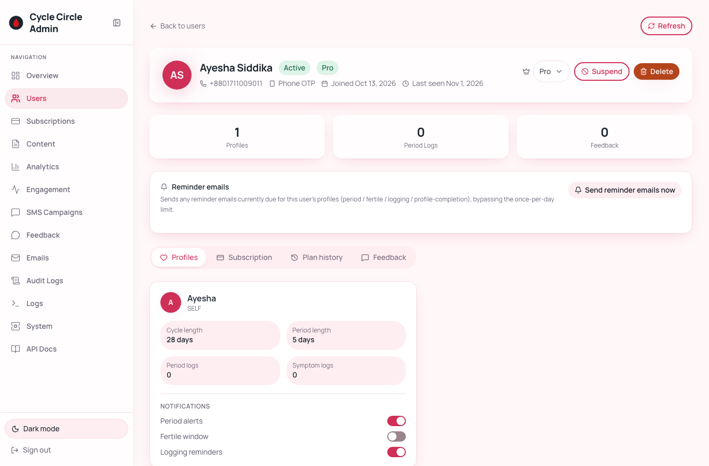

### How to use it

1. Click a switch. It changes at once and is saved.
2. If saving fails, the switch jumps back.

### Rules and limits

- Each profile has its own three switches. All default to on.
- Each change is written to the audit log with the profile and the values.
- The switches control what the reminder run sends.
- Switching a preference off does not cancel a reminder already sent.

### What can go wrong

| The Admin sees | Cause | Fix |
|---|---|---|
| A switch snaps back | The save failed | Check the connection and click again |
| The User still receives a message | A different message type, or an SMS campaign (these ignore these switches) | See [Emails at a glance](#ec-overview) and [SMS campaigns](#sm-list) |

### Related

- [Notification toggles](#st-notifications)
- [Send reminders](#us-reminders)

## Send reminders {#us-reminders}

### What it is

The **Reminder emails** card on the User detail page, with the button **Send reminder emails now**. It runs the daily reminder job for this one User immediately.

### Where to find it

User detail, between the counters and the tabs. Hidden for deleted Users.

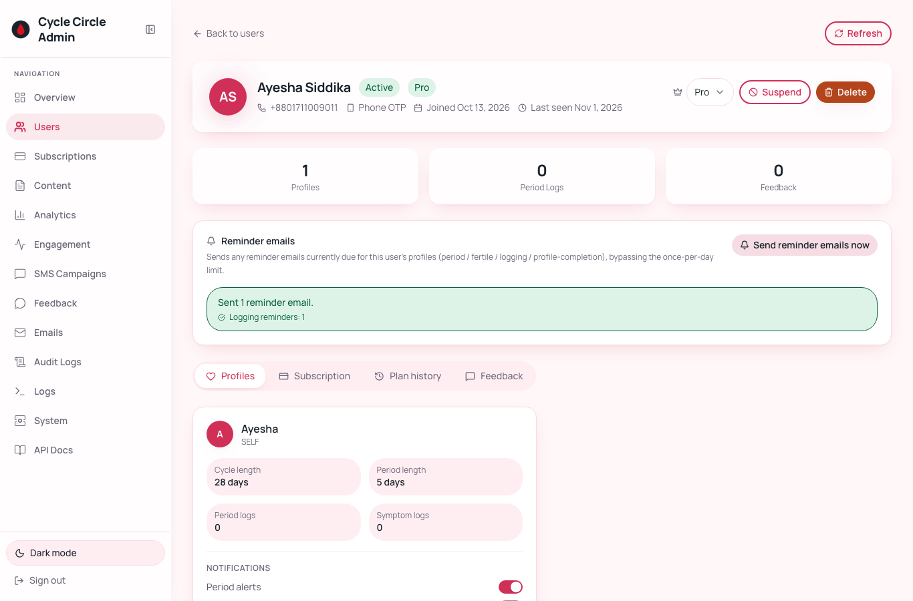

### How to use it

1. Press **Send reminder emails now**.
2. Read the result under the card: "Sent 2 reminder emails." followed by lines such as "Period alerts: 1", "Fertile window", "Logging reminders" and "Profile completion"; or "No reminders are currently due for this user."

### Rules and limits

- The card says it "Sends any reminder emails currently due for this user's profiles (period / fertile / logging / profile-completion), bypassing the once-per-day limit."
- "Due" means: a Period alert if the next predicted period is 0 to 2 days away; a Fertile window message if the fertile window starts today; a Logging reminder if the last period log is 3 or more days old (or there is none); a Profile completion reminder if the User's profile is not complete, they have not opted out and the account is 1 to 14 days old.
- The profile's [notification switches](#us-notif-prefs) are respected. The job also runs when the nightly job is switched off on the System page.
- The same messages are also sent as **SMS to Pro Users with a phone number**, although the card and the result say "emails". The counts include them.
- Running it triggers the same step the daily job runs afterwards: **today's planned SMS campaign message is sent if its send time has passed and it has not gone out yet**. That send is not limited to this User.
- Suspended Users' profiles are not skipped.
- Each run is written to the audit log with the counts.

### What can go wrong

| The Admin sees | Cause | Fix |
|---|---|---|
| "No reminders are currently due for this user." | Nothing matches today, or the switches are off | Check the dates on the profile and the [switches](#us-notif-prefs) |
| "APP_URL or CRON_SECRET is not configured for the admin app" | The admin app lacks the settings to call the web app | Ask the developers to set both on the admin app |
| "Web app returned 401" (or another number) | The secret does not match, or the web app returned an error | Check CRON_SECRET matches on both apps; see [Logs](#lg-viewer) |
| "Failed to send reminders." | The request failed without a reason | Retry; check the web app's health |

### Related

- [Run daily reminders manually](#sy-manual-reminders)
- [Logging reminder](#ec-logging-reminder)
- [Period alert](#ec-period-alert)

## Plan history and Translog {#us-history}

### What it is

The **Plan history** tab: every change to this User's plan, newest first, read from the **Translog** (the record of one plan change: who or what, from what, to what, and the cause).

### Where to find it

User detail, tab **Plan history** (`?tab=plan`).

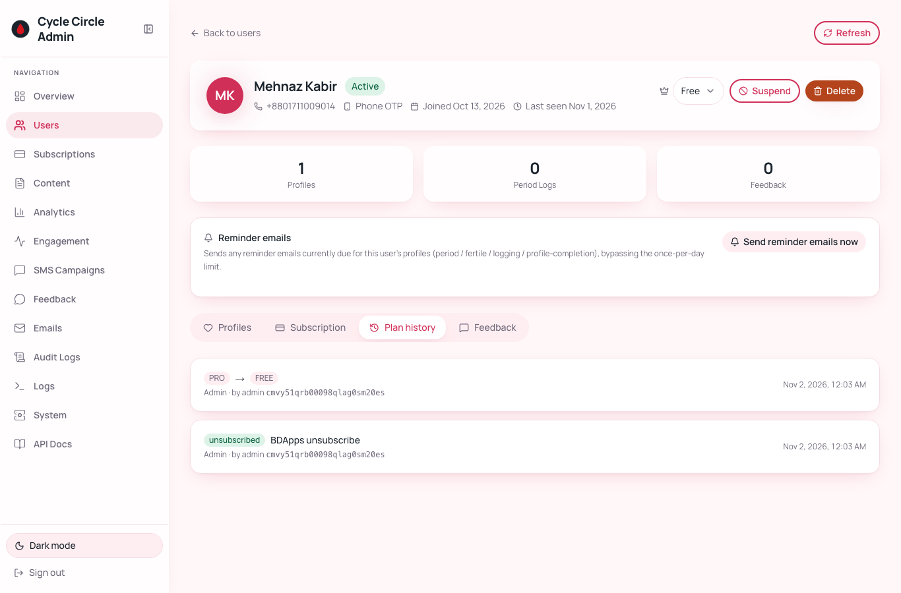

### How to use it

1. Open the tab. Each row shows the old plan, an arrow, the new plan, the cause and the time (Bangladesh time).
2. Two special rows exist: "BDApps unsubscribe" with a badge unsubscribed, skipped or failed (and the error text), and "Admin override kept" when the daily check left an override alone.

### Rules and limits

- Causes shown: OTP sign-in, Phone verified, Dev login, BDApps webhook, Nightly check, Unsubscribed, Admin (with "by admin <id>") and Unknown.
- "(no change)" marks a check that confirmed the same plan.
- It shows at most the latest 200 lines for this User.
- The entries come from **log files**, not the database, and are read only when this tab is opened. They exist only as long as the log files are kept; a User's older history may no longer be there ([Log channels](#lg-channels)).
- After a purge (30 days after deletion) one Translog line remains and the User's page no longer exists.

### What can go wrong

| The Admin sees | Cause | Fix |
|---|---|---|
| "No plan changes recorded for this user." | No change in the retained logs | Nothing to fix; the plan may have been set long ago |
| A "failed" BDApps unsubscribe | BDApps refused the call; the error text is shown | Ask BDApps to unsubscribe the number |
| The tab shows old data after an action | The page was cached | Press **Refresh** |

### Related

- [Grant and revoke Pro](#us-pro-override)
- [Log channels](#lg-channels)
- [Logs viewer](#lg-viewer)
