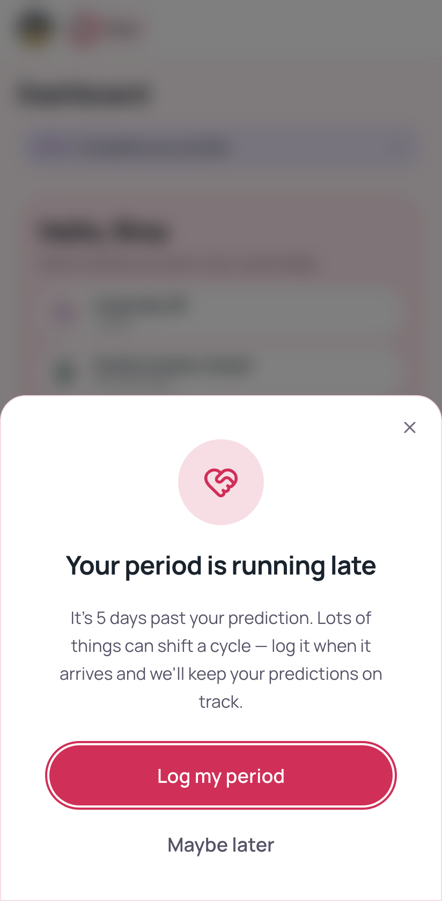
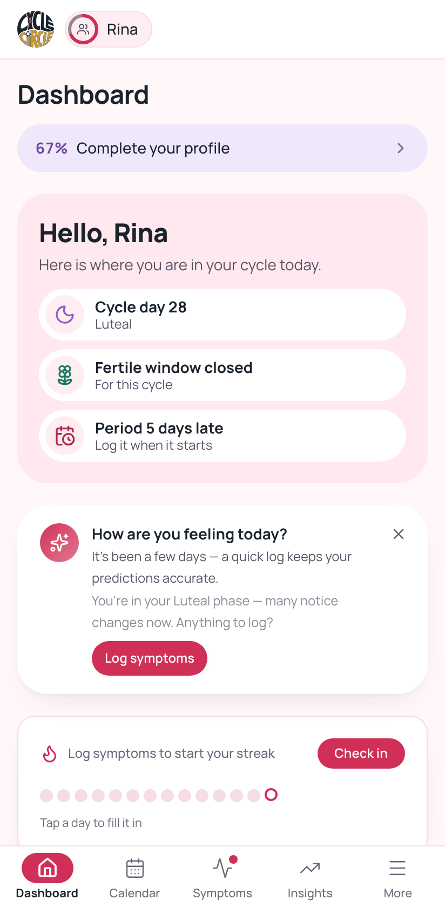
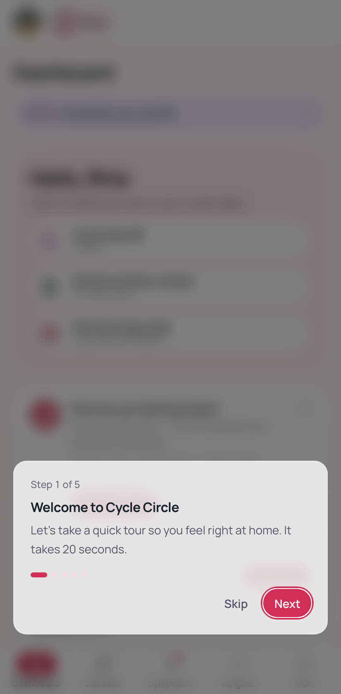
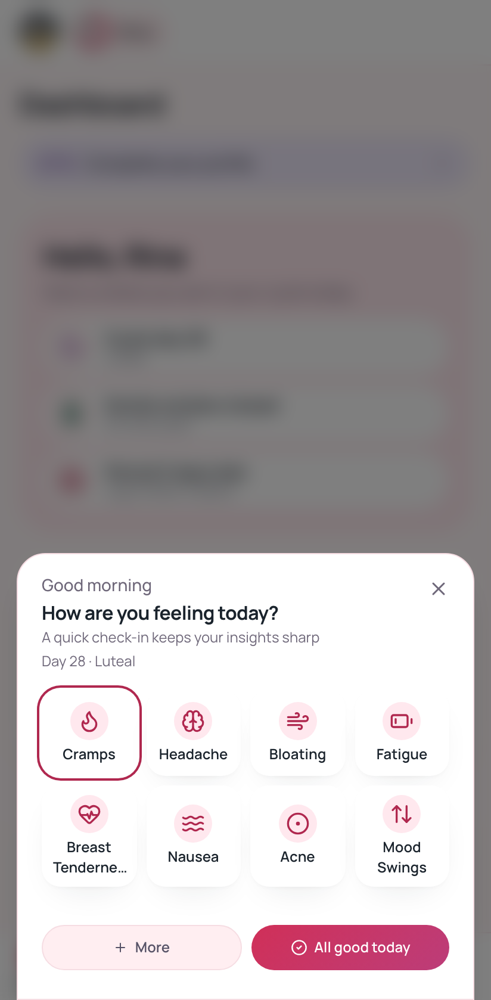
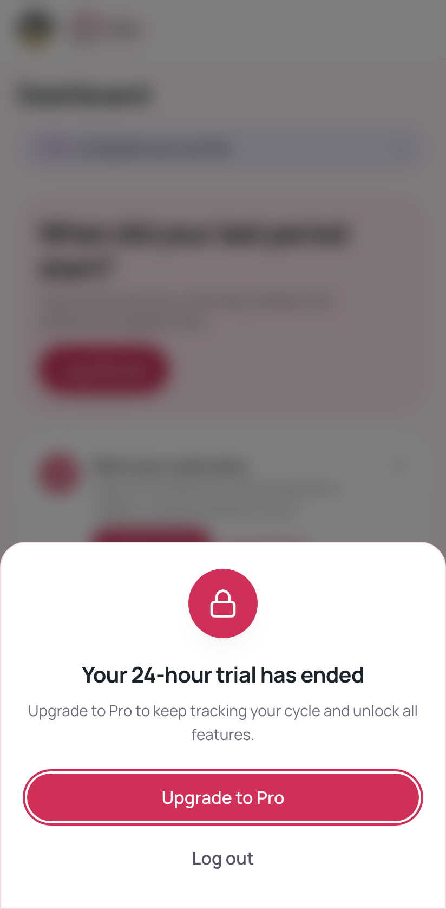
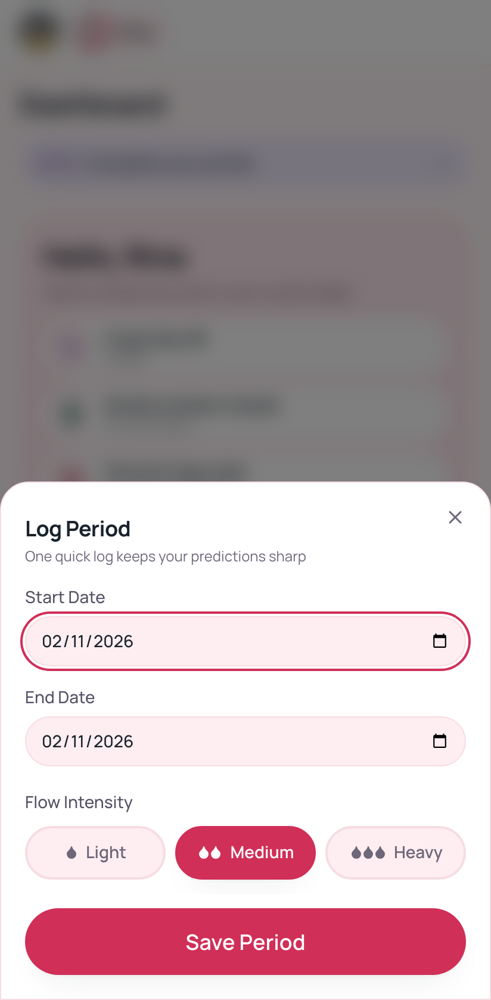
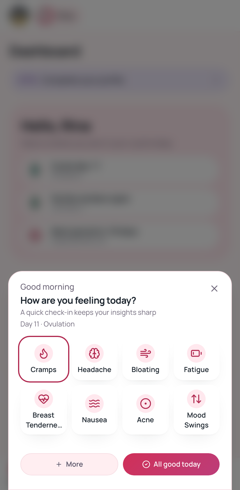
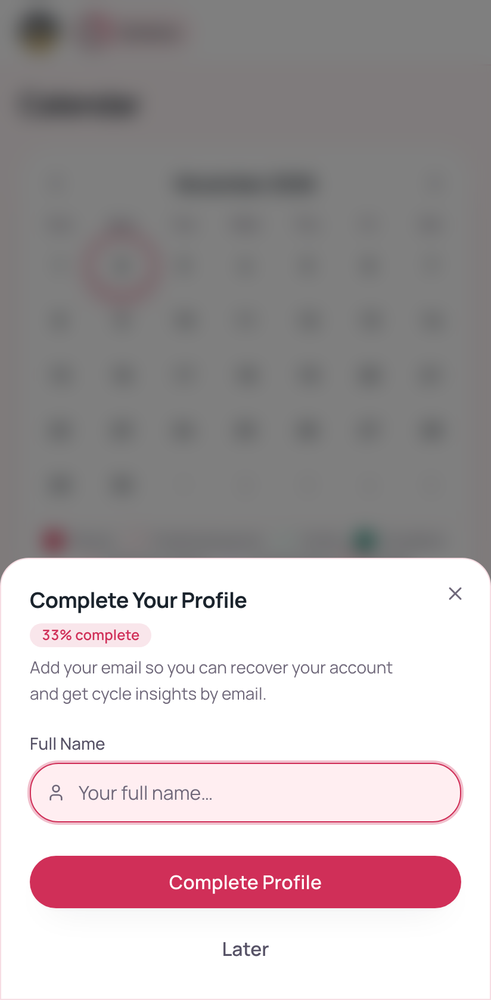

# Auto-prompts

An **auto-prompt** is a pop-up the app opens by itself, without the User tapping anything. There are five: the trial lock, the late-period alert, the onboarding tour, the check-in and the profile-completion prompt. This chapter explains each one and, most important for support, the rule that decides **which one shows and when**.

Support questions here come in two shapes: "why did this pop-up appear?" and "why did it not appear?". Both are answered by the same short list of rules in [The one-prompt-per-page-load rule](#ap-rule).

Other cards on the Dashboard look similar but are **not** auto-prompts and are not covered by the one-per-page-load rule: the **Logging nudge** card ([Logging nudge](#db-nudge)) and the **Complete your profile** row at the top of the Dashboard. They are cards that sit on the page; they do not open over it.

## The one-prompt-per-page-load rule {#ap-rule}

### What it is

At most **one** auto-prompt opens each time the app is loaded. Several may want to open at once (a late period, an unfinished tour, nothing logged today); the app picks one by a fixed order and holds the rest back until the next load.

### Where to find it

There is no screen for the rule; it shows in how the pop-ups arrive. This User has a late period, an unfinished tour and nothing logged today. The first load shows only the late-period alert:

After tapping **Maybe later** nothing else opens, although the tour and the check-in are both waiting:

On the next load (a reload, or opening the app again) the next prompt in line, the tour, opens:

After skipping the tour and loading once more, the check-in is next:

### How to use it

For support, read it as a checklist when a User asks why a pop-up appeared or did not:

1. **Is the trial lock up?** If so, nothing else can open ([Trial lock prompt](#ap-trial-lock)).
2. Otherwise, the prompts are tried **in this order**, and the first one that is allowed wins:
   1. Late-period alert ([Late-period alert](#ap-late-period))
   2. Onboarding tour ([Onboarding tour prompt](#ap-tour))
   3. Check-in ([Check-in prompt](#ap-checkin))
   4. Profile-completion prompt ([Profile-completion prompt](#ap-completion))
3. Once one has opened, **no other opens until the next page load**, even after the first is closed.

### Rules and limits

- **A "page load" is a full load of the app**: opening it, refreshing, or opening it in a new tab or window. Moving between screens inside the app (for example Calendar to Dashboard) is **not** a new page load. A late-period alert closed on the Calendar therefore does not make the check-in open when the User then taps **Dashboard**.
- **The trial lock is outside the rule.** It is not counted, it cannot be closed, and while it shows nothing else opens.
- **Closing, or ignoring, a prompt uses up its turn.** A prompt counts as shown the moment it opens.
- **Once a Bangladesh day, per browser.** The late-period alert, the tour and the check-in each open at most once per Bangladesh day. The late-period alert and the check-in are counted separately for **each profile**. The profile-completion prompt opens at most once every **3 days**. The time each prompt last opened is stored in the browser, not on the account. So a User on a second phone, in a private window, or after clearing browser data sees them again, and a User who switches profile may get a second check-in or late-period alert on the same day.
- **Where each can open:** the check-in and the tour only on the **Dashboard**. The late-period alert and the profile-completion prompt on any screen of the signed-in app.
- **Waiting:** a prompt that is still loading its data holds back the lower-priority ones, so the pop-up that finally opens may arrive a second or two after the page.
- **User-started pop-ups are not auto-prompts.** Tapping **Check in**, **Log Symptoms**, the **Complete your profile** row, or **Replay app tour** in Settings always opens its pop-up, whatever else has shown. A replayed tour takes that page load's slot so nothing else opens over it. None of these can open while the trial lock is up.
- The order is fixed. The check-in is **below** the tour, so an unfinished tour wins the check-in's page load. The check-in is below the late-period alert as well.

### What can go wrong

| The User sees | Cause | Fix |
|---|---|---|
| A pop-up they did not expect | It is the highest-priority prompt that was allowed that load | Use the checklist above |
| The check-in did not open | Another prompt took the page load, it already opened today, or something is already logged today | Tap **Check in** on the Dashboard ([Daily check-in](#sc-checkin)) |
| The tour did not open after onboarding | The late-period alert took the page load, or the tour already ran or was finished | Replay it from Settings ([Replay the tour](#st-replay-tour)) |
| The same pop-up opens every time on a particular phone | The browser is not keeping its storage (private mode, cleared data) | Use a normal browser window |
| A pop-up opens again after they closed it | It was a new Bangladesh day, a new load of a different profile, or a different browser | Expected |

### Related

- [Trial lock prompt](#ap-trial-lock), [Late-period alert](#ap-late-period), [Onboarding tour prompt](#ap-tour), [Check-in prompt](#ap-checkin), [Profile-completion prompt](#ap-completion)
- [Onboarding tour](#gs-tour), [Daily check-in](#sc-checkin)

## Trial lock prompt {#ap-trial-lock}

### What it is

A full-screen block shown to an **email-trial** account whose 24-hour trial has ended. It cannot be closed. The only ways past it are to upgrade or to log out.

### Where to find it

It opens over whatever screen the User is on, as soon as the app has checked their account.

It shows a lock icon, the title "Your 24-hour trial has ended", the text "Upgrade to Pro to keep tracking your cycle and unlock all features.", and two buttons: **Upgrade to Pro** and **Log out**.

### How to use it

1. **Upgrade to Pro** goes to the **Subscription** page, where the User verifies a phone number and subscribes ([Subscription page and status](#sb-status), [Adding a phone to keep an account](#pa-keep-account)).
2. **Log out** ends the session and goes to the login screen.
3. After a successful upgrade the lock disappears without reloading.

### Rules and limits

- It shows only when **all three** are true: the account signed up by **email**, its plan is **Free**, and its trial end time has passed. A User who logged in by phone never sees it, even if their Pro subscription ended ([Lapsed](#pa-lapsed)).
- The trial is 24 hours from the first magic-link login ([Email trial](#pa-email-trial)).
- It cannot be dismissed: no close button, and the Escape key and tapping outside do nothing.
- It steps aside on the **Subscription** page so the User can pay. Opening any other page brings it back.
- While it shows, **no other pop-up opens** and the pop-ups a User opens themselves are blocked too.
- The check is made against the phone's own clock in the app. Separately, the server refuses any data request from an expired trial with the error "Email trial has expired. Please upgrade to PRO." (HTTP 402), whatever the phone's clock says. A phone with its clock set wrongly can therefore show or miss the lock early or late, but cannot read or save data once the trial is over.

### What can go wrong

| The User sees | Cause | Fix |
|---|---|---|
| "Your 24-hour trial has ended" | Their email trial ran out | Upgrade, or log out |
| The lock still shows after they paid | The account has not yet moved to Pro, or the page has not refreshed | Reload; check the plan in Settings and the Admin panel ([Plans & access](#pa-at-a-glance)) |
| "Email trial has expired. Please upgrade to PRO." on a screen | The server refused a request after expiry | Same as above |
| The lock on a phone User | Cannot happen; only email accounts get it | Check how the User logged in |
| No lock, but the trial clock says it is over | The phone's clock is behind | Fix the phone's date and time |

### Related

- [Trial lock](#pa-trial-lock), [Email trial](#pa-email-trial), [Adding a phone to keep an account](#pa-keep-account)
- [One prompt per page load](#ap-rule)

## Late-period alert {#ap-late-period}

### What it is

A pop-up that tells a User their period is later than predicted and invites them to log it when it comes.

### Where to find it

It opens by itself on any screen of the signed-in app on the first load of the day when the active profile's period is late.

The title is "Your period is running late". The text reads "It's 5 days past your prediction. Lots of things can shift a cycle — log it when it arrives and we'll keep your predictions on track." ("1 day" in the singular.) The buttons are **Log my period** and **Maybe later**; an X closes it too.

### How to use it

1. Tap **Log my period** when the period has started. The alert closes and the **Log Period** pop-up opens on the Dashboard (the app moves there first if needed) with today's date filled in.

   

2. Or tap **Maybe later** to close it. Nothing is saved.

### Rules and limits

- **Late** means the next predicted period start is **before today** (Bangladesh day). The number in the text is how many days have passed since that predicted date. It uses the prediction record, or, with none, the last period start plus the profile's cycle length ([How predictions work](#pr-how)).
- With no last period and no prediction there is nothing to compare against, so no alert.
- The check does not look at the tracking goal, so a profile with a menopause-related goal can also see it.
- Once per Bangladesh day for each profile in each browser; only after any trial lock and before the tour, check-in and profile prompts ([One prompt per page load](#ap-rule)).
- A late period also shows on the Dashboard as "Period N days late" with the line "Log it when it starts"; that text stays all day. The pop-up is the only part that opens by itself.
- It stops as soon as the User logs a period that moves the next predicted date into the future.

### What can go wrong

| The User sees | Cause | Fix |
|---|---|---|
| "Your period is running late" and they say it is not | The predicted date passed. A period they forgot to log looks late | Log the period (use **Log my period**), or backfill it ([Backfill a past period](#lc-backfill)) |
| The number of days is wrong | The prediction uses the logged history | Check the last period dates ([Edit or delete a period](#lc-edit-delete)) |
| The alert comes every day | Still no period logged, so still late. It repeats once a Bangladesh day | Log the period |
| The alert never comes for a User who is late | No logged period, or it already opened today on this browser, or another prompt took the page load | See the checklist in [One prompt per page load](#ap-rule) |
| The alert is for a different profile | Active profile is not the one they meant | Switch profile |

### Related

- [One prompt per page load](#ap-rule), [Log a period](#lc-log-period), [How predictions work](#pr-how)
- [Cycle hero](#db-hero)

## Onboarding tour prompt {#ap-tour}

### What it is

The five-step first-run tour opening by itself on the Dashboard. The tour's content and replay are described in [Onboarding tour](#gs-tour); this section explains when it opens and when it does not.

### Where to find it

It opens on the Dashboard the first time a User reaches it after onboarding.

### How to use it

1. Tap **Next** through the five steps, or **Skip** at any time. On the last step the button reads **Done**.
2. The Escape key also closes it.

### Rules and limits

- It opens **only on the Dashboard**, and only for an account that has **not finished** the tour.
- **Skip**, **Done** and Escape all count as finished. That is saved on the account, so it will not open again on another phone or browser.
- Third in the order: the trial lock and the late-period alert both beat it ([One prompt per page load](#ap-rule)). It beats the check-in.
- It opens at most once per Bangladesh day per browser. If the "finished" save fails (no signal), the tour stays unfinished on the account and comes back, at the earliest, on the next Bangladesh day.
- Replaying from Settings is a User-started action and ignores the daily limit ([Replay the tour](#st-replay-tour)).

### What can go wrong

| The User sees | Cause | Fix |
|---|---|---|
| No tour after onboarding | The late-period alert took the page load, or they finished it earlier | Reload on the next day, or replay it from Settings |
| The tour opens again on another phone | The earlier "finished" did not save | Finish it again with a network connection |
| Tour opens on top of nothing else | Normal | None |
| Tour does not open on the Calendar | It only opens on the Dashboard | Go to the Dashboard |

### Related

- [Onboarding tour](#gs-tour), [Replaying the tour](#gs-tour-replay), [Replay the tour](#st-replay-tour)
- [One prompt per page load](#ap-rule)

## Check-in prompt {#ap-checkin}

### What it is

The daily check-in pop-up ([Daily check-in](#sc-checkin)) opening by itself on the Dashboard, once a day, when today is not logged yet.

### Where to find it

On the Dashboard, on the first load of the Bangladesh day for each profile, when nothing is logged today and no higher prompt took the load.

### How to use it

Same as the manual check-in: tap quick symptoms and **Save (N)**, tap **All good today**, or tap **More** for the full list ([Daily check-in](#sc-checkin), [All good today](#sc-all-good), [Quick symptom pop-up](#sc-quick-symptom)). Close it with the X to dismiss it for the day.

### Rules and limits

- Opens only on the **Dashboard**, and only when the active profile has **nothing logged today**: no symptom, no "all good" and no period day covering today.
- Once per Bangladesh day for each profile in each browser. Closing without saving still uses up that day's prompt; the **Check in** button stays on the Dashboard.
- Fourth in the order: below the trial lock, the late-period alert and the tour ([One prompt per page load](#ap-rule)). It holds back the profile-completion prompt on the Dashboard until it has settled.
- Pop-up and button are the same pop-up; the automatic one only differs in how it opens.
- This prompt is not the same as the **Logging nudge** card ([Logging nudge](#db-nudge)): the card appears after three days with no log, stays on the page and has its own dismiss button.

### What can go wrong

| The User sees | Cause | Fix |
|---|---|---|
| No check-in pop-up today | Another prompt took the load, it already opened today in this browser, or today is already logged | Tap **Check in** on the Dashboard |
| The check-in opens twice on one day | A second browser, or a second profile | Expected; the limit is per browser and per profile |
| "Couldn’t save your symptoms. Please try again." | The save failed | Tap **Save (N)** or **All good today** again |
| The check-in opens on the Calendar | It cannot; only on the Dashboard | Check which screen they are on |

### Related

- [Daily check-in](#sc-checkin), [All good today](#sc-all-good), [Check-in strip](#db-checkin-strip)
- [One prompt per page load](#ap-rule)

## Profile-completion prompt {#ap-completion}

### What it is

A reminder to finish the account details that help predictions and account recovery. It asks for a name, and points to Settings for a missing phone or email.

### Where to find it

It opens by itself on any signed-in screen, about a minute after the app loads.

The title is "Complete Your Profile", with a badge such as "33% complete". The text depends on what is missing: "Add your phone number to keep your account after the trial period" when a phone is missing, "Add your email so you can recover your account and get cycle insights by email." when only an email is missing. If the full name is missing there is a **Full Name** field (placeholder "Your full name…").

### How to use it

1. If a name is asked for, type it and tap **Complete Profile**. It saves the name and closes the pop-up.
2. If only a phone or email is missing, the pop-up has **Later** and **Settings**. **Settings** opens Settings, where the phone or email is added ([Add or verify an email](#st-email), [Add or verify a phone](#st-phone)).
3. **Later**, or the X, closes it.

### Rules and limits

- **What it measures.** Six items, each worth one sixth: full name, phone number, email address, tracking goal, cycle history (cycle length, period length and last period set), and first period logged. The badge percentage is the done items out of six, rounded. The prompt can only collect the **full name** itself.
- **Both phone and email count.** A phone User who never adds an email stays below 100% and keeps getting this prompt; so does an email User who never adds a phone. The glossary calls these details optional, but the prompt does not stop until all six are done.
- **When it opens** (all must hold): the profile is below 100%; the account is **more than 24 hours old**; **60 seconds** have passed since the app loaded; it has not opened in this browser in the last **3 days**; and no other auto-prompt opened this page load. It is the last in the order ([One prompt per page load](#ap-rule)).
- On the Dashboard the prompt cannot beat the check-in. On other screens it can open if no other prompt did.
- A toast "Nice — your profile is N% complete!" appears when the percentage goes up.
- The full name must not be empty. It is limited to 200 characters.
- The completion row on the Dashboard ("Complete your profile" with a percentage) is a User-started way into the same pop-up and is not limited.

### What can go wrong

| The User sees | Cause | Fix |
|---|---|---|
| "Full name is required" | They submitted an empty name | Type a name |
| "Something went wrong. Please try again." | Saving the name failed | Try again; check the connection |
| The prompt keeps returning every few days | The profile is below 100%. A missing email or phone counts | Add the missing details in Settings |
| They never see it | The account is new (under 24 hours), they closed the app within a minute, or another prompt took the load | Expected |
| The prompt asks for a phone, but the pop-up has no phone field | The pop-up collects only the name. Phone and email are added in Settings | Tap **Settings** |
| The English text is shown to a Bengali User | "Full name is required", "Something went wrong. Please try again." and "You're all set on contact info." are not translated | Known gap |

### Related

- [Profile completion](#pf-completion), [Add or verify an email](#st-email), [Add or verify a phone](#st-phone)
- [One prompt per page load](#ap-rule)
