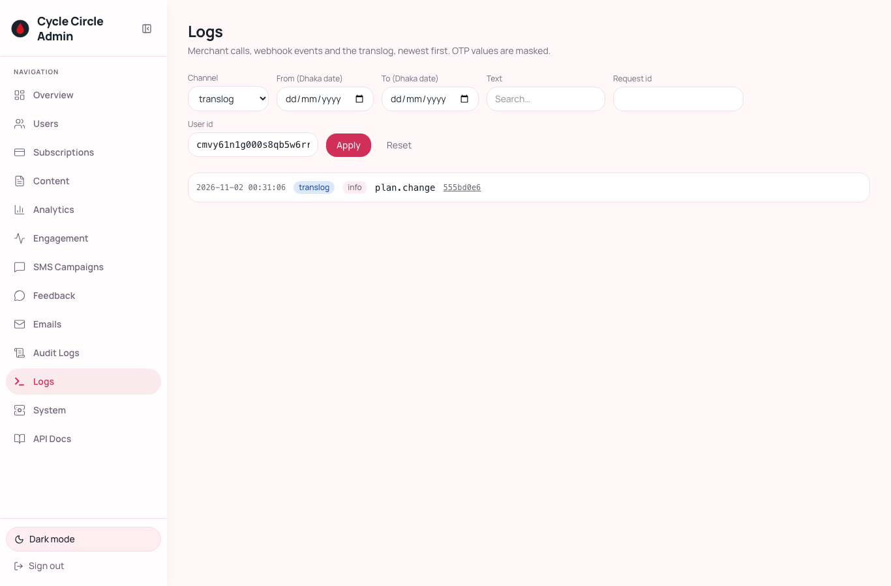
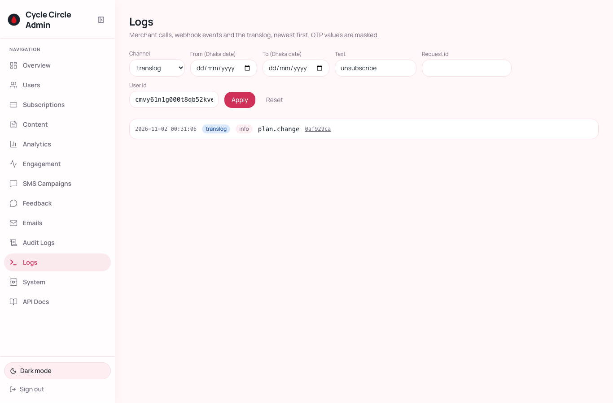

# BDApps billing events

## Subscribe {#bb-subscribe}

### What it is

Phone login **is** the subscription. When a User verifies a BDApps OTP, BDApps subscribes the number to Cycle Circle and the User becomes **Pro** (ADR 0002). BDApps does the charging; Cycle Circle does not charge anyone itself.

### Where to find it

The effect is in **Admin > Subscriptions** (the User's row shows Pro) and **Admin > Users > User detail > Plan history**. The raw event is a "plan.change" line in **Admin > Logs**, channel "translog", with cause "otp-verify":

### How to use it

1. The User enters a number and the BDApps OTP ([Phone login](#gs-phone-login)).
2. The app sends the code to BDApps. BDApps subscribes the number and returns a masked subscriber id (an opaque address instead of the phone number).
3. The app stores that id, marks the User **Pro**, and logs them in. A new number creates the account.
4. A User on an email trial who verifies a phone in the app goes the same way ([Adding a phone to keep an account](#pa-keep-account)).

### Rules and limits

- The masked id is the only address BDApps accepts for this number afterwards (status check, unsubscribe, App OTP). It changes with each new subscription.
- A "charging pending" answer from BDApps still counts as Pro. The webhook or the daily subscription check corrects it later. Only an explicit unregistered or blocked status leaves the User Free.
- **An Admin override wins.** If an Admin revoked Pro and BDApps now reports a *new* masked id, the override ends and the User is Pro; the same id counts only if the earlier BDApps unsubscribe worked ([Admin overrides and billing](#pa-admin-overrides)).
- The same number logging in again does not subscribe twice: an already-subscribed number gets an App OTP instead ([OTP messages](#as-otp)).
- The price is the Pro price shown to Users ([Pro price](#sb-price)); it is set by an Admin and does not change what BDApps charges.

### What can go wrong

| The User sees | Cause | Fix |
|---|---|---|
| Logged in but shown Free | BDApps reported the number unregistered or blocked at verify | Check the merchant log for the verify response; log in again |
| "We can't send a code to this number's mobile operator yet. Please try another number." | The operator is not supported by BDApps | Use email login or another number |
| Pro User but not in Subscriptions | The Subscription row is created at verify; very old accounts may only have a phone id | Open User detail; use **Run now** on the check ([Run the subscription check manually](#sy-manual-sub-check)) |

### Related

- [Phone login](#gs-phone-login), [Pro](#pa-pro), [Subscriptions list](#su-list), [Plan history and Translog](#us-history)

## Unsubscribe {#bb-unsubscribe}

### What it is

The number stops being a BDApps subscriber, so billing stops, and the User becomes **Free**. Their data is kept.

### Where to find it

In **Admin > Logs**, channel "translog": a "plan.change" line with cause "unsubscribe" (the User tapped it in the app), "webhook" (BDApps told us) or "nightly-check" (the daily check found it).

### How to use it

Ways an unsubscribe happens:

1. **The User** taps **Unsubscribe from Pro** in the app ([Unsubscribe](#sb-unsubscribe)). The app asks BDApps to unsubscribe the stored subscriber id, then marks the User Free.
2. **The User** unsubscribes outside the app (BDApps USSD or portal). BDApps sends a notification to the app ([How events reach the app](#bb-webhooks)), or the daily check finds it by 08:00 Bangladesh time next day.
3. **An Admin** revokes Pro, suspends or deletes the User. These also ask BDApps to unsubscribe, so no one is charged for access that was removed (ADR 0006). Unsuspending or restoring does not subscribe again.

### Rules and limits

- A Pro User whose Pro was granted by an Admin cannot unsubscribe in the app: "Your plan was set by an admin and cannot be cancelled here." (the screen shows "Your Pro access was granted by our team, so it can't be cancelled here. Contact support.").
- An account with no phone cannot unsubscribe: "A phone number is required to unsubscribe." (screen text: "No phone number is linked to this account. Add one to manage your subscription.").
- The data stays; SMS alerts stop; logging in with the phone again subscribes the number again.
- If BDApps cannot be reached when an Admin revokes, suspends or deletes, our side still changes and the Admin sees the BDApps failure text. The number may still be charged: check on BDApps.
- A Pro User who becomes Free is recorded as churn: reason "BDApps unsubscribe" (user action or webhook), "daily subscription check", "admin revoke" or "account deleted" ([Churn](#an-churn)).

### What can go wrong

| The User or Admin sees | Cause | Fix |
|---|---|---|
| "Couldn't unsubscribe. Try again in a minute." | BDApps did not answer | Retry; unsubscribe on BDApps if it persists |
| A red BDApps unsubscribe failure toast after revoke/suspend/delete | BDApps call failed | Unsubscribe the number on BDApps by hand |
| User says they are still charged | The number is still registered on BDApps | Check in the merchant log; unsubscribe on BDApps |

### Related

- [Unsubscribe](#sb-unsubscribe), [Suspend and reactivate](#us-suspend), [Delete and restore](#us-delete-restore), [Daily subscription check](#sj-sub-check)

## Lapse {#bb-lapse}

### What it is

A **lapse** is BDApps ending a subscription without the User tapping anything (for example the number was unregistered, or billing stopped). In Cycle Circle the User simply becomes **Free**. The word "Lapsed" (shown to the User as "Expired") is a different thing: it is only ever set by an Admin ([Lapsed](#pa-lapsed)).

### Where to find it

Same place as an unsubscribe: **Admin > Logs**, channel "translog", cause "webhook" or "nightly-check", and the User's row in **Admin > Subscriptions**.

### How to use it

1. BDApps posts "UNREGISTERED" for the subscriber, or the daily subscription check at 08:00 Bangladesh time sees it ([Daily subscription check](#sj-sub-check)).
2. The User moves to Free; subscription status and caches are refreshed, so the Subscription page shows Free on the next load.
3. The User keeps all data and the whole app except SMS alerts.
4. To get Pro back, the User logs in by phone again.

### Rules and limits

- There is **no grace period**: the move to Free is immediate (ADR 0002, amendment of 2026-10-19).
- Cycle Circle never retries a charge; BDApps does the billing.
- The daily check never downgrades because of an error, and skips old accounts that only have a raw phone id.
- An Admin override is kept over a lapse ([Admin overrides and billing](#pa-admin-overrides)); the translog records "plan.override-kept".
- Each lapse of a Pro User is recorded as churn ([Churn](#an-churn)).

### What can go wrong

| The User sees | Cause | Fix |
|---|---|---|
| "I paid but I'm Free" | BDApps reported UNREGISTERED, or the notification never reached the app | Check the webhook and merchant logs; if BDApps shows the number registered, run the check or log in again |
| Pro shown after unsubscribing on BDApps | The notification was missed and the daily check has not run | Wait for 08:00 or **Run now** |

### Related

- [Lapsed](#pa-lapsed), [Plans at a glance](#pa-at-a-glance), [Churn](#an-churn)

## How events reach the app {#bb-webhooks}

### What it is

BDApps tells Cycle Circle about changes by posting small messages (webhooks) to the web app. This is how a subscribe or unsubscribe done outside the app, an SMS delivery report, or a reply reaches the system.

### Where to find it

**Admin > Logs**, channel "webhook". Each event is one line, for example "subscription.notify".

### How to use it

| Address on the web app | What BDApps sends | What the app does |
|---|---|---|
| `/api/webhooks/subscription/notify` | A subscriber's status changed (REGISTERED or UNREGISTERED) | Moves the matching User to Pro or Free |
| `/api/webhooks/sms/report` | A delivery report for an SMS | Adds to the message's Delivered or Failed count ([Delivery reports](#as-delivery-reports)) |
| `/api/webhooks/sms/receive` | A reply SMS sent to the service | Stored only; nothing replies or acts |
| `/api/webhooks/ussd/receive` | A USSD message | Stored only |
| `/api/webhooks/resend` | Resend email delivery news (delivered, bounced, complained, delayed) | Updates the email's Delivery status ([Emails at a glance](#ec-overview)) |

### Rules and limits

- The app always answers BDApps with `{"statusCode":"S1000","statusDetail":"Received"}` when the call is accepted, even for events it ignores.
- A call is accepted only from the IP addresses listed in the server setting `BDAPPS_WEBHOOK_IPS` (if set) and, for subscription notices, only for this app's id. Otherwise the answer is 401 "Unauthorized: unknown webhook source" or "Unauthorized: unknown application". Resend calls are checked by signature.
- Each event is stored once. A repeat (same subscriber and time stamp, or same request id and recipient) is logged as "ignored: duplicate" and not applied again.
- For subscription notices, only REGISTERED and UNREGISTERED are acted on (a trailing dot as in "REGISTERED." is tolerated). Any other status is logged as "ignored: unhandled-status".
- The subscriber is matched by the masked id stored at subscription, then by phone number. A notice for nobody is logged as a warning "ignored: no-matching-user".
- If the webhook is missed, the daily subscription check catches an unsubscribe within a day. A new subscription done outside the app (for example by USSD) is only picked up by the webhook or the next phone login; the daily check only looks at Pro Users and revoked Users.

### What can go wrong

| The Admin sees | Cause | Fix |
|---|---|---|
| No "subscription.notify" lines at all | BDApps cannot reach the app, or the nginx host does not pass the real client IP | Ask the server owner to check the nginx access log and `BDAPPS_WEBHOOK_IPS` |
| Line with "unknown webhook source" | The caller's IP is not on the list | Add BDApps' IP to the setting |
| "ignored: no-matching-user" | The number has no account or a different masked id | Check the User's subscriber id in the merchant log |
| "ignored: duplicate" | BDApps retried | Nothing to do |

### Related

- [Logs viewer](#lg-viewer), [Log channels](#lg-channels), [Daily subscription check](#sj-sub-check), [Delivery reports](#as-delivery-reports), [Troubleshooting: Billing](#ts-billing)
