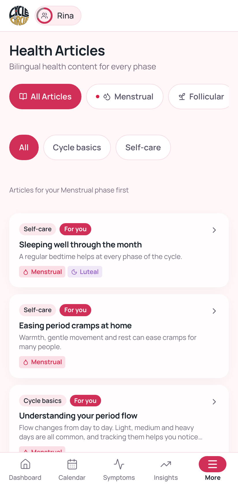
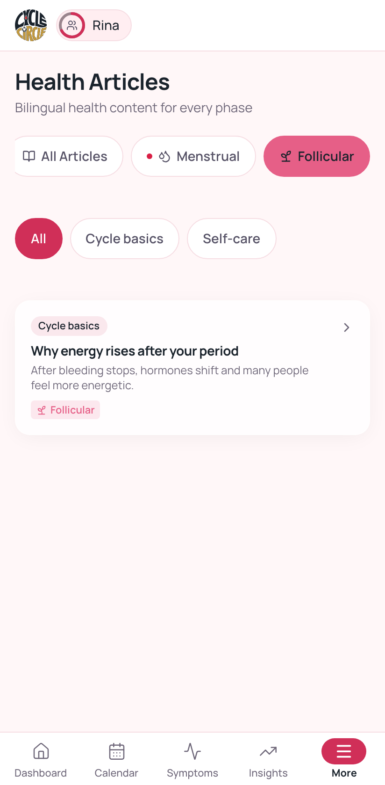
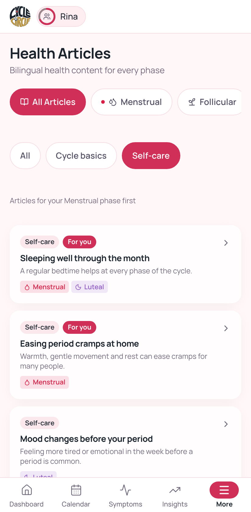
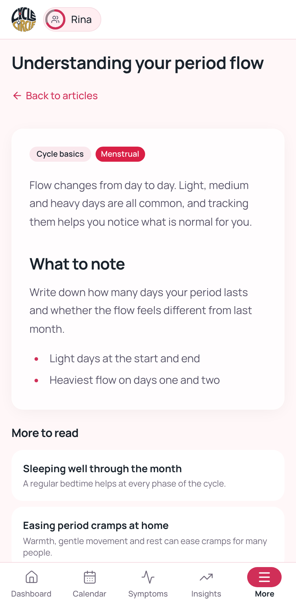
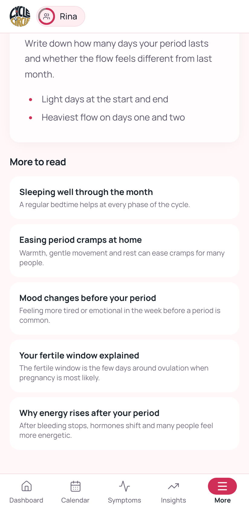

# Content

The Learn area: health articles written by Admins, shown to Users in the app. Articles are written, scheduled and published in the admin panel ([Article editor](#ac-editor)); this chapter is what the User sees. Support questions here are "where is the article I was told about?", "why do I see English?" and "why is the list empty?".

## Learn: article list {#ct-learn}

### What it is

A list of every published article, newest first, with a short preview of each. Articles that match the User's current cycle phase are moved to the top and marked "For you".

### Where to find it

On a phone: **More > Learn**. On desktop: **Learn** in the left sidebar. The address is `/content`. The page title is "Health Articles" with the line "Bilingual health content for every phase".

### How to use it

1. Scroll the list. Each card shows the category, the title, a preview of the first words, and the cycle phases the article is about (Menstrual, Follicular, Ovulation, Luteal).
2. When the User is in a known phase, a note reads "Articles for your Menstrual phase first" (with her current phase) and matching cards carry a "For you" badge. A small dot on a phase tab marks her current phase.
3. Tap a card to read it ([Reading an article](#ct-reader)).

### Rules and limits

- Only articles that are **Published** and whose publish time has passed are shown. Drafts, archived articles and articles scheduled for later never appear ([Scheduled publishing](#ac-schedule)).
- The list holds at most 50 articles, newest first; there are no more pages.
- Previews are the first 160 characters of the article text.
- The current phase comes from the active profile ([Switch the active profile](#pf-switch)). With no phase known (no period logged yet), nothing is promoted and no note shows.
- "For you" and the phase note appear only on the "All Articles" tab.
- Changes made by an Admin can take up to about a minute to show in the list, because the list is kept for 60 seconds.
- A User who reads in Bengali sees Bengali titles and previews where they exist. Where an article has no Bengali title or preview, the card shows the English text with a small "EN" tag.
- There is no search box. Learn is the same on every plan.

### What can go wrong

| The User sees | Cause | Fix |
|---|---|---|
| "No articles yet" and "Health content will appear here once published" | No article is published (or none matches the tab and category chosen) | Admin publishes one ([Article list](#ac-list)); otherwise change the tab or chip |
| An article the Admin just published is missing | The list is kept for up to a minute; or its publish time is still in the future | Wait a minute and reload; check [Scheduled publishing](#ac-schedule) |
| Some cards in English although the app is in Bengali | The article has no Bengali translation yet | Admin adds the translation ([Article editor](#ac-editor)) |
| An article she saw yesterday is gone | It was unpublished or archived | Admin republishes it |

### Related

- [Filter by phase](#ct-filter)
- [Reading an article](#ct-reader)
- [Article list (Admin)](#ac-list)
- [Switching language](#nl-switch-language)

## Filter by phase {#ct-filter}

### What it is

Tabs for the four cycle phases, and chips for article categories, that narrow the list.

### Where to find it

At the top of **Learn**: the tabs "All Articles", "Menstrual", "Follicular", "Ovulation", "Luteal", and below them the category chips ("All" and one chip per category).

### How to use it

1. Tap a phase tab. The address becomes `/content?phase=FOLLICULAR` (or the phase chosen) and only articles tagged for that phase remain.
2. Tap a category chip to narrow further. Tap "All" to clear the category.
3. Tap "All Articles" to clear the phase.

### Rules and limits

- A phase tab shows articles tagged with that phase; an article can be tagged for several phases and appears under each.
- Category chips show only categories that have at least one published article, in the order the Admin set ([Categories](#ac-categories)). Chips are hidden when there are no categories.
- The phase filter is in the address, so it survives a reload and can be shared. The category chip is not: it resets on reload and when leaving the page.
- Phase and category together show articles that match both.

### What can go wrong

| The User sees | Cause | Fix |
|---|---|---|
| "No articles yet" after tapping a tab | No published article is tagged for that phase | Choose another tab; Admin tags articles ([Article editor](#ac-editor)) |
| The phase tab clears but the category chip is still on | The category chip is separate from the phase tabs | Tap "All" in the chips |
| A category she expects has no chip | No published article is in that category | Admin publishes one or assigns the category |

### Related

- [Learn: article list](#ct-learn)
- [Categories (Admin)](#ac-categories)
- [Phase pattern](#db-phase-pattern)

## Reading an article {#ct-reader}

### What it is

The full text of one article on its own page.

### Where to find it

Tap a card in **Learn**. The address is `/content/<article id>`; it can be opened directly, bookmarked or shared with another logged-in User.

### How to use it

1. Read the article. Its category and phases show as tags above the text.
2. Tap **Back to articles** to return to the list.
3. At the end, "More to read" lists up to five other articles, those sharing a phase first.

### Rules and limits

- Only published articles open. A draft, archived or still-scheduled article, or a wrong id, shows the "Page not found" screen.
- The text is cleaned before it is shown, so unsafe HTML an Admin might paste is removed.
- A Bengali reader gets the Bengali title and text when they exist. If there is no Bengali text, the English text is shown with a note "Showing in English — Bengali translation coming soon".
- Each User opening an article counts as one view per Bangladesh day, however many times she reopens it; that feeds the Views column in the admin panel ([Views column](#ac-views)). Views by suspended or deleted Users are not counted, and a failure to count never blocks reading.
- The reader is the same on every plan.

### What can go wrong

| The User sees | Cause | Fix |
|---|---|---|
| "Page not found" | The article was unpublished, is a draft or scheduled, or the link is wrong | Admin checks its status ([Article list](#ac-list)) |
| "Showing in English — Bengali translation coming soon" | No Bengali body yet | Admin adds the translation |
| The login page instead of the article | The link was opened while logged out | Log in, then open the link again |

### Related

- [Learn: article list](#ct-learn)
- [Views column](#ac-views)
- [Article editor](#ac-editor)
- [Language persistence](#nl-language-persists)
