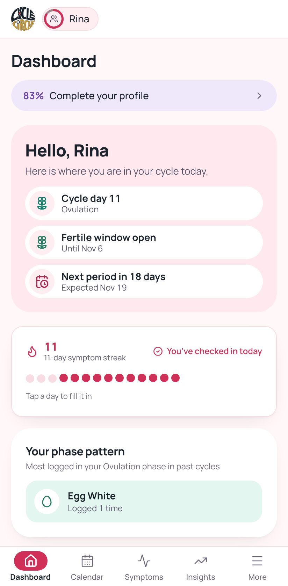
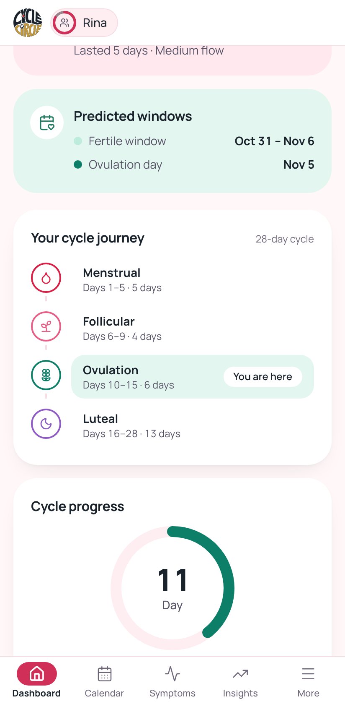
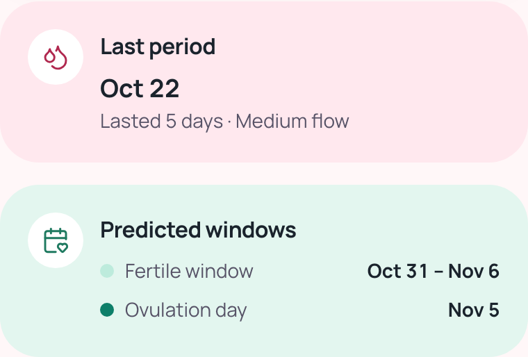
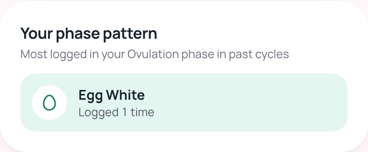
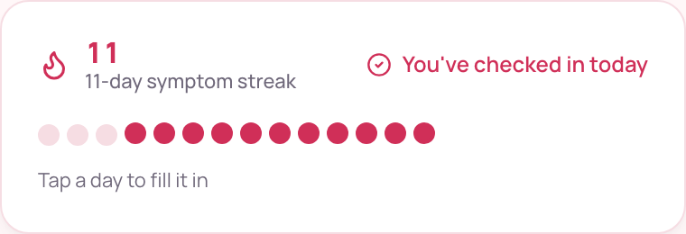
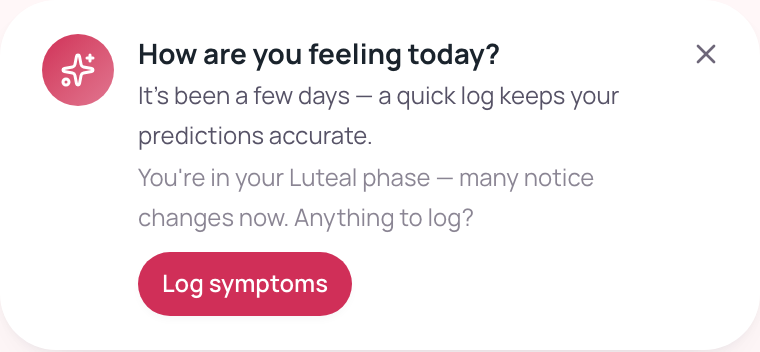
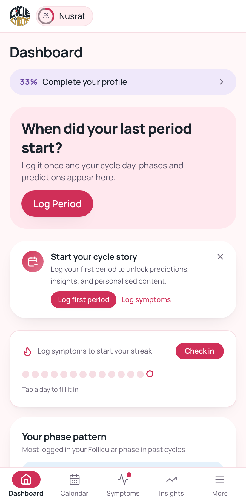
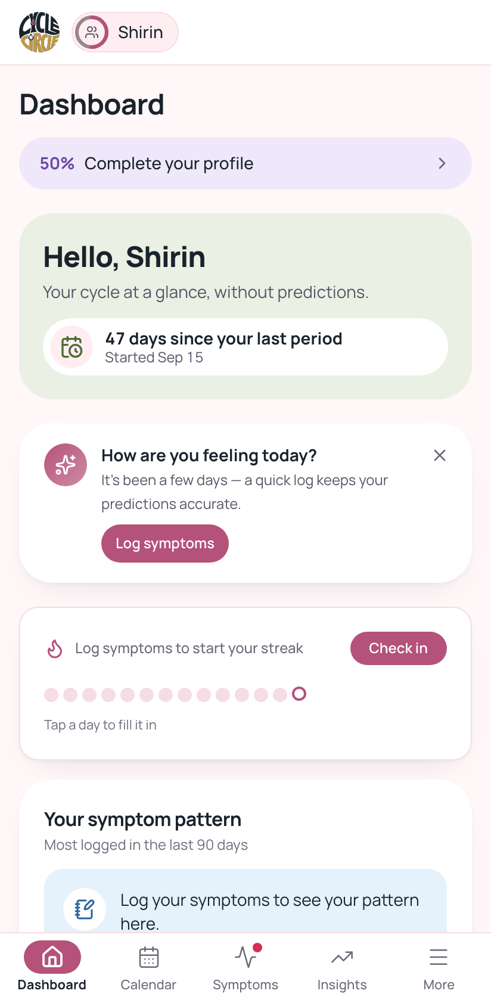

# Dashboard

The first screen after login (**Dashboard** in the bottom navigation). It answers "where am I in my cycle today?" for the active profile and offers the daily actions. A User with several profiles sees the Dashboard of the profile that is active; switching profile is in [Switch the active profile](#pf-switch).

Everything on the Dashboard is counted in **Bangladesh days** (ADR 0008): "today" is the Bangladesh calendar day, whatever the time zone of the phone. A User who logs at 11 pm and another at 1 am the next day are on two different days. The Dashboard has three modes, chosen from the profile, not by the User:

| Mode | When | What changes |
|---|---|---|
| Live cycle | The profile has a logged period and the goal is not perimenopause | Everything described below |
| First run | No period logged and no last-period date on the profile | A question instead of the cycle hero, a dimmed example cycle, no dates card, no phase pattern ([First-run dashboard](#db-first-run)) |
| Menopause | The profile goal is "perimenopause" | Days since the last period instead of predictions, no fertile window ([Menopause dashboard](#db-menopause)) |

Cards, top to bottom on a phone: the hero, the logging nudge (only when it applies), the check-in strip with the streak, the Phase pattern, the Last period and Predicted windows cards, the cycle journey and progress cards, and the "Your toolkit" shortcuts (Log Period, Log Symptoms, Calendar, Insights, articles for the phase, Profiles). On a wide screen the same cards are arranged in two columns.

## Cycle hero {#db-hero}

### What it is

The pink card at the top. It greets the User ("Hello, <profile name>", "Here is where you are in your cycle today.") and shows three facts under "Today at a glance":

| Fact | Looks like | Meaning |
|---|---|---|
| Cycle day | "Cycle day 11" and the phase name under it (Menstrual, Follicular, Ovulation, Luteal) | Days since the latest period start, counting the start day as day 1. It never goes above the profile's cycle length, so a late period stays on the last day. |
| Fertile window | "Fertile window in 3 days" / "Fertile window open" / "Fertile window closed"; the line under it says "Opens <date>", "Until <date>" or "For this cycle"; "No fertile window yet" when there is no prediction | Where today sits against the predicted fertile window ([Fertile window](#pr-fertile-window)) |
| Next period | "Next period in 18 days" / "Period due today" / "Period 2 days late"; under it "Expected <date>", or "Log it when it starts" when late | Days until the predicted next period start; "Next period not predicted yet" when there is no prediction |

Two more cards belong to the hero area. **Your cycle journey** shows the four phases as steps with their day ranges (for a 28-day cycle and a 5-day period: Menstrual days 1-5, Follicular days 6-9, Ovulation days 10-15, Luteal days 16-28) and marks "You are here". A phase that a short cycle or long period squeezes out to zero days is left out. **Cycle progress** shows a ring with "Day N" and a caption ("18 days to your next period", or "Period expected" once the date has passed), and under it the "Smarter predictions" meter ([Prediction tiers and confidence](#pr-tiers)).

### Where to find it

**Dashboard** (home) in the bottom navigation, at the top of the page.

### How to use it

1. Open **Dashboard**. Nothing needs tapping; the hero updates when a period is logged or removed.
2. To make "Next period" accurate, keep logging each period ([Log a period](#lc-log-period)).

### Rules and limits

- The phase is worked out from the profile's own **cycle length** and **period length** settings, not from the learned average: menstrual until the period length, ovulation phase from 4 days before to 1 day after (cycle length minus 14), follicular before that, luteal after. The next-period date and fertile window come from the prediction, which uses the average of the logged cycles ([How predictions work](#pr-how)). When the logged average differs from the profile's cycle length, the phase name and the fertile stat can disagree for a day or two. The system treats the prediction as the truth for dates and the profile settings as the truth for phase names.
- The late count appears only in the hero ("Period 2 days late"); the progress ring just says "Period expected".
- Cycle day counts from the **latest** period log, including one logged in the past (a backfill).

### What can go wrong

| The User sees | Cause | Fix |
|---|---|---|
| "Next period not predicted yet" and "No fertile window yet" | No prediction exists yet for the profile | Log a period; the prediction is made when a period is saved |
| "Period 3 days late" | The predicted date has passed and no new period is logged | Log the period when it starts ([Log a period](#lc-log-period)). The late-period pop-up may also appear ([Late-period alert](#ap-late-period)) |
| Phase says "Luteal" but the User expects "Ovulation" | The phase uses the profile cycle length, the dates use the learned average | Not a fault. Edit the profile's cycle length if the setting is wrong ([Edit or rename a profile](#pf-edit)) |
| "No profile found." with a **Set Up Profile** button | The account has no profile, or the active one was removed | Tap **Set Up Profile** ([Add a profile](#pf-add)) |

### Related

- [Fertile window](#pr-fertile-window)
- [Prediction tiers and confidence](#pr-tiers)
- [Log a period](#lc-log-period)
- [Late-period alert](#ap-late-period)

## Cycle dates {#db-cycle-dates}

### What it is

Two small cards: **Last period** (start date, "Lasted 5 days", "Medium flow") and **Predicted windows** ("Fertile window" with a date range, and "Ovulation day"). Both show real data only; a card is left out when its data is missing, and the pair is hidden in First-run and Menopause modes.

### Where to find it

**Dashboard**, below the check-in strip on a phone (in the right-hand column on a wide screen).

### How to use it

1. Read the dates. There is nothing to tap. To change the last period, open **Calendar** and edit it ([Edit or delete a period](#lc-edit-delete)).

### Rules and limits

- "Lasted N days" is the logged end date minus the start date, plus one day. Flow is the flow chosen when logging (Light, Medium or Heavy).
- If the profile only has a start date from onboarding and no logged period, the card shows just the date. The system then creates a logged period from that date (profile period length, flow Medium) the first time the Dashboard or Calendar opens, so in practice every profile that was given a last-period date has one.
- Dates are shown short ("Oct 21") in the language of the app.
- The windows are the stored prediction: fertile window = ovulation day minus 5 days to ovulation day plus 1 day; ovulation day = predicted next period minus 14 days.

### What can go wrong

| The User sees | Cause | Fix |
|---|---|---|
| The pair of cards is missing | First-run or Menopause mode, or the profile has no period yet | Log a period ([Log a period](#lc-log-period)) |
| Only "Last period" shows | No prediction stored yet | Log a period or reopen the page after it is saved |
| "Lasted 5 days" is not what the User remembers | The end date logged was different | Edit the period ([Edit or delete a period](#lc-edit-delete)) |

### Related

- [Fertile window](#pr-fertile-window)
- [Calendar and its markers](#lc-calendar)

## Phase pattern {#db-phase-pattern}

### What it is

"Your phase pattern" lists up to three symptoms the profile logged **most often in the same phase in past cycles** ("Most logged in your Follicular phase in past cycles", each tile "Logged 2 times"). It is a record of what the User logged, not a forecast (GLOSSARY: Phase pattern).

### Where to find it

**Dashboard**, next to or under the check-in strip.

### How to use it

1. Keep logging symptoms ([Logging symptoms](#sc-symptoms)). The card fills in by itself.
2. With no pattern yet the card says "Log your symptoms this cycle to see your pattern next time." and shows a **Log symptoms** button that opens the Symptoms page.

### Rules and limits

- Needs **at least two logged periods**: only the days between the first period start and the latest period start are used (the current, unfinished cycle is not counted, so a first cycle shows the empty message).
- Each logged symptom day is placed in the phase it fell in for its own finished cycle (that cycle's real length, from one period start to the next, and the profile's period length). Only symptoms from the current phase are ranked; the top three are shown, ties broken by the symptom's internal id. "All good" check-ins do not count as symptoms.
- Menopause mode shows "Your symptom pattern" instead: the three most logged in the last 90 days, no phases.

### What can go wrong

| The User sees | Cause | Fix |
|---|---|---|
| "Log your symptoms this cycle to see your pattern next time." | Fewer than two periods logged, or no symptoms logged in this phase before | Log periods and symptoms; the pattern appears from the next cycle |
| Different symptoms than the User expects | Only finished cycles count, and only the current phase | Wait for another cycle to close |

### Related

- [Logging symptoms](#sc-symptoms)
- [Menopause dashboard](#db-menopause)
- [Symptom statistics](#in-symptom-stats)

## Check-in strip {#db-checkin-strip}

### What it is

A card with the [Streak](#db-streak) on the left, a **Check in** button on the right, and below them a row of dots for the **last 14 days** (one dot per Bangladesh day, oldest first, today last) with the hint "Tap a day to fill it in". A filled dot is a day with something logged; an empty ring is a day without; today is outlined.

### Where to find it

**Dashboard**, in the card next to the Phase pattern.

### How to use it

1. Tap **Check in** to log how you feel today ([Daily check-in](#sc-checkin)).
2. Tap an empty past dot to log symptoms for that day ([Back-dated symptoms](#sc-backdate)). Today and future dots are not tappable.
3. Once something is logged today, **Check in** is replaced by "You've checked in today".

### Rules and limits

- A day counts as logged if it has any symptom log (including "All good today") **or** falls inside a logged period. A User in the middle of a logged period therefore already sees "You've checked in today" without having done a check-in, and the check-in pop-up does not open for them.
- The dots show 14 days although the group's accessible name (read by a screen reader) says "Last 30 days"; the streak looks back 30 days.
- Past dots that are already logged are not tappable.

### What can go wrong

| The User sees | Cause | Fix |
|---|---|---|
| "You've checked in today" but the User did not check in | Today falls inside a logged period | Expected; symptoms can still be added from **Symptoms** |
| No **Check in** button and no strip | The engagement data did not load (the card is left out) | Reload the page |
| A dot cannot be tapped | It is today, a future day, or already logged | Edit logged days from **Symptoms** |

### Related

- [Streak](#db-streak)
- [Daily check-in](#sc-checkin)
- [Check-in prompt](#ap-checkin)

## Streak {#db-streak}

### What it is

The flame badge on the check-in strip: "7-day symptom streak". With no streak it says "Log symptoms to start your streak". When yesterday was logged but today is not yet, the number stays and a note appears: "Your streak is at risk — a quick check-in keeps it alive".

### Where to find it

**Dashboard**, top-left of the check-in strip.

### How to use it

1. Log something every Bangladesh day (a check-in, a symptom, or a period day).
2. If the at-risk note shows, tap **Check in** before midnight (Bangladesh time).

### Rules and limits

- Count = consecutive Bangladesh days with a log, walking back from today. Today unlogged but yesterday logged: the streak is kept (counted from yesterday) and marked at risk. Yesterday also unlogged: 0.
- Period days count even though the badge says "symptom streak".
- The system only looks back 30 days, so the badge **never shows more than 30**.

### What can go wrong

| The User sees | Cause | Fix |
|---|---|---|
| "Log symptoms to start your streak" although they logged last week | A day was missed, which resets the count | Log today; the streak restarts at 1 |
| The streak "lost a day" at night | The User logged after midnight Bangladesh time, so it fell on the next day | Explain that the day is the Bangladesh day ([Bangladesh days and date rules](#lc-date-rules)) |
| Streak stuck at 30 | The window is 30 days | Expected |

### Related

- [Check-in strip](#db-checkin-strip)
- [Bangladesh days and date rules](#lc-date-rules)

## Logging nudge {#db-nudge}

### What it is

A card under the hero that asks the User to log, shown only when the profile has gone **three or more days** without a log, or has never logged anything. Wording:

| Variant | Title | Text | Buttons |
|---|---|---|---|
| Never logged | "Start your cycle story" | "Log your first period to unlock predictions, insights, and personalised content." | **Log first period**, **Log symptoms** |
| Three or more days | "How are you feeling today?" | "It's been a few days — a quick log keeps your predictions accurate." | **Log symptoms** |
| Goal is "conceive" (either variant) | "Track every sign that matters" | "Log symptoms, cervical mucus, and basal temperature to support your TTC journey." | as above |

In a live cycle a second line adds "You're in your <phase> phase — many notice changes now. Anything to log?".

### Where to find it

**Dashboard**, directly under the hero.

### How to use it

1. Tap the button to log, or the **X** (**Dismiss**) to hide it.

### Rules and limits

- "Days since the last log" is counted from the **start date of the latest period** and the **latest symptom log**, whichever is newer. A period's later days do not reset it. A User on day 4 of a period who logged only the period therefore sees the nudge from day 4.
- Dismiss hides it for the rest of the browser session and **3 days** in that browser, for that profile. It is stored in the browser, not the account, so another phone or a cleared browser shows it again.
- Not tied to the check-in pop-up: the nudge is a card, the check-in is an auto-prompt.

### What can go wrong

| The User sees | Cause | Fix |
|---|---|---|
| The nudge keeps coming back | Dismissal is stored per browser and expires after 3 days | Log something; it disappears while the last log is under 3 days old |
| The nudge shows although the User logged yesterday | The log was a period day (not a start or symptom) | Log a symptom or check in |
| No nudge though they logged nothing today | Under 3 days since the last log | Expected |

### Related

- [Daily check-in](#sc-checkin)
- [Quick symptom pop-up](#sc-quick-symptom)

## First-run dashboard {#db-first-run}

### What it is

What a profile sees when it has **no period logged and no last-period date**. The hero asks "When did your last period start?" ("Log it once and your cycle day, phases and predictions appear here.") with one **Log Period** button. The journey and progress cards are shown dimmed as an **Example** ("An example 28-day cycle, not your data"). Cycle dates, fertile window and predictions do not exist yet.

### Where to find it

**Dashboard** for a new profile, until the first period is logged.

### How to use it

1. Tap **Log Period**, choose the start date and save ([Log a period](#lc-log-period)).
2. The Dashboard turns into the live cycle view.

### Rules and limits

- Onboarding asks for the last period, so this mode appears only for a profile that was saved without one.
- The toolkit's own Log Period card is hidden in this mode; the hero button is the only one. The logging nudge may also show ("Start your cycle story").

### What can go wrong

| The User sees | Cause | Fix |
|---|---|---|
| Greyed example cycle that does not match them | It is a fixed example | Log a period |
| "This overlaps a period you already logged." | See the date rules | [Bangladesh days and date rules](#lc-date-rules) |

### Related

- [Log a period](#lc-log-period)
- [Onboarding](#gs-onboarding)
- [Add a profile](#pf-add)

## Menopause dashboard {#db-menopause}

### What it is

The Dashboard for a profile whose goal is **perimenopause**. The hero is green: "Your cycle at a glance, without predictions." with one fact, "47 days since your last period" and "Started <date>" (or "No period logged yet" / "Log one to start counting."). No cycle day, fertile window, predictions, journey, progress ring or cycle dates. The check-in strip, "Your symptom pattern", the nudge and the toolkit remain.

### Where to find it

**Dashboard**, for a profile with the goal Perimenopause.

### How to use it

1. Keep checking in and logging symptoms; log a period if one occurs.

### Rules and limits

- The mode follows the profile goal, set at onboarding or in the profile.
- Days since the last period are Bangladesh days from the latest period start to today.
- The calendar for such a profile still draws predicted periods, because the Calendar does not check the goal; only the Dashboard does. (The system does not hide them, the Dashboard simply does not show them.)

### What can go wrong

| The User sees | Cause | Fix |
|---|---|---|
| "No period logged yet" | Nothing logged | Optional; log a period if one occurs |
| No predictions on the Dashboard but dashed days on the Calendar | See above | Expected |

### Related

- [Phase pattern](#db-phase-pattern)
- [Edit or rename a profile](#pf-edit)
