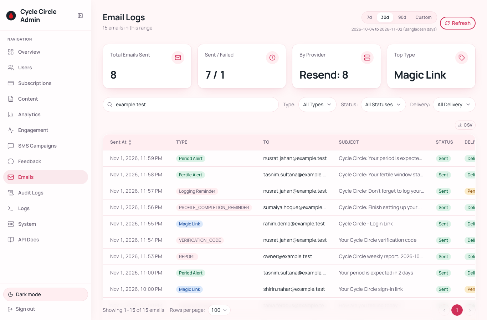
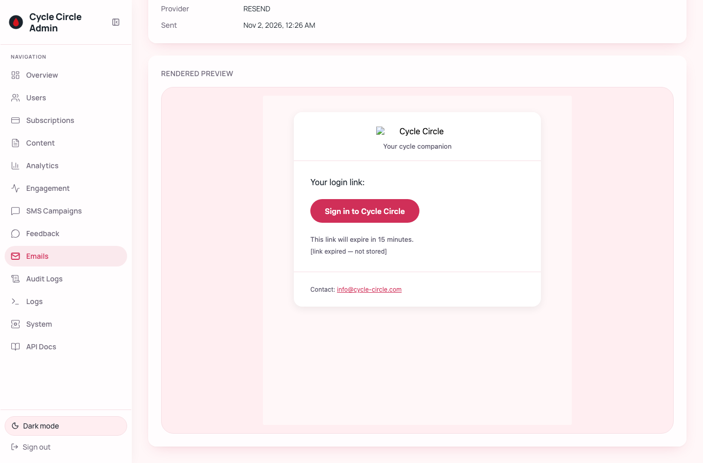
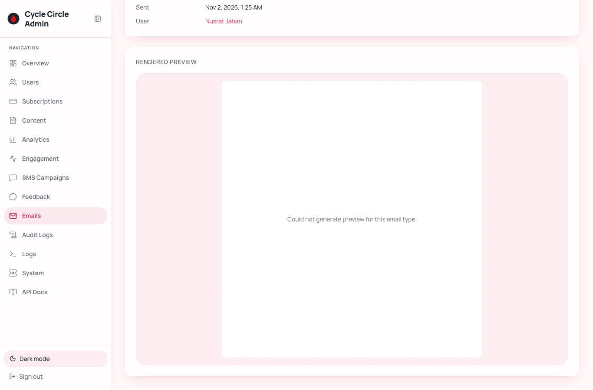
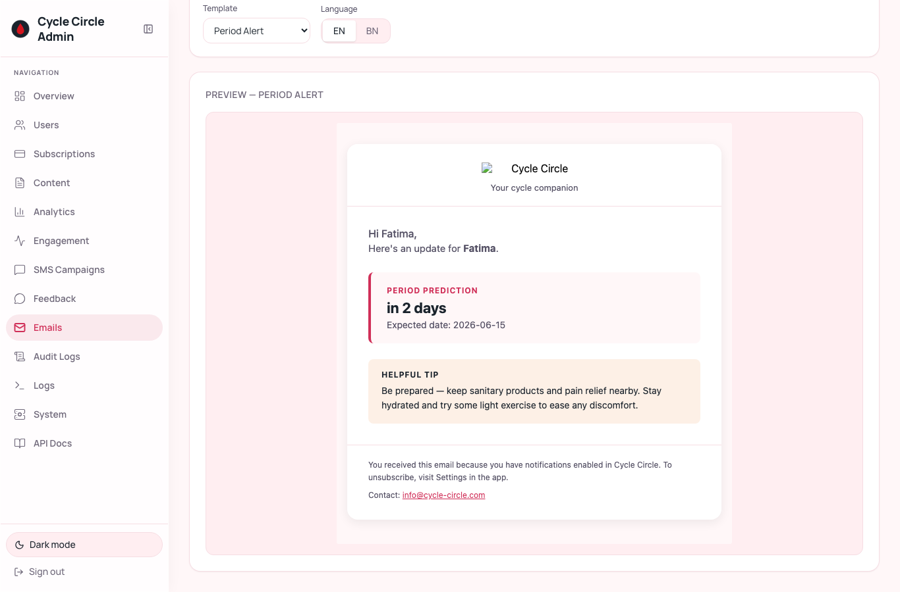
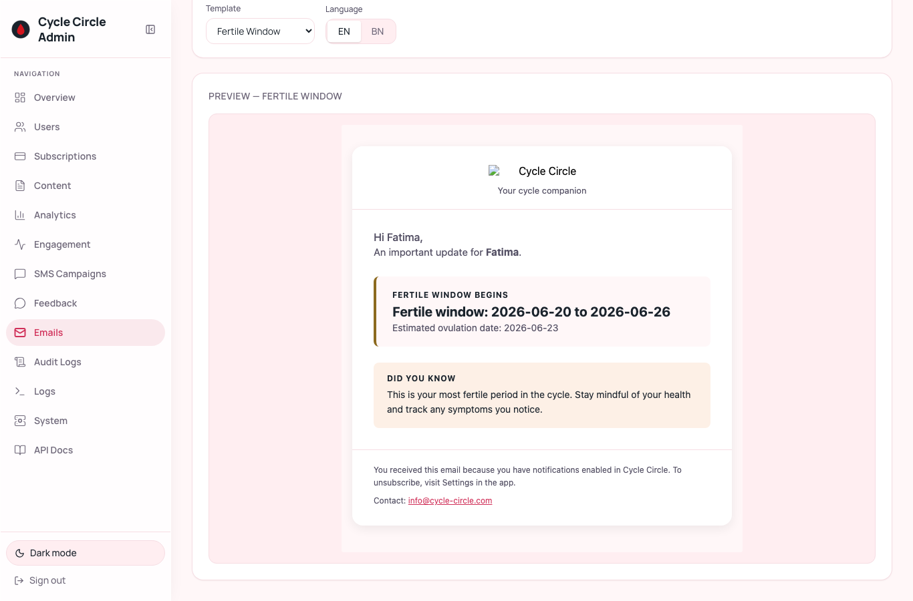
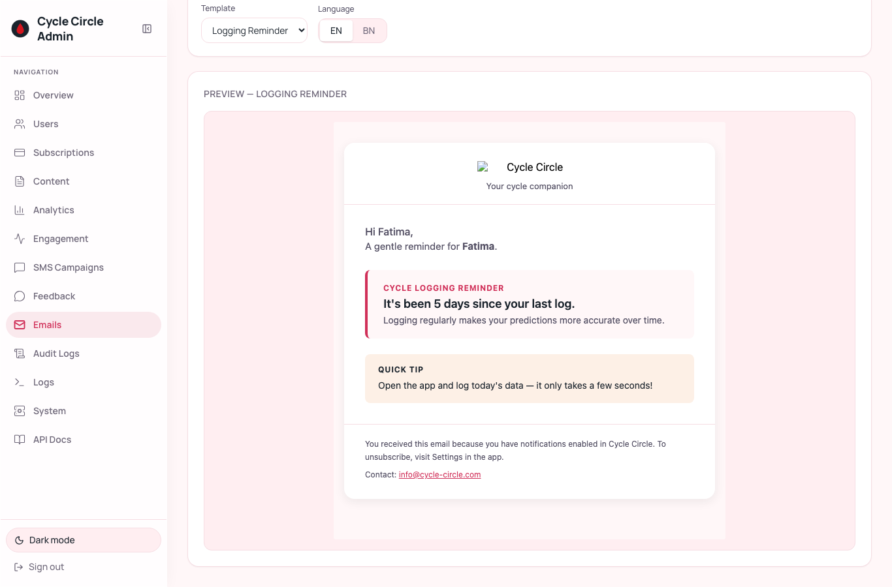
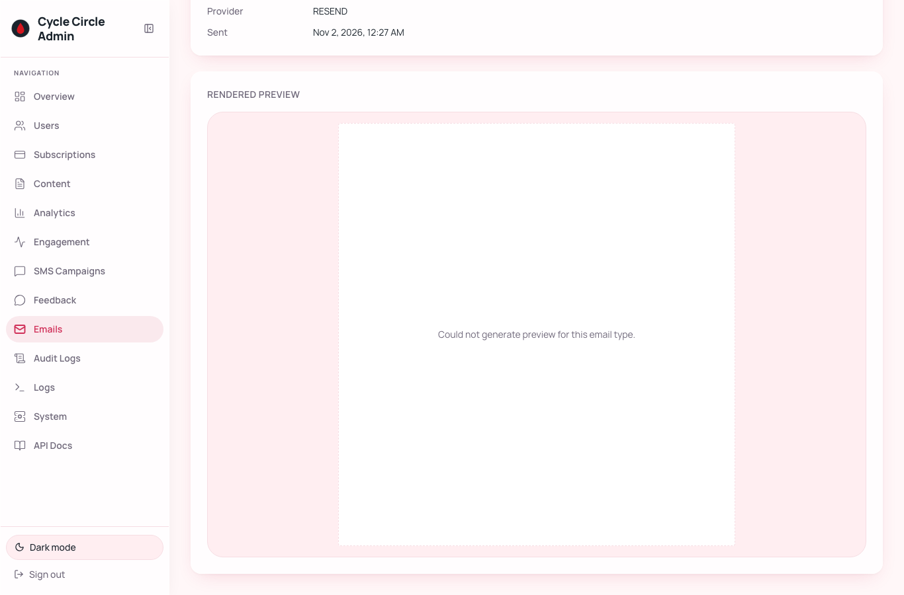

# Emails catalogue

## Emails at a glance {#ec-overview}

### What it is

Cycle Circle sends seven kinds of email. This section lists all of them, who gets each, and where an Admin finds them. The next sections show one sample of each. Every email is sent from the address in the server setting `RESEND_FROM_EMAIL` (the code's default is "Cycle Circle <noreply@vesta.app>"; ask the server owner what production uses) through Resend (in local development without a Resend key, mail goes to a test inbox instead), and every attempt, successful or not, is written to the email log.

### Where to find it

**Admin > Emails** ("Email Logs"). Each row shows Sent At, Type, To, Subject, Status and Delivery.

### How to use it

| Type in the log | Sent when | To | Language | Section |
|---|---|---|---|---|
| Magic Link | A User asks for an email login link | The email address typed | Always English | [Magic-link email](#ec-magic-link) |
| VERIFICATION_CODE | A signed-in User adds or changes an email address | The new address | The User's language | [Verification-code email](#ec-verification-code) |
| Period Alert | Daily job, 0 to 2 days before the predicted period | The User's email | The User's language | [Period alert](#ec-period-alert) |
| Fertile Alert | Daily job, the day the fertile window starts | The User's email | The User's language | [Fertile window email](#ec-fertile-window) |
| Logging Reminder | Daily job, 3 or more days since the last period log | The User's email | The User's language | [Logging reminder](#ec-logging-reminder) |
| PROFILE_COMPLETION_REMINDER | Daily job, signup 2 to 14 days ago with no profile created | The User's email | The User's language | [Profile-completion reminder](#ec-profile-completion) |
| REPORT | Weekly and monthly report jobs | Report recipients | English | [Emailed reports](#ec-reports) |

To find an email: type the address or a subject word in the search box. The "Type" filter lists only All Types, Magic Link, Period Alert, Fertile Alert and Logging Reminder. The other three types show their raw names (VERIFICATION_CODE, PROFILE_COMPLETION_REMINDER, REPORT) and can only be found by searching.

### Rules and limits

- **Status** is SENT or FAILED (the send call failed; the error text is stored). **Delivery** is PENDING at first, then updated by Resend's notifications to DELIVERED, BOUNCED, COMPLAINED or DELAYED. Only emails sent through Resend get delivery updates; the **Refresh** button on an email's page asks Resend again.
- Reminder emails are sent only to Users who have an email address. A phone-only User gets the profile-completion reminder as an SMS (any User with a phone, not only Pro). See [Daily reminder emails](#sj-daily-reminders)).
- All emails are sent in the language of the User's account, except the magic-link email (always English: the Email login page does not pass the language) and the reports (English only).
- The reminder emails end with "You received this email because you have notifications enabled in Cycle Circle. To unsubscribe, visit Settings in the app." There is no one-click unsubscribe link; the User uses **Settings > Notifications**.
- Every email carries the contact line "Contact: info@cycle-circle.com".
- **Preview is approximate.** An Admin can open a row to see a rendered copy, with the notice "Approximate preview — dynamic values (dates, magic links) are reconstructed and may differ from the original send." Only Magic Link, Period Alert, Fertile Alert and Logging Reminder rows can be rendered; the other three show "Could not generate preview for this email type." The samples below that have no preview in the Admin app are described from the template text.
- The logo at the top of every email is loaded from the web app's address (`APP_URL`). In the local demo it cannot load, which is why the screenshots show the words "Cycle Circle" in place of the logo.

### What can go wrong

| The Admin sees | Cause | Fix |
|---|---|---|
| Status FAILED with an error | The mail provider refused the send (bad address, provider down, API key missing) | Read the error on the row; check the address; ask the server owner to check Resend |
| Delivery BOUNCED or COMPLAINED | The address does not exist, or the User marked it as spam | Ask the User for another address |
| Delivery stays PENDING | Resend's notification has not arrived or the webhook is not set up | Use **Refresh** on the email's page |
| "Could not generate preview for this email type." | Verification code, profile-completion and report emails have no preview | Use the sample in this chapter |

### Related

- Admin screens: [Email log](#em-log), [Email detail](#em-detail), [Template preview](#em-preview)
- Automatic job: [Daily reminder emails](#sj-daily-reminders), [Weekly and monthly reports](#sj-reports)

## Magic-link email {#ec-magic-link}

### What it is

The email that carries the login link for a User who chose **Login with Email instead**.

### Where to find it

**Admin > Emails**, open a row of type "Magic Link". The page re-creates the email (the real link is not stored, so the link text reads "[link expired — not stored]").

### How to use it

What the User receives:

- Subject: "Cycle Circle - Login Link"
- Body: "Your login link:" then a button **Sign in to Cycle Circle**, the line "This link will expire in 15 minutes." and the link written out below the button.

### Rules and limits

- The link works once and for **1 hour**, although the email says 15 minutes (same difference as on the login screen, see [Email login](#gs-email-login)). Tell Users 15 minutes to be safe.
- At most 3 links per hour per address.
- Always sent in English.
- It is sent immediately when the User taps **Send Magic Link**; it is not part of any scheduled job.

### What can go wrong

| The User sees | Cause | Fix |
|---|---|---|
| "No email arrives" | Spam folder, typo, or FAILED in the log | Search the log for the address |
| "This sign-in link has expired. Enter your email below to get a new one." | Opened after 1 hour | Ask for a new link |
| "This sign-in link has already been used. Enter your email below to get a new one." | Some mail apps open the link first | Request a new link and open it directly |

### Related

- [Email login](#gs-email-login), [The 24-hour email trial](#gs-email-trial), [Email detail](#em-detail)

## Verification-code email {#ec-verification-code}

### What it is

A 6-digit code emailed to an address that a signed-in User wants to add or change, so nobody can claim an inbox they do not own.

### Where to find it

**Admin > Emails**: search for the address, or look for the type VERIFICATION_CODE. The Admin app cannot render it:

### How to use it

What the User receives (English; the Bengali text is the same in meaning):

- Subject: "Your Cycle Circle verification code"
- Body: "Your code is 123456." then the code in large type, and "It expires in 10 minutes. If you didn't ask for this, ignore this email."

In the app, **Settings > Account > Add Email** asks for the address; the next step shows "We sent a 6-digit code to <address>." and the User types the code. After a right code the toast says "Email verified and saved."

### Rules and limits

- The code is valid for **10 minutes**. Only the newest code works; a new request deletes the older ones.
- At most **5 wrong guesses** per code, then the User must ask for a new code.
- A User can request a code at most **3 times a minute**, and must wait 60 seconds between codes.
- The address is saved only after the right code. An address used by another account is refused ("This email is already used by another account.").

### What can go wrong

| The User sees | Cause | Fix |
|---|---|---|
| "Please wait 42s before requesting a new code." (number varies) | Resend wait | Wait |
| "Verification code has expired" | More than 10 minutes | Request a new code |
| "Invalid verification code" | Wrong code | Retype; after 5 wrong codes: |
| "Too many wrong codes. Request a new code." | 5 wrong guesses | Request a new code |
| "No verification code found. Request a new one." | The code was replaced or never sent | Request a new code |
| "Enter a valid email address." | Bad address | Retype |
| "This email is already used by another account." | Another account owns the address | Use another address |

### Related

- [Add or verify an email](#st-email), [Email log](#em-log)

## Period alert {#ec-period-alert}

### What it is

A reminder that a profile's predicted next period is 0 to 2 days away.

### Where to find it

**Admin > Emails > Email Preview** (open it from the email log). Choose the template **Period Alert** and the language **EN** or **BN**. The sample uses a fake name and date.

### How to use it

What the User receives:

- Subject: "Cycle Circle: Your period is expected in N days" (N is 0, 1 or 2).
- Greeting "Hi <name>," and "Here's an update for <profile>."
- A card headed "PERIOD PREDICTION" with "in N days" and "Expected date: <date>".
- A "Helpful tip" card: "Be prepared — keep sanitary products and pain relief nearby. Stay hydrated and try some light exercise to ease any discomfort."

### Rules and limits

- Sent by the daily job at 14:00 Bangladesh time, once per profile per day ([Daily reminder emails](#sj-daily-reminders)).
- The subject always says "days", even for 1 ("in 1 days") and 0 ("in 0 days"), and the SMS version does the same. The card in the body says "in 1 day" correctly.
- Needs the profile's switch **Period Alerts** on and a prediction.
- Pro Users with a phone also get an SMS: "Cycle Circle: <profile>'s period expected in N days (date)".

### What can go wrong

| The User sees | Cause | Fix |
|---|---|---|
| "My subject says 0 days" | The period is predicted for today | Expected; see rules |
| No alert | See [Daily reminder emails](#sj-daily-reminders) | |

### Related

- [Notification toggles](#st-notifications), [Template preview](#em-preview)

## Fertile window email {#ec-fertile-window}

### What it is

A single email on the day a profile's predicted fertile window starts.

### Where to find it

**Admin > Emails > Email Preview**, template **Fertile Window**.

### How to use it

What the User receives:

- Subject: "Cycle Circle: Your fertile window starts today"
- Greeting "Hi <name>," and "An important update for <profile>."
- A card "FERTILE WINDOW BEGINS" with "Fertile window: <start> to <end>" and "Estimated ovulation date: <date>".
- A "Did you know" card: "This is your most fertile period in the cycle. Stay mindful of your health and track any symptoms you notice."

### Rules and limits

- Sent once per cycle, on the first day of the predicted window, when **Fertile Window Alerts** is on.
- Pro Users with a phone also get an SMS: "Cycle Circle: <profile>'s fertile window starts today (start - end)".
- Profiles with the goal "trying to conceive" have this alert on by default; "perimenopause" profiles have it off ([Notification toggles](#st-notifications)).

### What can go wrong

| The User sees | Cause | Fix |
|---|---|---|
| No email on the expected day | The prediction changed, the switch is off, or the email address is missing | Check the profile's predictions |

### Related

- [Predictions](#pr-fertile-window), [Template preview](#em-preview)

## Logging reminder {#ec-logging-reminder}

### What it is

A daily nudge to log the cycle, sent while the last period log is 3 or more days old.

### Where to find it

**Admin > Emails > Email Preview**, template **Logging Reminder**.

### How to use it

What the User receives:

- Subject: "Cycle Circle: Don't forget to log your cycle"
- "Hi <name>," and "A gentle reminder for <profile>."
- A card "CYCLE LOGGING REMINDER" with "It's been N days since your last log." (or "You haven't logged a period yet." for a profile with no period log) and "Logging regularly makes your predictions more accurate over time."
- A "Quick tip": "Open the app and log today's data — it only takes a few seconds!"

### Rules and limits

- Counts days since the last **period log** started, not symptoms or check-ins. It is sent every day until a new period is logged ([Daily reminder emails](#sj-daily-reminders)).
- Needs **Logging Reminders** on.
- The Admin preview always shows "5 days".
- Not the same as the in-app Logging nudge card, which looks at any logging for 3 days ([Logging nudge](#db-nudge)).

### What can go wrong

| The User sees | Cause | Fix |
|---|---|---|
| "I log symptoms every day and still get this" | Only period logs count | Switch **Logging Reminders** off, or log the period |

### Related

- [Notification toggles](#st-notifications), [Logging nudge](#db-nudge)

## Profile-completion reminder {#ec-profile-completion}

### What it is

An email (and SMS) to a User who signed up but never finished creating a profile.

### Where to find it

**Admin > Emails**, type PROFILE_COMPLETION_REMINDER. The Admin app has no preview for it:

### How to use it

What the User receives:

- Subject: "Cycle Circle: Finish setting up your profile"
- "Hi <name>," ("Hi User," when no name is saved), a card "YOUR PROFILE IS ALMOST READY" with "You've joined Cycle Circle — that's a great first step! Completing your profile helps us give you more accurate cycle predictions and personalised health insights." and a button **Complete your profile** that opens `/profiles`.
- A tip "Quick to finish": "Adding just a few details unlocks the full experience — it takes less than 2 minutes."
- SMS (any User with a phone, not only Pro): "Cycle Circle: <name>, your profile setup isn't complete yet. Open the app to finish setting up."

### Rules and limits

- Sent on the 2nd to 14th Bangladesh day after signup, at most once a day, until the User creates a profile or switches **Profile-completion reminders** off ([Notification toggles](#st-notifications)).
- Not sent to a deleted User.
- The footer says the User received the email because notifications are enabled, but this reminder is controlled by the separate **Profile-completion reminders** switch.

### What can go wrong

| The User sees | Cause | Fix |
|---|---|---|
| The button opens a login page | The User is logged out | Log in; they land on the profile screen |
| "I already set up my profile" | The reminder is sent only while no profile exists, so this means the profile was created after the run | Ignore; it stops next day |

### Related

- [Profile completion](#ap-completion), [Daily reminder emails](#sj-daily-reminders)

## Emailed reports {#ec-reports}

### What it is

The weekly and monthly Overview report sent to the people listed on the System page.

### Where to find it

**Admin > Emails**, type REPORT. There is no preview in the Admin app:

### How to use it

What the recipient receives:

- Subject: "Cycle Circle weekly report: <from> to <to>" or "Cycle Circle monthly report: <from> to <to>".
- A table with Metric, This period, Change and Previous for: Total users, New signups, Average daily active users, Pro subscribers, Churned Pro users (excl. admin revokes), Churn rate, Estimated daily revenue; then "Estimated revenue in total: ..." and a note that revenue is an estimate, not billed money.
- A link "Open the Overview for this range" (when `ADMIN_APP_URL` is set) and the sentence "The numbers are also attached as a CSV file."
- A CSV attachment of the same numbers.

### Rules and limits

- Sent Sunday 09:00 (weekly) and on the 1st at 09:00 (monthly), Bangladesh time ([Weekly and monthly reports](#sj-reports)).
- Always English, to every saved recipient, one email each.

### What can go wrong

| The Admin sees | Cause | Fix |
|---|---|---|
| No REPORT rows | No recipients or the switch is off | See [Weekly and monthly reports](#sj-reports) |

### Related

- [Report recipients](#sy-report-recipients), [Weekly and monthly reports](#sj-reports)
