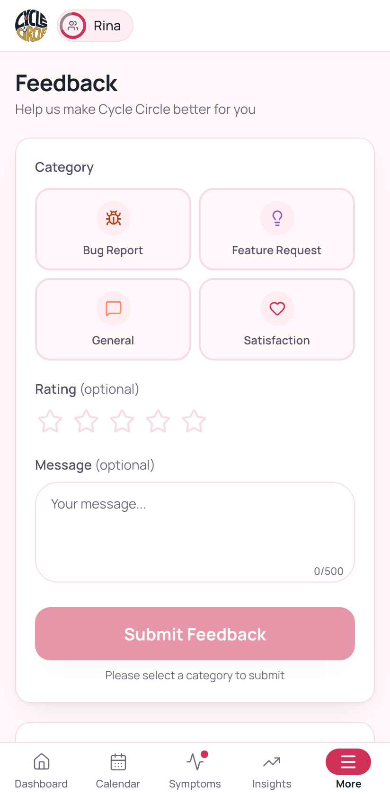
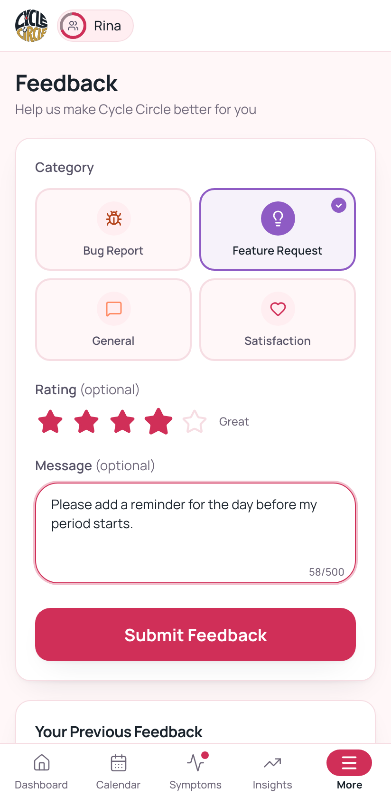
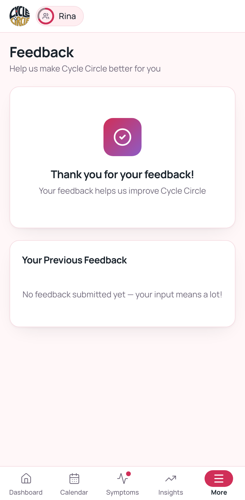
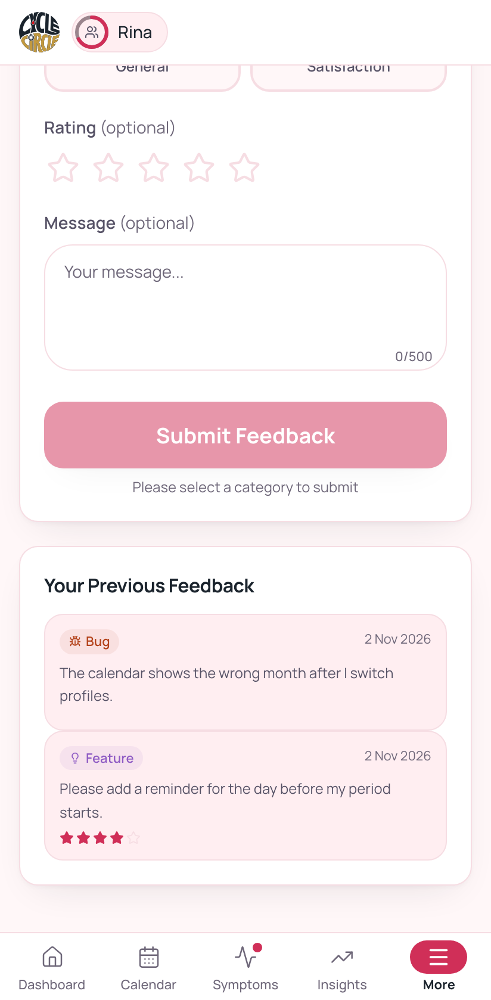
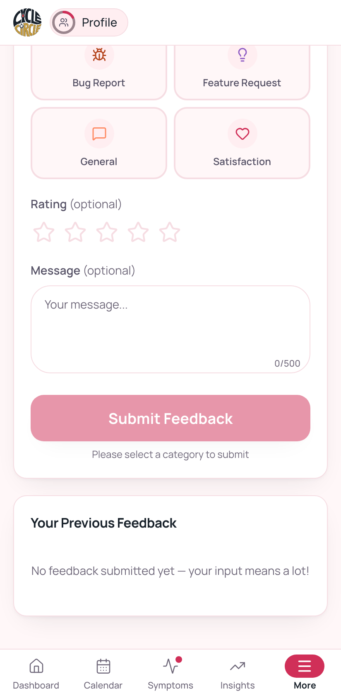

# Feedback

How a User tells the team about a bug, an idea or how she feels about the app. Her feedback goes to the Admin inbox ([Feedback inbox](#af-inbox)). Support questions here are "did my feedback arrive?" and "will someone reply?" (there is no reply feature: see the notes below).

## Send feedback {#fb-send}

### What it is

A short form with a category, an optional star rating and an optional message.

### Where to find it

On a phone: **More > Feedback**. On desktop: **Feedback** in the left sidebar. The address is `/feedback`. The page is titled "Feedback" with the line "Help us make Cycle Circle better for you".

### How to use it

1. Choose a **Category**: "Bug Report", "Feature Request", "General" or "Satisfaction".
2. Optionally tap a star from 1 to 5 under **Rating (optional)**. The word beside the stars follows the score: "Poor", "Fair", "Good", "Great", "Excellent".
3. Optionally type a message under **Message (optional)**. A counter shows the characters used out of 500.
4. Tap **Submit Feedback**. The button shows "Submitting…" while it sends.
5. The form is replaced by "Thank you for your feedback!" and "Your feedback helps us improve Cycle Circle". After three seconds the form returns, empty.

### Rules and limits

- The category is the only required part. The **Submit Feedback** button stays disabled, with the hint "Please select a category to submit", until one is chosen.
- A message is at most 500 characters; the box stops there. (The server itself would accept 2000.)
- Sending with an empty message is allowed; the system then stores the text "No message", and that is what the Admin sees.
- The submission records the User, the category, the message, the rating and the active profile at the time ([Switch the active profile](#pf-switch)).
- There is no limit on how many a User can send, and no confirmation email.
- Feedback is open to every plan, including the email trial and lapsed Users, as long as the User can reach the page (the [Trial lock](#pa-trial-lock) covers the screen when it applies).
- The SRS also describes "a persistent feedback button"; the app has none. Feedback is reached through the More sheet, the sidebar, or the **Give Feedback** row in Settings.
- Nothing in the app tells the User when the team has read or answered her feedback.

### What can go wrong

| The User sees | Cause | Fix |
|---|---|---|
| **Submit Feedback** is greyed out and "Please select a category to submit" shows | No category chosen | Tap one of the four categories |
| A red message under the message box and no thank-you | The send failed (network or server) | Try again; her typing is kept |
| The thank-you showed but the new item is not in "Your Previous Feedback" | The history list only refreshes when the page is loaded again ([Feedback history](#fb-history)) | Reload the page |
| "Did anyone answer me?" | There is no reply feature; Admins read feedback but cannot answer it in the app | Reach the User another way if a reply is needed |

### Related

- [Feedback history](#fb-history)
- [Feedback inbox (Admin)](#af-inbox)
- [Feedback detail (Admin)](#af-detail)
- [More sheet](#nl-more-sheet)

## Feedback history {#fb-history}

### What it is

Under the form, a card "Your Previous Feedback" lists what this User has sent before.

### Where to find it

Scroll down on the **Feedback** page.

### How to use it

1. Read the list, newest first. Each item shows a category tag ("Bug", "Feature", "General" or "Satisfaction"), the date, the message and the stars given.
2. With nothing sent yet the card says "No feedback submitted yet — your input means a lot!".

### Rules and limits

- Only the User's own feedback is shown, never another User's, and it is the whole account, not one profile.
- At most the 20 most recent items.
- Each message is cut to two lines in the list; the whole text is kept and the Admin sees all of it.
- Dates are Bangladesh dates, written like "1 Nov 2026".
- The category tag is always in English words ("Bug", not "Bug Report"), even when the app is in Bengali.
- The list does not update by itself after sending: the new item appears after the page is loaded again.
- Items cannot be edited or deleted by the User.

### What can go wrong

| The User sees | Cause | Fix |
|---|---|---|
| "No feedback submitted yet — your input means a lot!" straight after sending | The list was loaded before the new item existed | Reload the page |
| An old item is missing | Only the latest 20 are shown | The Admin can still find it in the inbox ([Feedback inbox](#af-inbox)) |
| "No message" as the text of an item | She sent it without writing anything | Nothing to fix |

### Related

- [Send feedback](#fb-send)
- [Feedback inbox (Admin)](#af-inbox)
- [CSV export (Admin)](#af-export)
