# Getting started

How a new User reaches the app: the public pages, logging in with a phone number or an email, setting up the first profile, and the first-run tour. Everything here is what a person sees **before** they have data in the app, so support questions in this chapter are mostly "I can't get in".

Two ways in, and they are not equal:

- **Phone login** verifies the number through BDApps. Verifying it **subscribes the number to Cycle Circle Pro** (ADR 0002), so a phone User is Pro. See [Plans & access](#pa-at-a-glance).
- **Email login** is a 24-hour trial. After 24 hours the User must add and verify a phone to keep the account.

## Welcome page {#gs-welcome}

### What it is

The public landing page, shown to anyone who is not logged in. It has the headline "Your cycle, understood", the buttons **Get Started** and **Log In**, a features section ("Everything you need to understand your body"), a final call to action and a footer with **Privacy**, **Terms** and **Log In** links. A language switch (EN / BN) and a light/dark switch sit in the top corner.

### Where to find it

Open the app address while logged out (the root address redirects here), or go to `/welcome`.

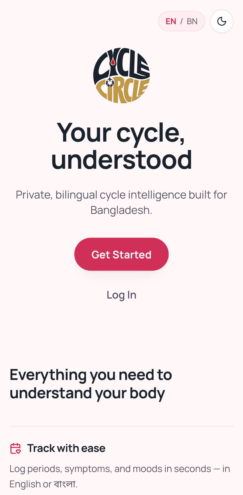

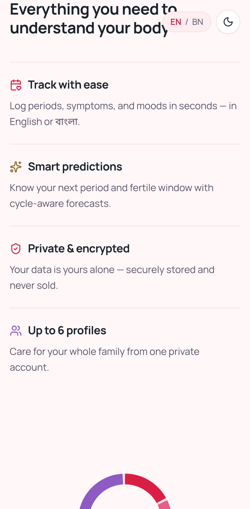

### How to use it

1. Tap **Get Started** to see the introduction slides ([Get Started slides](#gs-get-started)).
2. Or tap **Log In** to go straight to the phone login ([Phone login](#gs-phone-login)).

### Rules and limits

- A logged-in User never sees this page: they are sent to the Dashboard, or to onboarding if they have no profile yet.
- The page is public and shows no User data.

### What can go wrong

| The User sees | Cause | Fix |
|---|---|---|
| The page is in Bengali, not English | The language choice is remembered in the browser (ADR 0003) | Tap **EN** in the language switch |
| They land on the Dashboard instead of this page | They are already logged in on this browser | Log out from Settings to see the public pages |

### Related

- [Get Started slides](#gs-get-started)
- [Language persistence](#nl-language-persists)

## Get Started slides {#gs-get-started}

### What it is

A five-step introduction. Steps 1 to 4 each show one feature; step 5 invites the visitor to begin.

| Step | Headline | Text |
|---|---|---|
| 1 | Track with ease | Log periods, symptoms, and moods in seconds — in English or (the word "Bengali" written in Bengali script). |
| 2 | Smart predictions | Know your next period and fertile window with cycle-aware forecasts. |
| 3 | Private & encrypted | Your data is yours alone — securely stored and never sold. |
| 4 | Up to 6 profiles | Care for your whole family from one private account. |
| 5 | Ready to begin? | Create your private profile in under a minute. |

### Where to find it

**Get Started** on the [Welcome page](#gs-welcome), or `/get-started`.

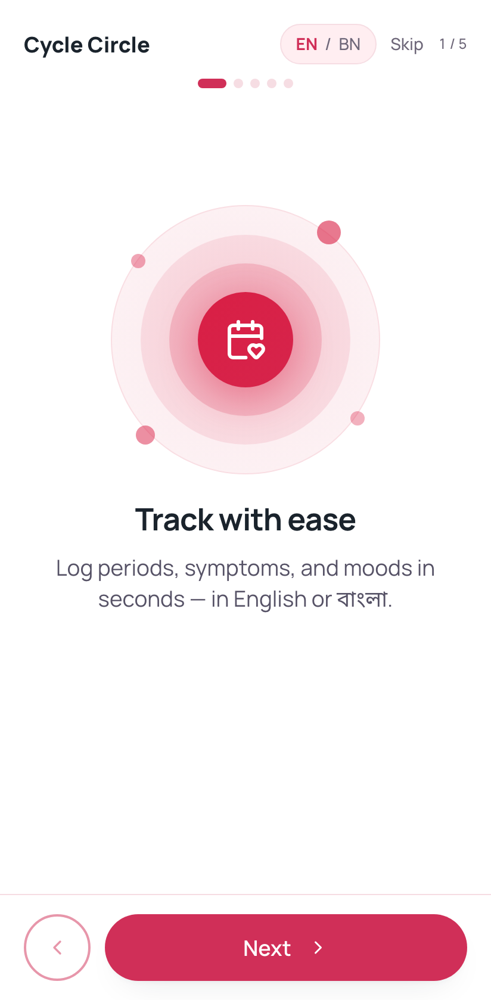

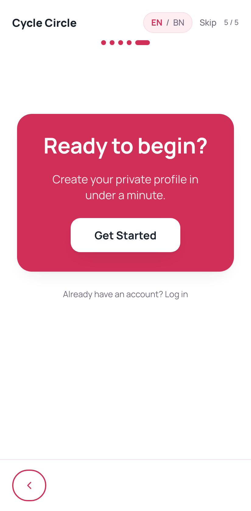

### How to use it

1. Tap **Next** to move through the steps (or use the left and right arrow keys on a keyboard). The round back button returns one step.
2. Tap **Skip** at any time, or **Get Started** on step 5, to go to the phone login. **Already have an account? Log in** does the same.

### Rules and limits

- The slides are information only: nothing is saved and no account is created here.
- Like the Welcome page, a logged-in User is redirected away.

### What can go wrong

Nothing User-facing. If a User says they "can't find where to sign up": there is no separate sign-up. A new phone number or a new email is registered the first time it is verified.

### Related

- [Phone login](#gs-phone-login), [Email login](#gs-email-login)

## Terms of Service {#gs-terms}

### What it is

The Terms & Conditions page (effective May 2026). The login screen links to it as "Terms of Service"; the page itself is titled "Terms & Conditions". It covers acceptance, the service, accounts and profiles, the Pro subscription, data and privacy, limitations (not a medical device) and changes.

### Where to find it

`/terms`, from the footer of the Welcome page, the login screen ("By continuing you agree to Cycle Circle's Privacy Policy & Terms of Service") and Settings.

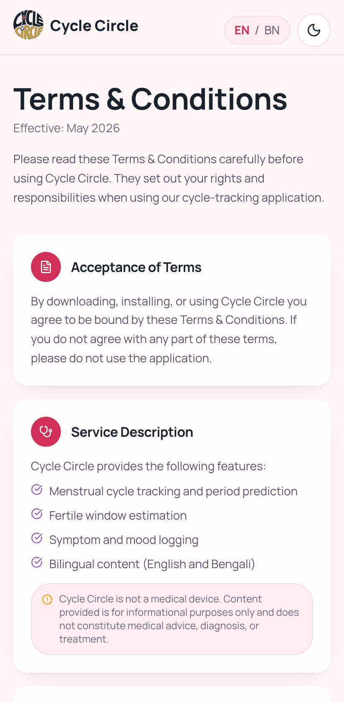

### How to use it

1. Open the link and scroll. There is nothing to accept or tap: continuing to log in counts as agreement.

### Rules and limits

- The Pro price shown in the Subscription section is the price an Admin set in System, and it changes without a new release ([Pro price](#sb-price), [System: Pro price](#sy-pro-price), ADR 0011). If no price has been set the page says only that Pro is a paid plan charged to the mobile balance through BDApps.
- The page says "One account is permitted per phone number" and "Each account supports up to 6 individual profiles". Both are enforced by the app.
- **Where the page and the product differ.** The Terms say charges go to a "Grameenphone mobile balance" and that a User can cancel "from Settings". In the app, Unsubscribe is on the Subscription page ([Unsubscribe](#sb-unsubscribe)), and billing is by BDApps for whichever operator the number belongs to. Point Users to the Subscription page.

### What can go wrong

| The User sees | Cause | Fix |
|---|---|---|
| Text is in Bengali | Language cookie | Switch language with **EN / BN** |

### Related

- [Privacy Policy](#gs-privacy), [Pro price](#sb-price)

## Privacy Policy {#gs-privacy}

### What it is

The Privacy Policy page (last updated May 2026): what data is collected, how it is used, stored and isolated per profile, third-party services (BDApps, Resend), and the User's rights (export, delete, opt out).

### Where to find it

`/privacy`, from the same places as the Terms.

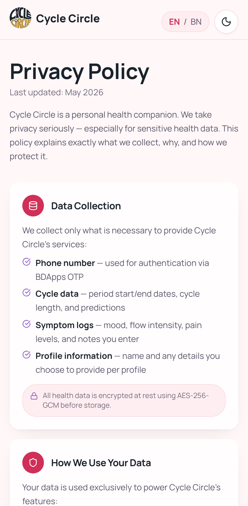

### How to use it

1. Open the link and scroll. The contact block at the end gives `info@cycle-circle.com`, and the promise to respond within 2 business days.

### Rules and limits

- Export of the User's data (CSV or Excel) is in Settings ([Export your data](#st-export)).
- Account deletion requests: the page says all data is removed within 30 days. When an Admin deletes a User, the account is hard-purged after 30 days by the nightly job ([Nightly maintenance](#sj-nightly)).
- **Where the page and production differ.** The policy says data is stored on Supabase with Row Level Security and that switching profiles needs an in-app PIN. Production uses a self-hosted PostgreSQL database, isolation between Users is enforced in the application (not by database row-level policies), and there is no profile PIN. Support should not repeat those three statements to a User; raise them with the client's legal contact so the page can be corrected.

### What can go wrong

| The User sees | Cause | Fix |
|---|---|---|
| "Can I delete my data?" | No self-service delete button | An Admin deletes the User ([Delete and restore](#us-delete-restore)) |

### Related

- [Export your data](#st-export), [Delete and restore](#us-delete-restore)

## Phone login with a BDApps OTP {#gs-phone-login}

### What it is

The main way in. The User enters a Bangladesh mobile number and a 6-digit one-time code (OTP) sent by SMS. For a **new** number the code comes from BDApps and verifying it subscribes the number to Pro. For a number that is **already subscribed** the code is an **App OTP** sent by Cycle Circle (ADR 0002) and the plan does not change.

### Where to find it

**Log In** on the Welcome page, or `/login`.

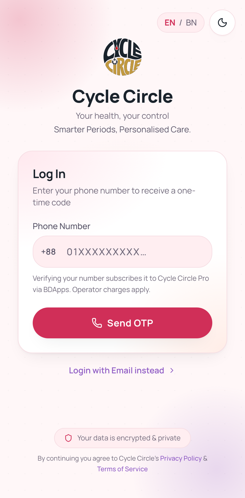

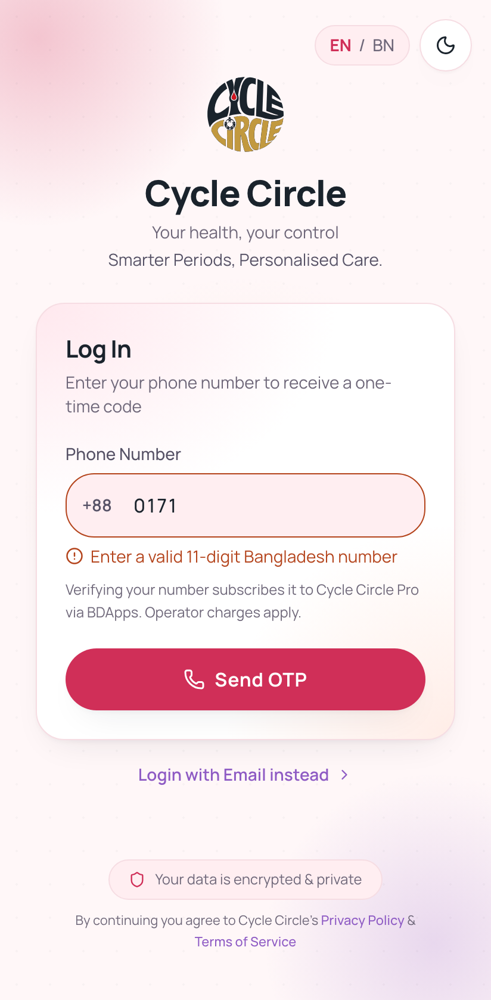

### How to use it

1. Open **Log In**. Under "Phone Number" type the 11-digit number, for example 01711223344 (the +88 prefix is already shown).
2. Tap **Send OTP**. The screen changes to "Enter OTP" with "We sent a 6-digit code to +88 01711223344".
3. Type the 6 digits (or let the phone auto-fill them). The code is submitted by itself when the sixth digit is in; the **Verify** button does the same.
4. On success the button reads "Verified!" and the app opens: **onboarding** for a number with no profile yet ([Onboarding](#gs-onboarding)), the **Dashboard** for a returning User.

### Rules and limits

- The number must have 11 digits and start with 01. The server also accepts +880 and 880 forms and normalises them.
- Under the button the login screen warns: "Verifying your number subscribes it to Cycle Circle Pro via BDApps. Operator charges apply."
- OTP codes are 6 digits. A challenge stays valid for **5 minutes** from the moment it is created (see the discrepancy below).
- Per number: at most **3 code requests per minute**, and a **60-second wait** before a resend. Per device (IP address): at most **10 code requests per hour**.
- Per code: at most **5 verify attempts in 5 minutes**. An App OTP is also locked after **5 wrong codes** (the User must request a new one), and a number can receive at most **5 App OTPs in 24 hours**.
- An App OTP SMS reads "Cycle Circle code: 123456. Valid 5 min. Don't share it." (Bengali text if the User's language is Bengali.)
- **Where the screen and the system differ.** The OTP screen says "This code expires in 10 minutes", but the code is accepted for 5 minutes. Tell Users 5 minutes.
- The user is never charged by logging in with an App OTP: it only logs in. See [BDApps billing events](#bb-subscribe) for what a new subscription does.

### What can go wrong

| The User sees | Cause | Fix |
|---|---|---|
| "Phone number is required" | Field empty | Type the number |
| "Enter a valid 11-digit Bangladesh number" | Fewer or more than 11 digits | Retype it |
| "Number must start with 01" | Wrong prefix | Use the mobile number, 01XXXXXXXXX |
| "We can't send a code to this number's mobile operator yet. Please try another number." | BDApps does not support the operator | Use a number on a supported operator, or log in by email ([Email login](#gs-email-login)) |
| "This number is already subscribed, but we could not send it a code. Log in with your email instead." | Subscribed number with no usable BDApps id to SMS, and the account has an email | Log in by email, then verify the number again later |
| "This number is already subscribed, but we could not send it a code. Unsubscribe this number from Cycle Circle on BDApps, then log in again. Your data stays safe." | Same, and the account has no email | The User unsubscribes the number on BDApps, then logs in again |
| "Failed to send OTP. Please try again." | Any other failure when requesting a code (for example BDApps is down) | Try again; if it persists check [Logs](#lg-viewer) (merchant channel) and [BDApps health](#ts-login) |
| "Too many attempts. Try again in a few minutes." | Rate limit (code requests, device limit, verify attempts, or the 5 App OTPs a day) | Wait. For the daily App OTP limit, wait until the next day |
| "Please wait a moment before requesting another code." | Resend inside the 60-second wait | Wait for the countdown |
| "Invalid or expired code. Please try again." | Wrong code, expired (5 minutes), already used, or no such request. All four show the same message | Request a new code ([Resend wait](#gs-otp-resend)) |
| "Too many wrong codes. Request a new code." | App OTP locked after 5 wrong codes | Tap **Resend OTP** once the wait is over |
| "Please enter all 6 digits" | Submitted with fewer than 6 digits | Enter all 6 |
| "Verification failed. Please try again." | Network problem on verify | Try again |

### Related

- [Resend wait and OTP errors](#gs-otp-resend), [OTP messages](#as-otp), [Troubleshooting: Login](#ts-login)
- Admin: [Users](#us-detail), [Logs viewer](#lg-viewer) (OTP codes are masked there)

## Resend wait and OTP errors {#gs-otp-resend}

### What it is

On the "Enter OTP" screen the **Resend** control is locked for 60 seconds. After that the User can ask for a new code. A wrong code shows an error under the digit boxes.

### Where to find it

The screen shown after **Send OTP**.

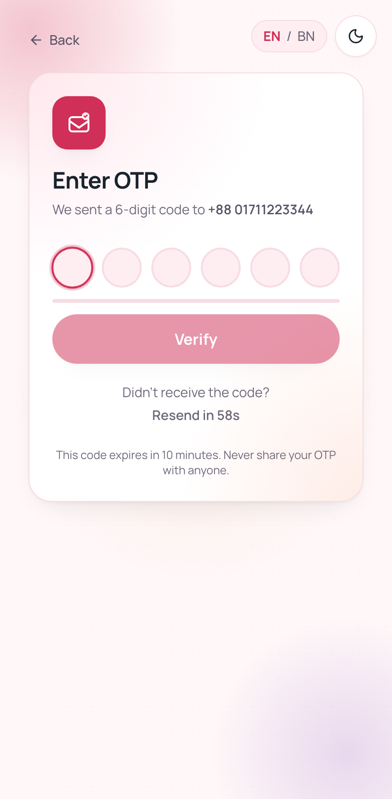

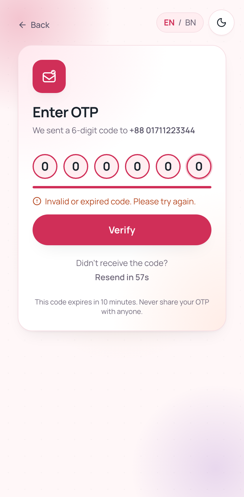

### How to use it

1. Read "Didn't receive the code?". While it says "Resend in 59s" (counting down from 60) the control cannot be tapped.
2. When it changes to **Resend OTP**, tap it. A new code is requested, the digit boxes are cleared and the 60-second wait starts again.
3. Use the newest code only; the older request is no longer used.
4. **Back** (top left) returns to the number field to fix a wrong number.

### Rules and limits

- The wait is 60 seconds and is also enforced by the server, so reloading the page does not skip it.
- The countdown is measured from a clock, so a phone in the background still counts down correctly.
- Error texts are listed in the table in [Phone login](#gs-phone-login--what-can-go-wrong).

### What can go wrong

| The User sees | Cause | Fix |
|---|---|---|
| "Resend in 60s" and no SMS | SMS delay or the number is on an unsupported route | Wait the full 60 seconds, resend once. Support can read the request in [Logs](#lg-viewer) (merchant channel) |
| "Couldn't resend the code. Please try again." | The resend request failed | Try again after a moment |
| "Invalid or expired code. Please try again." | See the phone login table | Resend |

### Related

- [Phone login](#gs-phone-login), [Troubleshooting: Login](#ts-login), [SMS](#as-otp)

## Email login (magic link) {#gs-email-login}

### What it is

A passwordless alternative: the User enters an email address and receives a **magic link**. Opening the link logs them in. A new email address creates an account with a **24-hour trial**.

### Where to find it

**Login with Email instead** under the phone login card, or `/email-login`.

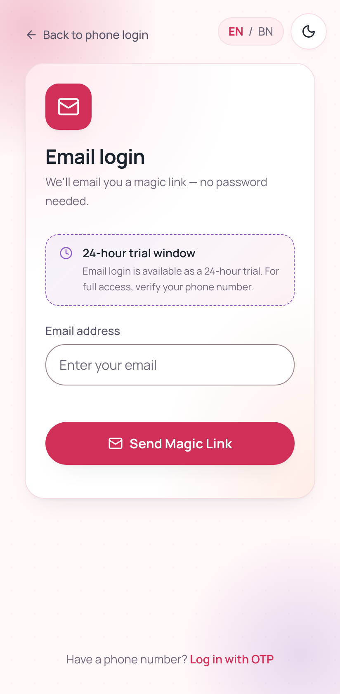

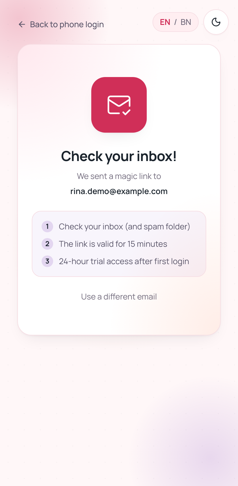

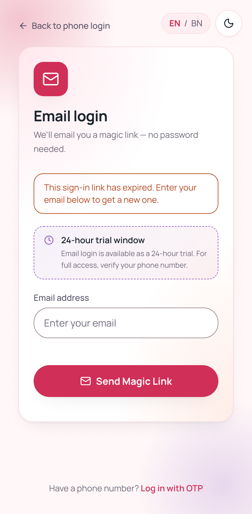

### How to use it

1. On the phone login screen tap **Login with Email instead**.
2. Under "Email address" type the address and tap **Send Magic Link**.
3. The screen shows "Check your inbox!" and "We sent a magic link to" the address, with three notes: "Check your inbox (and spam folder)", "The link is valid for 15 minutes", "24-hour trial access after first login".
4. Open the email and tap the link. The browser or phone that opens it is the one that is logged in. The User lands on the Dashboard (or onboarding if there is no profile).
5. **Use a different email** goes back to the form; **Log in with OTP** (at the bottom of the form) returns to phone login.

### Rules and limits

- The address is lower-cased and trimmed. At most **3 magic links per hour per address**.
- A link works **once**.
- **Where the screen and the system differ.** The screen and the email both say the link is valid for 15 minutes; the system keeps it valid for **1 hour**.
- An existing email account logs in again without a new trial: the trial clock starts at the **first** login only.
- The email is described in [Magic-link email](#ec-magic-link).

### What can go wrong

| The User sees | Cause | Fix |
|---|---|---|
| "Email address is required" / "Enter a valid email address" | Empty or malformed address | Correct it |
| "Too many magic link requests. Try again later." | More than 3 requests in an hour for that address | Wait up to an hour, and ask the User to use the latest email |
| "Failed to send magic link. Please try again." | The email could not be queued | Try again; Admins check [Emails](#em-log) |
| "This sign-in link has expired. Enter your email below to get a new one." | Link older than 1 hour | Request a new link |
| "This sign-in link has already been used. Enter your email below to get a new one." | Link used before (some mail apps pre-open links) | Request a new link and open it directly |
| "This sign-in link is not valid. Enter your email below to get a new one." | Mistyped or cut-off link | Request a new link |
| No email arrives | Spam folder, address typo, or the send failed | Check spam, check the address, then look up the address in the Admin email log ([Email log](#em-log)) |

### Related

- [The 24-hour email trial](#gs-email-trial), [Magic-link email](#ec-magic-link), [Emails](#em-log)

## The 24-hour email trial {#gs-email-trial}

### What it is

A User who logged in by email is on a free trial for 24 hours, counted from their **first** email login. A countdown pill in the header shows the time left. When it reaches zero the account is locked until they add and verify a phone number.

### Where to find it

The pill in the top bar of every page: a small timer with "Trial ends in HH:MM:SS". Tapping it opens "Keep your account".

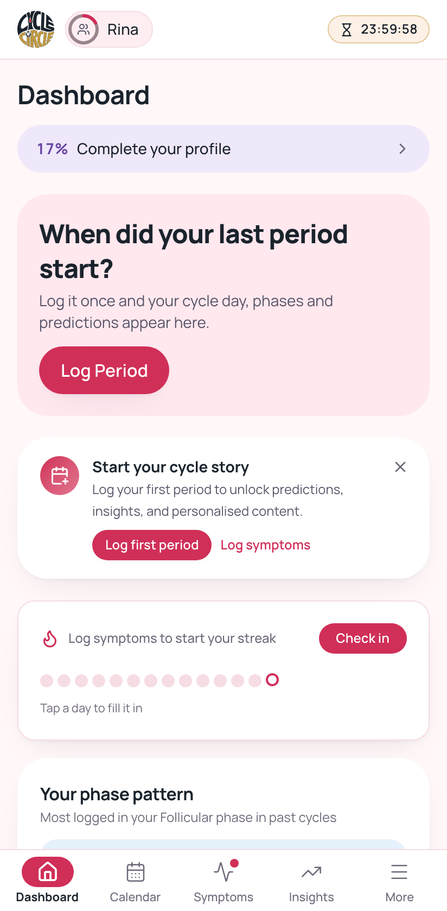

### How to use it

1. Tap the countdown pill (**Add number**). The dialog "Keep your account" says "Add & verify your mobile number to keep your account and unlock Pro."
2. Type the mobile number under "Mobile number" and tap **Send code**.
3. Enter the 6-digit code ("We sent a 6-digit code to ...") and tap **Verify**.
4. On success the dialog says "Your number is verified — you're now on Pro!" and the pill disappears.

### Rules and limits

- The trial lasts 24 hours from the first magic-link login and is not extended by logging in again.
- Verifying a phone subscribes it to Pro through BDApps, exactly like phone login ([Pro](#pa-pro)). A number already registered to another account is refused.
- The same dialog is used from Settings ([Add or verify a phone](#st-phone)).
- When the trial has ended the app shows the trial lock ([Trial lock](#pa-trial-lock)); Admins see the account in [User detail](#us-detail) as a Free User.

### What can go wrong

| The User sees | Cause | Fix |
|---|---|---|
| "Please wait a moment before requesting another code." | 60-second wait | Wait, then **Resend code** |
| "Too many attempts. Try again in a few minutes." | Rate limit | Wait |
| "This number is already registered to another account." | The number belongs to another User | Use another number, or log in to the other account |
| "This number is already subscribed. Unsubscribe it from Cycle Circle on BDApps first, then add it here." | Number subscribed on BDApps but not linked to this account | Unsubscribe on BDApps, then add it |
| "Invalid or expired code. Please try again." | Wrong or old code | Resend |
| "Too many wrong codes. Request a new code." | Code locked | Resend |
| "Enter a valid Bangladeshi mobile number." | Bad number | Retype it |
| "Something went wrong. Please try again." | Anything else | Try again |

### Related

- [Trial lock](#pa-trial-lock), [Plans at a glance](#pa-at-a-glance), [Add or verify a phone](#st-phone)

## Onboarding {#gs-onboarding}

### What it is

A five-step wizard that creates the User's first profile. A User with no profile is sent here from the app's start page until the wizard is finished.

### Where to find it

Shown automatically after the first login, or at `/onboarding`.

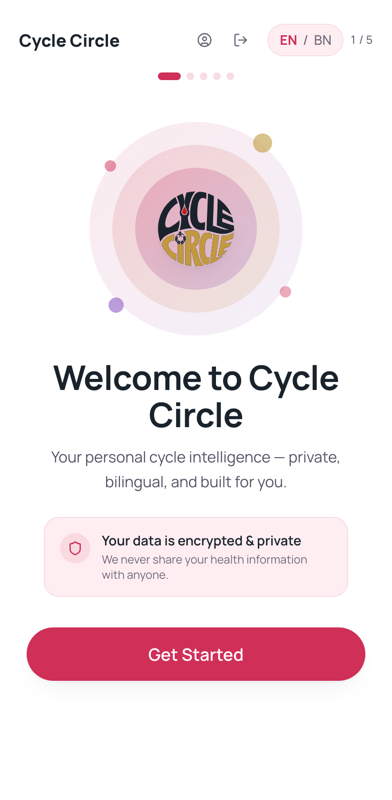

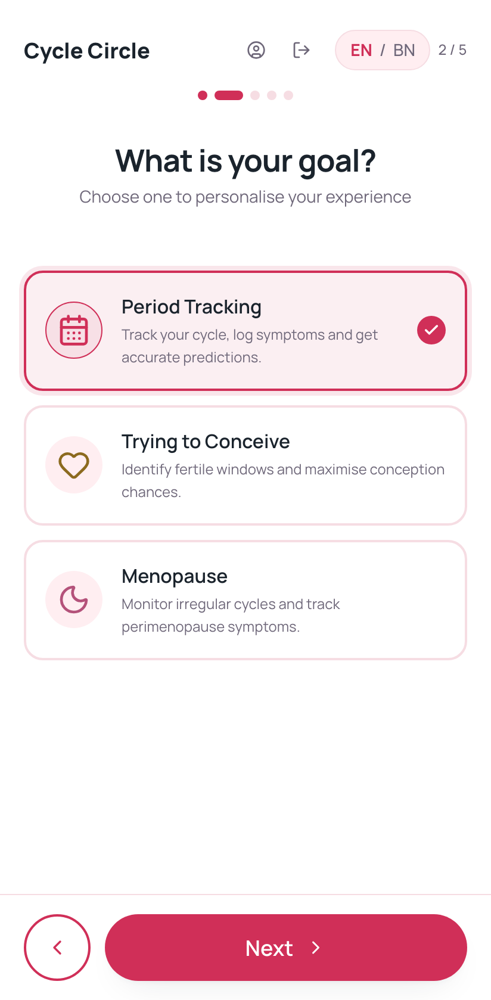

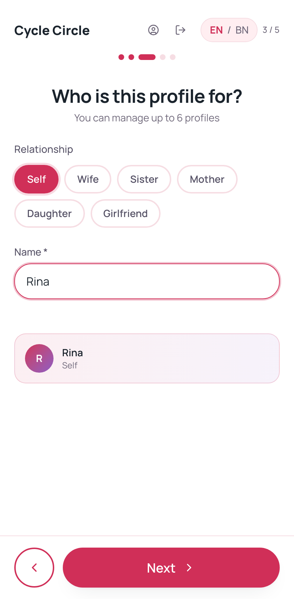

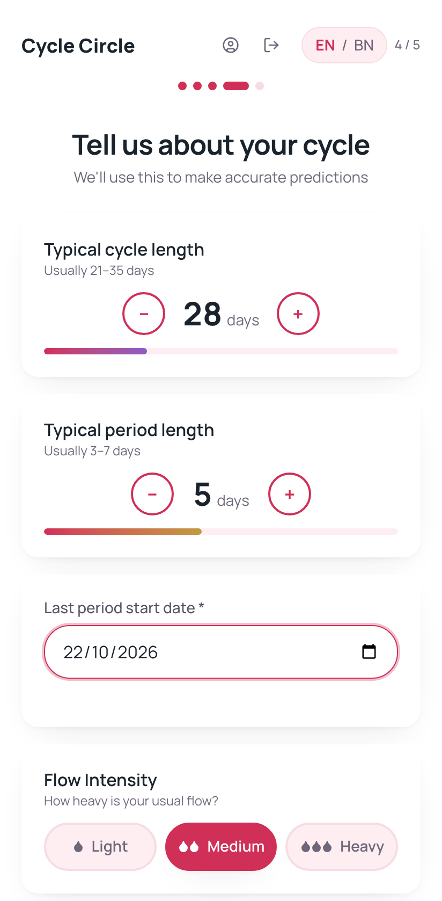

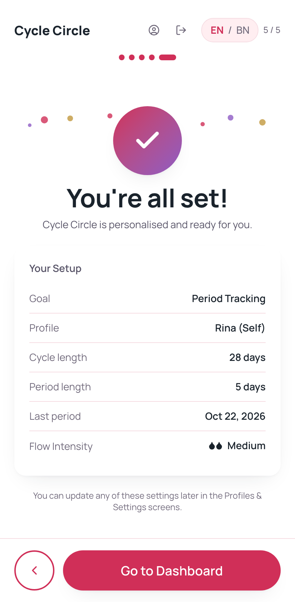

### How to use it

1. **Welcome to Cycle Circle** (step 1 of 5): read the privacy note and tap **Get Started**.
2. **What is your goal?**: choose one of **Period Tracking**, **Trying to Conceive** or **Menopause**, then **Next**.
3. **Who is this profile for?**: choose the relationship (**Self**, **Wife**, **Sister**, **Mother**, **Daughter**, **Girlfriend**) and type the **Name**. For anyone other than Self a second field, "Your name", is also required. Tap **Next**.
4. **Tell us about your cycle**: set "Typical cycle length" and "Typical period length" with the + and - buttons, pick "Last period start date", and choose "Flow Intensity" (**Light**, **Medium** or **Heavy**). Tap **Next**.
5. **You're all set!**: check "Your Setup" (Goal, Profile, Cycle length, Period length, Last period, Flow Intensity) and tap **Go to Dashboard**.

The back button on each step returns one step; answers are kept.

### Rules and limits

- Name: 2 to 40 characters. A profile name shorter than 2 characters is refused.
- Cycle length: 21 to 45 days, starting at 28. Period length: 1 to 10 days, starting at 5. (The hints on the screen say "Usually 21–35 days" and "Usually 3–7 days": those are guidance, the limits are wider.)
- Last period start date is required, cannot be in the future and cannot be more than 90 days ago. "Today" is the Bangladesh day, not the phone's date (ADR 0008).
- The first profile can be for someone else; the User account itself is still the person who logged in. A User can hold up to 6 profiles in total ([Six-profile limit](#pf-limit)).
- Settings can be changed later in Profiles ([Edit or rename a profile](#pf-edit)).

### What can go wrong

| The User sees | Cause | Fix |
|---|---|---|
| "Please select a goal to continue" | **Next** on step 2 with no goal | Pick a goal |
| "Name is required" / "Enter a name (at least 2 characters)" | Empty or one-letter name | Type a name of 2 or more letters |
| "Last period start date is required" | Date left empty | Pick a date |
| The date picker will not accept a date | Date in the future or older than 90 days | Pick a date inside the last 90 days; older periods can be backfilled later ([Backfill](#lc-backfill)) |
| "Failed to create profile. Please try again." (or the server's own message) | The save failed (for example a network drop) | Tap **Go to Dashboard** again |

### Related

- [Onboarding tour](#gs-tour), [Dashboard](#db-first-run), [Profiles](#pf-add), [Predictions](#pr-how)

## Onboarding tour {#gs-tour}

### What it is

A five-step spotlight tour that opens by itself the first time a User reaches the Dashboard, so they know where to log a period, see the calendar and insights, and finish their profile.

### Where to find it

Opens on the Dashboard right after onboarding. Each step shows "Step N of 5" in a card with **Back**, **Skip** and **Next** (**Done** on the last step) and highlights the part of the screen it talks about.

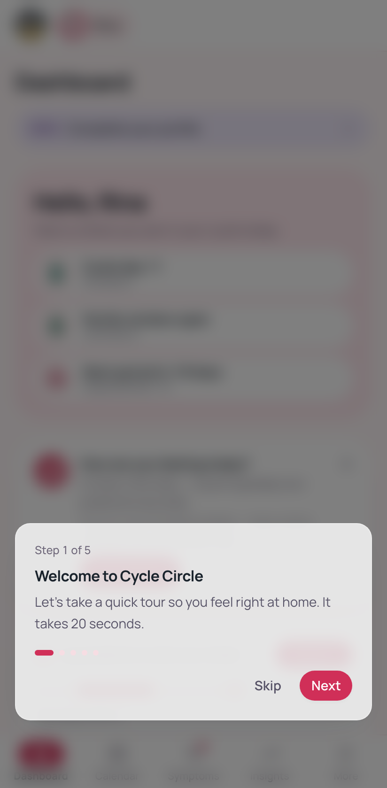

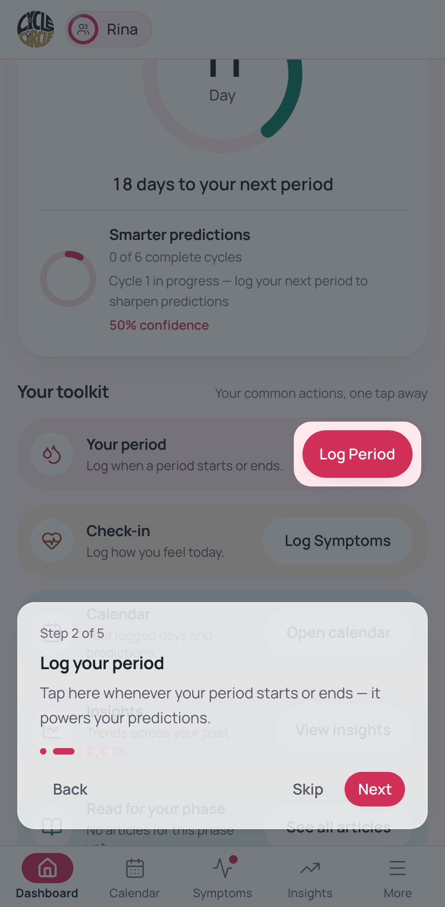

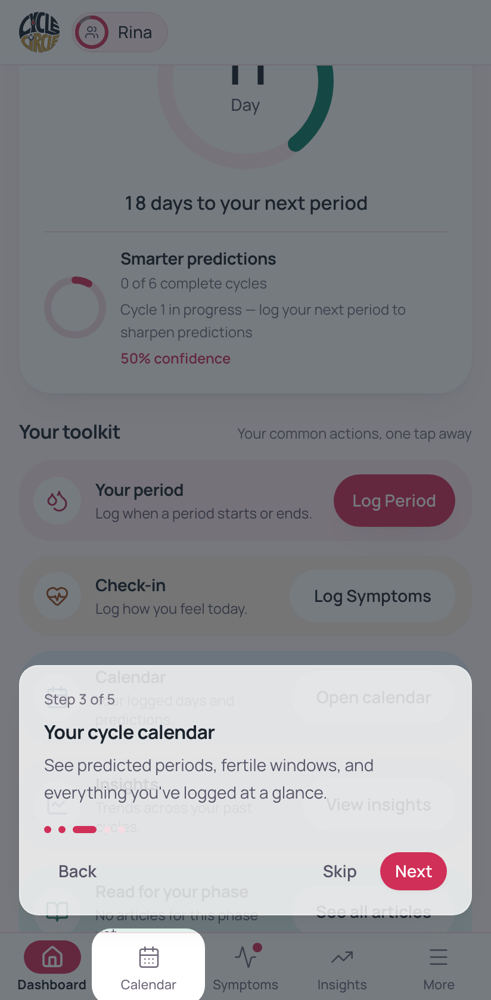

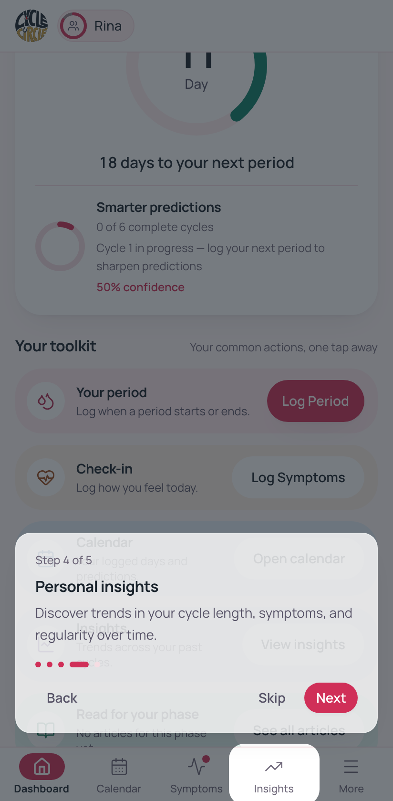

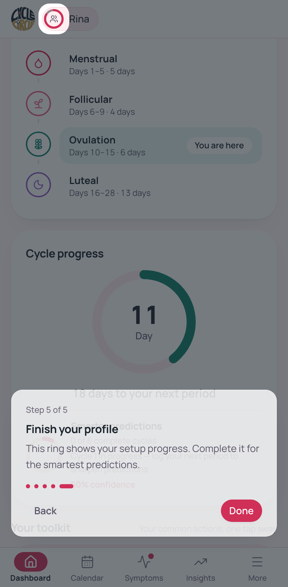

### How to use it

1. Step 1, "Welcome to Cycle Circle": "Let's take a quick tour so you feel right at home. It takes 20 seconds."
2. Step 2, "Log your period": "Tap here whenever your period starts or ends — it powers your predictions."
3. Step 3, "Your cycle calendar": "See predicted periods, fertile windows, and everything you've logged at a glance."
4. Step 4, "Personal insights": "Discover trends in your cycle length, symptoms, and regularity over time."
5. Step 5, "Finish your profile": "This ring shows your setup progress. Complete it for the smartest predictions."
6. Tap **Next** between steps; **Done** at the end. **Skip**, **Done** and the Escape key all close the tour.

### Rules and limits

- The tour opens only on the Dashboard, only for a logged-in User who has never finished it, and only if no more urgent auto-prompt is showing: the app opens at most one auto-prompt per page load ([One prompt per page load](#ap-rule), [Onboarding tour prompt](#ap-tour)).
- Skipping or finishing both count as "finished". That is stored on the account, so it does not open again on another phone or browser.
- A User whose email trial has expired sees the trial lock instead ([Trial lock prompt](#ap-trial-lock)).
- It can be replayed any time ([Replaying the tour](#gs-tour-replay)).

### What can go wrong

| The User sees | Cause | Fix |
|---|---|---|
| No tour after onboarding | Another auto-prompt took that page load (for example the check-in or late-period alert) or the tour was already finished | Replay it from Settings |
| The tour reappears on every visit | The close request failed (offline) so it was not saved | Finish it again with network on |

### Related

- [Replaying the tour](#gs-tour-replay), [Onboarding tour prompt](#ap-tour), [Replay the tour (Settings)](#st-replay-tour)

## Replaying the tour {#gs-tour-replay}

### What it is

A User can take the tour again whenever they like.

### Where to find it

Settings, in the Account card: **Replay app tour** ("Take the guided tour of the app again."). On a phone, Settings is in **More**.

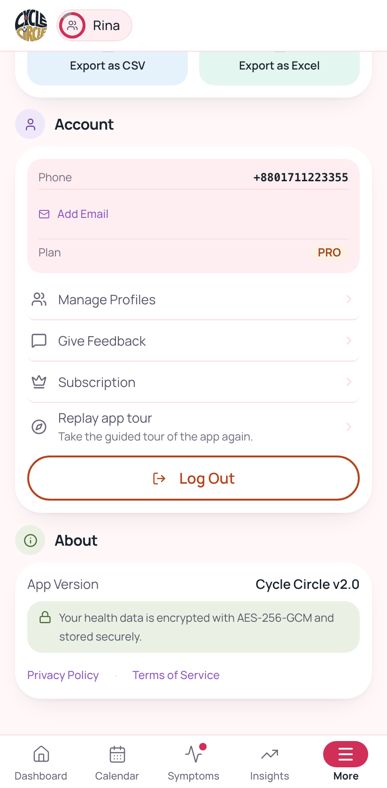

### How to use it

1. Open **More > Settings** and tap **Replay app tour**.
2. The app goes to the Dashboard and the tour starts at step 1.

### Rules and limits

- A replay is the User's own action, so it opens directly and is not held back by the one-prompt-per-page-load rule.
- It does not open over the trial lock.
- Closing a replay marks the tour finished again; nothing else changes.

### What can go wrong

| The User sees | Cause | Fix |
|---|---|---|
| The Dashboard opens without the tour | The trial lock was showing | Add a phone first ([The 24-hour email trial](#gs-email-trial)) |

### Related

- [Onboarding tour](#gs-tour), [Replay the tour (Settings)](#st-replay-tour)
