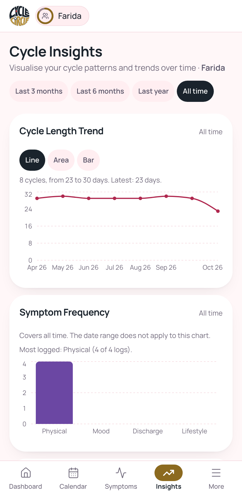
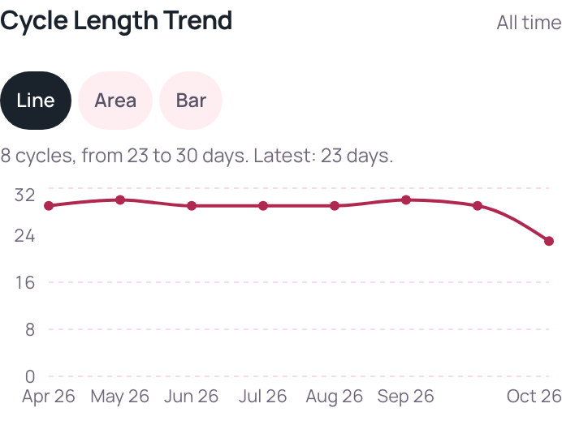
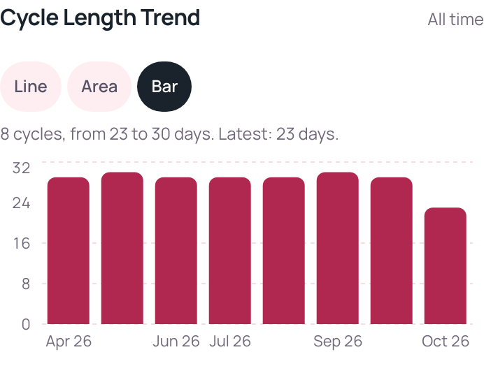
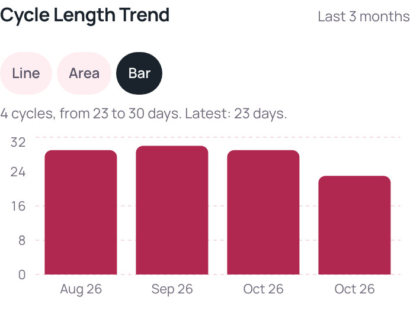
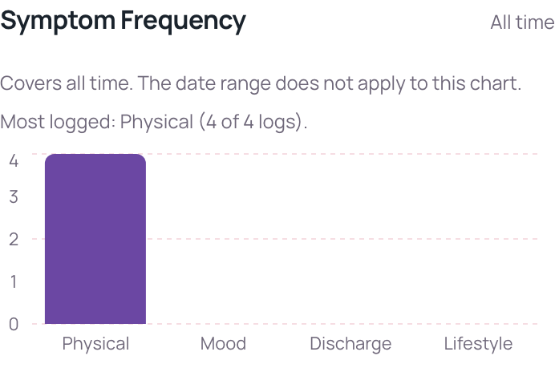
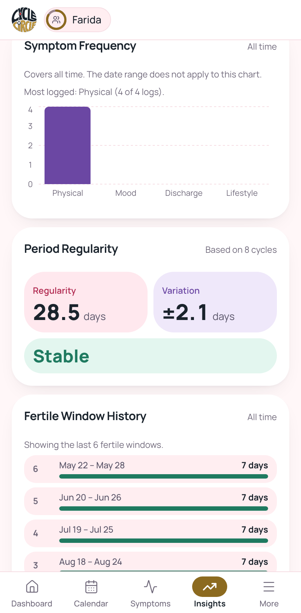
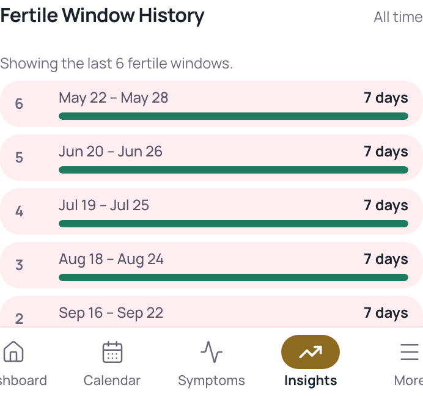
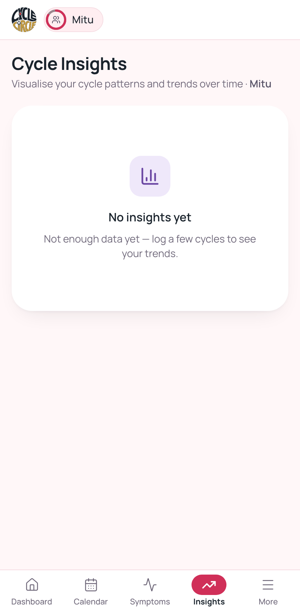
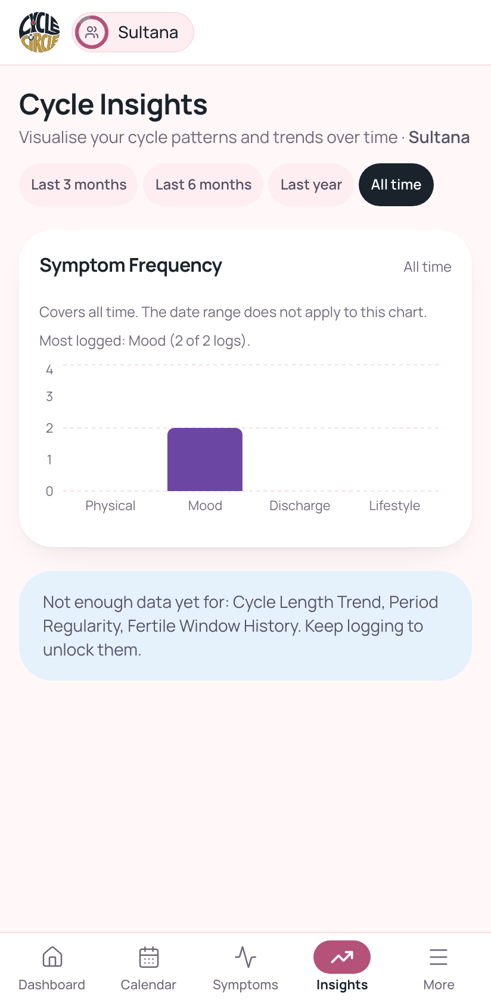

# Insights

The **Insights** screen turns a profile's logs into four charts and statistics: cycle length over time, which kinds of symptoms were logged, how regular the periods are, and the fertile windows of past cycles. It is the page a User opens to answer "is my cycle normal for me?". Support questions here are almost always "why is my chart empty?" or "why does this number look wrong?".

Facts that apply to every section:

- Insights shows **one profile at a time**: the active profile. Its name is in the page subtitle ("Visualise your cycle patterns and trends over time · Farida").
- The charts are built **only from what the User logged**: period start dates and symptom logs. They are not predictions, and they ignore the cycle length typed at setup.
- **All Users have Insights.** The Subscription page lists "Advanced Cycle Insights" among the Pro features, but the Insights screen applies no Free/Pro check: a Free User sees the same charts as a Pro User ([Pro-only features](#pa-pro-gating)). Only the trial lock blocks it ([Trial lock prompt](#ap-trial-lock)).
- The screen does **not remember** the chart type or the date range. Both go back to **Line** and **All time** each time the page loads.
- Numbers and month names follow the language choice (English or Bengali digits).

## Insights overview {#in-overview}

### What it is

The top of the **Insights** screen: the title "Cycle Insights", the active profile's name, the date-range buttons, and the cards below them.

### Where to find it

Tap **Insights** in the bottom bar (or in the left menu on a computer). The first-run tour also points at it ("Personal insights").

The cards, in order: **Cycle Length Trend**, **Symptom Frequency**, **Period Regularity**, **Fertile Window History**. A card appears only when it has data ([Empty and partial states](#in-empty)).

### How to use it

1. Open **Insights**.
2. Optionally tap a date range: **Last 3 months**, **Last 6 months**, **Last year** or **All time**. The chosen button turns dark.
3. Scroll down through the cards. Each chart can be read by a screen reader as text: every chart has a summary sentence and a hidden data table.

### Rules and limits

- The date-range buttons appear only when the profile has some data at all. They apply to **Cycle Length Trend** and **Fertile Window History** only. **Symptom Frequency** says "All time" and shows the note "Covers all time. The date range does not apply to this chart." **Period Regularity** also ignores the range, but the page does not say so.
- Months are counted back from today's Bangladesh date. "Last 3 months" keeps cycles whose later period start is on or after the same day of month, three months ago.
- New logs show up after the User saves, because saving refreshes the figures for that profile. If a chart looks out of date, reload the page.
- There is no export or print from this screen. Data export is in Settings ([Export your data](#st-export)).

### What can go wrong

| The User sees | Cause | Fix |
|---|---|---|
| "No insights yet" | Nothing chartable yet for this profile | See [Empty and partial states](#in-empty) |
| Insights show someone else's data | The active profile is a different profile | Switch the active profile ([Switch the active profile](#pf-switch)) |
| The range buttons are missing | The profile has no data at all | They appear once any data exists |
| A chart disappeared after choosing **Last 3 months** | No cycles fall in that range, so the card is hidden and the blue note lists it | Choose **Last 6 months**, **Last year** or **All time** |
| The page is slow to show charts | The chart library loads on first view; a grey block shows meanwhile | Wait a moment; reload if it stays |

### Related

- [Cycle length charts](#in-cycle-charts), [Symptom statistics](#in-symptom-stats), [Empty and partial states](#in-empty)
- [Logging symptoms](#sc-symptoms), [Log a period](#lc-log-period), [How predictions work](#pr-how)

## Cycle length charts {#in-cycle-charts}

### What it is

**Cycle Length Trend**: a chart of how many days each completed cycle lasted. A cycle is the gap between two **period start dates** the User logged, so the chart needs at least two periods.

### Where to find it

**Insights**, first card. Under the title it shows the chosen range (for example "All time"), three chart-type buttons (**Line**, **Area**, **Bar**) and a sentence such as "8 cycles, from 23 to 30 days. Latest: 23 days."

### How to use it

1. Pick **Line**, **Area** or **Bar** for the shape. Tap or hover on a point to see its value.
2. Pick a date range at the top of the page to see fewer cycles.
3. Read the summary line: number of cycles in view, shortest, longest and latest.

### Rules and limits

- One point per cycle. The point sits at the month of the **later** period start, and its value is the number of days since the previous period start.
- A cycle needs two logged periods. The current, unfinished cycle is not drawn until the next period is logged. The "Latest" figure is the most recent **completed** cycle, so it can be shorter than the cycle the User is in now.
- Only logged start dates count, not the cycle length set in the profile.
- The vertical axis is in days. Month labels are in short form ("Apr 26" is April 2026).
- **All logged periods count, even a mistaken one.** A period saved with a wrong date shows up as an unusually short or long cycle and also distorts [Period Regularity](#in-symptom-stats). Fix it in the Calendar ([Edit or delete a period](#lc-edit-delete)).

### What can go wrong

| The User sees | Cause | Fix |
|---|---|---|
| No Cycle Length Trend card | Fewer than two periods logged (or none in the chosen range). The blue note says "Not enough data yet for: Cycle Length Trend, ..." | Log another period, or widen the range |
| A very short cycle (for example 4 days) | Two period logs were entered close together, often a period split in two or a wrong start date | Edit or delete one of the periods |
| The line looks flat | Cycle lengths are close to each other. The vertical axis starts at 0 | Read the summary line for the exact numbers |
| "Latest" is not the cycle they are in | Latest means the last completed cycle | Expected; the next period log adds the new cycle |

### Related

- [Insights overview](#in-overview), [Symptom statistics](#in-symptom-stats)
- [Log a period](#lc-log-period), [Edit or delete a period](#lc-edit-delete), [Why predictions improve with more cycles](#pr-improve)

## Symptom statistics {#in-symptom-stats}

### What it is

Three cards that summarise logs rather than dates:

- **Symptom Frequency**: how many symptom logs fall in each category.
- **Period Regularity**: the average cycle length and how much it varies, with a **Stable** or **Variable** label.
- **Fertile Window History**: the fertile window of each past cycle.

### Where to find it

**Insights**, below Cycle Length Trend.

### How to use it

1. **Symptom Frequency.** Read the bars for Physical, Mood, Discharge and Lifestyle. The line above says "Most logged: Physical (4 of 4 logs)." Hover or tap a bar for the count.
2. **Period Regularity.** The card **Regularity** shows the average cycle in days (for example 28.5). **Variation** shows how far cycles stray from that average (for example ±2.1 days). The third box says **Stable** or **Variable**. Under the title, "Based on 8 cycles" says how many cycles were used.
3. **Fertile Window History.** Each row is one past cycle: its number (1 is the latest), the fertile window dates (for example "Oct 8 – Oct 14"), "7 days" and a bar. On a wider screen the ovulation day is shown with a circle-plus mark.

### Rules and limits

- **Symptom Frequency** counts **each saved symptom, on each day, once**, all time, per category. Two symptoms on one day count as two. The special "all good" entry is **not** counted ([All good today](#sc-all-good)). All four categories are always charted; a missing one shows 0. The card appears only when at least one symptom is logged.
- **Period Regularity** uses **all** logged periods (the date range does not apply). The average is the mean of all cycle lengths. Variation is the standard deviation of the same cycle lengths. The label is **Stable** when the variation is **3 days or less**, otherwise **Variable**. Both figures are rounded to one decimal place. With only one cycle the variation is 0, so the label reads **Stable**; the card then says "Based on 1 cycles".
- **Fertile Window History** is a **reconstruction, not what the app predicted at the time**. For each period start followed by another logged start, ovulation is taken as 14 days before the next period start, and the fertile window runs from 5 days before ovulation to 1 day after. So every row is 7 days long. The current cycle gets no row until its next period is logged. Only the **last 6** windows in the chosen range are shown, under the sentence "Showing the last 6 fertile windows." (the number is the number shown).
- The ovulation date on each fertile-window row is hidden on phone-width screens (under 640 px wide). It is visible on a tablet or computer.
- Symptom counts are never filtered by profile cycle phase; the phase view is the Phase pattern on the Dashboard ([Phase pattern](#db-phase-pattern)).
- The fertile window in Insights is not the same as the one on the Calendar and Dashboard, which come from the prediction ([Fertile window](#pr-fertile-window)).

### What can go wrong

| The User sees | Cause | Fix |
|---|---|---|
| "Not enough data yet for: Symptom Frequency, ..." (blue note) | No symptom logged yet, or only "all good" entries | Log symptoms ([Logging symptoms](#sc-symptoms)) |
| Regularity says **Variable** though cycles look similar | A wrong or extra period log widens the variation. The limit is 3 days | Look for a short or long cycle in Cycle Length Trend and fix that period |
| Regularity says "Based on 1 cycles" | Exactly two periods logged | Expected wording; it improves as more periods are logged |
| Symptom bars unchanged after choosing a date range | The chart is all-time by design. The note on the card says so | None |
| Fertile windows do not match the Calendar | History is reconstructed from logged periods with a fixed rule; the Calendar uses the prediction | Explain the difference; link to [Fertile window](#pr-fertile-window) |
| No ovulation date in a row | Phone-width screens hide it | Open on a wider screen |
| Fewer than six rows | Fewer than six completed cycles in range | Expected |

### Related

- [Cycle length charts](#in-cycle-charts), [Insights overview](#in-overview), [Empty and partial states](#in-empty)
- [All good today](#sc-all-good), [Phase pattern](#db-phase-pattern), [Fertile window](#pr-fertile-window)

## Empty and partial states {#in-empty}

### What it is

What **Insights** shows when there is little or nothing to chart. There are two states: nothing at all, or some charts with others missing.

### Where to find it

**Insights**, for a new User or one with few logs.

Nothing to chart: the whole page is one card.

Some data: the charts that can be built appear, and a blue note names the rest.

### How to use it

1. If the card says "No insights yet", the User needs to log first: at least two periods (for the cycle, regularity and fertile-window cards) or some symptoms (for Symptom Frequency).
2. If the blue note appears, it says "Not enough data yet for: ... Keep logging to unlock them." followed by the names of the missing cards, for example "Not enough data yet for: Cycle Length Trend, Period Regularity, Fertile Window History. Keep logging to unlock them."

### Rules and limits

- **Whole-page empty state** (title "No insights yet", text "Not enough data yet — log a few cycles to see your trends."): shown when there is no cycle, no symptom (apart from "all good"), no regularity sample and no fertile window for the profile, ignoring the date range. A profile with one period and no symptoms is in this state.
- **What each card needs:** Cycle Length Trend, Period Regularity and Fertile Window History each need **two logged periods**. Symptom Frequency needs **one real symptom**.
- The blue note also appears when a date range hides a card, even if more data exists in "All time".
- The date-range buttons are hidden in the whole-page empty state.
- Profiles with a menopause-related goal see the same charts; nothing is switched off for them.

### What can go wrong

| The User sees | Cause | Fix |
|---|---|---|
| "No insights yet" although they use the app daily | They have logged one period or none, and no real symptoms. Only "all good" check-ins do not count | Log a second period, or tick real symptoms |
| "No insights yet" for one profile only | Insights show the active profile; another profile has the data | Switch profile |
| The blue note lists a card that used to show | The date range now excludes it | Choose a wider range |
| Charts appear but one card is missing | It lacks data (see "What each card needs") | Keep logging |

### Related

- [Insights overview](#in-overview), [Symptom statistics](#in-symptom-stats)
- [First-run dashboard](#db-first-run), [Log a period](#lc-log-period), [Why predictions improve with more cycles](#pr-improve)
