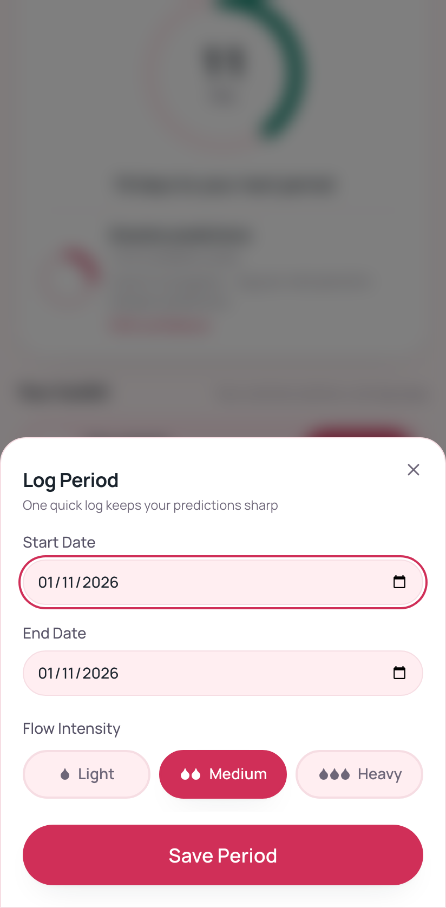
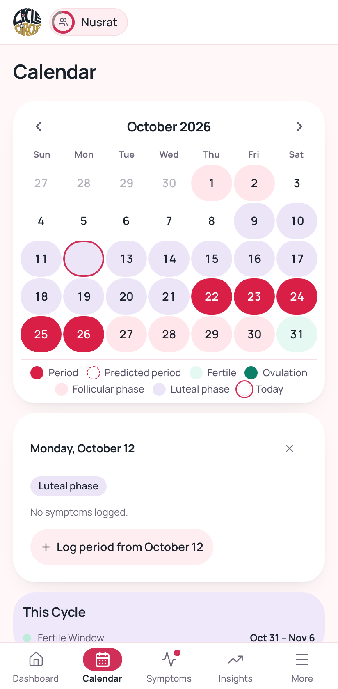
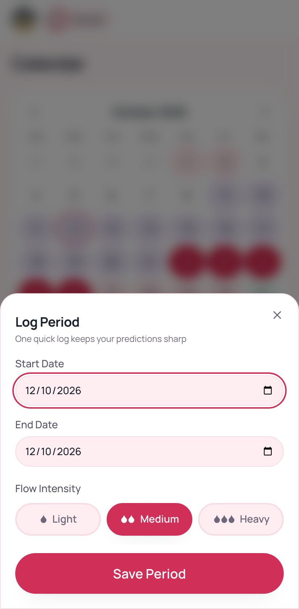
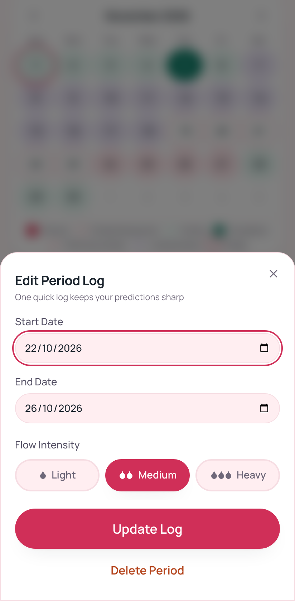
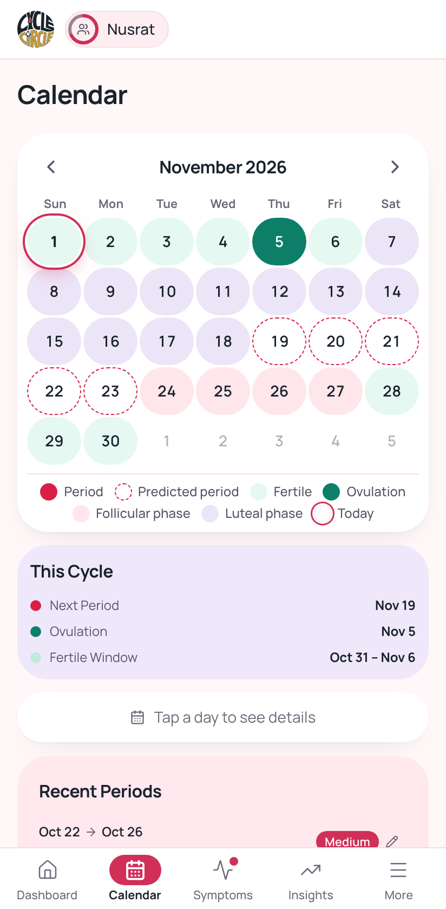
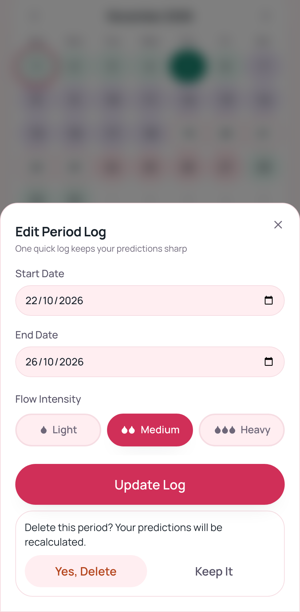
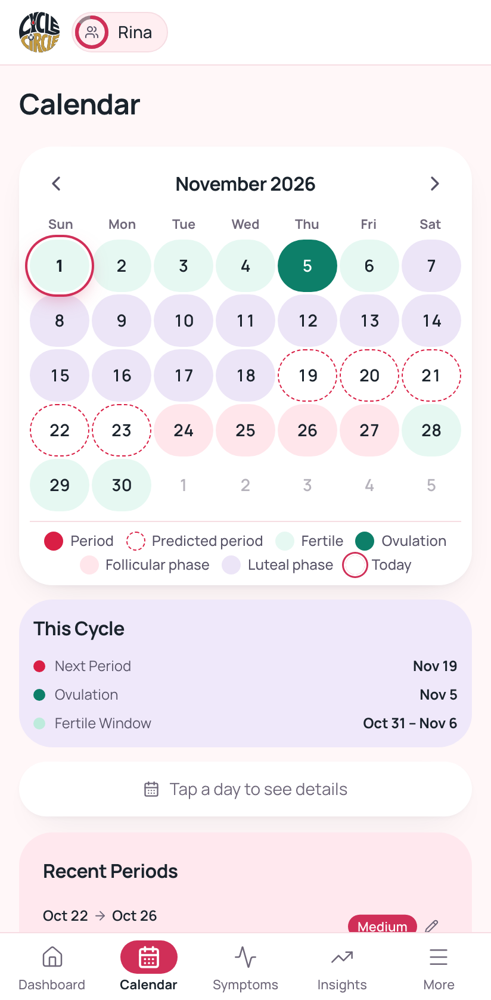
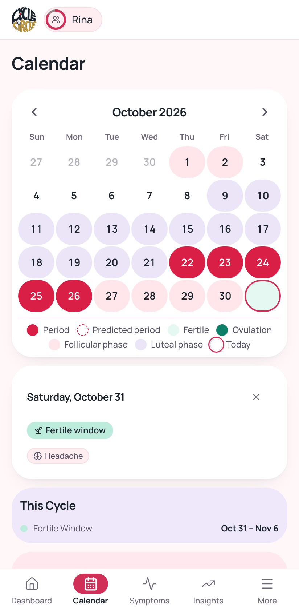
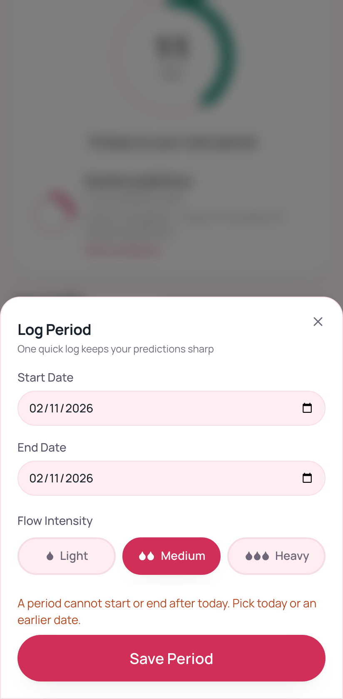
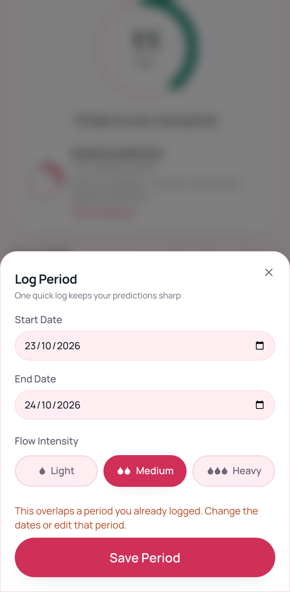

# Logging & Calendar

How a User records a period and reads the **Calendar**. A period is a start date, an end date and a flow (Light, Medium or Heavy). Every period saved, edited or deleted makes the system recalculate the prediction for that profile ([How predictions work](#pr-how)).

Symptoms and the daily check-in are a separate chapter ([Logging symptoms](#sc-symptoms)). The Calendar shows symptoms too, but only as a read-out on a day.

## Log a period {#lc-log-period}

### What it is

The **Log Period** pop-up: **Start Date**, **End Date** and **Flow Intensity** (Light, Medium, Heavy), with the line "One quick log keeps your predictions sharp" and a **Save Period** button. Start and end both begin on today and flow on Medium.

### Where to find it

- **Dashboard**: the **Log Period** button in "Your toolkit" ("Your period: Log when a period starts or ends."), or **Log Period** in the first-run hero, or the late-period pop-up's **Log my period** ([Late-period alert](#ap-late-period)).
- **Calendar**: tap a past day, then **Log period from <date>** ([Backfill a past period](#lc-backfill)).

### How to use it

1. Open **Dashboard** and tap **Log Period**.
2. Set **Start Date** (the first day of bleeding). If the period is still going, leave **End Date** as today; edit the period later when it ends ([Edit or delete a period](#lc-edit-delete)).
3. Choose **Flow Intensity**.
4. Tap **Save Period**. The pop-up closes, a short celebration message appears and the Dashboard refreshes with the new cycle day and prediction.

### Rules and limits

- Dates are Bangladesh days ([Bangladesh days and date rules](#lc-date-rules)). A period cannot start or end after today.
- The end date cannot be before the start date. The date picker stops the User choosing it, but if they change the start date to after an end date already chosen, Save fails with the generic message below.
- A period cannot share a day with another logged period of the same profile (the end day counts).
- The code sets **no maximum length** and no minimum gap between periods. Only gaps under 90 days between consecutive starts count as cycles for predictions ([Why predictions improve with more cycles](#pr-improve)).
- Saving a period for a profile in a family account affects only that profile.

### What can go wrong

| The User sees | Cause | Fix |
|---|---|---|
| "A period cannot start or end after today. Pick today or an earlier date." | Start or end date is after today's Bangladesh day | Pick today or an earlier date |
| "This overlaps a period you already logged. Change the dates or edit that period." | One of the days is inside another logged period | Change the dates, or edit the existing period from the Calendar |
| "Something went wrong" | The end date is before the start date, or the request failed | Check the dates and try again; if it repeats, check the User's connection |
| The **Save Period** button is greyed | A date field is empty | Fill both dates |
| The button shows "Loading..." for a long time | Slow connection | Wait; do not tap twice |

### Related

- [Edit or delete a period](#lc-edit-delete)
- [Bangladesh days and date rules](#lc-date-rules)
- [How predictions work](#pr-how)
- [Cycle hero](#db-hero)

## Backfill a past period {#lc-backfill}

### What it is

Adding a period that already happened, starting from a day on the Calendar. The pop-up opens with that day as the start and end date.

### Where to find it

**Calendar**: tap a past day; the day's card has a **Log period from <Month day>** button. On a computer with a mouse, a "+" also appears when hovering a day in the last 30 days.

### How to use it

1. Open **Calendar** and go to the month with **Previous month** if needed.
2. Tap the day the period started.
3. Tap **Log period from <date>**.
4. Set **End Date** and **Flow Intensity** and tap **Save Period**.

Alternative: **Dashboard > Log Period** and type an earlier **Start Date**; that works for any date up to today.

### Rules and limits

- The button is offered for a day that is **before today** and **not inside a logged period**.
- On the day's card the button shows only when **no symptoms are logged on that day** ("No symptoms logged." is the line beside it). If the day has symptoms, the card shows them and no button; on a phone the hover "+" does not exist. Use **Dashboard > Log Period** for that day instead.
- Backfilled periods change the prediction: it is recalculated from all logged starts, in date order, whatever order they were entered.
- The same rules as [Log a period](#lc-log-period) apply: no future dates, no overlaps.

### What can go wrong

| The User sees | Cause | Fix |
|---|---|---|
| No **Log period from** button on a day | The day is today or later, or inside a logged period, or has symptoms logged | Use **Dashboard > Log Period**, or edit the existing period |
| "This overlaps a period you already logged. Change the dates or edit that period." | The end date runs into another logged period | Shorten the end date |
| The Calendar shows the new period but the Dashboard shows old dates | The page was cached | Reload; the Dashboard refreshes after a save |

### Related

- [Log a period](#lc-log-period)
- [A day's logs](#lc-day-detail)
- [Back-dated symptoms](#sc-backdate)

## Edit or delete a period {#lc-edit-delete}

### What it is

Changing the dates or flow of a logged period, or removing it. The pop-up is the same form with the title **Edit Period Log**, an **Update Log** button and a **Delete Period** button.

### Where to find it

**Calendar > Recent Periods** (the pink card below the grid). Each row shows the dates ("Oct 1 > Oct 5"), the length ("5 days") and the flow; tap a row to edit. Six periods show per page, with **Prev** / **Next** and "1 / 2".

### How to use it

1. Open **Calendar**, scroll to **Recent Periods** and tap the period.
2. Change **Start Date**, **End Date** or **Flow Intensity** and tap **Update Log**.
3. To remove it, tap **Delete Period**, then **Yes, Delete** ("Delete this period? Your predictions will be recalculated."). **Keep It** cancels.

### Rules and limits

- The same date rules as logging: no future dates, no overlap with another period (the period being edited does not count against itself).
- After an edit or delete the prediction is recalculated at once. If the last period is deleted, the Dashboard goes back to the last remaining one; with none left it shows the First-run view ([First-run dashboard](#db-first-run)) unless the profile still has a last-period date, in which case the system creates a period from it again.
- There is no undo for a delete.
- The list shows every period of the active profile, newest first. "No period logs yet" means none.

### What can go wrong

| The User sees | Cause | Fix |
|---|---|---|
| "Could not delete this period. Please try again." | The delete request failed | Try again |
| A deleted period comes back | It was the only period, and the profile still has its last-period date from onboarding, from which the system creates one again | Log the correct period instead of deleting the only one |
| "This overlaps a period you already logged. Change the dates or edit that period." | Edited dates run into a neighbouring period | Fix the dates |
| "No period logs yet" | Nothing logged for this profile | Log a period |

### Related

- [Log a period](#lc-log-period)
- [Why predictions improve with more cycles](#pr-improve)
- [Switch the active profile](#pf-switch)

## Calendar and its markers {#lc-calendar}

### What it is

A month grid for the active profile with a colour key under it ("Colour key"), a "This Cycle" summary and the Recent Periods list. One marker means one thing:

| Marker | Looks like | Means |
|---|---|---|
| Period | Solid red fill | A **logged** period day |
| Predicted period | Dashed outline, no fill | A period day the system **expects** (not logged). A late period stays shown here in the past |
| Fertile | Soft green tint | Predicted fertile window day |
| Ovulation | Solid teal | Predicted ovulation day |
| Follicular phase / Luteal phase | Faint pink / faint lavender tint | The phase the day falls in, from the profile's cycle and period length |
| Today | An accent-coloured ring with a soft glow around the day | Today (Bangladesh day) |
| Plain number | No marker | Nothing predicted or logged |

If a day qualifies for more than one marker, the order is: period (logged or predicted), ovulation, fertile, then the phase tint. Today's ring is added on top.

### Where to find it

**Calendar** in the bottom navigation.

### How to use it

1. Open **Calendar**; it opens on the current month. Use the arrows (**Previous month** / **Next month**) or the month heading to move.
2. Read the colour key under the grid.
3. Tap a day to see its card ([A day's logs](#lc-day-detail)).
4. Read "This Cycle": **Next Period**, **Ovulation** and **Fertile Window** dates (or "Period Late · N days overdue" when the predicted date in the shown month has passed).

### Rules and limits

- Predictions are drawn for the next **three cycles** only. The first comes from the stored prediction; cycles two and three repeat after the **profile's cycle length setting** (not the learned average), so they can drift from the first when the logged average differs from the setting.
- Logged periods come from the period logs; the Calendar also creates one from the profile's last-period date if the profile has none.
- Ovulation = predicted period start minus 14 days; fertile window = 5 days before ovulation to 1 day after ([Fertile window](#pr-fertile-window)).
- Every date is a Bangladesh day. Months before the first logged period show no markers.
- The phase tint stops at the profile's cycle length, so a late cycle's extra days are plain.

### What can go wrong

| The User sees | Cause | Fix |
|---|---|---|
| No predicted days at all | No period logged for the profile | Log a period |
| The predicted period is a few days off the Dashboard's "Expected" date | The Dashboard date is from the stored prediction; later cycles use the profile cycle length | Expected for cycles after the first |
| Dashed days in the past | The predicted period has not been logged yet | Log the period, which turns them solid |
| The wrong profile's data | Another profile is active | Switch profile ([Switch the active profile](#pf-switch)) |

### Related

- [A day's logs](#lc-day-detail)
- [How predictions work](#pr-how)
- [Fertile window](#pr-fertile-window)
- [Bottom navigation](#nl-bottom-nav)

## A day's logs {#lc-day-detail}

### What it is

The card that opens when a day is tapped. Title is the weekday and date ("Thursday, October 15"), a **Predicted** badge for future days, then a status badge and the symptoms logged that day.

| Badge | Shown when |
|---|---|
| Period day | The day is a logged or predicted period day |
| Ovulation | The day is the predicted ovulation day |
| Fertile window | A predicted fertile day that is not ovulation day |
| Follicular phase / Luteal phase | No other status, and the day is in that phase |
| Regular day | None of the above |

Below it, symptom chips ("Cramps", "Headache"), or "No symptoms logged.".

### Where to find it

**Calendar**: tap any day. On a phone the card appears under the grid and the page scrolls to it. On a wide screen it opens beside the grid, already on today. Tap the **X** (**Close**) or the same day again to close it.

### How to use it

1. Tap a day.
2. Read the badge and symptoms. For a past day without symptoms or period, **Log period from <date>** is offered ([Backfill a past period](#lc-backfill)).

### Rules and limits

- Only symptoms are listed. The card does **not** show a logged period's flow or length; those are in **Recent Periods**.
- Symptoms are read-only here; add or change them on **Symptoms** ([Logging symptoms](#sc-symptoms)).
- A symptom whose id is no longer in the app's list is skipped.

### What can go wrong

| The User sees | Cause | Fix |
|---|---|---|
| "No symptoms logged." | None logged that day | Log symptoms for that day ([Back-dated symptoms](#sc-backdate)) |
| "Period day" with the dashed style | The day is predicted, not logged | Log the period if it started |
| A day's symptoms missing | They were logged on another profile | Switch profile |

### Related

- [Calendar and its markers](#lc-calendar)
- [Back-dated symptoms](#sc-backdate)

## Bangladesh days and date rules {#lc-date-rules}

### What it is

Every date in Cycle Circle, whether typed, shown, stored or compared, is a **Bangladesh day**: a calendar day in UTC+6 (ADR 0008). "Today" is the Bangladesh day, even for a User whose phone is set to another time zone (for example abroad). A period saved at 11:30 pm and one saved at 12:30 am are on different days.

### Where to find it

Everywhere dates appear. The visible case is the pop-up error when a date is after today.

### How to use it

1. For a User whose phone clock is not on Bangladesh time, tell them the app counts days in Bangladesh time. Near midnight their phone's "today" may be a different day than the app's.

### Rules and limits

- The date picker's latest allowed date is today's Bangladesh day, and the server checks again. The pop-up message is "A period cannot start or end after today. Pick today or an earlier date.".
- Overlap is checked by whole days, both ends included: a period ending on the 5th and another starting on the 5th overlap.
- The streak, the check-in "today", the late count, the Dashboard cycle day and the logging nudge all use the same day.
- Older documents (the ADR 0008 text) say the web app still defaults forms and "today" to the device's day. The code no longer does: the Dashboard, Calendar and Log Period pop-up all read the Bangladesh day, and the device-day helpers were removed.
- The date field shows dates in the format of the phone's own language settings; the stored value is always a plain date.

### What can go wrong

| The User sees | Cause | Fix |
|---|---|---|
| "A period cannot start or end after today. Pick today or an earlier date." | The date is after the Bangladesh day; often a User abroad or just after midnight Bangladesh time | Pick today (Bangladesh) or earlier |
| "Yesterday" looks wrong around midnight | Phone clock and Bangladesh time are on different days | Explain Bangladesh days |
| "This overlaps a period you already logged. Change the dates or edit that period." | Day ranges share a day | Change the dates, or edit the existing period |

### Related

- [Log a period](#lc-log-period)
- [Streak](#db-streak)
- [Late-period alert](#ap-late-period)
