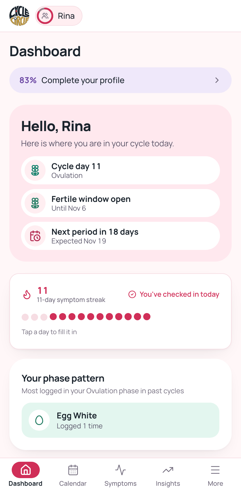
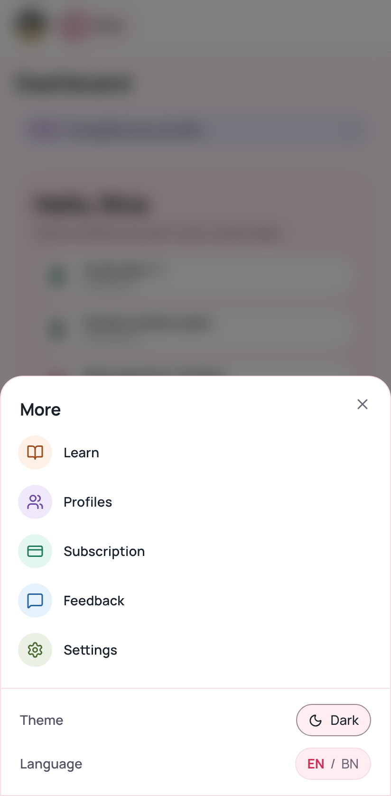
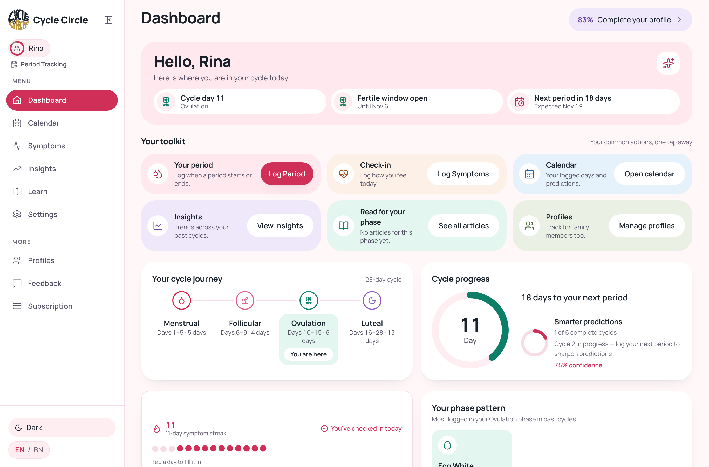
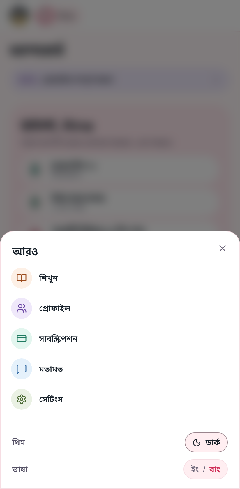
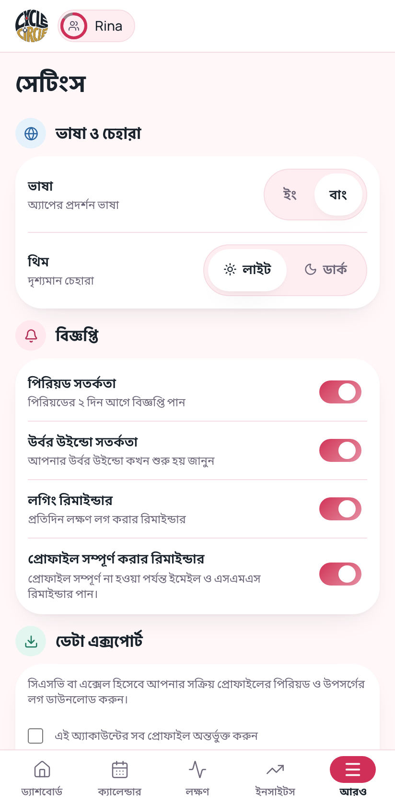
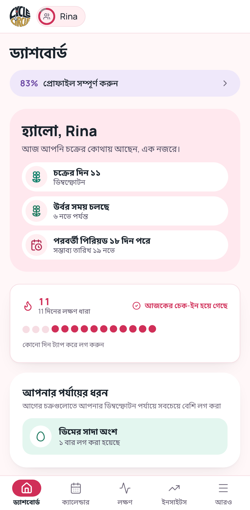

# Navigation & Language

How a User moves around the signed-in app, and how the app language is switched and remembered. The app has two layouts: a **phone layout** (screens narrower than 768 px) with a bottom bar and a More sheet, and a **wide layout** (768 px and up: tablets, laptops) with a sidebar. Every destination is reachable in both.

## Bottom navigation {#nl-bottom-nav}

### What it is

The bar fixed to the bottom of the screen in the phone layout. It has five slots of equal width: **Dashboard**, **Calendar**, **Symptoms**, **Insights** and **More**.

### Where to find it

On every signed-in screen on a phone. It is not shown on the login, onboarding or public pages.

### How to use it

1. Tap a slot to open that screen. The current screen's icon is filled with the accent colour and its label is bold.
2. Tap **More** for everything else ([More sheet](#nl-more-sheet)). **More** is highlighted when the current screen is one of its destinations (Learn, Profiles, Subscription, Feedback, Settings).
3. A small dot on **Symptoms** means nothing has been logged today for the active profile (screen readers say "Nothing logged today"). The dot goes away once a check-in is saved.

### Rules and limits

- The slots and their order are fixed. Learn, Profiles, Subscription, Feedback and Settings are behind **More**.
- The top of the phone screen shows the logo, the profile chip (tap it to switch profile, see [Switch the active profile](#pf-switch)) and, for an email-trial User, the trial countdown pill ([The 24-hour email trial](#gs-email-trial)).
- While the trial lock is showing, the bar is covered ([Trial lock](#pa-trial-lock)).

### What can go wrong

| The User sees | Cause | Fix |
|---|---|---|
| No bottom bar | The screen is 768 px or wider, so the sidebar is used; or the User is on a public or login page | On a wide screen the sidebar is used instead ([Desktop sidebar](#nl-sidebar)) |
| A dot on **Symptoms** that will not go | Nothing logged today yet | Log a check-in ([Check-in prompt](#ap-checkin)) |
| Tapping a slot does nothing | The page is still loading, or the trial lock is covering the app | Wait; for the lock see [Trial lock](#pa-trial-lock) |

### Related

- [More sheet](#nl-more-sheet), [Desktop sidebar](#nl-sidebar)

## More sheet {#nl-more-sheet}

### What it is

A pop-up that slides up from the bottom when **More** is tapped. It lists the destinations that do not fit in the bar and holds the theme and language switches.

### Where to find it

**More** in the bottom navigation.

### How to use it

1. Tap **More**. The sheet "More" opens.
2. Pick **Learn**, **Profiles**, **Subscription**, **Feedback** or **Settings**. The sheet closes and the screen opens.
3. At the bottom of the sheet, **Theme** has a button that reads **Dark** (or **Light**) and **Language** has the **EN / BN** switch.
4. Close the sheet with the close button, by tapping outside it, or with Esc.

### Rules and limits

- Order: Learn, Profiles, Subscription, Feedback, Settings.
- The theme and language buttons here do the same as in Settings ([Language and theme](#st-language-theme)).
- A page that is open stays highlighted in the list.

### What can go wrong

| The User sees | Cause | Fix |
|---|---|---|
| The sheet will not close | A touch on the sheet itself | Tap outside it or press Esc |
| The sheet is in Bengali | The language was switched | Tap **EN / BN** ([Switching language](#nl-switch-language)) |

### Related

- [Bottom navigation](#nl-bottom-nav), [Settings overview](#st-overview)

## Desktop sidebar {#nl-sidebar}

### What it is

On screens 768 px wide and up, navigation is a sidebar on the left instead of the bottom bar and the More sheet. The page header on top (logo and profile chip) is not shown; the same items are in the sidebar.

### Where to find it

Every signed-in screen on a tablet or computer. (Screenshot at 1366 px wide; every other chapter is a phone screen.)

### How to use it

1. Under **MENU**: **Dashboard**, **Calendar**, **Symptoms**, **Insights**, **Learn**, **Settings**. Under **MORE**: **Profiles**, **Feedback**, **Subscription**.
2. The profile chip and the goal name sit at the top. The footer has the theme button (**Dark** or **Light**) and the **EN / BN** language switch. An email-trial User also sees the trial countdown pill there.
3. The button next to the logo (**Collapse sidebar** / **Expand sidebar**) shrinks the sidebar to an icon-only rail. In the rail the language switch is a single icon button (**Switch language**).

### Rules and limits

- Default: collapsed to the rail from 768 to 1279 px, expanded from 1280 px. After the User taps the collapse button the choice is remembered in that browser and wins over the width.
- The grouping differs from the phone: **Settings** is under **MENU** in the sidebar and behind **More** on a phone; **Subscription** is under **MORE** in both.
- The same dot appears on **Symptoms** when nothing is logged today.

### What can go wrong

| The User sees | Cause | Fix |
|---|---|---|
| Only icons, no words | The sidebar is collapsed | Tap **Expand sidebar** |
| A phone-style bottom bar on a tablet | The screen is narrower than 768 px (portrait) | Rotate or widen the window |

### Related

- [Bottom navigation](#nl-bottom-nav), [More sheet](#nl-more-sheet)

## Switching language {#nl-switch-language}

### What it is

The app is available in English and Bengali. The switch changes every screen at once, with no reload and no login.

### Where to find it

Four places, all doing the same thing:

- **Settings > Language & Appearance**: the buttons **EN** and the Bengali button (Bengali script, "bang").
- The **More** sheet on a phone: the **EN / BN** switch.
- The sidebar footer on a wide screen: **EN / BN**, or the **Switch language** icon button on the rail.
- The Welcome page has a language switch in the top corner ([Welcome page](#gs-welcome)).

### How to use it

1. Tap the other language. The labels, dates and numbers change immediately (Bengali digits and month names in Bengali).
2. Tap again to go back.

### Rules and limits

- Two languages only. English is the default.
- The switch changes what the User sees in the app. It does not change the language of messages sent later: reminder and code emails and SMS follow the language saved on the account, which stays English because nothing in the app saves the choice there (see [Language persistence](#nl-language-persists)). The exception is the login OTP SMS: it follows the language of the browser at the moment the code is requested.

### What can go wrong

| The User sees | Cause | Fix |
|---|---|---|
| The whole app is in Bengali and the User cannot read it | Someone switched it | Tap the language switch and choose the first option, **EN** (ইং in Bengali) |
| Some text stays English | The text comes from the server (for example an email) | Expected |
| Reminder emails are in English though the app is Bengali | See above | Known behaviour |

### Related

- [Language and theme](#st-language-theme), [Language persistence](#nl-language-persists)

## Language persistence {#nl-language-persists}

### What it is

The language the User picks is remembered, so the next visit opens in it. It is remembered **in the browser**, not on the account (ADR 0003).

### Where to find it

Nothing to tap. The User sees the effect after reloading or returning later.

### How to use it

1. Switch the language ([Switching language](#nl-switch-language)).
2. Reload, close the app or come back later: it opens in the same language.

### Rules and limits

- **How it works.** The choice is stored in a cookie called `vesta_lang` ("en" or "bn"), set for the whole site and kept for one year. The server reads the cookie on every page, so the first screen is already in the right language with no English flash.
- **One browser, one choice.** A new phone, a new browser, a private window or cleared cookies start in English again. Logging in on another device does not bring the language along, because the choice is not saved in the User's account.
- **Logging out does not reset it.** The cookie stays after log out, so the login screen opens in the last chosen language.
- **Older choice.** A User who picked Bengali before the cookie existed had it only in the app's local storage. On the next visit the app copies it into the cookie and reloads the page once.
- **Cookies blocked.** If the browser refuses cookies the language goes back to English on the next page load. The cookie is also what makes pages server-rendered in the right language, so the app cannot remember it any other way.
- **The account's own language field** (used for emails and SMS) is never changed by the switch. Reminder emails, email verification codes and reminder SMS therefore go out in English, even for a User who uses the app in Bengali. Raise this with the client if Bengali messages are expected.
- The theme is remembered the same way, per browser, in local storage ([Language and theme](#st-language-theme)).

### What can go wrong

| The User sees | Cause | Fix |
|---|---|---|
| The app is in English again on a new phone | The choice lives in the browser | Switch again on that device |
| English after clearing browser data | The cookie was deleted | Switch again |
| English on every visit | Cookies are blocked for the site | Allow cookies for the site |
| Bengali login SMS or screens but an English email | Messages use the account language, which is English | Known behaviour |

### Related

- [Switching language](#nl-switch-language), [Phone login](#gs-phone-login), [Welcome page](#gs-welcome)
