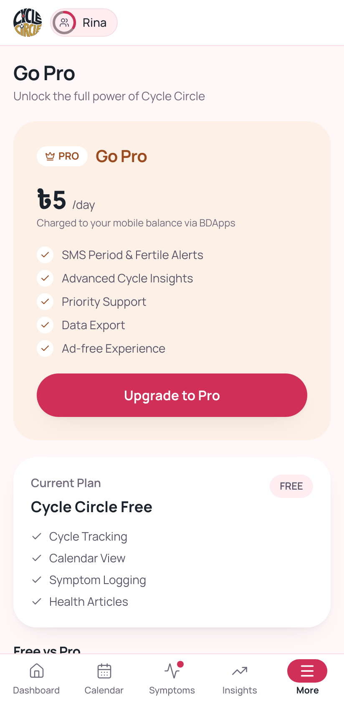
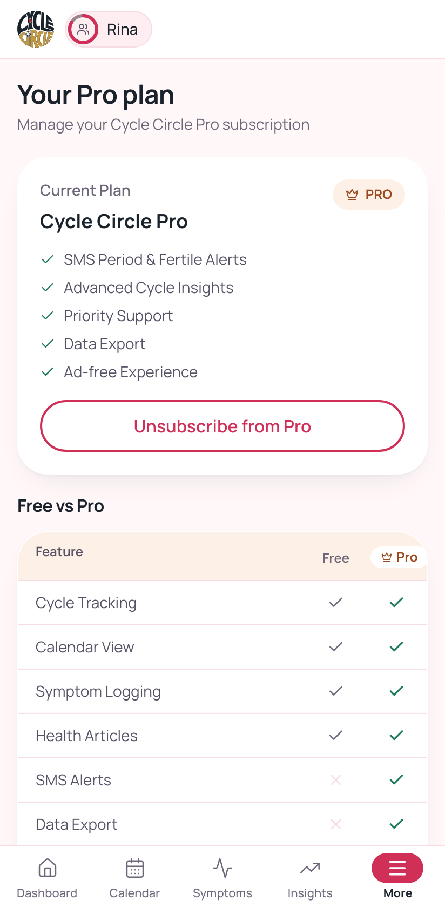
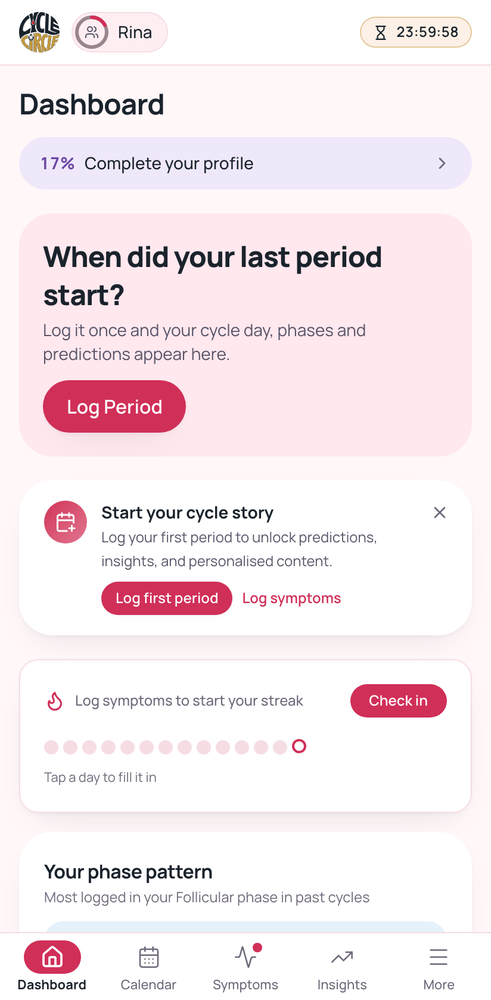
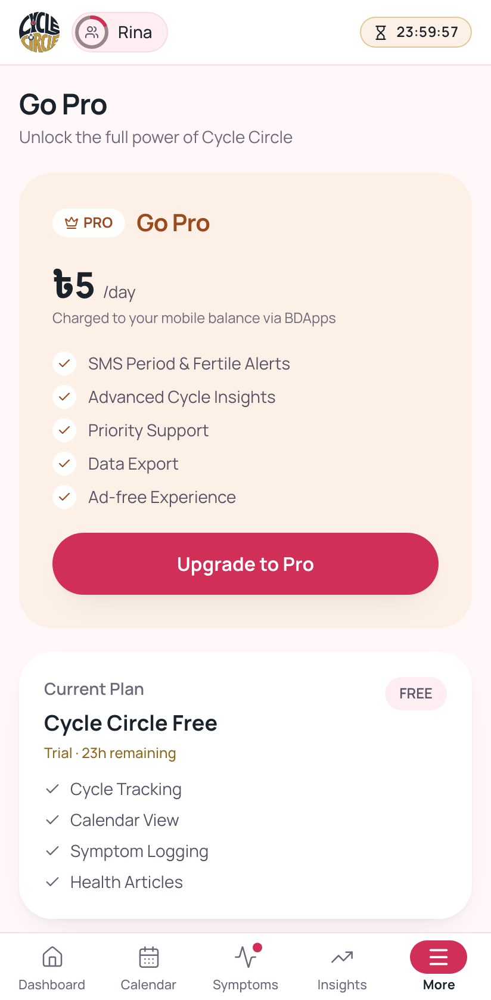
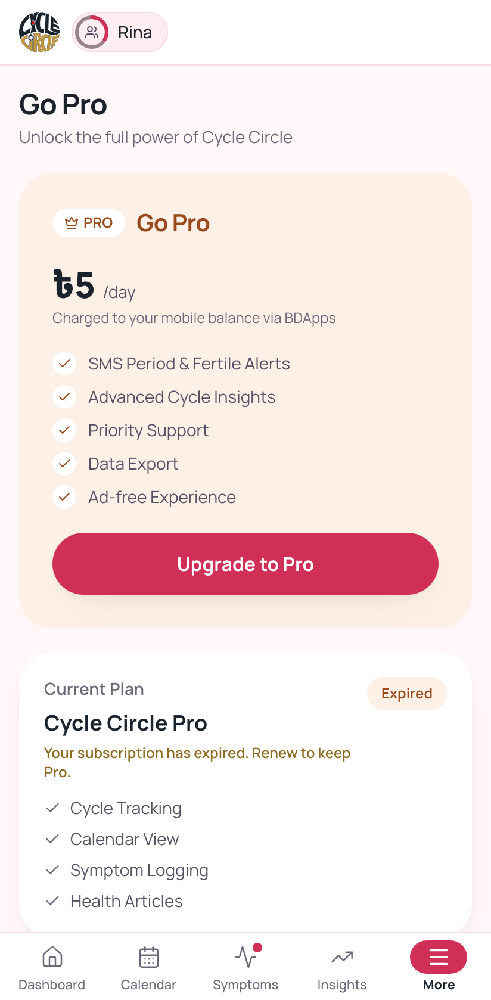
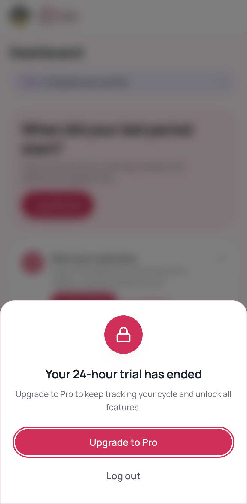
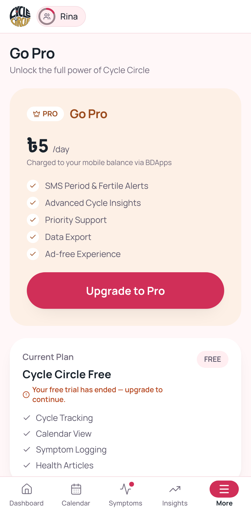
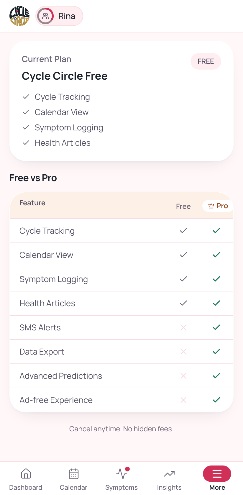
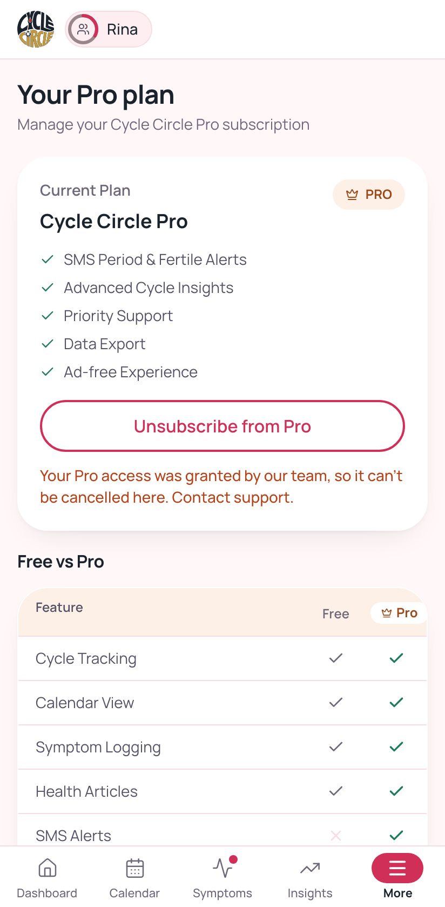
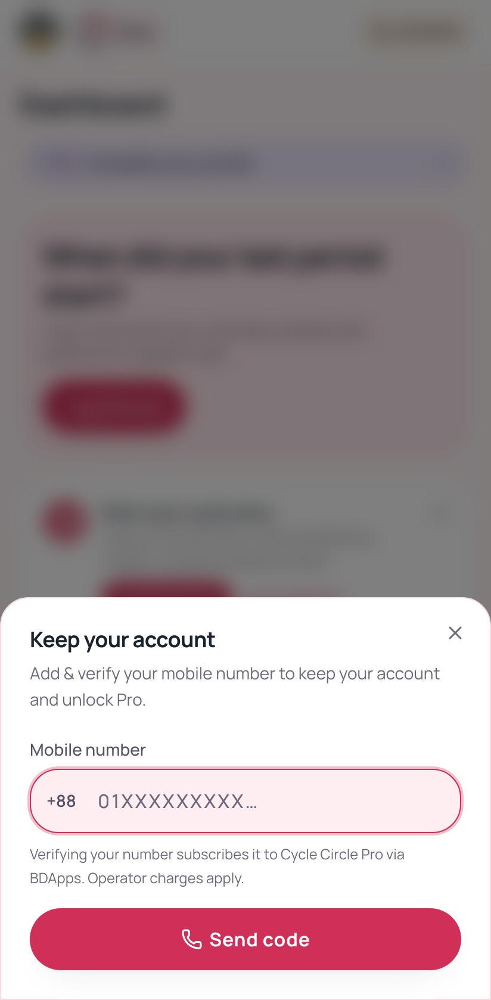

# Plans & access

Why a User can or cannot get into the app, and what each plan unlocks. A support question here is almost always one of: "I can't get past a lock screen", "I'm charged but not Pro", or "I unsubscribed and now ...".

There are three plan labels in the app: **Free**, **Pro** and **Expired** (an Admin-revoked plan, shown as "Lapsed" to Admins). Two rules explain nearly everything:

- **A phone login is the BDApps subscription** (ADR 0002). Verifying a number through a BDApps OTP subscribes it to Cycle Circle Pro, so a phone User is Pro for as long as BDApps says the number is subscribed.
- **An email login is Free with a 24-hour trial.** After the trial the User must add and verify a phone number to keep the account.

Admins can override the plan, and the overrides that take access away also end BDApps billing (ADR 0006). Use the terms in the [glossary](#gl-terms): the person is a **User**, a phone that BDApps reports as subscribed is a **Subscriber**.

## The plans at a glance {#pa-at-a-glance}

### What it is

The five situations a User can be in, and what the app does in each.

| Situation | Plan label | How the User got there | What they can do |
|---|---|---|---|
| Pro | Pro | Logged in with a phone (BDApps OTP), or verified a phone in the app, or an Admin granted Pro | Everything, including SMS alerts |
| Email trial | Free (with a countdown) | First email login, less than 24 hours ago | Everything except SMS alerts |
| Trial ended | Free | 24 hours after the first email login, no phone added | Nothing but the Subscription page and Log out ([Trial lock](#pa-trial-lock)) |
| Free (phone User) | Free | A Pro User unsubscribed, BDApps ended the subscription, or an Admin set Free | Everything except SMS alerts |
| Lapsed | Expired | An Admin revoked Pro or set the plan to Lapsed | Everything except SMS alerts |

Free, Expired and an ended trial all keep the User's data; nothing is deleted when a plan ends.

### Where to find it

**More > Subscription** shows the plan. **More > Settings** shows it as a badge, shown in capitals, for example EXPIRED ([Plan badge](#st-plan-badge)). Admins see it on the User detail page ([User detail](#us-detail)).

The Subscription page of a Free User (the Pro offer comes first on a phone, the plan card below it):

### How to use it

1. Ask the User what the **Subscription** page says under **Current Plan**: "Cycle Circle Pro" or "Cycle Circle Free".
2. If it says Free, look for the small note under the plan name: "Trial · Nh remaining" (trial), "Your free trial has ended — upgrade to continue." (trial ended) or nothing (phone User on Free).
3. If it says "Cycle Circle Pro" with an **Expired** badge, the plan is Lapsed ([Lapsed](#pa-lapsed)).

### Rules and limits

- The plan is stored on the User and follows the status BDApps reports for the User's number. An **Admin override** (Free, Pro or Lapsed) wins over BDApps until BDApps reports a new subscription for that number ([Admin overrides and billing](#pa-admin-overrides)).
- Only **SMS alerts** are limited to Pro in the app today. Export, advanced predictions and "ad-free" are listed as Pro on the Subscription page but are not enforced ([Pro-only features](#pa-pro-gating)).
- The app keeps a copy of the User for up to 5 minutes. After an Admin or BDApps change, the Subscription and Settings pages can show the old plan for up to 5 minutes; the countdown pill and trial lock often follow the live status, but they can also start from the same cached copy, so they can lag too.
- All times are Bangladesh time.

### What can go wrong

| The User sees | Cause | Fix |
|---|---|---|
| "Cycle Circle Free" although they pay | BDApps reported the number as unsubscribed (webhook or the [daily subscription check](#sj-sub-check)), or an Admin set Free | Check the plan history on [User detail](#us-detail). If BDApps still bills them, the subscription ended on our side only; the User logs in again with their phone to subscribe again |
| Old plan on the Subscription page after a change | The 5-minute user cache | Wait up to 5 minutes or log out and in |

### Related

- [Pro](#pa-pro), [Email trial](#pa-email-trial), [Lapsed](#pa-lapsed), [Trial lock](#pa-trial-lock)
- [Subscription page](#sb-status)
- Admin: [User detail](#us-detail), [Subscriptions list](#su-list)

## Pro {#pa-pro}

### What it is

Pro is the plan of a **Subscriber**: a phone number that BDApps reports as subscribed to Cycle Circle. The User is billed by BDApps at the [Pro price](#sb-price), not by Cycle Circle.

### Where to find it

**More > Subscription**. A Pro User sees the title "Your Pro plan", the badge **PRO**, "Cycle Circle Pro" and the button **Unsubscribe from Pro**.

### How to use it

A User becomes Pro in one of three ways:

1. **Phone login.** Send OTP, enter the 6-digit BDApps OTP. A new number is subscribed by verifying it ([Phone login](#gs-phone-login)).
2. **Add a phone in the app** (email User or Free User). The same BDApps OTP, from the Trial pill or **Upgrade to Pro** ([Adding a phone to keep an account](#pa-keep-account), [Upgrade by adding a phone](#sb-upgrade)).
3. **An Admin grants Pro** ([Admin overrides and billing](#pa-admin-overrides)). This does not subscribe the number on BDApps, so nothing is billed.

### Rules and limits

- Pro lasts while BDApps reports the number as subscribed. BDApps tells the app in two ways: a subscription webhook, and the daily subscription check ([Daily subscription check](#sj-sub-check)), which asks BDApps about Users whose Pro comes from a BDApps subscription (not Admin-granted or overridden Pro) and moves anyone no longer subscribed to Free. It also re-checks revoked Users, so one who has subscribed again is reinstated.
- A successful BDApps OTP verification counts as Pro even if BDApps reports a charging-pending status; the webhook or daily check corrects it later.
- An existing Subscriber who logs out and logs in again gets an **App OTP** by SMS (BDApps refuses a second OTP for an already-subscribed number). Logging in this way does not change the plan.
- Reminder SMS (period, fertile window, logging) go to Users with a BDApps subscription (a masked subscriber id), which is how a number becomes Pro. Nothing in the app is blocked for Free Users today.
- Unsubscribing, an Admin revoke or BDApps ending the subscription moves the User to Free (or Expired) and keeps all data.

### What can go wrong

| The User sees | Cause | Fix |
|---|---|---|
| "This number is already subscribed, but we could not send it a code. Log in with your email instead." | The number is already a Subscriber, the App OTP could not be sent, and the account has an email | Log in with the email, or retry later |
| "This number is already subscribed, but we could not send it a code. Unsubscribe this number from Cycle Circle on BDApps, then log in again. Your data stays safe." | Same, and the account has no email | The User unsubscribes the number on BDApps and logs in again; data is kept |
| Pro badge but no SMS | The User has no phone, or the daily SMS send time has not come ([SMS](#as-send-time)) | Check the phone number on [User detail](#us-detail) |

### Related

- [The plans at a glance](#pa-at-a-glance), [Phone login](#gs-phone-login)
- [Subscribe, Unsubscribe and Lapse events](#bb-subscribe)
- Admin: [Grant and revoke Pro](#us-pro-override)

## Email trial {#pa-email-trial}

### What it is

A User who logs in with an email link gets 24 hours to try the app. A countdown pill in the header shows the time left. After that the trial lock appears ([Trial lock](#pa-trial-lock)).

### Where to find it

The pill is in the header on every page, for example the Dashboard. On the **Subscription** page the plan card says "Trial · Nh remaining".

### How to use it

1. The User logs in with an email ([Email login](#gs-email-login)). The 24 hours start now.
2. To keep the account, the User taps the pill and adds a phone ([Adding a phone to keep an account](#pa-keep-account)).

### Rules and limits

- The trial is **24 hours from the first magic-link login**. Logging in again does not extend it, and an ended trial is never restarted.
- The countdown pill shows hours:minutes:seconds (with **Add number** beside it on wider screens; "Trial ends in" is only the label read aloud by screen readers). The Subscription page shows whole hours, rounded down: "Trial · 23h remaining", and "Trial · 0h remaining" in the last hour.
- A trial User is on the Free plan: everything works except SMS alerts.
- Adding and verifying a phone ends the trial and makes the User Pro, because the BDApps OTP subscribes the number.
- The trial exists only for accounts created by email. A phone User never has a trial.

### What can go wrong

| The User sees | Cause | Fix |
|---|---|---|
| A full-screen lock "Your 24-hour trial has ended" | 24 hours passed | [Trial lock](#pa-trial-lock) |
| Still "Trial" on the Subscription page after adding a phone | The 5-minute cache | Wait a few minutes; the lock and the countdown pill usually follow the live status, but may also lag |
| "Trial expired" badge on the Admin User page | The trial ended and the User did not add a phone | Nothing to fix; the User adds a phone |

### Related

- [The 24-hour email trial](#gs-email-trial), [Trial lock](#pa-trial-lock), [Adding a phone to keep an account](#pa-keep-account)

## Lapsed {#pa-lapsed}

### What it is

"Lapsed" is a plan an **Admin** sets: an Admin revoked Pro, or set the status to Lapsed. The User sees the label **Expired**. BDApps never makes a User Lapsed by itself: when BDApps ends a subscription, the User goes to Free.

### Where to find it

**More > Subscription** and the plan badge in **More > Settings**.

### How to use it

1. The User opens **Subscription**. The plan card shows "Expired" and the note "Your subscription has expired. Renew to keep Pro."
2. To get Pro again the User logs in by phone, or adds a phone with **Upgrade to Pro**. When BDApps reports a new subscription for the number, the Admin override ends and Pro starts ([Admin overrides and billing](#pa-admin-overrides)).

### Rules and limits

- A Lapsed User keeps all data and can use the whole app except SMS alerts.
- Revoke also unsubscribes the number on BDApps, so billing stops.
- The note says "expired", but nothing expired by time: it is always an Admin action. The page says the plan "has expired"; the system actually recorded an Admin revoke.
- The page also shows the name "Cycle Circle Pro" under **Current Plan** for a Lapsed User, next to the **Expired** badge. The page calls the plan Pro and the badge says it has ended; the User is on the Free feature set (no SMS alerts) and cannot unsubscribe, because the **Unsubscribe from Pro** button appears only for Pro Users.

### What can go wrong

| The User sees | Cause | Fix |
|---|---|---|
| "Your subscription has expired. Renew to keep Pro." | An Admin revoked Pro | Ask the Admin why (audit log); the User renews by phone login or **Upgrade to Pro** |
| "Cycle Circle Pro" with an **Expired** badge and no SMS | Lapsed shows the Pro name with the Expired badge | Explain that it is the Expired plan |

### Related

- [Admin overrides and billing](#pa-admin-overrides), [Upgrade by adding a phone](#sb-upgrade)
- Admin: [Grant and revoke Pro](#us-pro-override), [Plan history and Translog](#us-history)

## Trial lock {#pa-trial-lock}

### What it is

The blocking screen an email-trial User sees once their 24 hours are over. Only **Upgrade to Pro** or **Log out** gets past it.

### Where to find it

It covers every signed-in page except **Subscription**.

### How to use it

1. The User sees "Your 24-hour trial has ended" and "Upgrade to Pro to keep tracking your cycle and unlock all features."
2. **Upgrade to Pro** opens the Subscription page, where the lock is not shown. There the User taps **Upgrade to Pro**, enters a phone number and the BDApps OTP ([Upgrade by adding a phone](#sb-upgrade)).
3. Or **Log out** returns to the login page. The account and its data stay and the lock returns at the next email login.

### Rules and limits

- The lock cannot be dismissed: Escape and a tap outside do nothing.
- It applies to an **email** account on the Free plan whose trial end time has passed. A phone User is never locked.
- While locked, the app refuses data requests with an "Email trial has expired. Please upgrade to PRO." error (HTTP 402, code TRIAL_EXPIRED); the User sees only the lock screen. The requests needed to add a phone (request and verify), request and verify an email, subscribe, unsubscribe and check the sign-in status are still allowed.
- After a verified phone, the lock goes away at once and the User is Pro.
- The lock is an auto-prompt and always wins over the other prompts ([Trial lock prompt](#ap-trial-lock)).

### What can go wrong

| The User sees | Cause | Fix |
|---|---|---|
| "Your 24-hour trial has ended" | The trial is over | The User adds a phone and verifies it |
| "Your free trial has ended — upgrade to continue." on the Subscription page | Same | Same |
| The lock again after logging in | Logging in by email does not restart the trial | Add a phone |
| "This number is already registered to another account." when upgrading | The phone belongs to another User | Use another number, or log in to that account |

### Related

- [The 24-hour email trial](#gs-email-trial), [Email trial](#pa-email-trial), [Trial lock prompt](#ap-trial-lock)

## Pro-only features {#pa-pro-gating}

### What it is

The "Free vs Pro" table on the Subscription page lists what Pro adds. Only some of it is enforced.

### Where to find it

**More > Subscription**, section **Free vs Pro**.

### How to use it

1. Open the table to see which rows say "Included" and "Not included" for Free.
2. Use the list below to answer what a Free User can really do.

### Rules and limits

| Row in the table | Free on the page | What the app actually does |
|---|---|---|
| Cycle Tracking, Calendar View, Symptom Logging, Health Articles | Included | Free and Pro |
| SMS Alerts | Not included | **Enforced.** SMS (period, fertile window, logging reminders) goes only to Users with a BDApps subscription (a masked subscriber id). Email alerts go to everyone with an email |
| Data Export | Not included | **Not enforced.** A Free User can export CSV or Excel from Settings |
| Advanced Predictions | Not included | **Not enforced.** A Free User with enough cycles gets the same prediction tier as Pro |
| Ad-free Experience | Not included | Nothing to enforce: the app shows no ads to anyone |

The page lists "Priority Support" among the Pro benefits in the plan card; it is a promise, not a feature in the app.

### What can go wrong

| The User sees | Cause | Fix |
|---|---|---|
| "I'm Free but can export my data" | Export is not gated | Expected; do not ask them to upgrade for it |
| "I'm Pro but get no SMS" | No phone number on the account, or not Pro at send time | Check the phone and plan on [User detail](#us-detail) |

### Related

- [The plans at a glance](#pa-at-a-glance), [Subscription page](#sb-status)

## Admin overrides and billing {#pa-admin-overrides}

### What it is

An **Admin override** is a plan (Pro, Free or Lapsed) that an Admin sets by hand. It wins over what BDApps reports. Admin actions that take access away also end BDApps billing (ADR 0006).

### Where to find it

Admin panel, **Users > User detail** (status selector "Set subscription status", **Suspend**, **Delete**) and **Subscriptions** (buttons **Grant Pro**, **Set Free**, **Revoke**). See [Grant and revoke Pro](#us-pro-override), [Suspend and reactivate](#us-suspend) and [Delete and restore](#us-delete-restore).

What the User sees when they try to cancel an Admin-granted Pro:

### How to use it

| Admin action | Plan after | BDApps unsubscribe | Can the User log in |
|---|---|---|---|
| Grant Pro (or status Pro) | Pro | No (nothing is billed) | Yes |
| Set Free (status Free) | Free | **Yes** | Yes |
| Revoke (status Lapsed) | Lapsed ("Expired") | **Yes** | Yes |
| Suspend (reason required) | unchanged | **Yes** | No; sessions end at once |
| Delete | unchanged, account hidden | **Yes** | No |
| Reactivate / Restore | unchanged | **No**, never re-subscribes | Yes |

After Suspend or Delete the User must log in by phone to be a Subscriber again.

### Rules and limits

- Revoke, Set Free, Suspend and Delete call BDApps to unsubscribe the number. Our change applies even if BDApps fails; the Admin then sees "Plan changed, but the BDApps unsubscribe failed: ... The user may still be charged." (or the same for Suspend and Delete) and should follow up. If the User has no stored BDApps subscriber id (older accounts), the unsubscribe is skipped and the override is treated as unconfirmed (the Admin sees the failure toast only when BDApps actually failed, not when the call was skipped).
- **Grant Pro does not subscribe the number**, so the User is not billed. The **Unsubscribe from Pro** button then answers "Your Pro access was granted by our team, so it can't be cancelled here. Contact support." An Admin changes it.
- An override ends when BDApps reports a **new** subscription for the number (for example the User subscribes again by phone login). Then the real BDApps status applies: a revoked User who pays again is Pro. If the Admin's unsubscribe failed or was skipped, only a new BDApps subscriber id ends it; the same old subscription is ignored.
- A deleted account can be restored for **30 days**; after that a nightly job purges the User, profiles and logs, leaving one translog line ([Delete and restore](#us-delete-restore)).
- A suspended or deleted User who opens the app is sent back to the login page without an explanation message; the account cannot be used.
- Every override writes an audit log row and a plan-history entry ([Plan history and Translog](#us-history)).
- An Admin cannot suspend or delete another Admin: "Admin accounts can't be suspended or deleted."

### What can go wrong

| The User sees | Cause | Fix |
|---|---|---|
| "Your Pro access was granted by our team, so it can't be cancelled here. Contact support." | Admin-granted Pro | An Admin sets Free or Revoke, which also ends billing |
| Back at the login page after a correct code | The account is suspended or deleted | An Admin reactivates or restores it (restore within 30 days) |
| Free, but charged | The Admin's BDApps unsubscribe failed or was skipped | Unsubscribe the number on BDApps; see the failure toast and the plan history |
| Pro again after revoke | The User subscribed again; BDApps reports a new subscription, which ends the override | Expected. Use Suspend to keep someone out |

### Related

- Admin: [Grant and revoke Pro](#us-pro-override), [Set subscription status](#us-set-status), [Suspend and reactivate](#us-suspend), [Delete and restore](#us-delete-restore), [Subscriptions list](#su-list)
- [Unsubscribe](#bb-unsubscribe), [Lapse](#bb-lapse)
- Note: ADR 0006 still describes Revoke as "Pro to Free". The app follows the code: Revoke sets the plan to Lapsed (shown as Expired).

## Adding a phone to keep an account {#pa-keep-account}

### What it is

An email User can add and verify a phone number to keep the account after the trial and to become Pro. It is the same BDApps OTP as phone login, so verifying it subscribes the number.

### Where to find it

Tap the countdown pill in the header, or **More > Settings > Add Phone Number** ([Add or verify a phone](#st-phone)). The dialog title is "Keep your account".

### How to use it

1. Tap the pill. Read "Add & verify your mobile number to keep your account and unlock Pro."
2. Enter the **Mobile number** (01XXXXXXXXX) and tap **Send code**.
3. Enter the 6-digit code. It submits by itself when all digits are in.
4. The dialog says "Your number is verified — you're now on Pro!" and closes. The pill disappears.

### Rules and limits

- The number must be a Bangladesh mobile number and **not belong to another account**.
- The code is a BDApps OTP: valid 5 minutes, resend after 60 seconds (button shows "Resend in Ns"), 3 requests a minute per number, 5 verify attempts in 5 minutes per code. The text under the field says "Verifying your number subscribes it to Cycle Circle Pro via BDApps. Operator charges apply."
- The dialog never uses an App OTP. A number that is already subscribed on BDApps is refused.
- On success the trial is cleared, the number is saved and the plan is Pro.
- Closing the dialog changes nothing.

### What can go wrong

| The User sees | Cause | Fix |
|---|---|---|
| "Enter a valid Bangladeshi mobile number." | Not 11 digits starting 01 | Correct the number |
| "This number is already registered to another account." | Another User has the number | Use another number |
| "This number is already subscribed. Unsubscribe it from Cycle Circle on BDApps first, then add it here." | The number is subscribed on BDApps (for example from another account that was deleted) | Unsubscribe on BDApps, then retry |
| "We can't send a code to this number's mobile operator yet. Please try another number." | Operator not supported | Use another number |
| "Please wait a moment before requesting another code." | Resend within 60 seconds | Wait |
| "Too many attempts. Try again in a few minutes." | Rate limit | Wait |
| "Invalid or expired code. Please try again." | Wrong, expired or already used code | Request a new code |
| "Something went wrong. Please try again." | Any other failure, including a code locked after too many wrong tries | Request a new code |

### Related

- [The 24-hour email trial](#gs-email-trial), [Add or verify a phone](#st-phone), [Upgrade by adding a phone](#sb-upgrade), [Phone login](#gs-phone-login)
