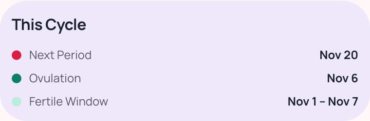
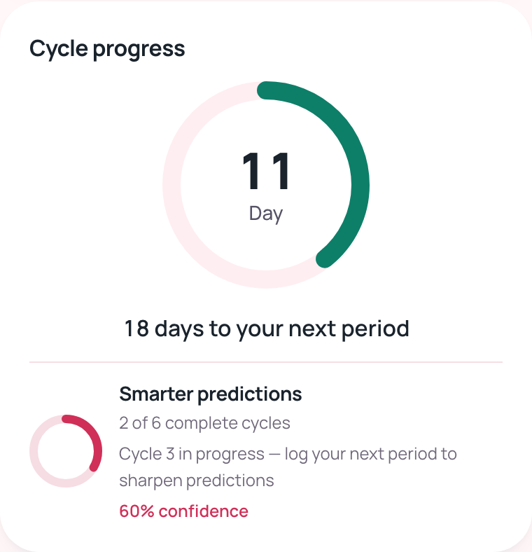
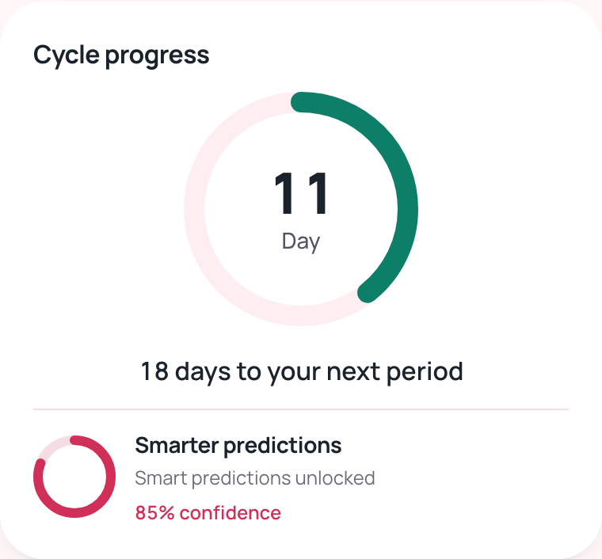
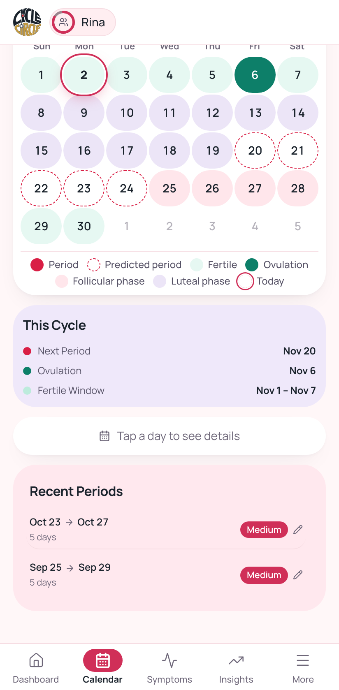

# Predictions

What the app expects for the next period, the ovulation day and the fertile window, and why the guess gets better the more periods a profile has logged. Every profile has its own prediction. The User sees it on the [Dashboard](#db-hero), the Dashboard's [Predicted windows](#db-cycle-dates) card and the [Calendar](#lc-calendar).

The short version for support: the app only learns from **period start dates**. Symptoms, flow and period length do not change the prediction.

## How predictions work {#pr-how}

### What it is

A saved prediction per profile with five values: the **next period start**, the **ovulation day**, the **fertile window** (start and end) and a **confidence**. It is recalculated each time a period is **saved, edited or deleted** for that profile, and once when a profile's first period is created from the last-period date given at onboarding.

How it is worked out, in plain steps:

1. Take all the period start dates the profile has logged, oldest first.
2. The gap in days between each start and the next is one **cycle length**. A gap of 90 days or more is ignored (and a gap of zero).
3. Estimate a typical cycle length from those gaps ([Prediction tiers and confidence](#pr-tiers) says how). With no gaps yet (only one period), use the profile's **cycle length** setting (21 to 45 days, default 28).
4. **Next period start** = the latest logged start + the typical cycle length.
5. **Ovulation day** = next period start minus 14 days.
6. **Fertile window** = 5 days before ovulation to 1 day after ([Fertile window](#pr-fertile-window)).

Worked example: starts on Sep 24 and Oct 22 give one cycle of 28 days. The latest start is Oct 22, so the next period is expected Nov 19, ovulation Nov 5 and the fertile window Oct 31 to Nov 6.

### Where to find it

- **Dashboard**: "Next period in 18 days" and "Expected Nov 19" in the hero; the "Predicted windows" card.
- **Calendar**: dashed days for the predicted period, the "This Cycle" card.

### How to use it

1. Nothing to set up. Log periods as they happen ([Log a period](#lc-log-period)); the next prediction is ready as soon as the pop-up closes.
2. To see what the prediction currently says, open **Calendar** and read "This Cycle".

### Rules and limits

- The latest period is the one with the latest **start date**, not the one saved last. A backfilled older period does not change which period is the latest, but it adds a cycle length, which changes the typical length and so can move the next date.
- If the next period does not start, the prediction is not changed. The date stays in the past, the Dashboard counts "Period N days late" and the Calendar keeps the dashed days ([Cycle hero](#db-hero)). It updates when the next period is logged.
- The Calendar draws the first predicted cycle from the saved prediction, and the two cycles after it by repeating the profile's cycle length setting. Only the first is the learned estimate.
- If a profile somehow has no saved prediction, the Dashboard works out the date from the last-period date and the profile's cycle length.
- Predictions are estimates for planning, based on dates only. All dates are Bangladesh days ([Bangladesh days and date rules](#lc-date-rules)).

### What can go wrong

| The User sees | Cause | Fix |
|---|---|---|
| "Next period not predicted yet" | The profile has no period logged and no saved prediction | Log a period |
| The predicted date did not change after logging symptoms | Symptoms are not used | Expected; only period starts matter |
| The date jumped after a delete or edit | The prediction is recalculated from the remaining starts | Check the periods in **Recent Periods** ([Edit or delete a period](#lc-edit-delete)) |
| "Period 5 days late" for weeks | The prediction waits for a new period log; it does not move on its own | Log the period, or the late-period alert's **Log my period** ([Late-period alert](#ap-late-period)) |
| Cycle 2 and 3 on the Calendar are not as the Dashboard says | Later cycles use the profile's cycle length setting | Expected; fix the setting if it is wrong ([Edit or rename a profile](#pf-edit)) |

### Related

- [Prediction tiers and confidence](#pr-tiers)
- [Why predictions improve with more cycles](#pr-improve)
- [Prediction accuracy (Admin)](#an-prediction-accuracy)

## Prediction tiers and confidence {#pr-tiers}

### What it is

The system keeps two tiers of estimate and a confidence figure. The User never sees the tier names. They see the **Smarter predictions** meter in the Cycle progress card on the Dashboard: "2 of 6 complete cycles", "Cycle 3 in progress — log your next period to sharpen predictions" and "60% confidence".

| Tier (internal) | Used when | How the typical cycle length is found |
|---|---|---|
| Tier 1, "Average" | Fewer than 6 logged cycles | The plain average of all logged cycle lengths, rounded to a whole day. With no cycle yet, the profile's cycle length setting. |
| Tier 2, "ARIMA" | 6 or more logged cycles | A weighted average of the **last 6** cycle lengths, newest weighing most (weights 1, 1.5, 2, 2.5, 3, 3.5 from oldest to newest), rounded |

Worked example, Tier 2: cycles of 28, 30, 27, 29, 31 and 28 days give (28 + 45 + 54 + 72.5 + 93 + 98) / 14 = 27.9, so 28 days.

**Confidence** = 50% plus 5% for each logged cycle, never above 95% (reached at 9 cycles). So: 0 cycles 50%, 2 cycles 60%, 5 cycles 75%, 6 cycles 80%, 7 cycles 85%, 9 or more 95%.

### Where to find it

**Dashboard > Cycle progress**, under the ring.

### How to use it

1. Open **Dashboard** and scroll to **Cycle progress**.
2. Read "N of 6 complete cycles". When it reaches 6 the text becomes "Smart predictions unlocked".

### Rules and limits

- A "complete cycle" is a gap of 1 to 89 days between two consecutive logged period starts. A profile with one period has 0 of 6 and 50% confidence.
- The meter's percentage is how much data the estimate rests on. It is **not** a measured chance of being right.
- The meter shows only for a live cycle. It is missing in First-run and Menopause modes ([First-run dashboard](#db-first-run), [Menopause dashboard](#db-menopause)).
- The name "ARIMA" is a label. The code uses the recency-weighted average above, not a statistical time-series model. A "Tier 3, LSTM" (12 or more cycles) exists in the database list and in the text of an internal API, but nothing in the system ever produces it.
- The older strings "Tier 1 · Average" and "Tier 2 · ARIMA" are in the app's text file but are not shown anywhere.
- Admins can see how close predictions were in [Prediction accuracy](#an-prediction-accuracy).

### What can go wrong

| The User sees | Cause | Fix |
|---|---|---|
| "0 of 6 complete cycles" and "50% confidence" | Only one period logged (for example from onboarding) | Log the next periods as they happen |
| Confidence did not rise after a log | The gap to the previous period start was 90 days or more (or zero), so it was not counted | Check the dates in **Recent Periods** |
| "Cycle 3 in progress — log your next period to sharpen predictions" | Normal message while fewer than 6 cycles are done | Expected |
| The meter is missing | First-run or Menopause mode | See the linked sections |

### Related

- [How predictions work](#pr-how)
- [Why predictions improve with more cycles](#pr-improve)
- [Prediction accuracy (Admin)](#an-prediction-accuracy)

## Why predictions improve with more cycles {#pr-improve}

### What it is

The explanation to give a User who asks "why is my date wrong?" or "why does the app keep asking me to log?". Cycle lengths vary from month to month. One gap says little; the average of many says more, and from the sixth cycle the newest cycles count more than the old ones.

### Where to find it

**Dashboard > Cycle progress**: the meter and its confidence figure.

### How to use it

1. Ask the User to log **every period** on its start day ([Log a period](#lc-log-period)), and to backfill ones they missed ([Backfill a past period](#lc-backfill)).
2. After 6 complete cycles the meter says "Smart predictions unlocked" and the weighting favours recent cycles.

### Rules and limits

- Each new logged period adds one cycle length (if the gap is under 90 days), so confidence rises 5 points per cycle up to 95%.
- A **missed log hurts**: if a User forgets one period, the gap between the two they did log is about two cycles long (say 56 days). It is under 90 days, so it counts as a very long cycle and pulls the average up. Adding the missing period by backfill fixes it at once, because the prediction is recalculated from all starts.
- A gap of 90 days or more is dropped, so a long break from the app does not poison the average.
- Editing or deleting a period recalculates the prediction the same way, so a wrong date entered by mistake is corrected by editing it.
- The profile's own cycle length setting is **not** updated by the learned average. It still sets the phase names and the Calendar's second and third predicted cycles.

### What can go wrong

| The User sees | Cause | Fix |
|---|---|---|
| The date is far off for a User who logs rarely | Missed periods make a gap about twice as long | Backfill the missing periods |
| The date is off after the User logs a period with a wrong start date | The wrong date adds a wrong cycle length | Edit the period ([Edit or delete a period](#lc-edit-delete)) |
| 8 periods logged but "Smart predictions unlocked" not shown | Fewer than 6 gaps of 1 to 89 days (for example gaps of 90 days or more) | Check the dates |
| Predictions are good in the app but the User says "not me" | Irregular cycles stay hard to predict | Nothing to fix; explain that it is an estimate |

### Related

- [Prediction tiers and confidence](#pr-tiers)
- [Backfill a past period](#lc-backfill)
- [Insights overview](#in-overview)

## Fertile window {#pr-fertile-window}

### What it is

The days the app estimates as most likely for conception: **5 days before the ovulation day through 1 day after it**, 7 days in all. Ovulation is estimated as **14 days before the predicted next period**. The same window is shown in three places:

| Where | What the User sees |
|---|---|
| Dashboard hero | "Fertile window in 3 days" ("Opens Oct 31"), "Fertile window open" ("Until Nov 6"), "Fertile window closed" ("For this cycle") or "No fertile window yet" |
| Dashboard Predicted windows card | "Fertile window" with a date range and "Ovulation day" |
| Calendar | Soft green days for the window, a solid teal day for ovulation, and the "This Cycle" card |

### Where to find it

**Dashboard** hero and Predicted windows card, and **Calendar**.

### How to use it

1. Open **Calendar** and look for the green days and the solid teal day.
2. Tap a day to see "Fertile window" or "Ovulation" on its card ([A day's logs](#lc-day-detail)).

### Rules and limits

- It is an estimate from dates only, with a fixed 14-day gap before the next period. It does not use body signs the User logs.
- It moves with the prediction: every new period logged recalculates it.
- The Dashboard uses the saved prediction for the window and so says "closed" once today is past the end, until the next period is logged.
- On the Calendar "This Cycle" shows the window that contains today; otherwise the latest one since the last period start; otherwise the next one.
- A day that is both ovulation and in the window shows as ovulation. A logged or predicted period day shows as a period day first.
- The Dashboard hides the fertile window in Menopause mode ([Menopause dashboard](#db-menopause)), but the Calendar still draws one if the profile has period data.

### What can go wrong

| The User sees | Cause | Fix |
|---|---|---|
| "No fertile window yet" | No prediction yet | Log a period |
| "Fertile window closed" earlier than expected | Today is after the window's end | Expected; a new window appears when the next period is logged |
| Window dates differ between Dashboard and Calendar for later months | The Calendar repeats the profile's cycle length for cycles after the first | Expected ([How predictions work](#pr-how)) |
| No window on a Menopause profile's Dashboard | Not shown in that mode | Expected |

### Related

- [Cycle hero](#db-hero)
- [Cycle dates](#db-cycle-dates)
- [Calendar and its markers](#lc-calendar)
