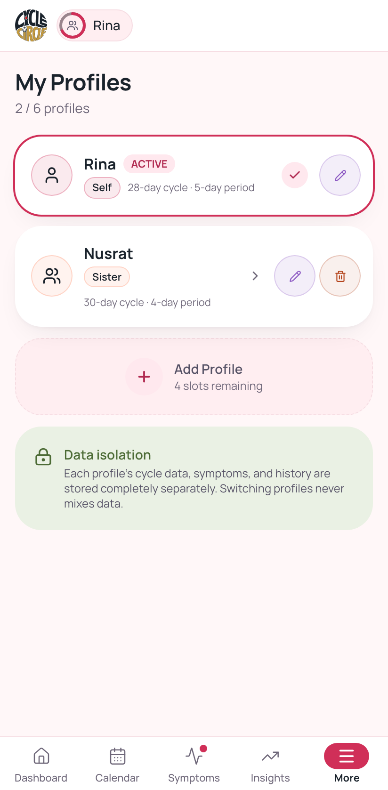
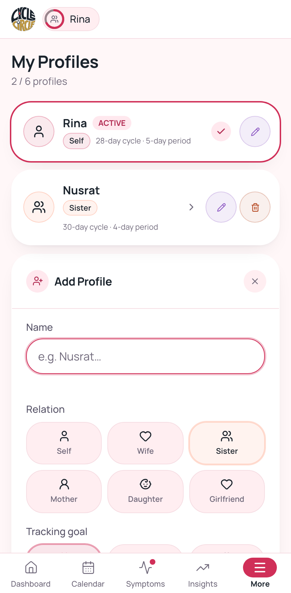
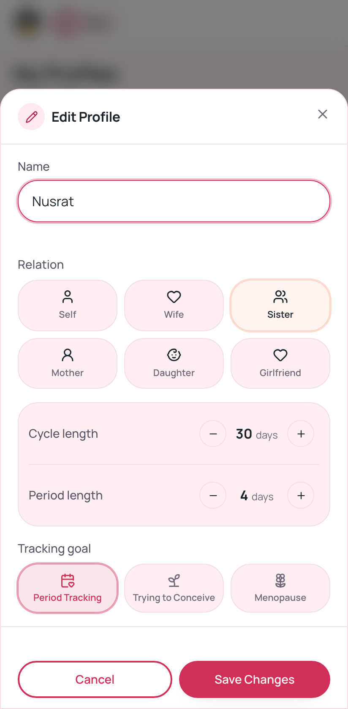
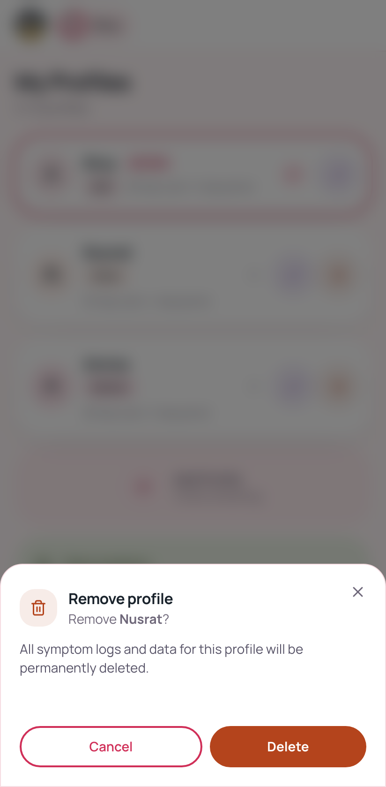
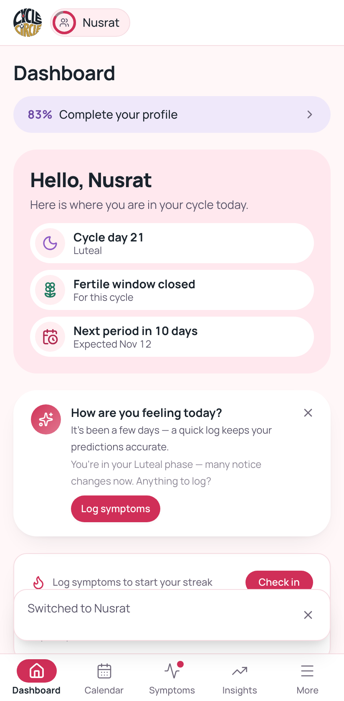
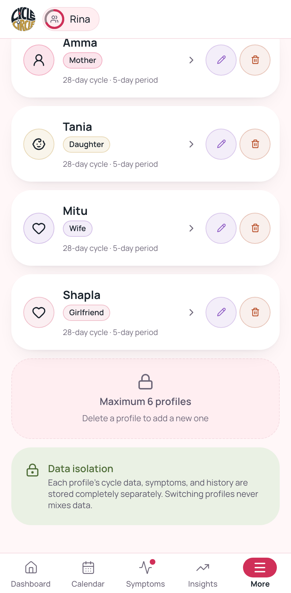
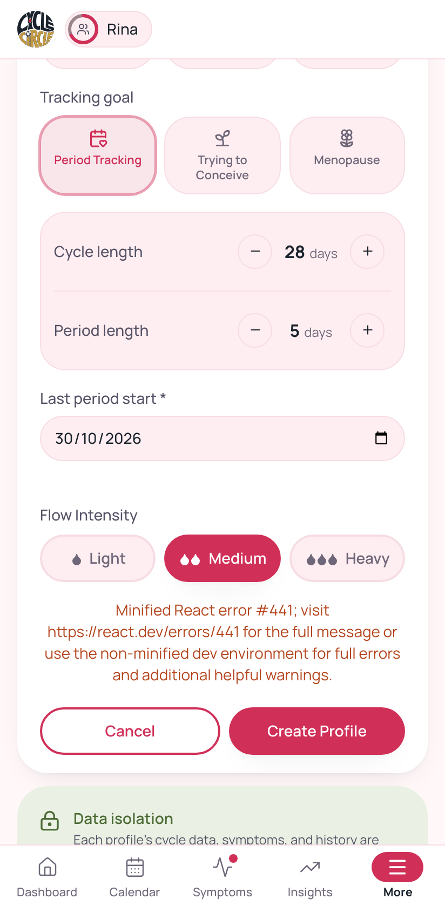
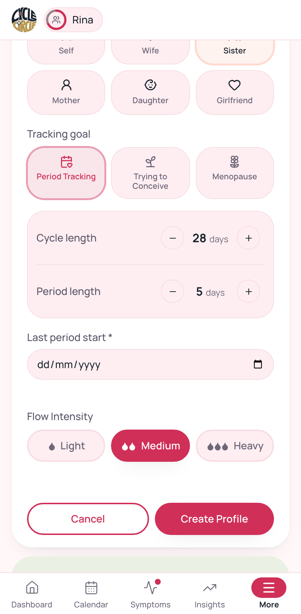
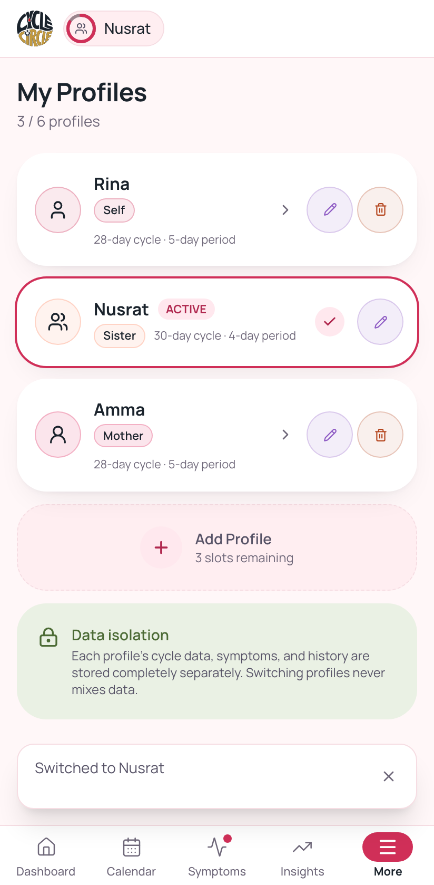
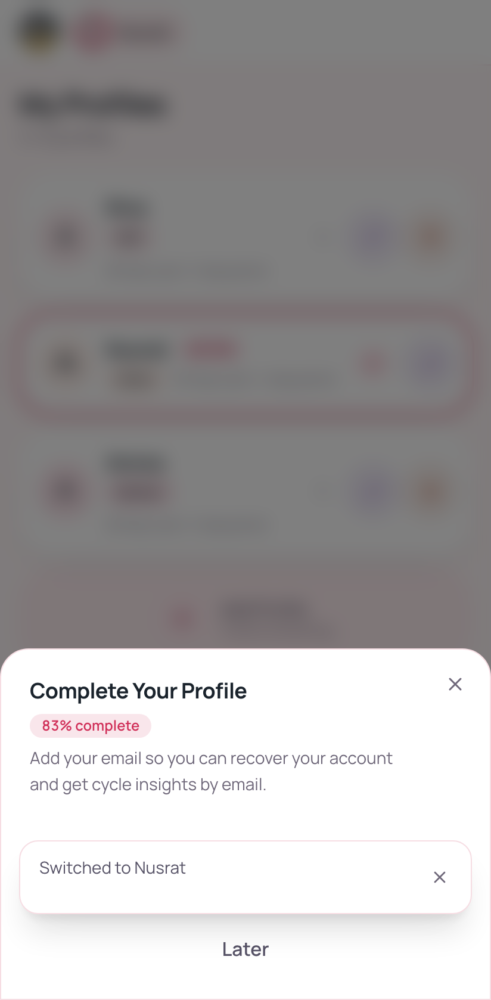

# Profiles

One Cycle Circle account can hold up to six **profiles**: usually the User and the family members she tracks for. Each profile has its own cycle history, symptoms and predictions. Support questions in this chapter are mostly "I can't add another profile", "I deleted the wrong one" and "which profile am I looking at?".

Things that are true for every section below:

- The limit is **six profiles per account**, the same on every plan (Pro, email trial, lapsed). No plan has a smaller limit.
- A User can **never delete the last profile**.
- Everything on this page is **per account**. A profile belongs to one User and nobody else can see it.
- Times and dates are Bangladesh time.

## My Profiles {#pf-list}

### What it is

The page that lists every profile on the account, shows how many of the six are used ("2 / 6 profiles"), and is where a User adds, edits, deletes and switches profiles. A "Data isolation" card at the bottom says each profile's cycle data, symptoms and history are stored separately and that switching profiles never mixes data.

### Where to find it

On a phone: **More > Profiles**, or tap the profile name next to the logo at the top of any screen. On desktop: **Profiles** in the left sidebar, or the profile name at the top of the sidebar. The address is `/profiles`.

### How to use it

1. Each card shows the profile name, a relationship badge (for example "Sister"), and the cycle summary ("30-day cycle · 4-day period").
2. The profile in use has an **Active** badge and a tick.
3. Tap a card to switch to it ([Switch the active profile](#pf-switch)). Tap the pencil to edit ([Edit or rename a profile](#pf-edit)). Tap the bin to delete ([Delete a profile](#pf-delete)).
4. The dashed **Add Profile** card at the end adds another ([Add a profile](#pf-add)).

### Rules and limits

- Cards are in the order the profiles were created, oldest first.
- The **Active** badge and the hidden bin on the active card depend on the active profile the browser remembers. The browser keeps it between visits, so a returning User sees the badge even after a refresh. A User on a new browser, or after clearing site data, sees no **Active** badge and a bin on every card, including the one she is really using, until the Dashboard or Settings has loaded her profile. Deleting the profile that is really active this way is possible; the next screen simply falls back to the oldest profile.
- The page needs a logged-in User. A logged-out visitor is sent to the login page.

### What can go wrong

| The User sees | Cause | Fix |
|---|---|---|
| No **Active** badge on any card | First visit in a new browser (or site data cleared) and the Dashboard has not loaded yet | Tap **Dashboard**, then open Profiles again from the name at the top |
| The profile name at the top is not the one she expected | The active profile is the one in the "vesta_active_profile" cookie, or the oldest profile when that cookie is missing or points to a deleted profile | Switch to the right profile ([Switch the active profile](#pf-switch)) |
| A full-screen lock instead of the page | Email trial ended and no phone is verified | See [Trial lock](#pa-trial-lock) |

### Related

- [Add a profile](#pf-add)
- [Six-profile limit](#pf-limit)
- [Profile completion](#pf-completion)
- [Bottom navigation](#nl-bottom-nav)

## Add a profile {#pf-add}

### What it is

A form on the My Profiles page that creates another profile (for the User herself, a relative or a friend) with its cycle settings and the date her last period started.

### Where to find it

**Profiles > Add Profile**. The card shows how many slots are left ("4 slots remaining", "1 slot remaining"). The form opens in place of the card.

### How to use it

1. Type a **Name**.
2. Pick a **Relation** ([Relationship types](#pf-relations)). It starts on "Sister".
3. Pick a **Tracking goal**: "Period Tracking" (the default), "Trying to Conceive" or "Menopause".
4. Set **Cycle length** and **Period length** with the minus and plus buttons. They start at 28 and 5 days.
5. Choose **Last period start**. The field is required.
6. Choose the **Flow Intensity** of that period: "Light", "Medium" (the default) or "Heavy".
7. Tap **Create Profile**. The form closes and the new card appears. Tap **Cancel** (or the round close button) to leave without saving.

Creating a profile does not switch to it. The User stays on the current profile until she taps the new card.

### Rules and limits

- **Name**: 2 to 30 characters after trimming spaces. The box stops accepting characters at 30.
- **Cycle length**: 21 to 45 days. **Period length**: 1 to 10 days. The buttons stop at those numbers.
- **Last period start**: any day from 90 days ago up to today (Bangladesh day). The date picker blocks anything else.
- Saving a profile also records that period as the profile's first logged period (with the chosen flow, lasting "Period length" days) and works out its first prediction straight away, so the Dashboard and Calendar have data immediately.
- The chosen goal sets the profile's default alerts: "Period Tracking" turns period alert, fertile-window alert and logging reminder on; "Trying to Conceive" turns on only the fertile-window alert; "Menopause" turns on period alert and logging reminder but no fertile-window alert. The User can change each in Settings later.
- If the account has no full name yet, the new profile's name becomes the account's full name.
- Six profiles at most ([Six-profile limit](#pf-limit)).
- Older planning documents describe period length up to 14 days; the form and the screens allow only 10. (The server itself accepts up to 14, but a User cannot send that from the app.)

### What can go wrong

| The User sees | Cause | Fix |
|---|---|---|
| "Name is required" | The name box is empty | Type a name |
| "Name must be at least 2 characters" | One character typed | Use at least two characters |
| "Last period start date is required" | No date chosen | Pick the date |
| Cannot pick a date more than 90 days back, or a future date | The date picker limits | If the real date is older, pick the oldest allowed date, or the day of the most recent period she remembers; she can add earlier periods later in the calendar |
| A red message under the buttons, then the form stays open | The server refused the save. When the account already has six profiles (for example another phone added the sixth meanwhile) the real reason is "You can have up to 6 profiles. Delete one to add another.", but the live app shows a technical line instead, see [Six-profile limit](#pf-limit) | Reload the page and check the list |
| "Something went wrong. Please try again." | Used when the server gives no message | Try again; if it repeats, check the [Logs viewer](#lg-viewer) |

### Related

- [Six-profile limit](#pf-limit)
- [Relationship types](#pf-relations)
- [Log a period](#lc-log-period)
- [Notification toggles](#st-notifications)

## Edit or rename a profile {#pf-edit}

### What it is

A pop-up that changes a profile's name, relationship, cycle length, period length and tracking goal.

### Where to find it

**Profiles**, then the pencil button on the profile's card (always visible, also on the active profile).

### How to use it

1. Tap the pencil on the card. The pop-up "Edit Profile" opens with the current values.
2. Change what is needed. The boxes work exactly as in [Add a profile](#pf-add).
3. Tap **Save Changes**, or **Cancel** to close without saving.

### Rules and limits

- The same limits as the add form: name 2 to 30 characters, cycle 21 to 45 days, period 1 to 10 days.
- The pop-up cannot change the last period date or flow. Those are changed by logging or editing a period on the calendar ([Edit or delete a period](#lc-edit-delete)).
- Changing the **Tracking goal** immediately resets that profile's alert toggles to the defaults for the new goal ([Add a profile](#pf-add)), replacing any toggles the User had set in Settings. A change that keeps the same goal leaves the toggles alone.
- Renaming the active profile updates the name at the top of the screen at once.
- Changing cycle length, period length or goal also refreshes the Dashboard and Calendar for that profile.

### What can go wrong

| The User sees | Cause | Fix |
|---|---|---|
| "Name is required" or "Name must be at least 2 characters" | Name emptied or one character | Enter a valid name |
| "Something went wrong. Please try again." | The save failed | Try again |
| Her alert toggles changed by themselves after she edited the goal | A goal change resets alerts to that goal's defaults | Set the toggles again in Settings |

### Related

- [Notification toggles](#st-notifications)
- [How predictions work](#pr-how)
- [Delete a profile](#pf-delete)

## Delete a profile {#pf-delete}

### What it is

Removes a profile and everything logged under it. It cannot be undone.

### Where to find it

**Profiles**, then the bin button on the card. The bin is not shown on the active profile.

### How to use it

1. If the profile to delete is the active one, switch to another profile first ([Switch the active profile](#pf-switch)).
2. Tap the bin on the card. The pop-up "Remove profile" asks "Remove <name>?" and warns "All symptom logs and data for this profile will be permanently deleted."
3. Tap **Delete** to confirm or **Cancel** to keep it.

### Rules and limits

- Deleting removes the profile's period logs, symptom logs, predictions, alert settings. Email history stays, with its link to the profile cleared. There is no recycle bin and no Admin tool to bring a deleted profile back.
- Feedback the User already sent stays; only its link to the profile is cleared.
- The last remaining profile cannot be deleted.
- After a delete the "slots remaining" count goes up by one.
- The older SRS says deletion removes period logs, symptom logs and predictions; the code also removes the profile's alert settings. Email history is kept, with its link to the profile cleared.

### What can go wrong

| The User sees | Cause | Fix |
|---|---|---|
| No bin on a card | It is the active profile | Switch to another profile, then delete |
| No way to delete the only profile | The last profile is protected | She must add another profile first |
| A red message in the pop-up and the profile stays | The server refused or failed. When it is the last profile the system's reason is "Cannot delete your last profile", but as with other server messages the live app may show a technical line instead | Check the list, reload, try again |
| "I deleted the wrong profile and want it back" | Deletion is permanent | Nothing can restore the data. Add the profile again and log the periods again |

### Related

- [Switch the active profile](#pf-switch)
- [Delete and restore (Admin)](#us-delete-restore)
- [Export your data](#st-export)

## Switch the active profile {#pf-switch}

### What it is

Choosing which profile the app is showing. The Dashboard, Calendar, Symptoms, Insights, Learn ("For you" articles) and new feedback all follow the active profile.

### Where to find it

**Profiles**, then tap the card (the name and badge area, not the pencil or bin).

### How to use it

1. Tap the card of the profile to use.
2. A short message "Switched to <name>" appears and the app opens the Dashboard for that profile.
3. The name at the top of every screen is now the new profile.

### Rules and limits

- The choice is remembered for 30 days in the browser (a cookie named vesta_active_profile), separately on each device. Switching on a phone does not change what a laptop shows.
- With no remembered choice, or when the remembered profile was deleted, the app uses the oldest profile.
- Tapping the profile that is already active does nothing.

### What can go wrong

| The User sees | Cause | Fix |
|---|---|---|
| The other device still shows the old profile | The choice is stored per device | Switch on that device too |
| She is back on her first profile after a few weeks | The 30-day memory expired or the browser data was cleared | Switch again |
| Data for the wrong person on the Dashboard | Active profile is not the one she thinks | Check the name at the top, switch |

### Related

- [My Profiles](#pf-list)
- [Cycle hero](#db-hero)
- [Learn: article list](#ct-learn)

## Six-profile limit {#pf-limit}

### What it is

An account can hold six profiles. When it holds six, the Add Profile card is replaced by a locked card.

### Where to find it

**Profiles**, below the sixth card.

### How to use it

1. The locked card says "Maximum 6 profiles" and "Delete a profile to add a new one".
2. To add another, delete one first ([Delete a profile](#pf-delete)).

### Rules and limits

- Exactly six, on every plan. The check runs on the server too, so it cannot be bypassed from the app.
- The counter under the title reads "6 / 6 profiles".
- The slots count on the Add Profile card is singular for one ("1 slot remaining") and plural otherwise ("3 slots remaining").
- Edge case: the page was opened with five profiles and a sixth was added elsewhere (another phone, another tab). The Add button is still there, and the server refuses the seventh. The system's reason is "You can have up to 6 profiles. Delete one to add another.", but in the live app the User sees a technical React error line in red (shown below). Reloading the page shows the locked card.

### What can go wrong

| The User sees | Cause | Fix |
|---|---|---|
| "Maximum 6 profiles" and no Add button | Six profiles | Delete one first |
| A red line starting "Minified React error #441" under the form | Seventh profile refused after the limit was reached elsewhere; the app shows the system error text instead of the friendly message | Reload; the locked card appears. This is a known wording gap |

### Related

- [Delete a profile](#pf-delete)
- [Add a profile](#pf-add)
- [Get Started slides](#gs-get-started)

## Relationship types {#pf-relations}

### What it is

The "Relation" choice on a profile says who the profile is for. It is a label only.

### Where to find it

In the **Relation** row of the add and edit forms.

### How to use it

1. Tap one of: "Self", "Wife", "Sister", "Mother", "Daughter", "Girlfriend". The chosen one is highlighted.
2. The add form starts on "Sister"; the edit form starts on the profile's saved relation.

### Rules and limits

- Six fixed types, no free text and no "Other".
- The label shows as a badge on the profile card and in the User's data export. It does not change predictions, alerts, wording or what the profile may do.
- There is no limit on how many profiles share a type (a User can have three "Sister" profiles) and "Self" is not forced to be unique.
- A User can change the relation later in the edit pop-up.

### What can go wrong

| The User sees | Cause | Fix |
|---|---|---|
| "I need a type like Friend or Aunt" | Only the six types exist | Pick the nearest one; it is a label only |
| Two profiles marked "Self" | Nothing prevents it | Edit one of them |

### Related

- [Add a profile](#pf-add)
- [Edit or rename a profile](#pf-edit)
- [Export your data](#st-export)

## Profile completion {#pf-completion}

### What it is

A progress measure that nudges a User to finish setting up. It has six checks, each worth the same: full name, phone number, email address, tracking goal, cycle history (cycle length, period length and a last period date), and "First period logged". The percentage is the number done out of six, rounded (so 4 of 6 is 67% and 5 of 6 is 83%).

### Where to find it

- A ring around the profile icon at the top of the screen while the profile is below 100%. Tap it to open the "Complete Your Profile" pop-up.
- A row "Complete your profile" with the percentage at the top of the Dashboard (hidden at 100%).

### How to use it

1. Tap the ring or the Dashboard row.
2. If the full name is missing, the pop-up has a **Full Name** box; type it and tap **Complete Profile**.
3. If only a phone number or email is missing, the pop-up explains why (for example "Add your email so you can recover your account and get cycle insights by email.") and the button is **Settings**, which opens Settings where she can add it ([Add or verify an email](#st-email), [Add or verify a phone](#st-phone)).
4. **Later** closes the pop-up.

### Rules and limits

- Full name and contacts belong to the account. Tracking goal, cycle history and "First period logged" belong to the active profile, so the percentage can differ when she switches profile.
- For a phone User the phone counts as the primary contact and the email as the second; for an email User the other way round. Both count.
- The ring turns into a plain icon at 100%.
- The pop-up never saves an email or phone itself; those are verified in Settings.
- Reminder emails and the once-per-visit pop-up for incomplete profiles are described in [Profile-completion prompt](#ap-completion) and [Profile-completion reminder](#ec-profile-completion).

### What can go wrong

| The User sees | Cause | Fix |
|---|---|---|
| "Full name is required" | Name box empty | Type the name |
| "Something went wrong. Please try again." | Saving the name failed | Try again |
| 83% and she thinks she has done everything | An email or phone is still missing | Open the pop-up, tap **Settings**, add it |
| Percentage changed after switching profile | Goal, cycle history and first log are per profile | Complete them for each profile |

### Related

- [Profile-completion prompt](#ap-completion)
- [Profile-completion reminder](#ec-profile-completion)
- [Account details](#st-account)
- [Onboarding](#gs-onboarding)
