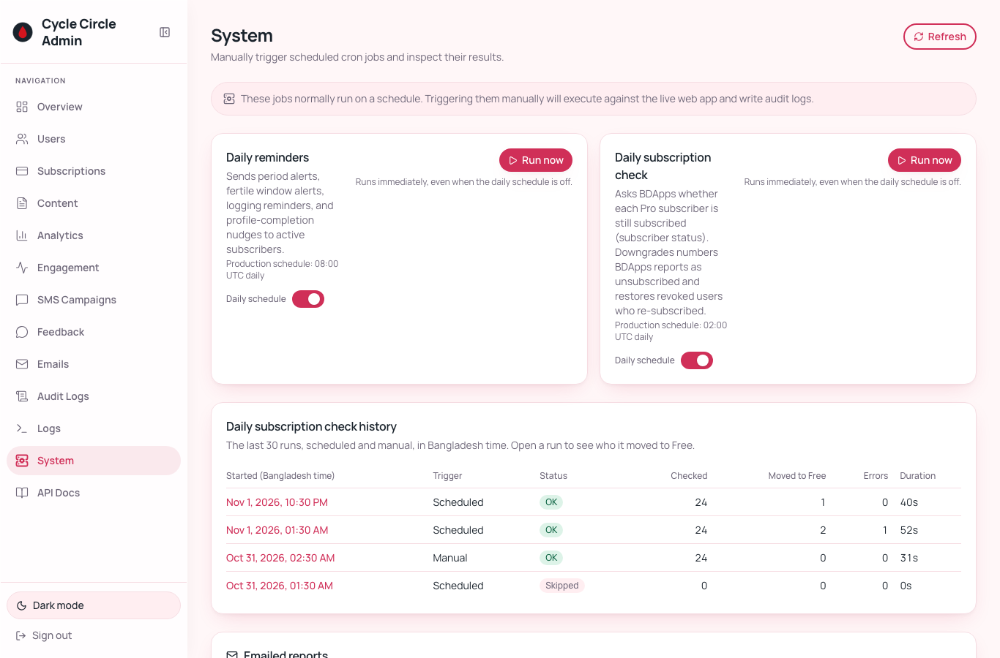
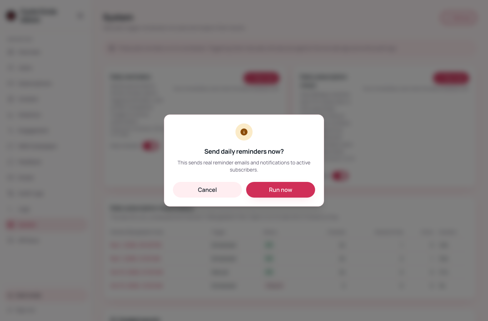
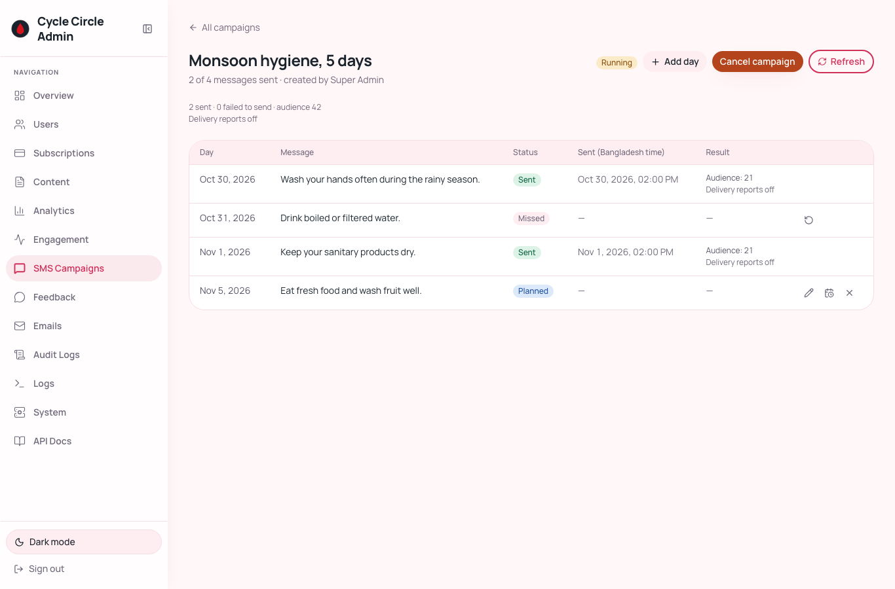
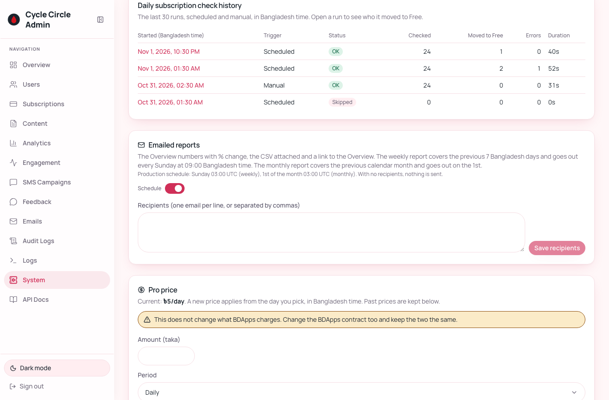
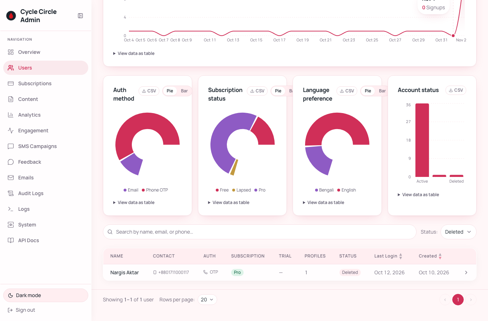
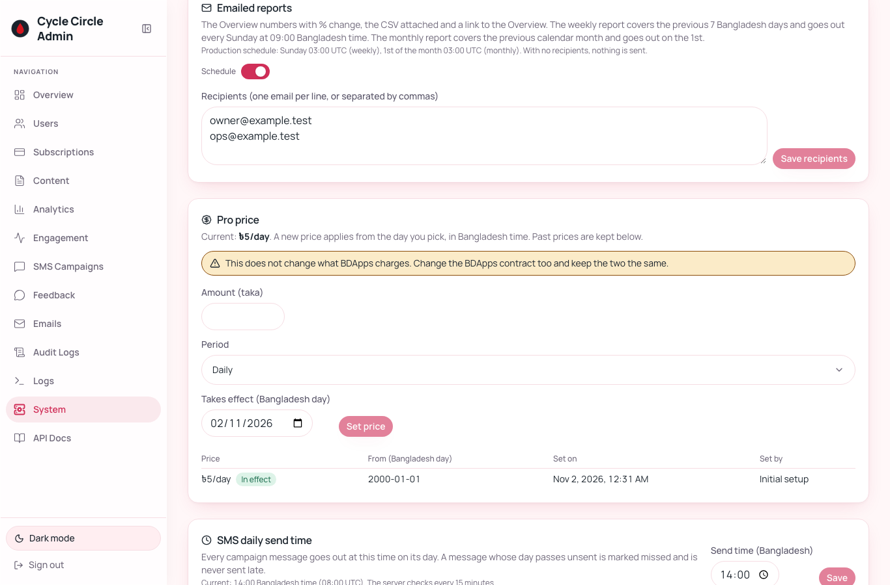

# Scheduled jobs

## Jobs at a glance {#sj-overview}

### What it is

Some things in Cycle Circle happen without anyone tapping anything: reminder emails go out, a daily SMS is sent, subscriptions are re-checked, old deleted accounts disappear, and reports land in an inbox. Each of these is a **job**. A job is started by the production server's clock (a host `crontab` that calls the app's `/api/cron/...` address with a secret), not by the app itself.

### Where to find it

**Admin > System** lists the two jobs an Admin can switch and run by hand, plus the report, SMS send time, delivery-report and Pro price cards. The other jobs have no screen of their own; their results show up in the places named in the table below.

### How to use it

Use this table to answer "when does it run, and what does a User or Admin see afterwards?". **All times are Bangladesh time (UTC+6, no daylight saving).**

| Job | When it runs (Bangladesh time) | Server time (UTC) | Switch on System | What the User or Admin experiences |
|---|---|---|---|---|
| Daily reminder emails | Every day 14:00 | 08:00 | "Daily reminders" > "Daily schedule" | Period alert, fertile-window, logging-reminder and profile-completion emails and SMS ([Daily reminder emails](#sj-daily-reminders)) |
| Campaign SMS dispatch | Every 15 minutes (at :00, :15, :30, :45); also inside the 14:00 reminder run | Every 15 minutes | Same switch as the daily reminders | Today's campaign message goes to all subscribers once the send time has passed ([Campaign SMS dispatch](#sj-sms-dispatch)) |
| Daily subscription check | Every day 08:00 | 02:00 | "Daily subscription check" > "Daily schedule" | Subscribers BDApps no longer lists move to Free ([Daily subscription check](#sj-sub-check)) |
| Nightly maintenance | Every day 08:30 | 02:30 | None | Prediction-accuracy snapshot; accounts deleted more than 30 days ago are erased ([Nightly maintenance](#sj-nightly)) |
| Pro subscriber snapshot | Every day 23:55 | 17:55 | None | One Pro count for the Bangladesh day, used by churn rate and estimated revenue |
| Weekly report email | Every Sunday 09:00 | Sunday 03:00 | "Emailed reports" > "Schedule" | Overview numbers emailed to the report recipients ([Weekly and monthly reports](#sj-reports)) |
| Monthly report email | The 1st of each month 09:00 | 1st, 03:00 | Same switch | Same, for the previous calendar month |

### Rules and limits

- The times come from the production host crontab (`ops/deploy/vesta-crontab`, described in `docs/ops/05-operations.md`). The app does not schedule anything itself. (For developers: `apps/web/vercel.json` still lists two legacy Vercel Cron entries; production does not use them.) If someone edits the host crontab, these times change; the in-app switches and the SMS send time do not move them.
- **The System page shows UTC.** Its cards say "Production schedule: 08:00 UTC daily" and "02:00 UTC daily", and the report card adds "Sunday 03:00 UTC (weekly), 1st of the month 03:00 UTC (monthly)". Add 6 hours for Bangladesh time. The report card's own text also says "every Sunday at 09:00 Bangladesh time".
- Only three switches exist: **Daily reminders**, **Daily subscription check** and **Emailed reports**. A switched-off job answers the server's call with `{"skipped":true,"reason":"cron disabled"}` and does nothing. Nightly maintenance and the Pro subscriber snapshot cannot be switched off.
- The campaign SMS dispatch has **no switch of its own**. It follows the **Daily reminders** switch: turning "Daily reminders" off also stops the SMS dispatch.
- **Run now** (System page) runs a job at once even when its switch is off. It is available for Daily reminders and the Daily subscription check only ([Run daily reminders manually](#sy-manual-reminders), [Run the subscription check manually](#sy-manual-sub-check)).
- Days in every job are Bangladesh days. A day starts at 00:00 Bangladesh time.
- If a job is called with a wrong or missing secret the server answers 401 "Invalid cron secret". If the host crontab was never installed, nothing runs and nothing complains.
- Older docs differ from the code in small ways: `docs/ops/05-operations.md` shows `curl -X GET` for the reminder and check jobs and log files under `/opt/vesta/logs`, while the repository crontab uses `POST` and `/var/log/vesta`. The routes accept both `GET` and `POST`.

### What can go wrong

| The User or Admin sees | Cause | Fix |
|---|---|---|
| No reminder emails or SMS for anyone | The host crontab line is missing, the "Daily reminders" switch is off, or `CRON_SECRET` differs between the crontab and the app | Check the switch on System; ask the server owner to check `crontab -l` and the log `/var/log/vesta/cron-daily-reminders.log` |
| A job result says `{"skipped":true,"reason":"cron disabled"}` | The job's switch is off | Switch "Daily schedule" back on |
| "Web app returned 401" after **Run now** | The admin app's `CRON_SECRET` does not match the web app's | Ask the server owner to align the two environment files |
| Daily subscription check history has no row for today | The job did not run, or its switch is off (a skipped run is still recorded as "Skipped") | See [Daily subscription check](#sj-sub-check) |

### Related

- Admin screen: [Job on/off switches](#sy-jobs)
- Admin screen: [Logs viewer](#lg-viewer) (cron lines are not shown there; they are on the server)
- Automatic: [Emails catalogue](#ec-overview), [SMS](#as-otp), [BDApps billing events](#bb-webhooks)

## Daily reminder emails {#sj-daily-reminders}

### What it is

Every day at **14:00 Bangladesh time** the server looks at every profile and every account and sends four kinds of reminder. Each goes by email (to a User with an email address) and, in the cases below, by SMS.

### Where to find it

**Admin > System > Daily reminders** shows the switch and the **Run now** button. Every email sent is in **Admin > Emails** ([Email log](#em-log)). Clicking **Run now** asks for confirmation first:

### How to use it

To see who got a reminder, open the email log and filter by type or search by the User's email. To explain why a User got nothing, check each rule below against that User's profile.

| Reminder | Who gets it | Email subject | SMS |
|---|---|---|---|
| Period alert | A profile with **Period Alerts** on whose predicted next period starts 0, 1 or 2 days from today | "Cycle Circle: Your period is expected in N days" | Users with a BDApps subscription (a masked subscriber id): "Cycle Circle: <profile>'s period expected in N days (date)" |
| Fertile window | A profile with **Fertile Window Alerts** on, on the day its predicted fertile window starts | "Cycle Circle: Your fertile window starts today" | Users with a BDApps subscription (a masked subscriber id) |
| Logging reminder | A profile with **Logging Reminders** on whose latest period log started 3 or more days ago, or that has no period log | "Cycle Circle: Don't forget to log your cycle" | Users with a BDApps subscription (a masked subscriber id) |
| Profile-completion reminder | A User whose profile is not complete, who has not switched **Profile-completion reminders** off, was not deleted, and signed up between 2 and 14 days ago | "Cycle Circle: Finish setting up your profile" | Users with a BDApps subscription (a masked subscriber id) |

### Rules and limits

- **One email per kind per day.** The job skips a profile if a SENT email of the same type was already logged for it since 00:00 Bangladesh time. The profile-completion reminder is checked per User. A failed send does not count, so a re-run retries it.
- **The period alert can arrive three days in a row** (2 days before, 1 day before, on the day), one email each day.
- A new profile gets its default switches from its goal ([Notification toggles](#st-notifications)): "trying to conceive" sends only fertile-window alerts; "perimenopause" sends period alerts and logging reminders; everything else has all three on.
- **Logging reminders count days since the last period log**, not symptom logs or check-ins. A User who logs symptoms every day but has not logged a period for 3 days still receives the reminder, every day, until a new period is logged. The email says "It's been N days since your last log." or, with no period yet, "You haven't logged a period yet."
- **Profile-completion window.** "Complete" means the User has created a profile (finished onboarding). The reminder is sent on the 2nd to 14th Bangladesh day after signup, at most once a day, and stops when a profile is created. A User who signed up on the 1st gets the first reminder on the 3rd.
- Emails use the User's saved language (English or Bengali). SMS texts are also in that language.
- SMS go to the User's masked BDApps subscriber id (since 2.4.2; before, they went to the raw number and BDApps rejected them). A User without one (email-only, old phone-only records, admin-granted Pro) gets no SMS; the log shows `notification.sms.skipped` with `no-masked-id`. An unsubscribed id logs `unregistered`.
- **The job does not skip suspended Users or Users deleted in the last 30 days** for the three profile-based reminders. Nothing in the code filters them out; only the profile-completion step skips deleted Users. The System page caption says the reminders go "to active subscribers"; in fact they go to every profile that has the switch on.
- The job also runs the campaign SMS step ([Campaign SMS dispatch](#sj-sms-dispatch)) at the end, and a failure there never stops the reminders.
- **Run now** and the per-User reminder button use the same job. **Run now** keeps the one-per-day rule. The per-User button on the User detail page forces a send even if one went out today.
- Because the one-per-day rule is read from the email log, a User with a phone but no email has no log entry to check: running the job twice in a day sends that User the SMS twice.
- The caption on the System page says it sends "profile-completion nudges"; the User-facing wording is "Profile-completion reminders".

### What can go wrong

| The User or Admin sees | Cause | Fix |
|---|---|---|
| The User says "I get a logging reminder every day" | The last period log started 3 or more days ago (see rule above) | Explain it is based on the last period log; the User can switch **Logging Reminders** off in **Settings > Notifications** |
| The User says "I never get a period alert" | No prediction yet, the switch is off for the active profile, the next period is more than 2 days away, or the email address is missing | Check the profile's predictions and switches; for SMS check the User has a BDApps subscription |
| Email log shows no row for a User | No email on the account, or the job did not run that day | Check the account has an email; check [Jobs at a glance](#sj-overview) |
| A User received two SMS the same day | The job ran twice and the User has no email on file | Expected; the one-per-day check needs an email log entry |
| A deleted or suspended User still gets reminders | The job does not filter them | Report it to the developers; until fixed, delete means reminders continue for up to 30 days |
| System page toast "Daily reminders finished" but counts are 0 | Nobody was due (counts shown: processed, period alerts, fertile alerts, reminders, completion reminders, errors, skipped) | Normal on a quiet day |

### Related

- Settings: [Notification toggles](#st-notifications)
- Admin screens: [Run daily reminders manually](#sy-manual-reminders), [Per-User reminders](#us-reminders), [Email log](#em-log)
- Automatic: [Period alert](#ec-period-alert), [Fertile window email](#ec-fertile-window), [Logging reminder](#ec-logging-reminder), [Profile-completion reminder](#ec-profile-completion)

## Campaign SMS dispatch {#sj-sms-dispatch}

### What it is

Admins plan a **campaign**: one SMS per Bangladesh day. A job sends each day's **campaign message** to all subscribers at the daily send time. A day that passes without a send is marked **Missed** and is never sent late.

### Where to find it

**Admin > SMS Campaigns**, then open a campaign. The Status column shows what the job did:

### How to use it

1. An Admin plans messages for future days ([Create a campaign](#sm-create)).
2. The server calls the dispatch every 15 minutes. Before the send time the call does nothing.
3. From the send time (default **14:00 Bangladesh time**) the next call sends today's planned message to everyone subscribed. The message turns **Sent**, with the time in Bangladesh time and an "Audience" number.
4. After midnight, any message of an earlier day that is still **Planned** becomes **Missed**.

### Rules and limits

- The send time is one time for all campaigns, set on the System page ([SMS send time](#sy-sms-time), [Send time and missed days](#as-send-time)). A message has a day, never a time of day.
- Because the server checks every 15 minutes, a message goes out at the first check after the send time: a send time of 09:05 goes out at 09:15. The 14:00 reminder run also dispatches, so even without the 15-minute line the default 14:00 still works.
- At most one message goes out per Bangladesh day across all campaigns.
- **Sending is claimed once.** Two calls at the same moment (or a manual send racing the job) make only one BDApps call.
- A failed send is marked **Failed to send** and is **not retried automatically**. The Admin decides ([Resend failed messages](#sm-resend)). A message stuck in "Sending" for more than 30 minutes becomes **Failed to send** with "Outcome unknown: sending did not finish. Check whether subscribers received it before rescheduling."
- A **Missed** message has the note "Missed: not sent on its day." in the data and is never sent late. Cancelled campaigns are skipped.
- The job follows the **Daily reminders** switch. When it is off, nothing is dispatched and the days become Missed.
- The audience number is an estimate: Pro subscriptions that have a stored BDApps subscriber id. BDApps does not report the real number.

### What can go wrong

| The Admin sees | Cause | Fix |
|---|---|---|
| A day is **Missed** | The server was down at the send time, or the "Daily reminders" switch was off (nothing runs while it is off; the day is marked Missed at the first check after it is switched back on) | Resend the text on a free day ([Resend failed messages](#sm-resend)) |
| **Failed to send** with an error | BDApps refused the send (for example E1312 when delivery reports are on but not enabled for the plan) | Fix the cause, then resend ([Resend failed messages](#sm-resend)); see [Delivery reports](#as-delivery-reports) |
| Message sent later than the send time | The 15-minute step; or the cron line is missing and only the 14:00 run sends | Check the host crontab has the every-15-minutes line |
| "Delivery reports off" under a sent message | Delivery reports were off when it was sent | Normal; see [Delivery reports](#as-delivery-reports) |

### Related

- Admin screens: [Send a campaign](#sm-send), [Cancel a campaign](#sm-cancel), [SMS send time](#sy-sms-time)
- Automatic: [Campaign messages](#as-campaign-sms), [Send time and missed days](#as-send-time)

## Daily subscription check {#sj-sub-check}

### What it is

Once a day the server asks BDApps whether each **Subscriber** is still subscribed. The check is **read-only toward BDApps: it asks for status and never charges anyone**. It only changes the User's plan in Cycle Circle.

### Where to find it

**Admin > System > Daily subscription check history** lists the last 30 runs (scheduled and manual). Open a run to see who it moved ([Run detail](#sy-run-detail)).

### How to use it

1. The job runs every day at **08:00 Bangladesh time** (02:00 UTC).
2. For each Pro User with a BDApps subscriber id, it asks BDApps for the status.
3. If BDApps says **UNREGISTERED**, the User moves to **Free**. Their data stays.
4. For Users whose Pro was revoked by an Admin, it asks too: if BDApps now says **REGISTERED** (they subscribed again), the Admin override ends and the User is Pro again.
5. The run is stored with the columns "Started (Bangladesh time)", "Trigger" (Scheduled or Manual), "Status" (OK, Failed or Skipped), "Checked", "Moved to Free", "Errors" and "Duration".

### Rules and limits

- It never downgrades on an error. A User BDApps cannot be reached for counts under "Errors" and keeps Pro.
- Only the answer UNREGISTERED moves a User to Free. Any other answer (REGISTERED, a charging-pending state, BLOCKED) leaves the plan alone.
- **Older accounts that only have a raw phone number as their id are skipped, never downgraded**, because BDApps answers "unregistered" for raw numbers even when they are subscribed. These count under "Checked" but not under "Moved to Free".
- Users with an Admin override (granted Pro) are not asked, and a granted Pro is never downgraded by this job.
- When the switch is off the run is recorded as "Skipped" and nothing is checked.
- Each run also stores "last confirmed" and the last BDApps status for each subscription, shown on the Subscriptions page.
- A User moved to Free here is counted as churn with the reason "daily subscription check" ([Churn](#an-churn)).

### What can go wrong

| The Admin sees | Cause | Fix |
|---|---|---|
| Status "Failed" on a run | The whole job crashed (for example BDApps down, database error) | Open the run for the error; run it again with **Run now** |
| "Errors" above 0 | BDApps did not answer for some Users | Nothing was downgraded; they are checked again tomorrow |
| A User says "I am still charged but I am Free" | BDApps reported UNREGISTERED earlier or the User unsubscribed on BDApps and subscribed again | See [BDApps billing events](#bb-unsubscribe); a new subscription re-activates Pro through the webhook or the next check |
| A User unsubscribed on BDApps but is still Pro | The check has not run yet, or the User has a raw-phone id, or an Admin override | Wait for 08:00, or use **Run now** ([Run the subscription check manually](#sy-manual-sub-check)) |
| "Skipped" status | The "Daily subscription check" switch is off | Switch it back on |

### Related

- Admin screens: [Run history](#sy-runs), [Run detail](#sy-run-detail), [Subscriptions list](#su-list)
- Automatic: [Unsubscribe](#bb-unsubscribe), [Lapse](#bb-lapse)

## Nightly maintenance {#sj-nightly}

### What it is

Every day at **08:30 Bangladesh time** (02:30 UTC) the server does two housekeeping jobs: it stores a **prediction-accuracy snapshot** for the Admin dashboard, and it permanently erases accounts that were deleted more than 30 days ago.

### Where to find it

There is no screen for the job itself. The deleted accounts waiting to be erased are listed in **Admin > Users** with the status filter on "Deleted":

### How to use it

1. An Admin deletes the account (Users can not delete their own account in the app). The account is hidden and BDApps is asked to unsubscribe the number. For 30 days an Admin can restore it ([Delete and restore](#us-delete-restore)).
2. After more than 30 days the nightly job erases the User: profiles, period and symptom logs, feedback and subscriptions go with it. The Admin email log keeps its rows but without the link to the User. One line "account.purge" is written to the translog.
3. The same run stores the prediction-accuracy snapshot (mean error in days for the "Average" and "ARIMA" predictors), shown on the Admin dashboard ([Prediction accuracy](#an-prediction-accuracy)).

### Rules and limits

- The cutoff is exactly 30 x 24 hours. A User deleted exactly 30 days ago can still be restored; only an account deleted *strictly more than* 30 days ago is erased.
- The erase cannot be undone and does not go through the restore window again.
- One failing account never blocks the others (an Admin account that still owns articles cannot be erased; the run counts it as failed and tries again the next night).
- Because the job runs at 08:30 Bangladesh time, the erase happens in the morning of the 31st day, not at midnight.
- No switch exists for this job.
- The result of each run is `snapshotTiers`, `purged`, `failed`, written to the server's cron log.

### What can go wrong

| The Admin or User sees | Cause | Fix |
|---|---|---|
| A User asks to be restored after 30 days | The account was erased | It cannot be restored; the User signs up again |
| A deleted User is still in the list after 30 days | The erase failed for that User (counted as "failed") | Ask a developer to check the cron log for `nightly-maintenance.purge-failed` |
| The accuracy figures on the dashboard are old | The job did not run | Check the host crontab |

### Related

- Admin screens: [User detail](#us-detail), [Delete and restore](#us-delete-restore)
- Automatic: [Jobs at a glance](#sj-overview)

## Weekly and monthly reports {#sj-reports}

### What it is

The server emails the Overview numbers to a list of recipients every week and every month, with a CSV file attached.

### Where to find it

**Admin > System > Emailed reports** holds the on/off switch and the recipient list. Each report sent is in **Admin > Emails** with type REPORT.

### How to use it

1. An Admin types the recipient email addresses in "Recipients (one email per line, or separated by commas)" and taps **Save recipients** ([Report recipients](#sy-report-recipients)).
2. **Weekly:** every Sunday at **09:00 Bangladesh time**. It covers the previous 7 complete Bangladesh days (Sunday to Saturday).
3. **Monthly:** on the 1st of each month at **09:00 Bangladesh time**. It covers the previous calendar month.
4. Each report email has a table of the headline Overview numbers with the change against the previous period, a link to the Overview, and the same numbers as a CSV attachment.

### Rules and limits

- Subjects read "Cycle Circle weekly report: <from> to <to>" and "Cycle Circle monthly report: <from> to <to>".
- The table has: Total users, New signups, Average daily active users, Pro subscribers, Churned Pro users (excl. admin revokes), Churn rate and Estimated daily revenue, plus "Estimated revenue in total". Revenue is an estimate, not billed money.
- With no recipients, nothing is sent. Recipients are lower-cased, de-duplicated and validated; one bad address rejects the whole save with "Not a valid email address: <address>".
- **Each period is sent once.** A repeated call for the same period answers `already-sent` and sends nothing. If every recipient fails, the period is released so the next call tries again.
- The link to the Overview is added only when the web app has `ADMIN_APP_URL` set.
- The "Schedule" switch turns both reports off. Reports sent are logged as type REPORT, and in the Admin email log they show with the raw type text.
- To send a period again by hand, a developer calls the report URL with `force=true` and the `Authorization: Bearer` cron secret header (without it the answer is 401 "Invalid cron secret"); there is no button.

### What can go wrong

| The Admin sees | Cause | Fix |
|---|---|---|
| No report arrives | No recipients, the "Schedule" switch is off, the host crontab lacks the two report lines, or the address is wrong | Check the card; check [Email log](#em-log) for a REPORT row |
| "Not a valid email address: ..." | A recipient is not an email | Correct it and save again |
| Report arrives without the Overview link | `ADMIN_APP_URL` is not set | Ask the server owner to set it |
| Two weeks of numbers look the same | Compare the "Previous" column; the report compares with the period before it | Read the CSV |

### Related

- Admin screens: [Report recipients](#sy-report-recipients), [Overview numbers](#ov-kpis)
- Automatic: [Emailed reports](#ec-reports)
