# Settings

Everything a User can change about their account, in one screen: contact details, plan badge, notification toggles, language and theme, data export, the tour, legal links and log out. The screen has five blocks, in this order on a phone: **Language & Appearance**, **Notifications**, **Export Data**, **Account** and **About**. On a wide screen the blocks sit in two or three columns.

Settings belongs to the signed-in app. A logged-out visitor who opens `/settings` is sent to the login screen. An email-trial User whose 24 hours have ended sees the trial lock over it ([Trial lock](#pa-trial-lock)).

## Settings overview {#st-overview}

### What it is

The Settings screen. Each block is described in its own section below.

### Where to find it

**More > Settings** on a phone, **Settings** in the sidebar on a wide screen, or `/settings`.

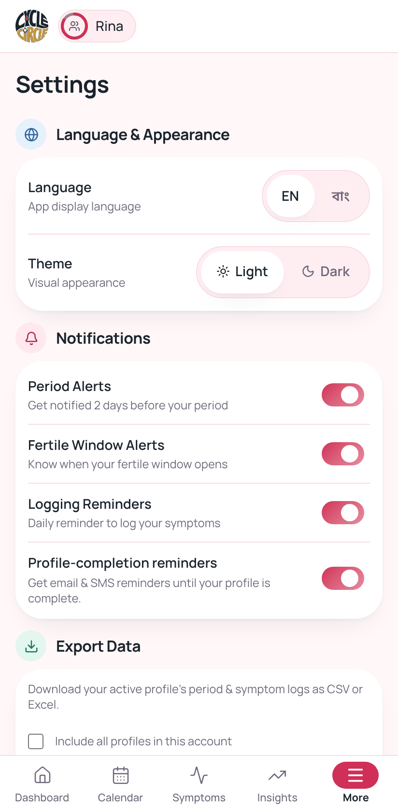

### How to use it

1. Open **Settings**. Scroll to the block you need.
2. Notification toggles and the language and theme buttons save by themselves. Export, the tour and log out are buttons.

### Rules and limits

- The screen shows the **active profile's** notification settings and export. The active profile is the one chosen in the profile chip at the top of the app ([Switch the active profile](#pf-switch)).
- The **Account** block also links to **Manage Profiles**, **Give Feedback** and **Subscription** ([Switch the active profile](#pf-switch), [Send feedback](#fb-send), [Subscription page and status](#sb-status)).
- There is no way to change a name, phone number or email here. A User can only **add** a missing email or phone.

### What can go wrong

| The User sees | Cause | Fix |
|---|---|---|
| The login screen instead of Settings | The session ended or the User is logged out | Log in again ([Phone login](#gs-phone-login)) |
| A full-screen "Your 24-hour trial has ended" | Email trial ended | Add a phone ([Adding a phone to keep an account](#pa-keep-account)) |

### Related

- [Account details](#st-account), [Notification toggles](#st-notifications), [Export your data](#st-export)

## Account details {#st-account}

### What it is

The **Account** block: the User's phone and email, the plan badge, shortcuts and the **Log Out** button.

### Where to find it

**Settings > Account**.

### How to use it

1. Read the **Phone** and **Email** rows to confirm which contacts are on the account. A phone is shown with a leading +, for example +8801700000001.
2. A missing contact has a button instead of a row: **Add Email** or **Add Phone Number** ([Add or verify an email](#st-email), [Add or verify a phone](#st-phone)).
3. Shortcuts under the details: **Manage Profiles**, **Give Feedback**, **Subscription** (with an **Upgrade** tag unless the User is Pro) and **Replay app tour**.

### Rules and limits

- A phone User always has a phone row. An email-trial User always has an email row. The other contact can be added once.
- Neither contact can be edited or removed afterwards. An Admin cannot change them from Settings either; support must go through the Admin app ([Users](#us-detail)).
- Phone and email are each unique across Cycle Circle: one number or address belongs to one account.

### What can go wrong

| The User sees | Cause | Fix |
|---|---|---|
| "Add Phone Number" is missing | The account already has a phone | Nothing to add |
| Wants to change the phone or email | Not supported in Settings | Add the missing contact only; for anything else ask an Admin |

### Related

- [Plan badge](#st-plan-badge), [Users](#us-detail)

## Add or verify an email {#st-email}

### What it is

A User who signed in with a phone can attach an email address. The address is saved only after the User types a 6-digit code mailed to it, so nobody can claim an inbox they do not own.

### Where to find it

**Settings > Account > Add Email**. The button shows only when the account has no email.

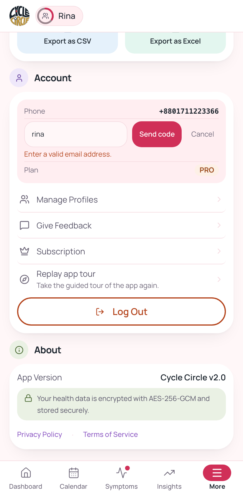

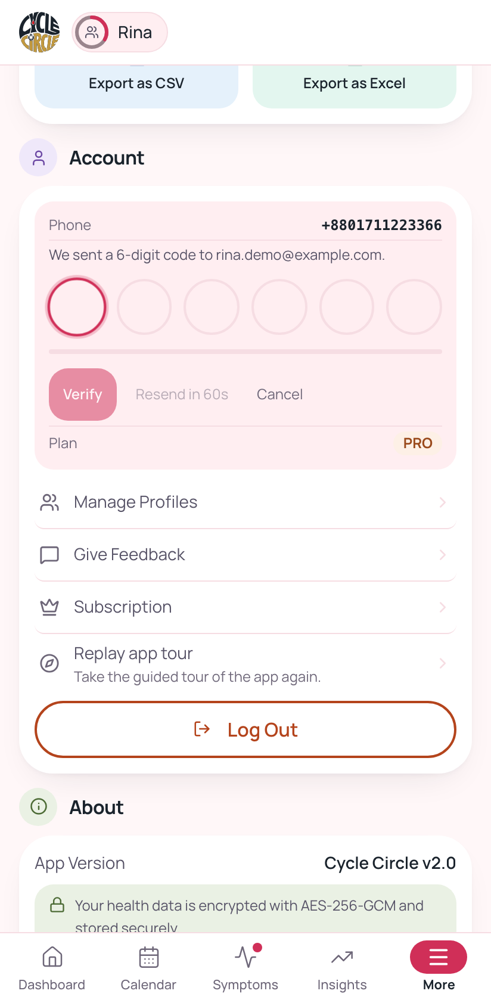

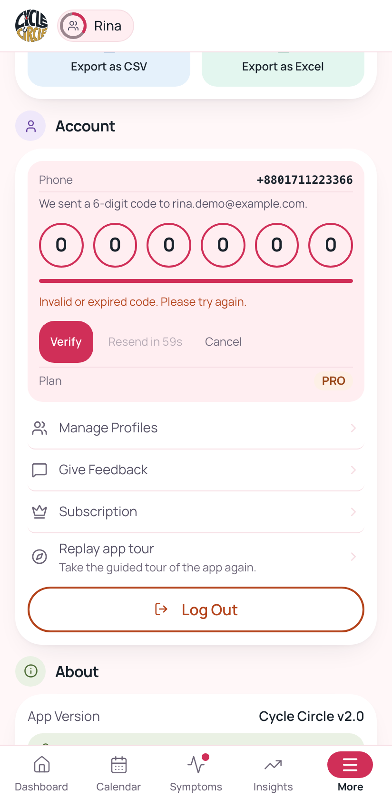

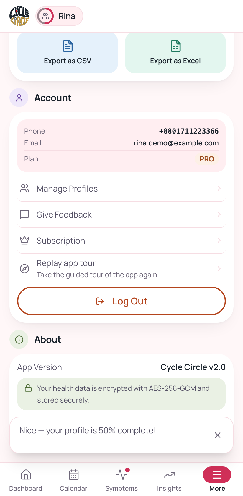

### How to use it

1. Tap **Add Email**. A field "Enter email address…" appears.
2. Type the address and tap **Send code**.
3. The screen says "We sent a 6-digit code to (address)." Open the email and type the 6 digits. Tap **Verify**.
4. A toast says "Email verified and saved." and the **Email** row appears.
5. If no email arrived, wait for the countdown ("Resend in 60s") and tap **Resend code**. **Cancel** closes the form.

### Rules and limits

- The code is 6 digits and is valid for 10 minutes. Only the newest code works; asking for a new one cancels the older one.
- 5 wrong codes lock that code. The User must request a new one.
- A new code can be requested every 60 seconds, at most 3 times a minute per User, and the server also limits requests per device (10 an hour). Code checks are limited to 10 per 5 minutes.
- The address is lower-cased before it is saved.
- The check on the address is simple: text, an @, a dot. An address that belongs to another account is refused.
- The email asks nothing of the User beyond the code. Adding an email does not change the plan.

### What can go wrong

| The User sees | Cause | Fix |
|---|---|---|
| "Enter a valid email address." | The address has no @ or no dot, or the server rejected it | Retype it |
| "This email is already used by another account." | Another account has this address | Use a different address |
| "Please wait a moment before requesting another code." | Asked again within 60 seconds | Wait for the countdown |
| "Too many attempts. Try again in a few minutes." | Too many requests or code checks | Wait a few minutes |
| "Invalid or expired code. Please try again." | Wrong digits, code older than 10 minutes, or an older code | Type the newest code, or request a new one |
| "Too many wrong codes. Request a new code." | 5 wrong tries on this code | Tap **Resend code** when it is available, then use the new code |
| "Something went wrong. Please try again." | The email could not be sent, or the network failed | Try again; if it repeats, check the mail log ([Log channels](#lg-channels)) |

The code email is written in the account's language. Because the app never saves the language choice on the account ([Language persistence](#nl-language-persists)), it is in English.

### Related

- [Account details](#st-account), [Add or verify a phone](#st-phone), [Language persistence](#nl-language-persists)

## Add or verify a phone {#st-phone}

### What it is

An email-trial User adds a mobile number and verifies it with a 6-digit code sent by SMS. **Verifying the number subscribes it to Cycle Circle Pro through BDApps**, ends the trial and makes the User Pro (ADR 0002). The dialog says so: "Verifying your number subscribes it to Cycle Circle Pro via BDApps. Operator charges apply."

### Where to find it

**Settings > Account > Add Phone Number**. The button shows only when the account has no phone. The same dialog opens from the trial countdown pill ("Add number") and from the Subscription page ([Upgrade by adding a phone](#sb-upgrade)).

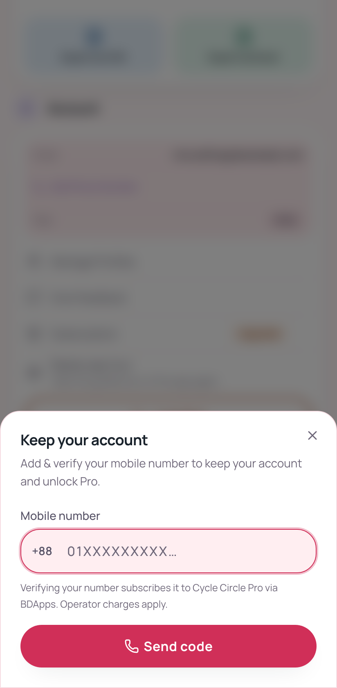

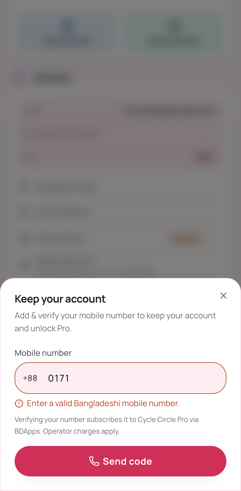

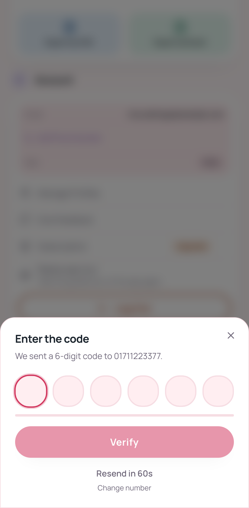

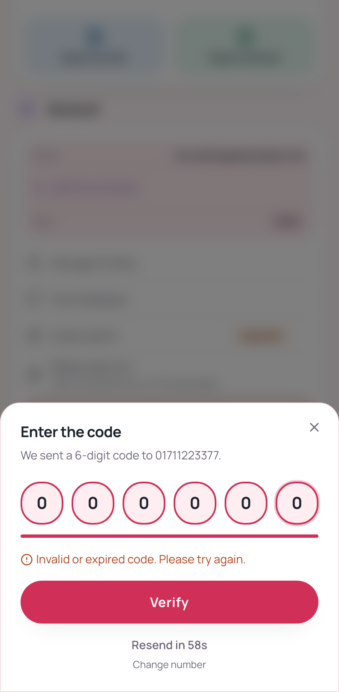

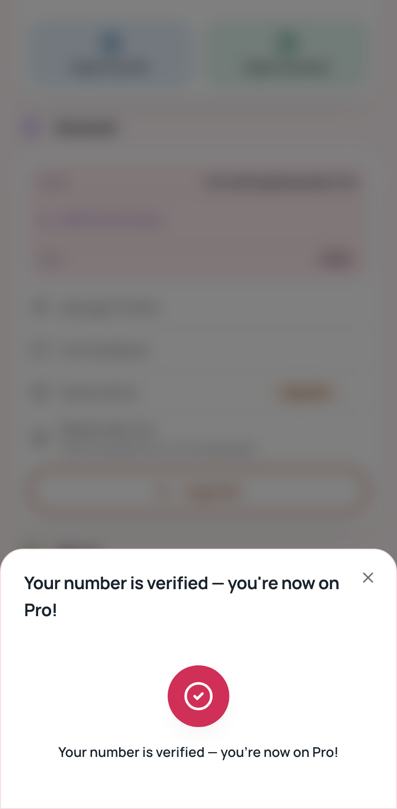

### How to use it

1. Tap **Add Phone Number**. The dialog "Keep your account" opens with "Add & verify your mobile number to keep your account and unlock Pro."
2. Type the 11-digit number under "Mobile number" (for example 01711223377) and tap **Send code**.
3. The dialog changes to "Enter the code" ("We sent a 6-digit code to (number)."). Type the 6 digits. The code is submitted by itself when the sixth digit is in; **Verify** does the same.
4. The dialog shows "Your number is verified — you're now on Pro!" for about two seconds, closes, and a toast says "Phone number added successfully".
5. **Change number** goes back to the first step. **Resend in (n)s** becomes **Resend code** after 60 seconds.

### Rules and limits

- The number must have 11 digits and start with 01.
- The code is a BDApps OTP: valid for 5 minutes, at most 3 requests a minute per number, 10 an hour per device, 5 checks per 5 minutes per request.
- A number already used by another account is refused. A number that is already subscribed to Cycle Circle elsewhere (for example a number that has its own account) is refused until the subscription is cancelled on BDApps.
- Success makes the User Pro and clears the email trial. The trial countdown pill disappears.
- This is a billing step: Pro is charged to the mobile balance ([Pro price](#sb-price)).

### What can go wrong

| The User sees | Cause | Fix |
|---|---|---|
| "Enter a valid Bangladeshi mobile number." | Not 11 digits starting 01 | Retype the number |
| "This number is already registered to another account." | Another account owns the number | Use another number or log in to the other account |
| "This number is already subscribed. Unsubscribe it from Cycle Circle on BDApps first, then add it here." | The number has an active BDApps subscription | Unsubscribe on BDApps, then add it ([Unsubscribe](#sb-unsubscribe)) |
| "Please wait a moment before requesting another code." | Asked again within 60 seconds | Wait for the countdown |
| "Too many attempts. Try again in a few minutes." | Rate limit | Wait a few minutes |
| "Invalid or expired code. Please try again." | Wrong digits or code older than 5 minutes | Request a new code |
| "We can't send a code to this number's mobile operator yet. Please try another number." | BDApps does not support the operator | Use a number on a supported operator |
| "Something went wrong. Please try again." | Network or BDApps error | Try again later; see the logs ([Log channels](#lg-channels)) |

### Related

- [Adding a phone to keep an account](#pa-keep-account), [Upgrade by adding a phone](#sb-upgrade), [Email trial](#pa-email-trial)

## Plan badge {#st-plan-badge}

### What it is

The **Plan** row in the Account block: a small badge with the User's tier.

### Where to find it

**Settings > Account > Plan**.

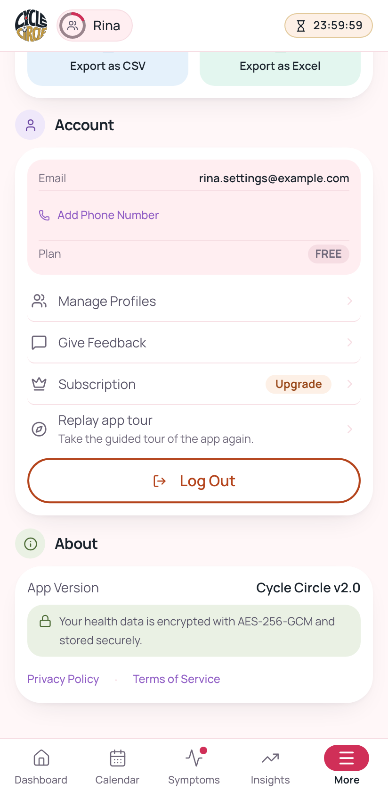

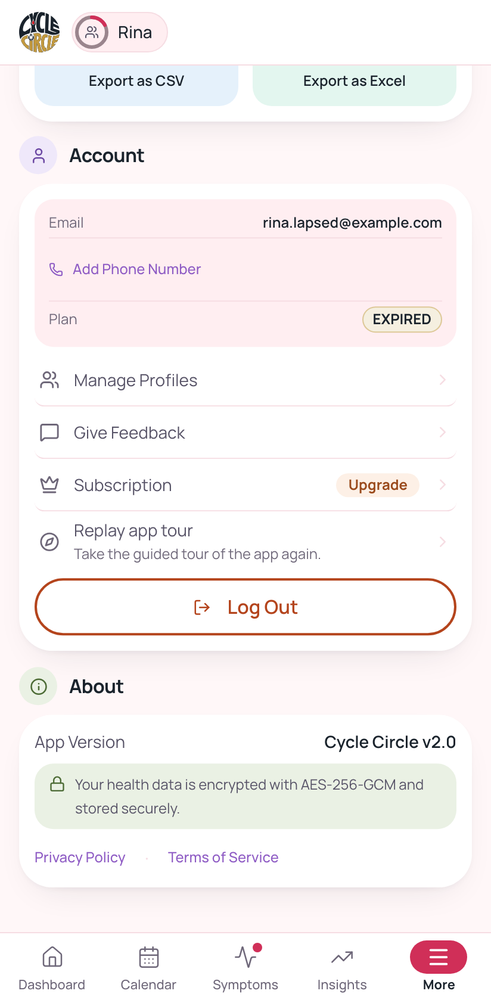

### How to use it

1. Read the badge. It never changes by itself on screen; it follows the account.
2. For a User who is not Pro, tap **Subscription** (tagged **Upgrade**) to upgrade ([Subscription page and status](#sb-status)).

### Rules and limits

| Badge | Meaning |
|---|---|
| PRO | Pro: a subscribed phone, or Pro granted by an Admin |
| FREE | An email-trial account (24-hour trial) |
| EXPIRED | The subscription lapsed (billing failed or an Admin revoked it). Not the same as Free |

- The badge follows the account's subscription status only. It does not show how much of an email trial is left; the countdown pill at the top of the app does ([Email trial](#pa-email-trial)).
- Lapsed Users keep the label "Expired" in this row; the Subscription page explains how to renew ([Lapsed](#pa-lapsed)).

### What can go wrong

| The User sees | Cause | Fix |
|---|---|---|
| FREE although the User paid | Paid with another number, or the phone was never verified | Check the account's phone ([Users](#us-detail)) |
| EXPIRED | Billing failed or revoked | See [Lapsed](#pa-lapsed) |
| PRO changed after adding a phone | Verifying the phone subscribes it | Expected ([Add or verify a phone](#st-phone)) |

### Related

- [The plans at a glance](#pa-at-a-glance), [Subscription page and status](#sb-status)

## Notification toggles {#st-notifications}

### What it is

Four switches that decide which reminders the system sends. Three are **per profile** (they apply to the active profile) and one is **per User**.

### Where to find it

**Settings > Notifications**.

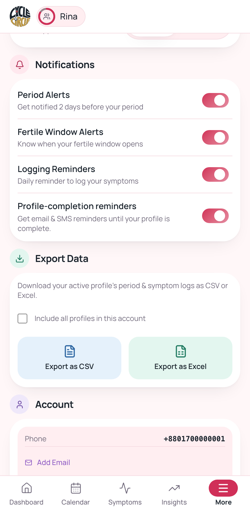

### How to use it

1. Check which profile is active (profile chip at the top).
2. Tap a switch to turn it on or off. After about half a second a toast says "Preferences saved".
3. If saving fails, the switch jumps back and a toast says "Failed to save preferences".

| Switch | Screen text | What it does |
|---|---|---|
| Period Alerts | "Get notified 2 days before your period" | Sent when the next predicted period is 0 to 2 days away; at most one a day |
| Fertile Window Alerts | "Know when your fertile window opens" | Sent once, on the day the predicted fertile window starts |
| Logging Reminders | "Daily reminder to log your symptoms" | Sent every day while the last period log started 3 or more days ago (or none exists) |
| Profile-completion reminders | "Get email & SMS reminders until your profile is complete." | Per User. Sent daily until the profile is complete; stops after 14 days from signup |

### Rules and limits

- All four are on by default.
- Alerts go by **email** (if the account has an email) and by **SMS** (only for Pro Users who have a phone). Profile-completion reminders go by SMS to any User with a phone. There are no push notifications.
- Alerts use the account's language, which is English ([Language persistence](#nl-language-persists)).
- The jobs run once a day ([Daily reminders](#sj-daily-reminders)). Switching a toggle off applies from the next run.
- The page says Logging Reminders ask for "symptoms"; the system counts days since the last **period log**, not symptom logs. A User who logs symptoms every day but no new period still gets the reminder.
- A switch off for a profile stops alerts for that profile only. Each of a User's profiles has its own three switches; Settings shows the active one.

### What can go wrong

| The User sees | Cause | Fix |
|---|---|---|
| "Failed to save preferences" | Network or server error | Try again |
| No alerts arrive | Switch off, no prediction yet, no email, or not Pro for SMS | Check the switches, the profile's predictions and the plan |
| Toggles show the wrong profile | Another profile is active | Switch profile, then reopen Settings |

### Related

- [Daily reminders](#sj-daily-reminders), [Profile completion](#ap-completion)

## Language and theme {#st-language-theme}

### What it is

The **Language & Appearance** block: the app language (English or Bengali) and the colour theme (Light or Dark).

### Where to find it

**Settings > Language & Appearance**.

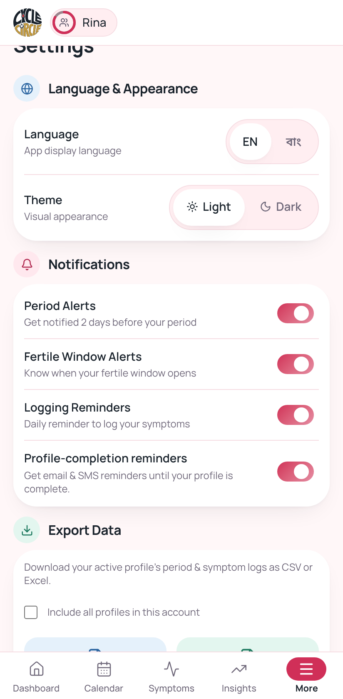

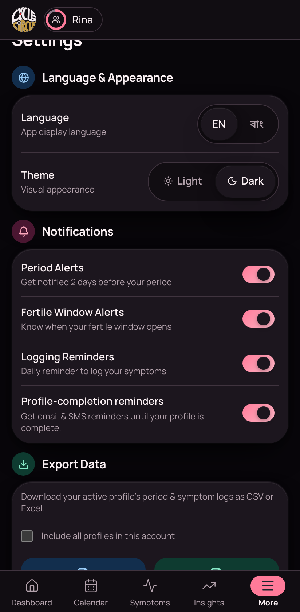

### How to use it

1. Under **Language** ("App display language") tap **EN** or the Bengali button. The whole app changes at once.
2. Under **Theme** ("Visual appearance") tap **Light** or **Dark**.

### Rules and limits

- Language is described in [Switching language](#nl-switch-language) and [Language persistence](#nl-language-persists).
- Theme starts from the phone or computer setting. Once the User taps a theme it is remembered in that browser. It is not saved on the account.
- The same two controls are also in the More sheet and the wide-screen sidebar ([More sheet](#nl-more-sheet), [Desktop sidebar](#nl-sidebar)).

### What can go wrong

| The User sees | Cause | Fix |
|---|---|---|
| Theme differs on another device | Theme is per browser | Set it again there |
| Language differs on another device | Language is per browser | See [Language persistence](#nl-language-persists) |

### Related

- [Switching language](#nl-switch-language), [Language persistence](#nl-language-persists)

## Export your data {#st-export}

### What it is

Download a User's period and symptom logs as a CSV or Excel file.

### Where to find it

**Settings > Export Data**.

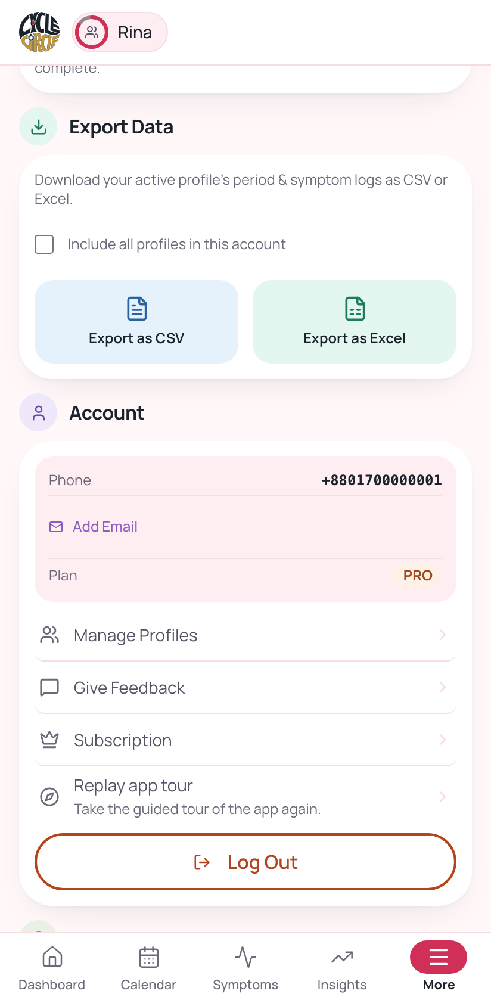

### How to use it

1. Optional: tick **Include all profiles in this account**.
2. Tap **Export as CSV** or **Export as Excel**. A toast says "Preparing CSV export…" or "Preparing export…".
3. The file downloads and a toast says "CSV downloaded" or "File downloaded".

### Rules and limits

- Without the tick the file has the **active profile** only ("Download your active profile's period & symptom logs as CSV or Excel."). With the tick it has every profile of the account.
- Contents: period logs (Profile, Relation, Start Date, End Date, Flow Intensity) and symptom logs (Profile, Relation, Date, Category, Symptom ID). Dates are year-month-day. Symptom ID is the internal symptom name, not the display label. Nothing else is exported: no predictions, notes or account details.
- File names: `vesta-export-profile-(date).csv`, `vesta-export-all-profiles-(date).csv` and the same with `.xlsx`, using the Bangladesh date. The CSV holds both tables in one file, headed "=== PERIOD LOGS ===" and "=== SYMPTOM LOGS ===". The Excel file has two sheets, "Period Logs" and "Symptom Logs".
- The buttons are disabled while an export runs.
- Export is not limited to Pro.
- A User can only export their own profiles. A forged profile is ignored.
- The CSV has no byte-order mark, so Excel may show Bengali names wrongly when the CSV is double-clicked. The Excel option avoids this.

### What can go wrong

| The User sees | Cause | Fix |
|---|---|---|
| "Export failed. Please try again." | Network or server error | Try again |
| An empty file (only headers) | The profile has no logs | Log something first |
| Only one profile in the file | Box not ticked | Tick **Include all profiles in this account** |

### Related

- [Privacy Policy](#gs-privacy), [My Profiles](#pf-list)

## Replay the tour {#st-replay-tour}

### What it is

Shows the first-run guided tour again.

### Where to find it

**Settings > Account > Replay app tour** ("Take the guided tour of the app again.").

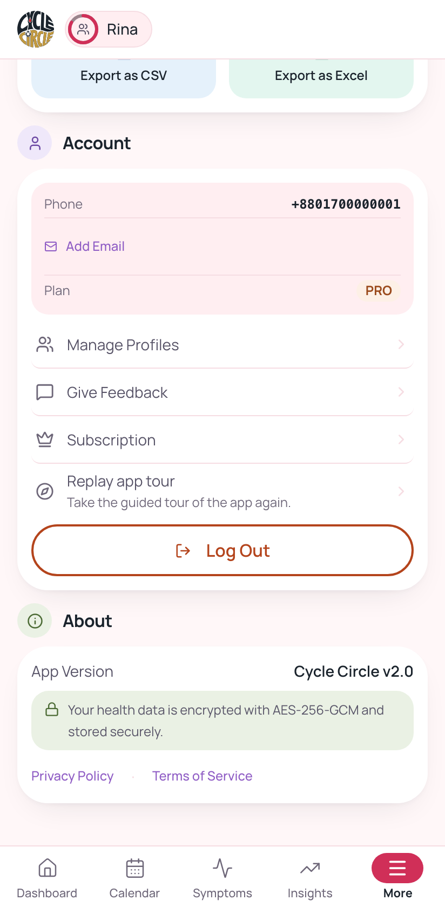

### How to use it

1. Tap **Replay app tour**. The app opens the Dashboard and the tour starts.
2. Step through with **Next**, finish with **Done**, or close it with **Skip** or Esc.

### Rules and limits

- The replay is a flag in the browser, used once. It works any time, even after the tour was finished.
- The tour is described in [First-run tour](#gs-tour).

### What can go wrong

| The User sees | Cause | Fix |
|---|---|---|
| The Dashboard opens with no tour | Another pop-up took priority this page load, or the Dashboard failed to load | Reload, or tap **Replay app tour** again |

### Related

- [First-run tour](#gs-tour), [Auto-prompts](#ap-tour)

## Legal links and app version {#st-legal}

### What it is

The **About** block: app version, a note on data protection, and links to the legal pages.

### Where to find it

**Settings > About**.

### How to use it

1. The version reads "Cycle Circle v2.0".
2. Tap **Privacy Policy** or **Terms of Service** to open the page ([Privacy Policy](#gs-privacy), [Terms of Service](#gs-terms)).

### Rules and limits

- The version number is fixed text in the app. It does not change with a release, so do not use it to tell which build a User has.
- The note says "Your health data is encrypted with AES-256-GCM and stored securely." The code has no application-level encryption of health data, so support should not repeat this sentence. Raise it with the client.
- The legal pages contain statements that production does not match; see [Terms of Service](#gs-terms) and [Privacy Policy](#gs-privacy).

### What can go wrong

| The User sees | Cause | Fix |
|---|---|---|
| Cannot open a legal link | Network | Try again; the pages are public |

### Related

- [Terms of Service](#gs-terms), [Privacy Policy](#gs-privacy)

## Log out {#st-logout}

### What it is

Ends the session on this device.

### Where to find it

**Settings > Account > Log Out** (the last button of the Account block).

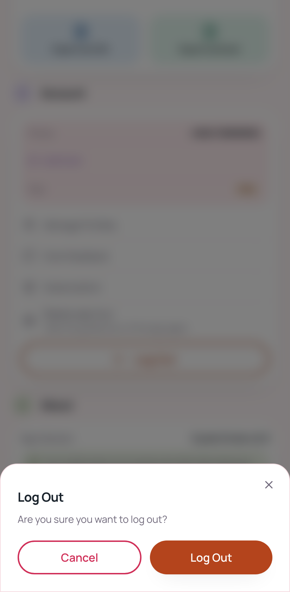

### How to use it

1. Tap **Log Out**. A pop-up asks "Are you sure you want to log out?".
2. Tap **Log Out** to confirm, or **Cancel**. The button changes to "Logging out…" and the login screen opens.

### Rules and limits

- The session is ended on the server (the login token is blocked) and the browser goes to the login screen. Other devices stay logged in.
- The chosen language and theme stay in the browser after logout.
- Logging out does not cancel Pro or delete data.
- The trial lock and the onboarding screen have their own **Log out** buttons that do the same.

### What can go wrong

| The User sees | Cause | Fix |
|---|---|---|
| Still logged in after tapping | Cancelled the pop-up | Confirm with **Log Out** |
| Back on Settings after pressing the back button | Browser cache | Reload; the session is gone |

### Related

- [Phone login](#gs-phone-login), [Email login](#gs-email-login)
