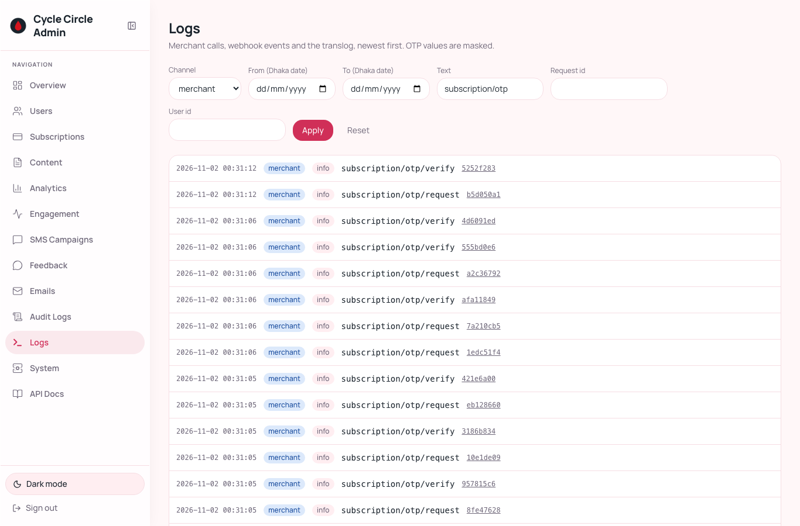
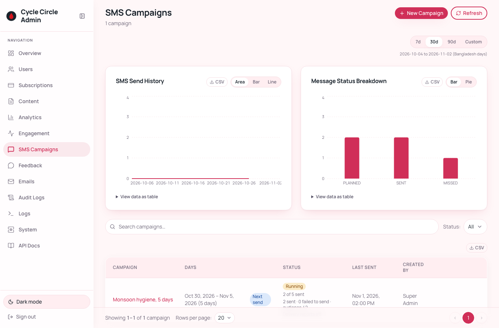
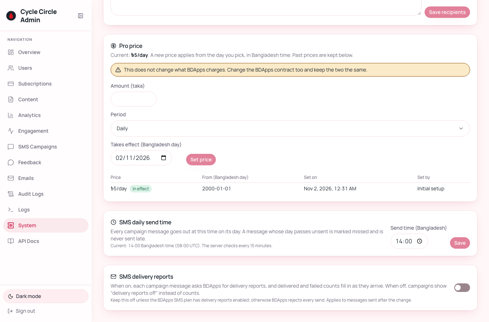

# SMS

## OTP messages {#as-otp}

### What it is

The text messages that carry a one-time code. There are two kinds, and which one a User gets depends on whether the number is already subscribed.

| Kind | Who sends it | When | Text |
|---|---|---|---|
| **BDApps OTP** | BDApps | A phone number that is **not yet subscribed** asks for a code | BDApps' own wording; Cycle Circle does not control it |
| **App OTP** | Cycle Circle, through BDApps' SMS service | The number is **already subscribed** (BDApps refuses its own code with E1351) and the User is known | English: "Cycle Circle code: 123456. Valid 5 min. Don't share it." Bengali for a User whose language is Bengali |

Verifying a BDApps OTP subscribes the number and makes the User Pro ([Subscribe](#bb-subscribe)). Verifying an App OTP only logs the User in and never changes the plan.

### Where to find it

There is no SMS inbox in the Admin app. The request and verify calls to BDApps are in **Admin > Logs** (channel "merchant", text "subscription/otp"). OTP values are masked there ("<MASKED>").

### How to use it

1. The User enters a number on the login screen and taps **Send OTP** ([Phone login](#gs-phone-login)).
2. The system asks BDApps for a code. If BDApps answers "already subscribed", it checks that the User has a stored BDApps subscriber id that BDApps still reports as subscribed, and sends an App OTP to that id.
3. If no App OTP can be sent, the User is offered email login when the account has an email, or told to unsubscribe the number on BDApps and log in again.
4. To investigate, filter **Logs** by channel "merchant" and the text "subscription/otp" or "sms/send".

### Rules and limits

- A code is valid for **5 minutes**, although the screen says 10 ([Phone login](#gs-phone-login)).
- Resend wait 60 seconds; 3 requests per minute per number; 10 per hour per device; 5 verify attempts in 5 minutes per code.
- An App OTP is locked after 5 wrong codes, and a number can get at most **5 App OTPs in 24 hours**; the sixth is refused with "Too many codes sent to this number today. Try again tomorrow." (the User sees "Too many attempts. Try again in a few minutes.").
- The App OTP is sent to the masked subscriber id BDApps gave at subscription. A raw phone number would be refused by BDApps for this app (E1951), so Users whose account only has a raw phone id cannot receive App OTPs.
- The code is saved before the SMS is sent; if the send fails, the saved code is deleted so it does not count toward the 24-hour limit.
- App OTP SMS are sent without delivery reports, so a lost code cannot be seen in the Admin app; the User uses **Resend OTP**.
- In development mode no SMS is sent; the code is written to the server console. This never applies in production.
- Email verification codes are emails, not SMS ([Verification-code email](#ec-verification-code)).

### What can go wrong

| The User sees | Cause | Fix |
|---|---|---|
| "Failed to send OTP. Please try again." | BDApps or the SMS send failed | Retry; check the merchant log |
| "This number is already subscribed, but we could not send it a code. Log in with your email instead." | No usable BDApps id, and the account has an email | Log in by email |
| "This number is already subscribed, but we could not send it a code. Unsubscribe this number from Cycle Circle on BDApps, then log in again. Your data stays safe." | Same, no email on the account | Unsubscribe on BDApps, log in again |
| "Too many attempts. Try again in a few minutes." | Rate limit or the 5-a-day App OTP cap | Wait; the daily cap resets 24 hours after the first code |
| "Invalid or expired code. Please try again." | Wrong, expired or used code | Resend |
| "Too many wrong codes. Request a new code." | 5 wrong App OTP codes | **Resend OTP** |

### Related

- [Phone login](#gs-phone-login), [Resend wait and OTP errors](#gs-otp-resend), [Logs viewer](#lg-viewer), [OTP masking](#lg-masking), [Troubleshooting: Login](#ts-login)

## Campaign messages {#as-campaign-sms}

### What it is

A **campaign** is a named series of SMS messages, one per Bangladesh day, sent to every subscriber. Each day's text is a **campaign message**. Subscribers cannot reply or opt out of an individual message; they leave by unsubscribing from the service ([Unsubscribe](#bb-unsubscribe)).

### Where to find it

**Admin > SMS Campaigns** lists campaigns with their days, status, last sent and totals.

### How to use it

What a subscriber receives: the message text exactly as the Admin wrote it, in Bengali, English or both. Cycle Circle adds no greeting or sender text of its own.

An Admin creates, imports, reschedules, sends and cancels campaigns ([Create a campaign](#sm-create)).

### Rules and limits

- One message per Bangladesh day across all campaigns; a clash is refused when planned.
- Limits: campaign name up to 80 characters, up to 120 messages per campaign, each message up to 6 SMS parts (70 characters per part for Bengali, 160 for plain English, 67 and 153 when a message needs more than one part). Admins see a warning above 2 parts: "every subscriber is charged for N SMS".
- A day cannot be planned in the past.
- Status of a message: Planned, Sending, Sent, "Failed to send", Missed, Cancelled.
- The audience number shown is an estimate (Pro subscriptions with a stored subscriber id).
- The send goes to all subscribers in one BDApps call ("tel:all"). There is no per-User targeting.

### What can go wrong

| The Admin sees | Cause | Fix |
|---|---|---|
| "Message is N SMS parts long; the limit is 6" | Text too long | Shorten it |
| "2026-11-04 already has a message in the campaign "..."" | Another campaign owns that day | Pick another day |
| "<day> is in the past" | Planned for a finished day | Choose today or later |

### Related

- Admin screens: [Campaign list](#sm-list), [Create a campaign](#sm-create), [Send a campaign](#sm-send)
- Automatic: [Campaign SMS dispatch](#sj-sms-dispatch), [Send time and missed days](#as-send-time)

## Send time and missed days {#as-send-time}

### What it is

All campaign messages go out at one daily time. If a message is not sent on its day, it is **Missed** and is never sent late.

### Where to find it

**Admin > System > SMS daily send time**.

### How to use it

1. Open **System** and scroll to "SMS daily send time". It shows "Current: 14:00 Bangladesh time (08:00 UTC). The server checks every 15 minutes."
2. Under "Send time (Bangladesh)" choose a time and tap **Save**. A toast says "SMS send time set to HH:MM Bangladesh time".

### Rules and limits

- Default **14:00 Bangladesh time**. Format 24-hour HH:MM; an invalid value is refused with "Send time must be HH:MM in 24-hour time (for example 14:00)".
- The server checks every 15 minutes (at :00, :15, :30 and :45 past each hour), so the send happens up to 15 minutes after the chosen time.
- A change applies from the next check. If the new time is already past today, today's message goes at the next check.
- If the "every 15 minutes" line is missing from the host crontab, the message goes out only in the 14:00 daily reminder run, whatever time is saved.
- A planned message whose day passes unsent is marked Missed at the next check after midnight; "Missed: not sent on its day." It stays Missed. An Admin can resend its text on a free day ([Resend failed messages](#sm-resend)).
- Missed days happen when the server was down, the "Daily reminders" switch was off, or the campaign was cancelled (cancelled campaigns are skipped).

### What can go wrong

| The Admin sees | Cause | Fix |
|---|---|---|
| "Send time must be HH:MM in 24-hour time (for example 14:00)" | Empty or invalid time | Enter a valid time |
| A message "Missed" | See rules | Resend on a free day |
| Message arrives later than the set time | 15-minute step | Normal |

### Related

- [SMS send time](#sy-sms-time), [Campaign SMS dispatch](#sj-sms-dispatch)

## Delivery reports {#as-delivery-reports}

### What it is

An optional feature: BDApps tells Cycle Circle which SMS arrived. When on, a sent message shows "Delivered N · Failed N". When off, it shows "Delivery reports off".

### Where to find it

**Admin > System > SMS delivery reports** (a switch).

### How to use it

1. Leave the switch **off** unless BDApps confirms delivery reports are enabled for the SMS plan.
2. To turn it on, flip the switch. It applies to messages sent after the change.

### Rules and limits

- **Off by default.** Current production SMS plan has reports disabled; when a send asks for them anyway BDApps rejects the entire send with error E1312, so the message becomes "Failed to send".
- BDApps posts one report per recipient to `/api/webhooks/sms/report`. Each report is matched to its message by the BDApps request id and counted once (a repeated report is ignored).
- "Delivered" counts DELIVERED. "Failed" counts FAILED, UNDELIVERABLE, EXPIRED, DELETED and REJECTED. ACCEPTED and UNKNOWN are not counted and are written to the webhook log as "sms.report.unclassified".
- Never shown as zeros when off: the screen says "Delivery reports off".
- The App OTP and reminder SMS never ask for delivery reports.

### What can go wrong

| The Admin sees | Cause | Fix |
|---|---|---|
| "Failed to send" right after turning reports on | BDApps rejects reports (E1312) | Turn the switch off and resend |
| Counts stay at 0 | Reports are slow, or the report webhook is not reaching the app | Check the webhook channel in [Logs](#lg-viewer); see [How events reach the app](#bb-webhooks) |

### Related

- [SMS delivery reports](#sy-delivery-reports), [Delivery status](#sm-delivery)
