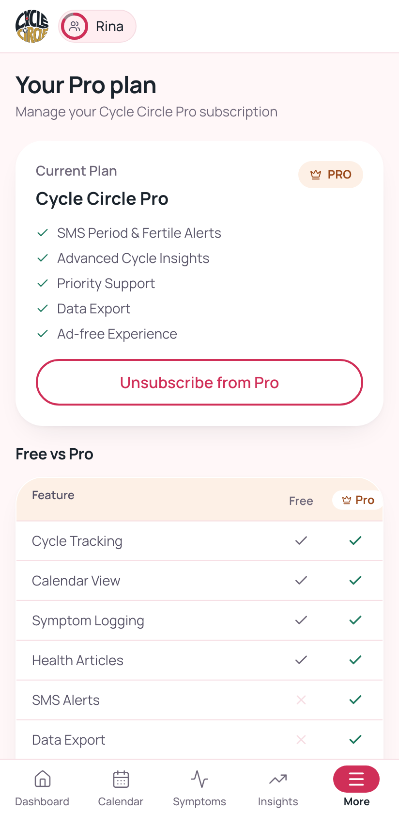
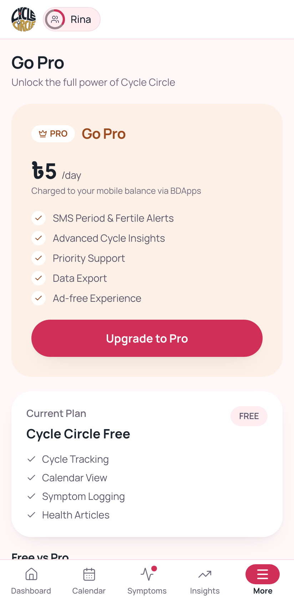
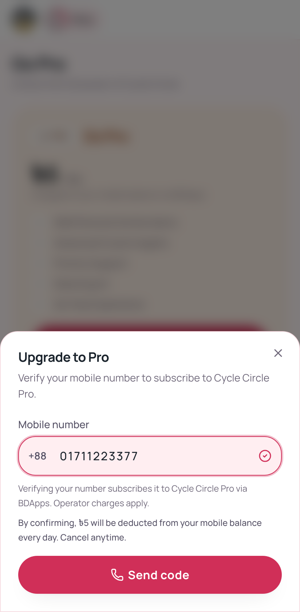
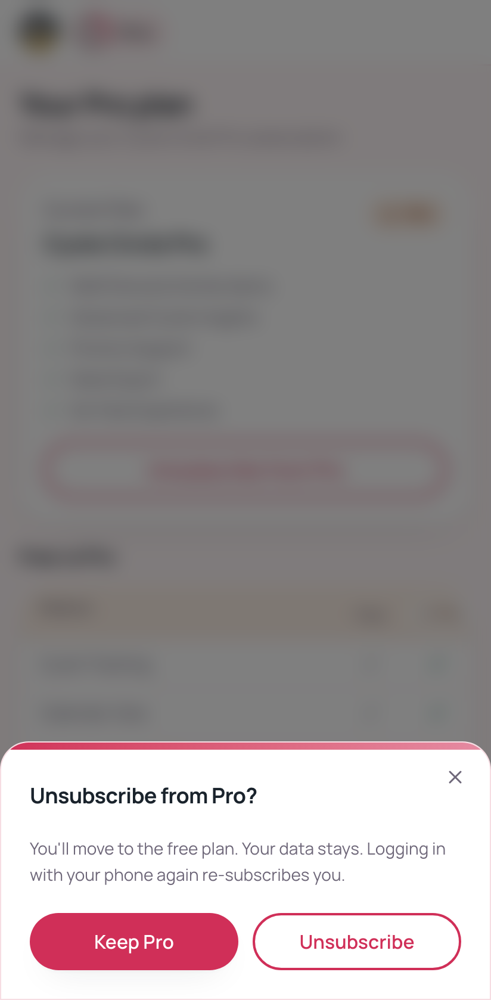
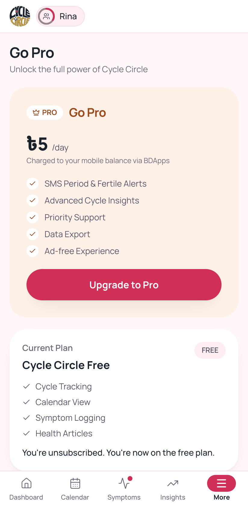

# Subscription

The page where a User sees their plan, the Pro price, upgrades by adding a phone number, or unsubscribes. For what each plan means see [Plans & access](#pa-at-a-glance).

## Subscription page and status {#sb-status}

### What it is

One page that shows the current plan, what it includes and a **Free vs Pro** table. A Pro User also gets the button **Unsubscribe from Pro**; a Free, Expired or trial User gets the Pro offer with **Upgrade to Pro**.

### Where to find it

**More > Subscription** (also reachable from **Settings > Subscription**, which carries an "Upgrade" tag for Users who are not Pro).

### How to use it

1. Open **Subscription**. The title is "Your Pro plan" for a Pro User and "Go Pro" for everyone else.
2. **Current Plan** shows "Cycle Circle Pro" or "Cycle Circle Free", with a badge (**PRO**, **FREE** or **Expired**) and the list of included features.
3. Below, **Free vs Pro** compares the two plans ([Pro-only features](#pa-pro-gating)).

### Rules and limits

- The page follows the plan stored on the User. After a change (an Admin action, BDApps, an upgrade in another tab) it can lag by up to 5 minutes (the trial note and countdown can lag the same way); an upgrade or unsubscribe done on this page updates it at once.
- Notes under the plan name: "Trial · {hours}h remaining" (email trial), "Your free trial has ended — upgrade to continue." (trial ended), "Your subscription has expired. Renew to keep Pro." (Lapsed).
- The page is the only signed-in page that opens while the trial lock is active.
- The footer "Cancel anytime. No hidden fees." shows to Users who are not Pro.

### What can go wrong

| The User sees | Cause | Fix |
|---|---|---|
| "Go Pro" and Free although they just subscribed | The 5-minute cache, or the BDApps OTP was not verified | Wait or log out and in; check [User detail](#us-detail) |
| "Cycle Circle Pro" with **Expired** | Admin revoked ([Lapsed](#pa-lapsed)) | See Lapsed |
| No **Unsubscribe from Pro** button on a Pro User | The account has no phone number (for example an email User an Admin made Pro) | Nothing to unsubscribe on BDApps; an Admin changes the plan |

### Related

- [Pro](#pa-pro), [The plans at a glance](#pa-at-a-glance), [Plan badge](#st-plan-badge)
- Admin: [Subscriptions list](#su-list)

## Pro price {#sb-price}

### What it is

The amount the Pro offer shows, for example "5 /day" with the taka sign (৳) before the amount. It is set by an **Admin**, not read from BDApps (ADR 0011). It is what the Subscription page, the upgrade dialog and the Terms show, in English and Bengali.

### Where to find it

On the Pro offer card of the Subscription page, under "Go Pro", with the line "Charged to your mobile balance via BDApps". Admins set it under **System > Pro price** ([Pro price](#sy-pro-price)).

### How to use it

1. Read the price from the offer card: amount, then "/day", "/week" or "/month".
2. To change it, an Admin enters **Amount (taka)**, **Period** (Daily, Weekly or Monthly) and **Takes effect (Bangladesh day)**, then **Set price**.

### Rules and limits

- The price is an amount (more than 0, up to 100,000 taka, at most two decimals) and a period: daily, weekly or monthly.
- A new price starts on the Bangladesh day the Admin picks (today or later, never in the past). Every change is kept in a history with the day it took effect, and each change writes an audit row.
- Changing it **does not change what BDApps charges**. The Admin screen warns: "This does not change what BDApps charges. Change the BDApps contract too and keep the two the same." Keeping them equal is the Admin's job. The first entry, set at launch, is 5 taka per day.
- The web app caches the price for up to 5 minutes. After a change a User can see the old price for that long. If the app could not refresh, the Admin sees "Saved, but the web app cache did not refresh. Customers may see the old price for a few minutes."
- If no price is set, the Pro offer shows no amount and the upgrade dialog shows no deduction line. Only the "Charged to your mobile balance via BDApps" line remains.
- The Terms page can say something different. Check the Terms before quoting it ([Terms](#gs-terms)).

### What can go wrong

| The User sees | Cause | Fix |
|---|---|---|
| A different price from what they are charged | The Admin changed the Pro price but not the BDApps contract | Make the two equal on BDApps; the screen is not the source of the charge |
| The old price after an Admin change | The 5-minute cache | Wait a few minutes |
| No price on the offer | No price entry is in effect | An Admin sets one |

### Related

- Admin: [Pro price](#sy-pro-price)
- [Upgrade by adding a phone](#sb-upgrade)

## Upgrade by adding a phone {#sb-upgrade}

### What it is

How a Free, Expired or trial User becomes Pro: tap **Upgrade to Pro**, verify a phone number with a BDApps OTP, and the number is subscribed. There is no card or separate payment step.

### Where to find it

**More > Subscription > Upgrade to Pro** (the trial lock's **Upgrade to Pro** leads here too). The dialog is titled "Upgrade to Pro".

### How to use it

1. Tap **Upgrade to Pro**. The dialog says "Verify your mobile number to subscribe to Cycle Circle Pro."
2. The **Mobile number** field is filled with the account's phone if there is one; otherwise type it (01XXXXXXXXX).
3. Read the notice: "By confirming, [taka sign]5 will be deducted from your mobile balance every day. Cancel anytime." The amount and period come from the [Pro price](#sb-price).
4. Tap **Send code**, then enter the 6-digit code. The dialog says "Your number is verified — you're now on Pro!" and closes; the page now shows "Your Pro plan".

### Rules and limits

- Verifying the BDApps OTP subscribes the number (ADR 0002). Operator charges apply and BDApps does the billing.
- The code is valid 5 minutes (the app says 10 elsewhere on the login screens), resend after 60 seconds, 3 requests per minute per number, 5 verify attempts in 5 minutes per code.
- The number must not belong to another account, and a number that is already subscribed on BDApps is refused, because BDApps will not send a second OTP; the app never uses an App OTP here.
- A phone added by an email User clears the trial. An Expired User with an Admin override gets Pro again once BDApps reports a new subscription ([Admin overrides and billing](#pa-admin-overrides)).
- Trial-ended Users can use this dialog while the lock is up; it is one of the few things the lock allows.

### What can go wrong

| The User sees | Cause | Fix |
|---|---|---|
| "Enter a valid Bangladeshi mobile number." | Wrong format | Correct the number |
| "This number is already registered to another account." | Another User owns the number | Use another number |
| "This number is already subscribed. Unsubscribe it from Cycle Circle on BDApps first, then add it here." | The number is already a BDApps Subscriber, for example a Free User whose plan fell out of sync with BDApps | The User unsubscribes on BDApps and retries, or an Admin sets Pro |
| "We can't send a code to this number's mobile operator yet. Please try another number." | Unsupported operator | Use another number |
| "Please wait a moment before requesting another code." | Resend within 60 seconds | Wait |
| "Too many attempts. Try again in a few minutes." | Rate limit | Wait |
| "Invalid or expired code. Please try again." | Wrong, expired or reused code | Request a new code |
| "Something went wrong. Please try again." | Any other failure, including too many wrong codes | Request a new code |

### Related

- [Adding a phone to keep an account](#pa-keep-account), [Phone login](#gs-phone-login), [Add or verify a phone](#st-phone), [Pro price](#sb-price)
- [Subscribe](#bb-subscribe)

## Unsubscribe {#sb-unsubscribe}

### What it is

A Pro User ends their own BDApps subscription from the app. The plan becomes Free and all data is kept.

### Where to find it

**More > Subscription > Unsubscribe from Pro**. The button shows only for a Pro User whose account has a phone number.

### How to use it

1. Tap **Unsubscribe from Pro**.
2. The dialog "Unsubscribe from Pro?" says "You'll move to the free plan. Your data stays. Logging in with your phone again re-subscribes you."
3. Tap **Unsubscribe** to confirm, or **Keep Pro** to cancel.
4. The page says "You're unsubscribed. You're now on the free plan." and shows the Free plan with the upgrade offer.

### Rules and limits

- The app asks BDApps to unsubscribe the number (using the stored BDApps subscriber id), then marks the User Free.
- Not available when an Admin granted Pro ([Admin overrides and billing](#pa-admin-overrides)) or the account has no phone.
- Logging in with the phone again, or **Upgrade to Pro**, subscribes the number again.
- Unsubscribing in the app is the same as BDApps ending the subscription: SMS alerts stop and nothing else changes.
- Unsubscribing takes effect at once: the User moves to Free immediately, even though the Terms say access continues until the end of the current billing period.
- The Terms page may say a User cancels "from Settings". The cancel button is on the Subscription page, not in Settings.

### What can go wrong

| The User sees | Cause | Fix |
|---|---|---|
| "Your Pro access was granted by our team, so it can't be cancelled here. Contact support." | Admin-granted Pro | An Admin sets Free ([Set subscription status](#us-set-status)) |
| "No phone number is linked to this account. Add one to manage your subscription." | The account has no phone | Add a phone ([Add or verify a phone](#st-phone)) |
| "Couldn't unsubscribe. Try again in a minute." | BDApps did not answer or refused | Try again; if it keeps failing, check the merchant log ([Logs](#lg-channels)) and unsubscribe the number on BDApps |

### Related

- [Pro](#pa-pro), [Unsubscribe event](#bb-unsubscribe), [Daily subscription check](#sj-sub-check)
