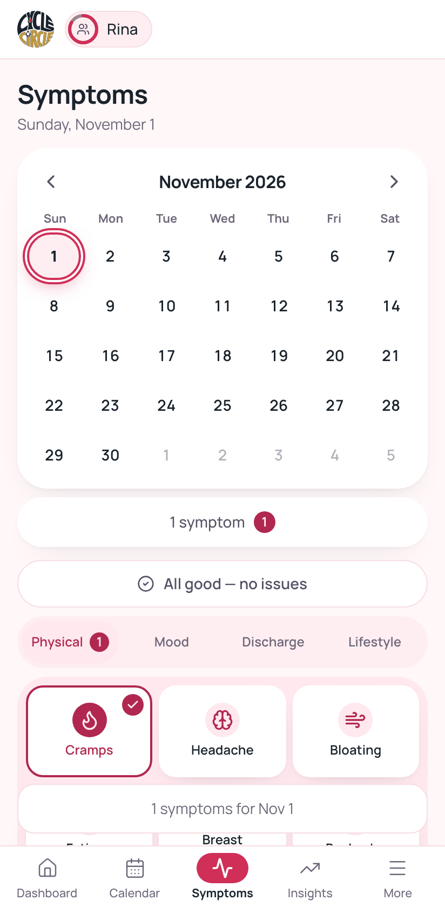
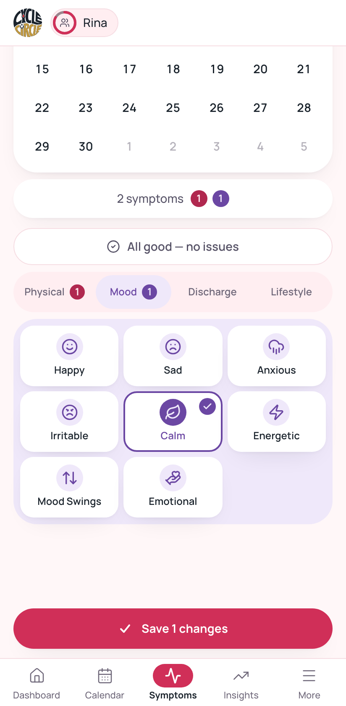
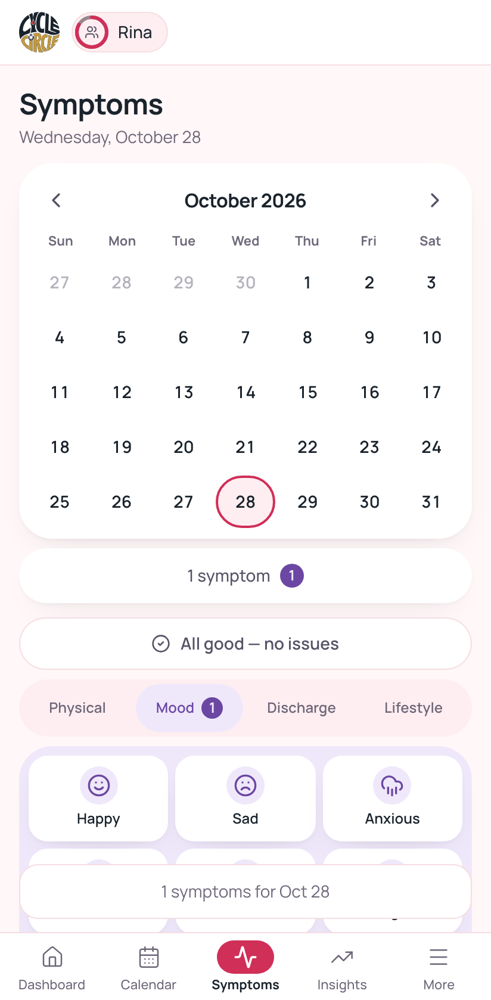
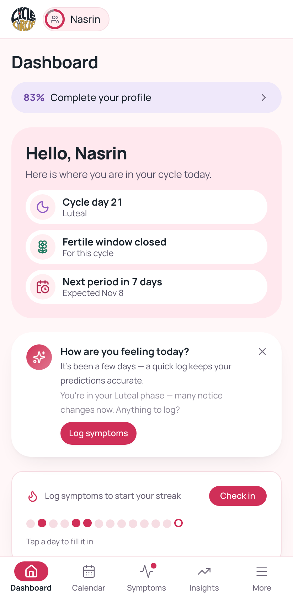
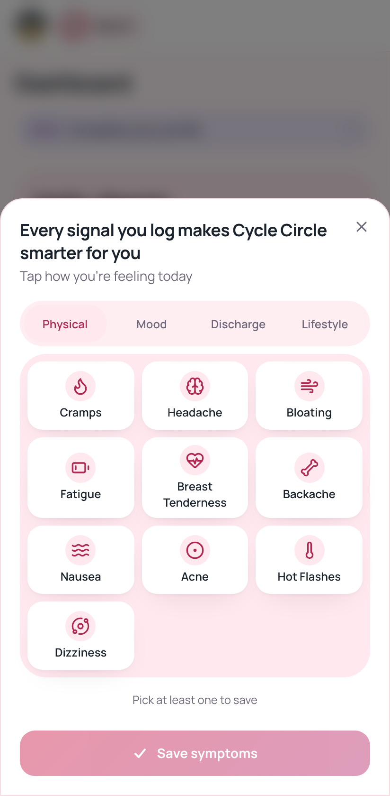
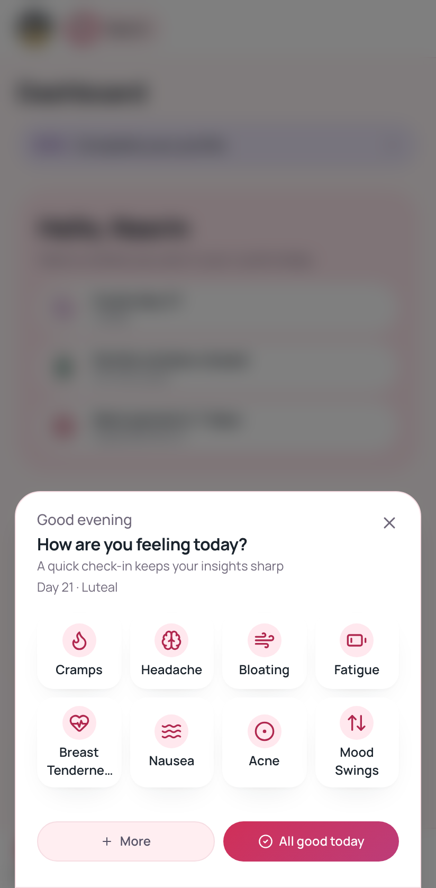
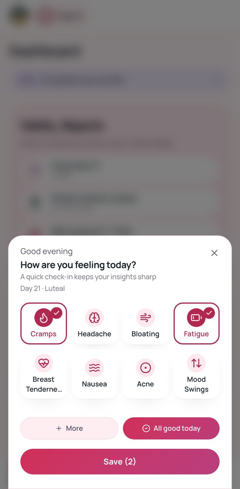
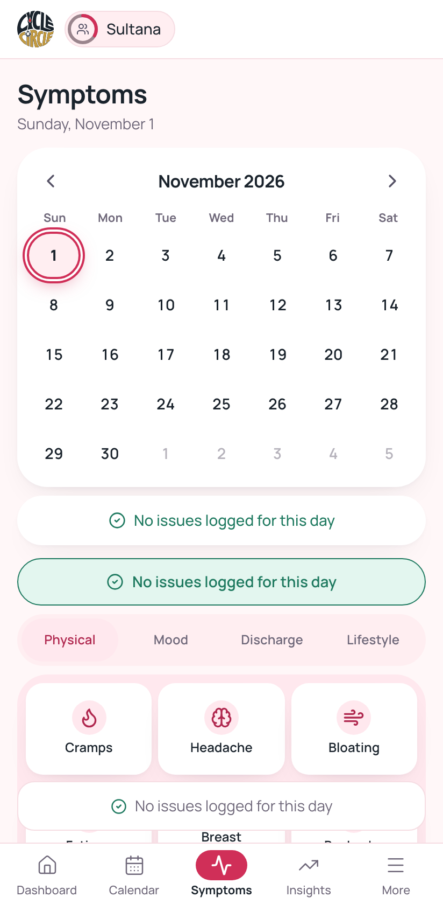
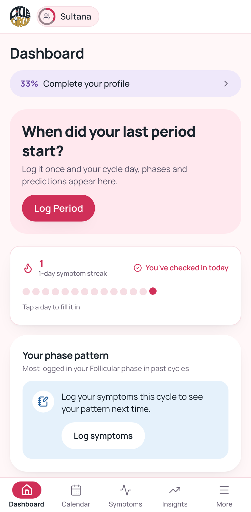
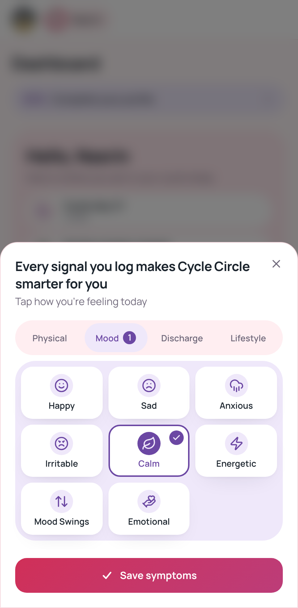

# Symptoms & Check-in

How a User records how they feel: the full **Symptoms** screen, the one-tap daily **Check-in**, the "all good" shortcut, and the **Quick symptom** pop-up that appears from several places. A symptom log is tied to one profile and one day. It feeds the streak, the Insights charts and the Phase pattern ([Insights](#in-overview), [Phase pattern](#db-phase-pattern)).

Four things to know before reading the sections:

- **There are 32 symptoms**, fixed, in four categories: Physical (10), Mood (8), Discharge (6) and Lifestyle (8). A User cannot add their own.
- **A day is a Bangladesh day** (UTC+6). "Today" is the Bangladesh day, whatever the phone's clock says ([Bangladesh days and date rules](#lc-date-rules)).
- **A day counts as logged** when it has at least one symptom (or the "all good" entry) **or** falls inside a logged period. This one definition drives the streak, the "Not logged" dots, the Check-in button and the red dot on the **Symptoms** tab.
- **Logging symptoms is free.** Free, email-trial and Pro Users all have it. The only block is the trial lock ([Trial lock prompt](#ap-trial-lock)).

## Logging symptoms {#sc-symptoms}

### What it is

The **Symptoms** screen. The User picks a day, taps the symptoms they had, and saves. Each tap switches a symptom on or off for that day.

### Where to find it

Tap **Symptoms** in the bottom bar (on a computer: **Symptoms** in the left menu). When the active profile has logged nothing today, the **Symptoms** tab shows a small dot and is read out as "Nothing logged today".

The screen shows the page title "Symptoms", the chosen day under it (for example "Sunday, November 1"), a month calendar, a summary line, the **All good — no issues** button, four category tabs (**Physical**, **Mood**, **Discharge**, **Lifestyle**) and a grid of symptoms for the open tab. A number on a tab counts the symptoms picked in it.

After a tap, a **Save N changes** bar appears at the bottom:

### How to use it

1. Open **Symptoms**. Today is selected.
2. Tap a category tab, then tap each symptom that applies. A ticked symptom is highlighted. Tap it again to untick it.
3. Tap **Save N changes** at the bottom. N is the number of symptoms added plus the number removed since the screen opened.
4. When something was added, a toast says "Nicely done!" and "N symptom saved — every log helps Cycle Circle understand you." (plural for more than one). Nothing is shown when the save only removed symptoms.
5. To clear a day, untick everything and save.

### Rules and limits

- Nothing is stored until **Save N changes** is tapped. Leaving the screen with unsaved ticks drops them.
- There is no limit on how many symptoms one day can have. A symptom can be on a day only once; saving it again does nothing new.
- A symptom has no severity or note. The User only says "had it" or "did not".
- A **real symptom and "all good" cannot both be on one day**. Ticking a symptom switches "all good" off; see [All good today](#sc-all-good).
- Logs belong to the **active profile**, which is not named on this screen. The profile chip at the top shows which one it is; switch it first if the User keeps several profiles ([Switch the active profile](#pf-switch)).
- The day is a Bangladesh day. A symptom saved just after midnight in Bangladesh belongs to the new day.
- Saving refreshes the Dashboard and Insights figures for that profile.
- The summary line under the calendar reads "1 symptom" or "N symptoms" at the top of the screen, but the grey line at the bottom of the screen always says "N symptoms for Nov 1", even when N is 1 ("1 symptoms for Nov 1"). This wording is a cosmetic flaw; the data is right.

### What can go wrong

| The User sees | Cause | Fix |
|---|---|---|
| "Couldn’t save your symptoms. Please try again." | The save did not reach the server (no signal, or the session ended). The ticks stay on screen. | Check the connection and tap **Save N changes** again. If it keeps failing, log out and back in. |
| No **Save** bar | Nothing differs from what is already saved for that day. | Tick or untick a symptom first. |
| A symptom they ticked is gone after a reload | It was never saved (no **Save** tap), or a later "all good" on the same day removed it. | Tick it again and save. |
| Symptoms show on the wrong person | The active profile is not the one they meant. | Switch profile, then reopen **Symptoms**. |
| The **Symptoms** tab keeps its dot | Nothing is logged today for the active profile (the dot ignores other profiles). | Log a symptom, or use [All good today](#sc-all-good). |
| Everything looks empty but the User has logged before | Another day is selected in the calendar (the date is in the web address). | Tap today in the calendar. |

### Related

- [Back-dated symptoms](#sc-backdate), [All good today](#sc-all-good), [Symptom statistics](#in-symptom-stats)
- [Streak](#db-streak), [Switch the active profile](#pf-switch)

## Back-dated symptoms {#sc-backdate}

### What it is

Logging symptoms for a past day the User forgot. There are two ways: pick the day on the **Symptoms** calendar, or tap a missed dot in the check-in history on the Dashboard.

### Where to find it

**Symptoms** > tap any day in the month calendar. The heading under "Symptoms" changes to that day (for example "Wednesday, October 28") and the symptoms already saved for that day are ticked.

On the Dashboard, the check-in strip has a row of dots, one per day for the last 14 days, with the line "Tap a day to fill it in". A dot for a missed day is tappable:

Tapping one opens the Quick symptom pop-up for that day:

### How to use it

1. **From the calendar.** Open **Symptoms**, tap the day, tick the symptoms, tap **Save N changes**. To correct a day, untick and save. To switch to another month, use the arrows beside the month name.
2. **From the history dots.** On the Dashboard tap a dot whose label reads "<date>: Not logged". Tick symptoms in the pop-up and tap **Save symptoms**.

### Rules and limits

- **No limit on how far back** a User can go. The month calendar can be paged to any month.
- **Future days are not blocked.** The calendar does not grey them out, and a future date can be opened and saved. A symptom saved for a future day is counted in Symptom Frequency at once but does not count toward the streak until that day arrives. Tell the User to log only past and present days.
- The history dots cover the **last 14 days**. A dot is tappable only for a day that is **not logged, not today and not in the future**. A logged day (including a period day) is not tappable; correct it from the **Symptoms** calendar instead.
- The pop-up from a dot **always starts empty** and can only add. It cannot show or remove what is already saved. The pop-up still says "Tap how you're feeling today" although it saves to the tapped day.
- A back-dated log counts for the streak as soon as it is saved: a gap filled in yesterday can lengthen a streak.
- Back-dating does not change cycle predictions; only period logs do ([How predictions work](#pr-how)).

### What can go wrong

| The User sees | Cause | Fix |
|---|---|---|
| The pop-up says "Tap how you're feeling today" for an old day | The pop-up text is fixed. It saves to the day that was tapped. | Ignore the wording; check the day in the Symptoms calendar afterwards. |
| A dot does not respond | The day is logged already, is today, or is in the future. | Open that day from the **Symptoms** calendar. |
| "Couldn’t save your symptoms. Please try again." | The save did not reach the server. | Tap **Save symptoms** again. |
| Old symptoms are not shown in the pop-up | The pop-up never loads saved symptoms. | Use the **Symptoms** calendar to see or remove them. |
| A day marked "Not logged" on a period they logged | Only days **inside** the period dates count, and the period may end earlier than they remember. | Check the period in the Calendar ([Edit or delete a period](#lc-edit-delete)). |

### Related

- [Logging symptoms](#sc-symptoms), [Quick symptom pop-up](#sc-quick-symptom), [Daily check-in](#sc-checkin)
- [Bangladesh days and date rules](#lc-date-rules), [Backfill a past period](#lc-backfill)

## Daily check-in {#sc-checkin}

### What it is

A small pop-up that lets a User say how they feel today in one or two taps. It is the lightest form of logging. It can be opened by the User, or the app can open it by itself once a day ([Check-in prompt](#ap-checkin)).

### Where to find it

On the **Dashboard**, the check-in strip (streak count and history dots) has a **Check in** button. The pop-up shows a greeting, the title "How are you feeling today?", the line "A quick check-in keeps your insights sharp", the cycle day and phase (for example "Day 21 · Luteal"), eight quick symptoms, a **More** button and an **All good today** button.

### How to use it

1. On the Dashboard tap **Check in**.
2. Tap any of the quick symptoms: Cramps, Headache, Bloating, Fatigue, Breast Tenderness, Nausea, Acne, Mood Swings. A **Save (N)** button appears.

   

3. Tap **Save (N)** to save them for today, **All good today** to log a good day ([All good today](#sc-all-good)), or **More** to choose from the full list ([Quick symptom pop-up](#sc-quick-symptom)).
4. A toast shows "N-day streak!" with "You're building a great habit". On the 3rd, 7th, 14th, 30th, 60th and 100th day it shows "Milestone reached!" with "N days of consistent logging".
5. The **Check in** button is replaced by "You've checked in today".

### Rules and limits

- The greeting ("Good morning" before 12:00, "Good afternoon" before 17:00, otherwise "Good evening") follows the **phone's own clock**, not Bangladesh time. A User travelling abroad may see a different greeting than a User in Dhaka; nothing else changes.
- The **Check in** button and the automatic pop-up exist only while **today is not logged**. Once anything is logged (a symptom, "all good", or a period day covering today) the strip shows "You've checked in today" and the button is gone.
- A User whose period covers today therefore never gets a check-in, even with no symptoms.
- The pop-up saves for **today** only, and only adds symptoms. It does not show symptoms already saved today (there should be none, since the button is gone once today is logged).
- The streak is the number of days in a row, ending today, that have a log. If yesterday has a log and today does not, the streak is still alive and the strip says "Your streak is at risk — a quick check-in keeps it alive". With no recent log it says "Log symptoms to start your streak". The streak is counted inside the last 30 days only, so it never shows more than 30. The 60-day and 100-day milestone toasts can therefore never appear (the page says nothing about this; the system behaves as described).
- The close (X) button dismisses it without saving. Nothing is saved until **Save (N)** or **All good today**.

### What can go wrong

| The User sees | Cause | Fix |
|---|---|---|
| "Couldn’t save your symptoms. Please try again." | The save failed; the ticks remain. | Tap **Save (N)** or **All good today** again. |
| No **Check in** button, but "You've checked in today" | Something is already logged today, or today is inside a logged period. | Nothing to fix. To change today, use the **Symptoms** screen. |
| The pop-up never opens by itself | Auto-prompts are limited to one per page load and once a Bangladesh day per browser ([One prompt per page load](#ap-rule)). | Tap **Check in** by hand. |
| The check-in strip is missing | The Dashboard data did not load. | Reload the page. |
| Greeting does not match Dhaka time | It uses the phone's clock and time zone. | None needed. |

### Related

- [Check-in prompt](#ap-checkin), [All good today](#sc-all-good), [Quick symptom pop-up](#sc-quick-symptom)
- [Check-in strip](#db-checkin-strip), [Streak](#db-streak)

## All good today {#sc-all-good}

### What it is

A one-tap way to say "nothing to report today". It stores a special "all good" entry for the day instead of symptoms, so the day still counts as logged and the streak continues.

### Where to find it

Two places: the **All good today** button in the Check-in pop-up, and the **All good — no issues** button on the **Symptoms** screen (above the category tabs). Once set, the Symptoms button changes to **No issues logged for this day** and a matching line appears in the summary card.

On the Dashboard the strip then reads "You've checked in today":

### How to use it

1. Check-in pop-up: tap **All good today**. It saves at once.
2. Or on **Symptoms**: choose the day, tap **All good — no issues**. It also saves at once; there is no **Save** step.
3. To undo it, tap **No issues logged for this day** (the same button). The day goes back to empty.

### Rules and limits

- **It replaces real symptoms.** Tapping "all good" deletes every symptom already saved for that day, straight away and without a confirmation. Ticks not yet saved on the screen are dropped too.
- **It is switched off by a real symptom.** Ticking any symptom and saving removes the "all good" entry for that day.
- The "all good" entry counts as a log for the streak, the history dots, the Check-in button and the logging nudge.
- It is **not counted as a symptom** in Insights: it is left out of Symptom Frequency and out of the Phase pattern ([Symptom statistics](#in-symptom-stats)).
- It can be set for any day on the Symptoms screen. From the Check-in pop-up it is always for today.
- If the save fails, "Couldn’t save your symptoms. Please try again." appears and the state is unchanged.

### What can go wrong

| The User sees | Cause | Fix |
|---|---|---|
| Their symptoms for the day vanished | They tapped **All good**, which clears the day's other symptoms. | Re-tick the symptoms and save; this also switches "all good" off. |
| "Couldn’t save your symptoms. Please try again." | The save failed. | Tap the button again. |
| Streak did not grow after "all good" | The day was not today, or the strip has not refreshed. | Reload the Dashboard. |
| Symptom Frequency shows nothing though they log daily | The days are all "all good", which Insights does not count. | Expected. Only real symptoms are charted. |

### Related

- [Daily check-in](#sc-checkin), [Logging symptoms](#sc-symptoms), [Symptom statistics](#in-symptom-stats)
- [Streak](#db-streak)

## Quick symptom pop-up {#sc-quick-symptom}

### What it is

A bottom-sheet with the full symptom list, so a User can log without leaving the screen they are on. It is the same list as the Symptoms screen, in a pop-up.

### Where to find it

Three entry points:

- **Dashboard > Log Symptoms** (a button in the Dashboard toolkit, and in the logging nudge as **Log symptoms**).
- **Check in** pop-up > **More**.
- A missed dot in the check-in history ([Back-dated symptoms](#sc-backdate)).

The pop-up header reads "Every signal you log makes Cycle Circle smarter for you" with the line "Tap how you're feeling today". It has the four category tabs, a grid of symptoms, and a **Save symptoms** button.

### How to use it

1. Open the pop-up from one of the entry points.
2. Switch tabs and tap symptoms. A number on a tab counts the picks in it.
3. Tap **Save symptoms**. A toast "Nicely done!" appears and the pop-up closes.
4. Close the pop-up without saving with the X button. Tapping outside it does **not** close it.

### Rules and limits

- **Save symptoms** is disabled, and the line "Pick at least one to save" shows, until at least one symptom is ticked.
- It always starts empty and only adds. It does not show what is already saved for the day and cannot remove a symptom. Use **Symptoms** for that ([Logging symptoms](#sc-symptoms)).
- It saves for **today**, except when opened from a history dot, when it saves for that dot's day.
- Saving a symptom on a day that has an "all good" entry removes the "all good" ([All good today](#sc-all-good)).
- It cannot open while the trial lock is showing ([Trial lock prompt](#ap-trial-lock)).

### What can go wrong

| The User sees | Cause | Fix |
|---|---|---|
| "Pick at least one to save" and a greyed button | Nothing ticked yet. | Tick a symptom. |
| "Couldn’t save your symptoms. Please try again." | The save failed; ticks are kept. | Tap **Save symptoms** again. |
| The pop-up will not close when they tap outside | By design, so ticks are not lost by accident. | Use the X button. |
| A symptom they logged earlier is not ticked | The pop-up never loads saved symptoms. | Open **Symptoms** to see and edit the day. |

### Related

- [Daily check-in](#sc-checkin), [Back-dated symptoms](#sc-backdate), [Logging symptoms](#sc-symptoms)
