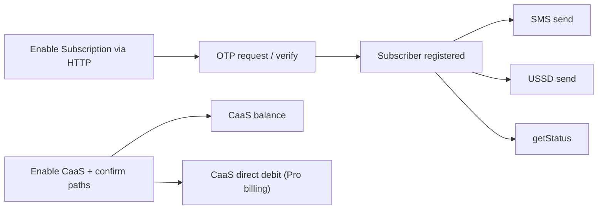

# BDApps API Integration Test Report — CycleCircle (Vesta)

| | |
|---|---|
| Date | 2026-10-02, 15:00–15:05 (UTC+6) |
| Application | CycleCircle — `APP_140389` |
| API base | `https://developer.bdapps.com` |
| Production server IP | `62.171.155.231` (IPv6 `2a02:c207:2361:2692::1`) |
| Test subscriber | `tel:8801805718862` (Robi) |
| Scope | Non-charging endpoints only (no CaaS direct debit executed) |

## 1. Summary

Credentials are valid and the production server IP is accepted by BDApps. Basic account access works (`query-base` returns `S1000`).

End-to-end flows are **blocked** by two configuration items on the BDApps side:

1. **Subscription via HTTP is disabled** for the application (`E1324`). This prevents OTP-based subscription, so no user can subscribe, and every subscriber-bound API (SMS, USSD, status) returns `E1951`.
2. **CaaS endpoints are not reachable** — both `/caas/get/balance` and `/caas/balance/query` return HTTP 404 for this application.

## 2. Results (from production server 62.171.155.231)

| # | Endpoint | Response | Result |
|---|---|---|---|
| 1 | `POST /subscription/query-base` | `S1000` — baseSize `0` | Working |
| 2 | `POST /subscription/otp/request` | `E1324` — "Subscription via HTTP is not allowed." | **Blocked (app config)** |
| 3 | `POST /subscription/otp/verify` | `E1854` — "Could not find OTP" | Reachable (no OTP issued due to #2) |
| 4 | `POST /subscription/getStatus` | `E1951` — "Format of the address is invalid Or User Already UnRegistered" | Reachable (subscriber not registered) |
| 5 | `POST /sms/send` | `E1951` — same as above | Reachable (subscriber not registered) |
| 6 | `POST /ussd/send` | `E1951` — same as above | Reachable (subscriber not registered) |
| 7 | `POST /caas/get/balance` | HTTP 404 Not Found | **Not available** |
| 8 | `POST /caas/balance/query` | HTTP 404 Not Found | **Not available** |

Requests from a developer workstation (non-whitelisted IP) returned `E1303` — "IP address … is not listed within the allowed-host-address list", which is expected.

## 3. Dependency chain

## 4. Requested actions from BDApps

| # | Request | Unblocks |
|---|---|---|
| A1 | Enable **Subscription via HTTP (OTP subscription)** for `APP_140389`. | OTP login, subscriber registration, SMS, USSD, getStatus |
| A2 | Enable **CaaS** for `APP_140389` and confirm the exact endpoint paths for balance query and direct debit. | Pro billing |
| A3 | Confirm `62.171.155.231` (and IPv6 `2a02:c207:2361:2692::1` if applicable) is the registered allowed host. | Already working for IPv4; confirmation only |
| A4 | Confirm the app's charging configuration (amount, frequency) for subscription. | Billing correctness |

## 5. Actions on our side

| # | Action | Status |
|---|---|---|
| B1 | Correct OTP endpoint paths in our integration to `/subscription/otp/request` and `/subscription/otp/verify`. | Pending |
| B2 | Update CaaS endpoint paths once BDApps confirms them (A2). | Waiting on A2 |
| B3 | Re-run the full test suite after A1/A2: OTP request → verify with real code → getStatus `REGISTERED` → SMS delivered → CaaS balance. | Waiting on A1/A2 |
| B4 | Rotate the application password after go-live verification. | Pending |

## 6. Acceptance criteria for re-test

- `/subscription/otp/request` returns `S1000` with a `referenceNo`, and an OTP SMS arrives on the test number.
- `/subscription/otp/verify` returns `S1000` and `subscriptionStatus: REGISTERED`.
- `/subscription/getStatus` returns `REGISTERED` for the test number.
- `/sms/send` returns `S1000` and the SMS is delivered.
- CaaS balance returns `S1000` with `chargeableBalance`.
