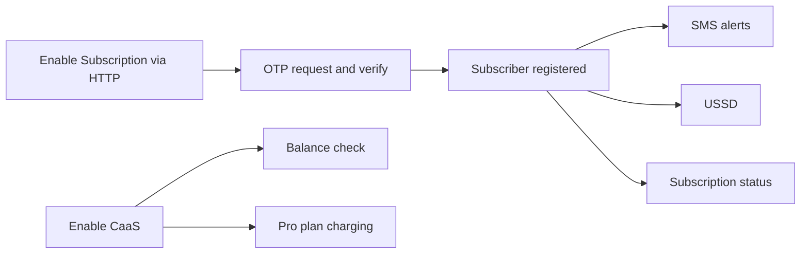

# BDApps API Test Report: CycleCircle

| | |
|---|---|
| Test date | 4 October 2026, 04:18 (UTC+6) |
| Previous test | 2 October 2026 (same results) |
| Application ID | `APP_140389` |
| API base URL | `https://developer.bdapps.com` |
| Calling server | `62.171.155.231` (CycleCircle production) |
| Test number | `tel:8801805718862` (Robi) |
| Scope | All non-charging endpoints. No direct debit was attempted. |

## Summary

Our application credentials work and our production server IP is accepted. Two settings on the BDApps side are still blocking every user flow:

1. **Subscription via HTTP is disabled** for `APP_140389` (error `E1324`). Users can't subscribe through OTP, so no subscriber exists. Because of that, SMS, USSD and status checks all fail with `E1951`.
2. **CaaS endpoints return HTTP 404** for our application. We can't check balance or charge for the Pro plan.

Nothing has changed since our 2 October test.

## Results

| # | Endpoint | Response | Status |
|---|---|---|---|
| 1 | `/subscription/query-base` | `S1000` Success, base size 0 | Working |
| 2 | `/subscription/otp/request` | `E1324` Subscription via HTTP is not allowed | **Blocked** |
| 3 | `/subscription/otp/verify` | `E1854` Could not find OTP | Reachable, no OTP issued because of #2 |
| 4 | `/subscription/getStatus` | `E1951` User Already UnRegistered | Reachable, no subscriber because of #2 |
| 5 | `/sms/send` | `E1951` User Already UnRegistered | Reachable, no subscriber because of #2 |
| 6 | `/ussd/send` | `E1951` User Already UnRegistered | Reachable, no subscriber because of #2 |
| 7 | `/caas/get/balance` | HTTP 404 Not Found | **Not available** |
| 8 | `/caas/balance/query` | HTTP 404 Not Found | **Not available** |

As a control, the same call from a non-whitelisted IP returned `E1303` (IP not in the allowed-host list), which is expected. It confirms the IP whitelist is active and our server is on it.

## What's blocked

## What we need from BDApps

| # | Request | Unblocks |
|---|---|---|
| 1 | Enable **Subscription via HTTP (OTP subscription)** for `APP_140389`. | User sign-up, SMS, USSD, status check |
| 2 | Enable **CaaS** for `APP_140389` and confirm the correct endpoint paths for balance query and direct debit. | Pro plan billing |
| 3 | Confirm the charging setup for the app (amount and frequency). | Correct billing |

Once 1 and 2 are done, please let us know and we'll re-run the full flow the same day: OTP request, OTP verify with a real code, status check, SMS delivery and CaaS balance.

## Pass criteria for the next test

- OTP request returns `S1000` with a reference number, and the OTP SMS arrives on the test phone.
- OTP verify returns `S1000` with status `REGISTERED`.
- Status check returns `REGISTERED` for the test number.
- SMS send returns `S1000` and the message is delivered.
- CaaS balance returns `S1000` with the chargeable balance.
