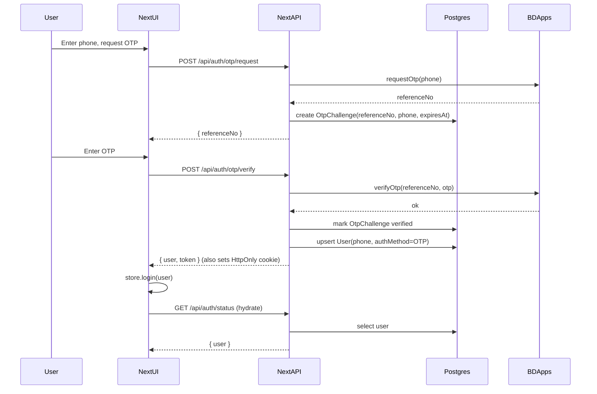
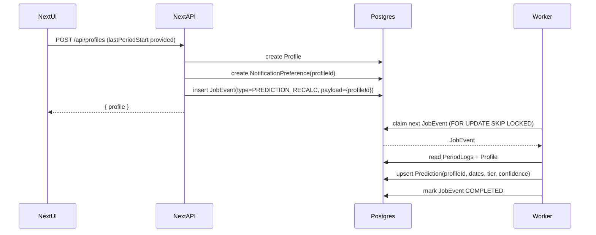
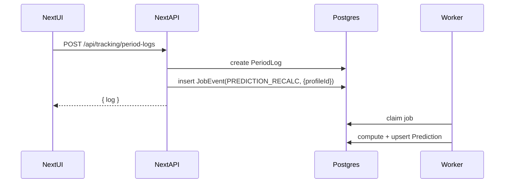
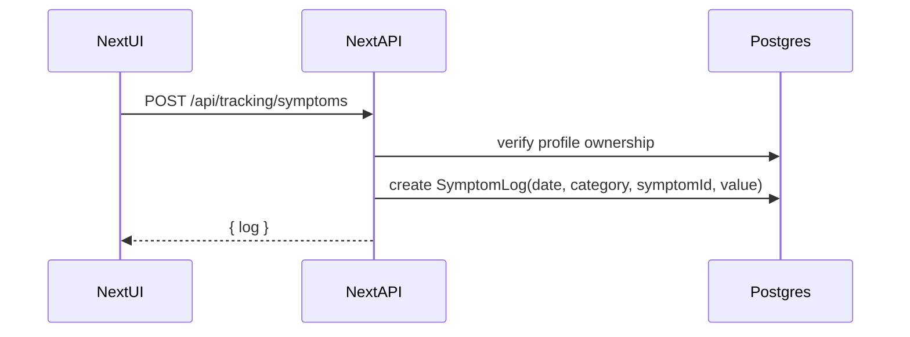
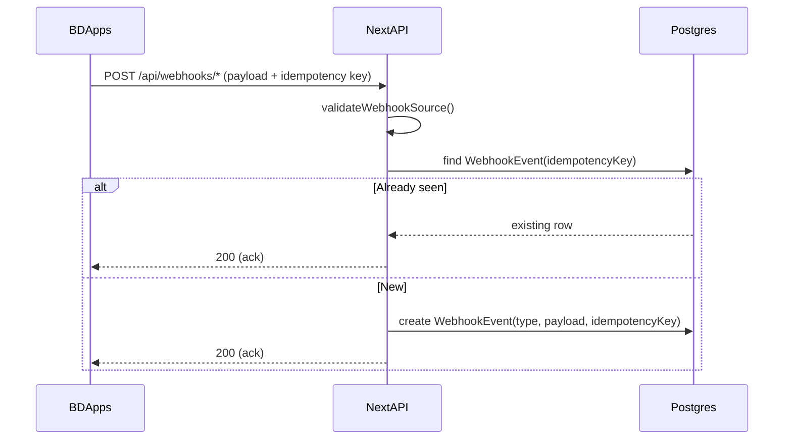

# Vesta Sequence Diagrams

These diagrams describe the high-level flows across UI → API routes → DB → worker/webhooks.

## OTP login + session cookie + frontend hydration

## Create profile + enqueue prediction recalculation job

## Period log create/update triggers recalculation

## Symptom logging

## Webhook persistence (idempotent)

